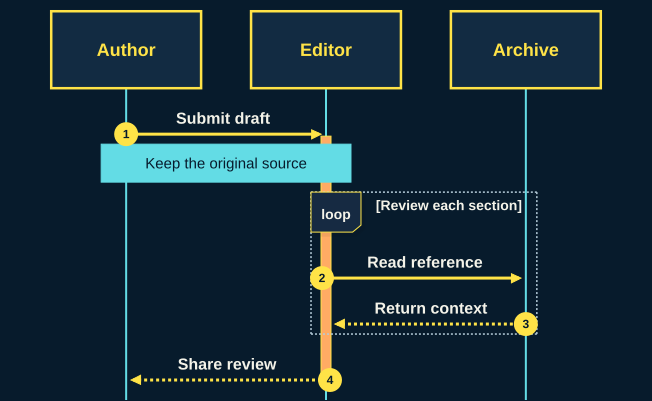
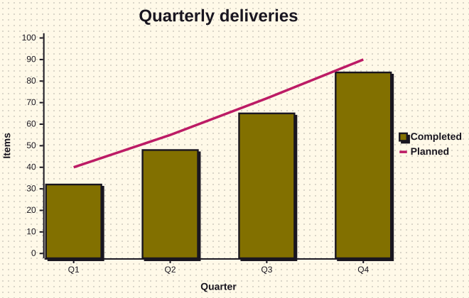
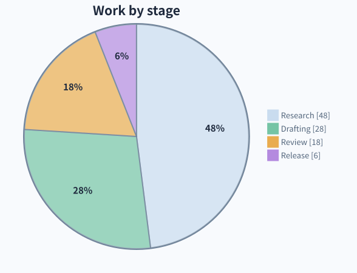

# Merman

**Mermaid diagrams, rendered in Rust.**

Parse, lay out, and render [Mermaid] diagrams for documentation, editor previews, reports, and
applications. Merman runs headlessly: its native rendering path needs no browser or JavaScript
runtime. Use it as a Rust library, a CLI, or through browser and native bindings.

[](https://github.com/Latias94/merman/actions/workflows/ci.yml) [](https://crates.io/crates/merman) [](https://docs.rs/merman) [](#license-and-attribution)

[Try the Playground][Playground] · [Quick start](#quick-start) · [Ecosystem](#ecosystem) · [Documentation][documentation index]

<table>
  <tr>
    <td width="36%" rowspan="2" align="center" valign="middle">
      <a href="https://frankorz.com/merman/?theme-design=riso"></a><br>
      <a href="https://frankorz.com/merman/?theme-design=riso"><strong>Riso · Flowchart</strong></a>
    </td>
    <td colspan="2" align="center">
      <a href="https://frankorz.com/merman/?theme-design=metro"></a><br>
      <a href="https://frankorz.com/merman/?theme-design=metro"><strong>Metro · Sequence</strong></a>
    </td>
  </tr>
  <tr>
    <td width="32%" align="center" valign="middle">
      <a href="https://frankorz.com/merman/?theme-design=pop-art"></a><br>
      <a href="https://frankorz.com/merman/?theme-design=pop-art"><strong>Pop Art · XY Chart</strong></a>
    </td>
    <td width="32%" align="center" valign="middle">
      <a href="https://frankorz.com/merman/?theme-design=atlas"></a><br>
      <a href="https://frankorz.com/merman/?theme-design=atlas"><strong>Atlas · Pie</strong></a>
    </td>
  </tr>
</table>

Actual Merman SVG exports using four of the Playground's **15 JSON theme explorations**.
Open a design above for its diagram sources, editable recipe, and integration examples.

> **Used by Zed.** Zed uses Merman as its Rust Mermaid backend.
> [Read the merged integration](https://github.com/zed-industries/zed/pull/57644).

## Quick start

The examples below use `0.10.0-alpha.2`. For release selection and prebuilt downloads, start
with the [host installation guide][host guide].

### Rust

With Rust 1.95 or later, add Merman to your `Cargo.toml`:

```toml
[dependencies]
merman = "=0.10.0-alpha.2"
```

Save this as `src/main.rs`:

```rust
use merman::{OperationControl, RenderOutput, RenderRequest, Renderer, SvgRequest};

fn main() -> Result<(), Box<dyn std::error::Error>> {
    let output = Renderer::new().render(RenderRequest::svg(
        "flowchart LR\n  Source[Mermaid source] --> Merman --> Svg[SVG string]",
        OperationControl::new(),
        SvgRequest::default(),
    ))?;
    let RenderOutput::Svg(Some(svg)) = output else {
        return Err("no Mermaid diagram detected".into());
    };
    print!("{}", svg.svg());
    Ok(())
}
```

```sh
cargo run --quiet > diagram.svg
```

See the [Rust embedding guide] and [runnable examples][Rust examples] for configuration,
repeated rendering, and host integration.

### CLI

Install from Cargo and render a first diagram:

```sh
cargo install merman-cli --version 0.10.0-alpha.2 --locked
printf 'flowchart LR\n  Source --> Merman --> SVG\n' | merman-cli render - --output diagram.svg
```

For an existing file, run `merman-cli render diagram.mmd --output diagram.svg`.
The [CLI guide] also covers prebuilt installation, PNG/JPEG/PDF export, Markdown batches,
linting, and ASCII/Unicode output for supported families.

## Ecosystem

Choose the host where your application runs. Each guide owns its installation steps and
available operations; the [host guide] records release availability across channels.

| Use Merman in | Start here |
| --- | --- |
| Rust applications | [`merman` API][Rust API] · [Embedding guide][Rust embedding guide] |
| Shell scripts and CI | [CLI][CLI guide] · [GitHub Actions setup](https://github.com/Latias94/merman/blob/main/distribution/github-action/README.md) |
| JavaScript applications | [Native Node.js](https://github.com/Latias94/merman/blob/main/platforms/node/README.md) (experimental) · [Node-WASM](https://github.com/Latias94/merman/blob/main/platforms/node/packages/node-wasm/README.md) · [Browsers and Workers](https://github.com/Latias94/merman/blob/main/platforms/web/README.md) |
| Native and mobile applications | [C/C++ and WASI SDK](https://github.com/Latias94/merman/blob/main/distribution/sdk/README.md) · [Python](https://github.com/Latias94/merman/blob/main/platforms/python/merman/README.md) · [Swift](https://github.com/Latias94/merman/blob/main/platforms/apple/README.md) · [Android](https://github.com/Latias94/merman/blob/main/platforms/android/README.md) · [Flutter/Dart](https://github.com/Latias94/merman/blob/main/platforms/flutter/README.md) |
| Editors and language tools | [LSP](https://github.com/Latias94/merman/blob/main/crates/merman-lsp/README.md) · [VS Code](https://github.com/Latias94/merman/blob/main/tools/vscode-extension/README.md) · [Tree-sitter grammar](https://github.com/Latias94/merman/blob/main/distribution/tree-sitter-mermaid/README.md) |
| Documentation systems | [Rustdoc](https://github.com/Latias94/merman/blob/main/crates/merman-rustdoc/README.md) · [Typst](https://github.com/Latias94/merman/blob/main/distribution/typst/merman/README.md) |

Beyond SVG, Merman offers typed diagram models, diagnostics, editor APIs, image/PDF export,
and terminal output. Start with the [capability guide] for feature selection or the
[package surface guide] for the complete product map.

## Make it your own

**Built-in presets** such as Brutalist, Spotless, Cyberpunk, and Ghibli are selected by their
runtime preset IDs. The **15 standalone explorations** in the [Playground theme designs]
are editable JSON recipes, including the four designs shown above. Copy a recipe to use it
through Rust, CLI, Web, or Node.

The [theme guide] covers adopting and customizing recipes, family scope, and output support.
The [preset gallery] shows more real renders and includes [design credits][theme credits].

## Rendering quality and performance

Merman follows pinned Mermaid source, with checks for parsing, layout, configuration, themes,
and SVG structure. Browse the [alignment dashboard] for diagram-family coverage and comparison
evidence, from Flowchart and Sequence to Class, ER, State, Gantt, Mindmap, and charts.

Text measurement, host fonts, HTML labels, and hand-drawn paths can differ from browser output.
The [SVG output guide] explains the output pipelines and viewer requirements. Performance
methodology, workloads, and reproducible commands live in the [benchmark guide].

## Documentation and contributing

The [documentation index] routes to maintained guides for integration, architecture, and
development. See [resource policy] for cancellation and bounded host workloads,
[rendering security] for safe embedding, and the [contributor and CI guide] for local checks.
Use the [changelog] and [release and upgrade index] when moving between releases.

## License and attribution

Merman's own code is available under the [Apache License 2.0](https://github.com/Latias94/merman/blob/main/LICENSE-APACHE) or [MIT License](https://github.com/Latias94/merman/blob/main/LICENSE-MIT).
Distributed components retain their own licenses and notices, including EPL-2.0 ELK in default
Rust rendering features. See [THIRD_PARTY_NOTICES.md](https://github.com/Latias94/merman/blob/main/THIRD_PARTY_NOTICES.md) for the
feature-dependent requirements.

Merman is independent of, and not affiliated with, endorsed by, or sponsored by the Mermaid
project or its maintainers.

[Mermaid]: https://mermaid.js.org/
[Playground]: https://frankorz.com/merman/
[Playground theme designs]: https://frankorz.com/merman/?theme-design=riso
[host guide]: https://github.com/Latias94/merman/blob/main/docs/release/PREBUILT_PRODUCTS.md
[Rust API]: https://docs.rs/merman
[Rust embedding guide]: https://github.com/Latias94/merman/blob/main/docs/rendering/RUST_EMBEDDING.md
[Rust examples]: https://github.com/Latias94/merman/blob/main/crates/merman/examples/README.md
[CLI guide]: https://github.com/Latias94/merman/blob/main/crates/merman-cli/README.md
[capability guide]: https://github.com/Latias94/merman/blob/main/docs/FEATURES.md
[package surface guide]: https://github.com/Latias94/merman/blob/main/docs/release/PACKAGE_SURFACES.md
[theme guide]: https://github.com/Latias94/merman/blob/main/docs/rendering/custom-diagram-themes.md
[preset gallery]: https://github.com/Latias94/merman/blob/main/docs/rendering/theme-gallery/README.md
[theme credits]: https://github.com/Latias94/merman/blob/main/docs/rendering/theme-gallery/README.md#design-references-and-license
[alignment dashboard]: https://github.com/Latias94/merman/blob/main/docs/alignment/STATUS.md
[SVG output guide]: https://github.com/Latias94/merman/blob/main/docs/rendering/SVG_OUTPUT_PIPELINE.md
[benchmark guide]: https://github.com/Latias94/merman/blob/main/docs/performance/BENCHMARKING.md
[documentation index]: https://github.com/Latias94/merman/blob/main/docs/README.md
[resource policy]: https://github.com/Latias94/merman/blob/main/docs/integration/RESOURCE_POLICY.md
[rendering security]: https://github.com/Latias94/merman/blob/main/docs/security/RENDERING_SECURITY.md
[contributor and CI guide]: https://github.com/Latias94/merman/blob/main/docs/development/CI.md
[changelog]: https://github.com/Latias94/merman/blob/main/CHANGELOG.md
[release and upgrade index]: https://github.com/Latias94/merman/blob/main/docs/release/README.md
