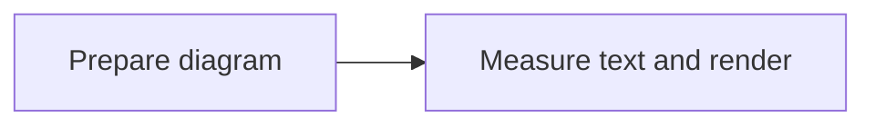

# merman-cli

[](https://crates.io/crates/merman-cli) [](https://docs.rs/merman-cli) [](https://github.com/Latias94/merman/blob/main/LICENSE-MIT)

Render, inspect, and lint Mermaid without Node.js, Puppeteer, Chromium, or another JavaScript runtime. The source-default binary includes SVG, PNG, JPEG, vector PDF, ASCII/Unicode, analysis, Markdown batch rendering, Cytoscape layout, icons, completions, and native runtime adapters. Official release archives additionally select math explicitly. Current development source defaults omit math; select the `math` feature to include it. The current source default includes the Rustdoc fragment command and ELK, with its EPL-2.0 notices and source provenance; explicit lean builds can omit it.

Installation examples target `0.9.3`. Check `merman-cli --version` and `merman-cli capabilities --json` for your installed binary; see the [upgrade guide](../../docs/release/V080_TO_V090_UPGRADE_GUIDE.md) for changed APIs and output defaults.

Compiled-theme options in this checkout are unreleased. The native font defaults for PNG/JPEG/PDF shipped in `0.9.3`; use the `v0.9.3` tagged guide for the published CLI and the [release index](../../docs/release/README.md#merman-093) for the maintenance/development boundary.

The command line has four explicit workflows:

| Workflow | Command | Use it when |
| --- | --- | --- |
| One diagram | `merman-cli render` | You want concise defaults and strict option validation |
| Markdown batch | `merman-cli batch` | You want a recoverable, tool-owned multi-file generation |
| Static Rustdoc fragments | `merman-cli rustdoc` (included by default) | You want Mermaid in crate or item docs without adding a renderer to the crate's Cargo graph |
| Pinned compatibility | `merman-cli mmdc` | You are migrating an `mmdc@11.16.0` command or need its naming and scanner rules |

## Install

This guide targets `merman-cli 0.9.3`. Match the documentation and generated artifacts to the version installed in your project. Install with cargo-binstall:

```sh
cargo binstall merman-cli@0.9.3
```

Merman's cargo-binstall metadata uses the repository's cargo-dist archive, disables third-party QuickInstall artifacts, and retains `cargo install` as a fallback when an official archive is unavailable. Check `merman-cli --version` before relying on the API or output schema in this guide.

Homebrew users can install the stable formula:

```sh
brew install merman-cli
```

The formula follows stable releases and may trail the current Merman release.

Windows users can install from Scoop's main bucket:

```powershell
scoop install merman-cli
```

External package managers update on their own schedule. Check the installed version against the [dated release record](../../docs/release/PUBLISH_ORDER.md#091-publication-snapshot).

Starting with `0.8.0-alpha.5`, version-specific [GitHub Releases](https://github.com/Latias94/merman/releases) also provide `merman-cli-installer.sh` and `merman-cli-installer.ps1`. Download an installer from the chosen release rather than a moving URL; it installs only the binary and fails closed if the archive SHA-256 cannot be verified.

From the matching reviewed source checkout:

```sh
cargo install --path crates/merman-cli --locked
```

The source default includes ELK; alpha.6 source defaults omitted it. Project release artifacts select the complete `cli-release` capability set, including ELK, and ship the matching notices. Cargo-dist and, beginning with `0.8.0-alpha.5`, cargo-binstall consume the project-built `dist` artifact; source channels build the default features unless you select an explicit profile. Channels also differ in which support files they place on disk and who publishes them:

| Channel | Binary source | Completion and man pages | Availability |
| --- | --- | --- | --- |
| `cargo binstall merman-cli@VERSION` | `0.8.0-alpha.5` and later: project release archive, with source fallback | Not installed | Selected registry version; its own metadata governs |
| GitHub shell or PowerShell installer | Project release archive | Not installed | `0.8.0-alpha.5` and later |
| Direct GitHub archive | Project release archive | Bundled under `completions/` and `man/` | `0.8.0-alpha.5` and later |
| Homebrew formula | Formula source build or Homebrew bottle | Controlled by the selected formula; inspect its support-asset installation | External stable channel; selected formula version governs |
| Repository Nix package | Built from locked repository source | Bash, Zsh, Fish, PowerShell, Elvish, and man pages installed | First-party source interface, not a registry package |
| `cargo install` | Built from crates.io, Git, or a checkout | Not installed | Registry or source revision selected by the user |
| Scoop and WinGet | Verified Windows x86_64 release archive | Not installed | Upstream manifests govern availability; see the dated [release record](../../docs/release/PUBLISH_ORDER.md) |

Nix users can run `nix run . -- --version` or `nix profile install .` from a checkout at the exact accepted preflight commit. This source package is separate from the precompiled Linux archive compatibility claim.

Older cargo-binstall releases follow the metadata and fallback policy embedded in that selected release; the current official-archive mapping and QuickInstall prohibition do not apply retroactively.

A complete binary, or a custom build that includes `shell-completions`, can generate completion at runtime:

```sh
merman-cli completion bash
merman-cli completion zsh
merman-cli completion fish
merman-cli completion powershell
merman-cli completion elvish
```

Release archives beginning with `0.8.0-alpha.5` also include legal notices. Cargo-binstall installs only the executable. The cargo-dist installers likewise omit completion and man files, but may create an environment file and update shell startup configuration to expose their install directory on `PATH`. Direct archive users should verify the adjacent checksum and the GitHub attestation constrained to the release workflow and tag; the [CLI release contract](https://github.com/Latias94/merman/blob/main/docs/releasing/CLI.md) provides the exact command and trust boundary.

The repository also provides an [Arch source package recipe](../../distribution/arch/README.md),
a [GitHub Actions setup action](../../distribution/github-action/README.md), and a
[container build and publishing workflow](../../distribution/container/README.md). AUR, GHCR,
and Marketplace availability are separate from these repository integrations. The setup action
requires an exact CLI version and a separately pinned action commit.

GNU Linux compatibility depends on the selected release: the published `0.9.0` archives require
GLIBC 2.38. The updated build workflow verifies a GLIBC 2.35 ceiling for subsequent GNU releases;
it does not replace old archives. See the [Linux release contract](../../docs/releasing/CLI.md#gnu-linux-compatibility).

The executable is named `merman-cli`; Merman does not install an `mmdc` alias.

## First Render

For a named input, native rendering writes a sibling file and replaces the source extension:

```sh
merman-cli render diagram.mmd
# writes diagram.svg

merman-cli render diagram.mmd --format png
# writes diagram.png
```

Piped input writes the payload to stdout:

```sh
printf 'flowchart LR\n  Source --> Merman --> SVG\n' | merman-cli render -
```

Use `--output -` to request stdout explicitly or `--output PATH` to choose a file. Payload bytes go only to stdout; diagnostics and progress go to stderr.

## Common Workflows

Mermaid SVG output uses deterministic text measurement without system-font discovery.
Mermaid PNG/JPEG/PDF output uses native measurement by default when the CLI includes
`system-fonts`, sharing a font context between layout and painting. For reproducible
font selection, [provide fixed local fonts](#explicit-fonts).


| Task | Command |
| --- | --- |
| Mermaid to SVG | `merman-cli render diagram.mmd` |
| Mermaid to PNG | `merman-cli render diagram.mmd --format png` |
| Mermaid to JPEG | `merman-cli render diagram.mmd --format jpg` |
| Mermaid to vector PDF | `merman-cli render diagram.mmd --format pdf` |
| Terminal output | `merman-cli render diagram.mmd --format unicode --output -` |
| Markdown fences to a managed generation | `merman-cli batch README.md` |
| Build committed Rustdoc fragments | `merman-cli rustdoc build` |
| Verify committed Rustdoc fragments | `merman-cli rustdoc check --quiet` |
| Human-readable diagnostics | `merman-cli lint diagram.mmd` |
| Machine-readable diagnostics | `merman-cli lint diagram.mmd --format json` |
| Check whether fixes are needed | `merman-cli fix diagram.mmd --check` |
| Inspect the compiled binary | `merman-cli capabilities --json` |

Run `merman-cli --help` to see only the commands compiled into your binary, then use `<command> --help` for command-owned options.

Native SVG rendering leaves the canvas background unset, matching Mermaid core. Use
`render --background white` for an opaque SVG canvas or choose another explicit color.
The `mmdc` compatibility command defaults to white and accepts `--backgroundColor transparent`
for host compositing. PNG/PDF backgrounds are applied by export options independently of SVG CSS.

For a coding-agent or log channel, choose explicit width and Plain report output. Given a Flowchart
or Sequence input in a build with Auto support:

```sh
merman-cli render diagram.mmd --format unicode --ascii-layout-profile auto --ascii-max-width 80 --ascii-overflow fallback --ascii-color plain --ascii-report --output -
```

The caller owns terminal detection, pager actions, caching, and display of returned artifacts. The
CLI owns command-line I/O and its documented color-auto policy; those behaviors are not implicit
library behavior. For embedded integrations, use the
[host integration recipes](../merman/examples/README.md#host-integration-recipes).

`lint` defaults to stable human-readable text. Automation should request `--format json` explicitly; `lint-rules` remains JSON by default, and `--pretty` is valid only with JSON output.

## Explicit Fonts

Current-source default builds and the official release profile include
`native-fonts` and `system-fonts`. Mermaid SVG keeps deterministic, font-agnostic
measurement by default, without creating a native font context or discovering
system fonts. Mermaid-to-PNG/JPEG/PDF rendering automatically discovers system
fonts within bounded resource limits before layout and shares that context with
native painting. This keeps label sizing and the export font selection together.
It can change wrapping, node sizes and image/PDF snapshots, and system-font results
depend on the host.

With those CLI capabilities compiled:

| Font options | Mermaid SVG measurement | Mermaid PNG/JPEG/PDF measurement | Native-context system discovery |
| --- | --- | --- | --- |
| No font options | Deterministic | Native | Before layout for PNG/JPEG/PDF; off for SVG |
| `--font-measurement deterministic` | Deterministic | Deterministic | Off |
| `--font-file PATH` or `--font-dir PATH` | Native, using supplied fonts | Native, using supplied fonts | Off unless `--font-system on` is added |
| `--font-measurement native` without font sources | Native | Native | On |
| `--font-system on` | Native | Native | Explicitly on |

To retain the previous font-agnostic layout estimates and native painting for an
encoded output, select deterministic measurement explicitly:

```sh
merman-cli render diagram.mmd --format png --font-measurement deterministic
```

That compatibility route can still discover system fonts during painting; it does
not guarantee font-free or host-independent PNG/JPEG/PDF bytes. The same output-based
defaults apply to Mermaid input through `render`, `batch`, and `mmdc`. Raw SVG
conversion only paints existing geometry and is never relaid out.

For diagrams with strict layout requirements, **provide the fonts that will be
used to display the result**. Actual-font measurement uses their glyph sizes for
labels, wrapping and node layout; fixed files also avoid full system-font
catalogue discovery. The CLI does not bundle diagram text fonts.

Set Mermaid's `fontFamily` to the family stored in your files. For example,
`diagram.mmd` can select your local Fira Sans fonts:



```sh
# SVG with explicit regular and bold font files.
merman-cli render diagram.mmd --output diagram.svg --font-file fonts/FiraSans-Regular.ttf --font-file fonts/FiraSans-Bold.ttf

# PNG with fonts from a local directory; write output outside that directory.
merman-cli render diagram.mmd --format png --output diagram.png --font-dir fonts
```

Supply the regular, bold or italic files your diagram uses. Sources are
repeatable and earlier equal family/style/weight faces take precedence. Explicit
sources disable system fallback unless `--font-system on` is supplied, even with
`--font-measurement native`. Fixed font contents and matching configuration make
layout more reproducible; a directory with many fonts still has its own scanning
cost.

To explicitly use the fonts installed on the current machine instead:

```sh
merman-cli render diagram.mmd --output diagram.svg --font-measurement native
```

Native measurement allows 16,384 uncached shaping probes per diagram by default.
Large diagrams can reach this budget because one label may need several probes.
If the CLI reports `native_font_measurements`, simplify or split the diagram, or
retain your font options and increase the finite budget:

```sh
merman-cli render diagram.mmd --output diagram.svg --font-file fonts/FiraSans-Regular.ttf --font-max-measurements 32768
```

The reported `actual` is the first rejected probe, not the total needed to finish.
`--resource-profile` does not change this font-provider limit. The same option is
available on `mmdc` and `batch`; each diagram gets its own allowance. It requires
native Mermaid measurement and does not apply to raw SVG conversion. See the
[host resource guide](../../docs/integration/RESOURCE_POLICY.md#native-font-measurement-budget)
for the corresponding Rust API.

Explicit font files added roughly 2–7 ms per invocation in two small Windows
Flowchart SVG probes: about 43–46 ms with default measurement and 46–53 ms with
fixed fonts, using warm filesystem caches. These observations do not predict
large-diagram or PNG/JPEG/PDF latency. System-font discovery can add much more
work; supply the fonts used by your document when precise wrapping and node
bounds matter. The [saved measurements](../../docs/performance/cli_font_runtime_policy_2026-10-12.md)
record this particular probe.

`fontFamily` selects among available faces; it does not supply a font file or
change the output's measurement policy. Custom `--css-file` and `themeCSS` remain
incompatible with native Mermaid measurement because they can change typography
after layout. For encoded output that needs the previous CSS behavior, explicitly
select `--font-measurement deterministic` without font sources; existing CSS
security admission still applies.

Minimal builds without the CLI `system-fonts` capability keep deterministic
encoded-output defaults and require explicit sources for native measurement.
Dependency feature union alone does not enable the CLI policy. If a native route
cannot load any usable fonts, it fails instead of silently succeeding with
deterministic estimates. Unsupported individual probes and missing glyphs retain
their documented per-request fallback. Rust library, bindings, ASCII, and committed
Rustdoc generation defaults are unchanged.

Explicit font files and directories are protected inputs. With `--font-dir`,
choose output outside that directory; existing output files with multiple hard
links are rejected because an alias to a directory font cannot be excluded without
scanning the directory again. New outputs and ordinary existing outputs remain
supported, including when the Mermaid source lives in the font directory.

Native measurement uses the shared text-measurement infrastructure for layout,
wrapping, SVG bounds, and computed lengths, not just titles. SVG output does not
embed fonts; viewers need the same fonts. Raw SVG conversion uses supplied fonts
for painting only and cannot relayout existing geometry. See
[font support and limitations](../../docs/FEATURES.md#optional-cli-fonts).

Deterministic layout can size a fixed HTML label viewport more narrowly than the
font used by PNG/PDF painting. For example, Mindmap labels can clip even when the
outer node has padding. The native encoded-output default shares layout and
painting metrics; explicit fonts also make the selected faces reproducible.
Supply every face needed by bold, italic, and mixed labels. A successful native
export with unresolved fonts or glyphs reports a warning with the actual missing
resolution state and `.notdef` glyph count; `--quiet` suppresses that diagnostic.
Best-effort export remains permissive, while strict portability admission retains
its existing rejection policy.

Known native backend differences also produce specific warnings: directional filter offsets
under rotation, shear or reflection; CSS effects on converted HTML labels; and implicit PDF
viewports that may clip painted content. These fidelity diagnostics preserve default output.
Use explicit SVG dimensions or a `viewBox` to control PDF clipping. `--quiet` suppresses warnings.

## Command Dialects And Root Compatibility

Root-level render flags no longer belong to the advertised command tree. Keeping native and compatibility arguments in separate parsers gives each workflow its own defaults, validation, help, completion output, input rules, and publication guarantees without breaking existing root-level `mmdc` scripts.

| Upstream syntax or former 0.8.x native spelling | Current explicit syntax |
| --- | --- |
| `mmdc -i diagram.mmd -o diagram.svg` | `merman-cli mmdc -i diagram.mmd -o diagram.svg` |
| `merman-cli -i diagram.mmd -o diagram.svg` | `merman-cli mmdc -i diagram.mmd -o diagram.svg` |
| `merman-cli -i diagram.mmd -o diagram.png -t dark` | `merman-cli mmdc -i diagram.mmd -o diagram.png -t dark` |
| `merman-cli -i README.md -o README.rendered.md --artifacts docs/assets` | `merman-cli mmdc -i README.md -o README.rendered.md --artifacts docs/assets` |
| Native single render through shared flags | `merman-cli render diagram.mmd --output diagram.svg` |
| Native Markdown through extension inference | `merman-cli batch README.md --output-dir README.merman` |
| `merman-cli render diagram.mmd -e png` | `merman-cli render diagram.mmd -f png` |
| `merman-cli batch README.md -e png` | `merman-cli batch README.md -f png` |

An invocation whose first argument is an option owned by `mmdc`, such as `-i` or `--input`, is permanently forwarded to the same parser and execution path as `merman-cli mmdc`. This silent compatibility alias is intentionally absent from help and completions. Explicit `merman-cli mmdc` remains the preferred compatibility spelling because it makes the selected contract visible to readers and tooling.

Bare root inputs and native-only root options exit `2` with a targeted message pointing to `mmdc`, `render`, and `batch`. New scripts should choose an explicit subcommand.

Native `render` and `batch` use `-f/--format`; their former `-e` aliases are removed in 0.9.0. The separate `merman-cli mmdc -e/--outputFormat` interface remains part of the pinned compatibility contract. See the [upgrade guide](../../docs/release/V080_TO_V090_UPGRADE_GUIDE.md) when migrating native scripts from 0.8.x.

The `mmdc` subcommand is a release-pinned compatibility snapshot. This release follows the supported command behavior of `@mermaid-js/mermaid-cli@11.16.0`; future changes are tied to an explicit Mermaid baseline update. See the [compatibility register](https://github.com/Latias94/merman/blob/main/docs/alignment/CLI_COMPATIBILITY.md) for exact coverage and deliberate browserless divergences.

`mmdc -t/--theme` remains the official Mermaid CLI selector and accepts only `default`, `forest`, `dark`, and `neutral`; omitting the option value selects `default`, matching mmdc. Native theme selection belongs only to `render` and `batch`: use `--theme-design-file` for a shareable `ThemeDesignV1` JSON file, `--theme-preset` for a built-in compiled theme, or `--theme-file` for a versioned `ThemeRecipeV1` document or a selection such as `{"preset":"editor-dark"}`. A selection contains exactly one `preset` or `spec` member; a recipe keeps its `schema_version`, `kind`, and matching `design` or `complete_spec` payload. These three inputs are mutually exclusive. `mmdc` and `layout` intentionally reject them; use the official `--theme` or `--configFile` on `mmdc`. The removed `--presentation-profile` and `merman-modern` inputs are not compatibility aliases.

Run `merman-cli capabilities` to choose a Merman preset using its curated diagram-design scope
and application notes. `capabilities --json` exposes the same metadata, including representative
`preview_colors`, `family_designs` and `application_notes`. An unlisted family is unreviewed;
recipe availability and a dedicated design do not qualify every scene or output format.
Mermaid's base theme (`--theme dark`) and Merman styling (`--theme-preset ghibli`) are separate
inputs. A preset never changes diagram look or layout. For example, Brutalist hard Flowchart
shadows require an explicit Classic configuration; the capability listing provides the suggested
`--config-file` content. See the [two-theme gallery](../../docs/rendering/theme-gallery/README.md)
for complete sources, configuration and commands.

Native `render` and `batch` print one concise theme line to stderr for an actual theme request
or an actionable renderer diagnostic. The line includes up to three explanations, such as
`unsupported-geometry rule (lifeline)`. A rule-level diagnostic describes a partially consumed
rule; it does not claim that every property failed. `--quiet` suppresses this feedback while
retaining errors and explicitly requested report files. Plain diagrams do not print generic
theme-evidence or unadapted-family notices.

Use `--theme-report PATH` to retain the full renderer diagnostics and target-admission result:

```sh
merman-cli render diagram.mmd --theme-file theme.json --output diagram.svg \
  --theme-report diagram.theme.json
merman-cli batch README.md --output-dir generated --theme-file theme.json \
  --theme-report README.theme.json --quiet
```

The JSON report has `schema_version: 1`, `stage: "render"`, and an ordered `results` array.
Each result identifies its one-based `chart` number and optional `output` path (a relative image
URL for batch; omitted for stdout). A completed result contains `evidence` with the diagram
family, theme status, output-mutation flag, and all diagnostics. Diagnostics preserve renderer
codes, subjects, targets, optional properties, source-document names, RFC 6901 source paths,
and generated-default markers. `target` contains the actual artifact kind, admission status,
reason IDs and font source. These IDs are open strings. SVG, PNG, JPEG and PDF use the same
feedback path; the report records each format's own target receipt.

Render failures instead contain `error` and any target receipt returned by the renderer.
Unavailable completed evidence is omitted. Preflight, input acquisition, theme compilation,
batch setup and cancellation can fail before a report is published; an existing report then
remains unchanged. Batch reports contain the charts that reached rendering, including failures,
in source order even with parallel jobs. An empty batch produces an empty results array.

Reports are separate files with an existing parent directory. They reject `-`, stdio aliases,
input aliases, and image/document aliases, including existing hard links. Report and image names
in the same directory must not differ only by case, including on case-sensitive hosts. A batch report must
be outside the managed output directory. The report is atomically replaced after rendering and
before image publication; a report write failure prevents image publication. The report is
render evidence, not a receipt that image publication succeeded. Failed rendering preserves
existing images and the previous batch generation. Stdout carries only the requested image.

`--theme-portability best-effort` is the default. `--theme-portability require-portable` passes
the strict requirement directly to the renderer environment, which enforces its existing family
and target admission checks. It rejects residuals and other nonportable target conditions without
changing fonts, SVG pipelines, or diagram geometry. Browser-oriented SVG can remain `unverified`,
and encoded output can depend on host fonts. Choosing `--svg-pipeline resvg-safe` requests SVG
compatibility observation, but does not by itself guarantee portable admission. Empty diagnostics
are not a portability certificate. Theme feedback options apply to Mermaid graphical `render`
and `batch`; they are not available for raw SVG conversion, ASCII/Unicode, `layout`, or `mmdc`.

## Markdown Batches

Native batch rendering owns one output directory:

```sh
merman-cli batch README.md
# writes README.merman/README.md, numbered assets, a manifest, and a stable lock

merman-cli batch docs/guide.md --output-dir generated --format pdf
```

All charts render into staging before publication. The rewritten document is published last, stale files are removed only when named by the prior validated manifest, and an interrupted commit is recovered under the output lock before new work starts. Switching among supported output formats migrates the same managed generation and removes its prior-format artifacts. A document with no eligible charts is a valid generation.

Stdin requires an explicit logical name and output directory:

```sh
cat README.md | merman-cli batch - \
  --stdin-file-name README.md \
  --output-dir README.merman
```

The `parallel-markdown` Cargo feature adds Rayon-backed bounded scheduling and the `--jobs` option. It implies `markdown`; it does not affect single renders. Without it, `batch` remains fully supported and renders charts serially.

Strict `mmdc` Markdown uses the pinned upstream fence scanner and output naming. To keep recovery honest, its rewritten document and artifacts must remain below one transaction root on one filesystem; split-root layouts are rejected before output creation or network access. Changing `-e` or `--artefacts` publishes the new namespace but leaves files from the previous namespace untouched.

## Rustdoc Fragments

`merman-cli rustdoc` is the CLI-first integration for crates that want static Mermaid diagrams in
Rustdoc without placing Merman, layout engines, math rendering, or a procedural macro in the
consuming crate's normal or build dependency graph. The CLI is an authoring and CI tool: it renders
the complete bundle ahead of `cargo doc`, and the crate consumes only committed Markdown through
Rust's built-in `include_str!`.

Place `merman-rustdoc.toml` at the crate root so its fixed managed output root is
`docs/generated/merman-rustdoc/`:

```toml
schema = 1

[[fragments]]
id = "crate-overview"
source = "docs/rustdoc-src/crate-overview.md"

[[fragments]]
id = "render-module"
source = "docs/rustdoc-src/render-module.md"
source_display = "details"
```

`source` is relative to the directory containing the configuration. Markdown sources may contain
backtick or tilde Mermaid fences and standalone `include_mmd!("diagrams/architecture.mmd")` lines;
include paths are also relative to the configuration root. Raw `.mmd` and `.mermaid` files are
accepted as one-diagram fragments. `source_display` is optional and is either `hide` (the default)
or `details`, which adds the Mermaid source below each rendered diagram in a collapsed block.
Fragment IDs are portable ASCII identifiers and become `<id>.md` filenames. The output directory
cannot be redirected by configuration.
Rename an ID through a temporary, distinctly spelled ID in two builds when only its ASCII case
changes; direct case-only renames are rejected so the same history behaves on every filesystem.
The fixed managed root has one owner: a receipt created by one configuration filename cannot be
replaced or cleaned by a different configuration in the same package directory. Move or remove
the old managed root explicitly before adopting it with a different configuration.

Build or verify the bundle:

```sh
merman-cli rustdoc build
merman-cli rustdoc check --quiet

# A workspace member can keep its own configuration and managed root.
merman-cli rustdoc build --config crates/my-crate/merman-rustdoc.toml
merman-cli rustdoc check --config crates/my-crate/merman-rustdoc.toml --quiet
```

`build` renders and validates the complete expected bundle before publishing it transactionally.
It writes `receipt.json` last, removes only stale files owned by the previous valid receipt, leaves
unknown neighboring files alone, and preserves unchanged files on a no-op rebuild. It never
overwrites the configuration, Markdown sources, or included Mermaid files. `check` performs the
same bounded generation in memory, compares the exact receipt-owned file set, receipt, and fragment
bytes, and never writes. A stale or missing generation exits `1`, invalid invocation or
configuration exits `2`, and an invalid receipt, unfinished publication, or other operational
failure exits `3`.

Consume generated fragments at crate or item scope without a documentation dependency:

```rust
#![doc = include_str!(concat!(
    env!("CARGO_MANIFEST_DIR"),
    "/docs/generated/merman-rustdoc/crate-overview.md"
))]

#[doc = include_str!(concat!(
    env!("CARGO_MANIFEST_DIR"),
    "/docs/generated/merman-rustdoc/render-module.md"
))]
pub mod render {}
```

Include each generated fragment at most once on one rendered Rustdoc page. Its SVG DOM IDs are
deterministic within the fragment, so including the same fragment twice would duplicate those IDs.

Commit the configuration, authoring sources, generated fragments, and `receipt.json` together.
Review an intentional regeneration before staging it:

```sh
merman-cli rustdoc build
git diff -- merman-rustdoc.toml docs/rustdoc-src docs/generated/merman-rustdoc
```

To abandon the whole local documentation change, restore the configuration, source paths, and
managed output paths with Git. To keep the source change but discard only generated edits, restore
the managed directory and run `rustdoc build` again; `rustdoc check` will deliberately report stale
output until the generated bundle matches the retained sources.

```sh
# Substitute the source paths used by your configuration.
git restore -- merman-rustdoc.toml docs/rustdoc-src docs/generated/merman-rustdoc
```

Run freshness verification before Rustdoc in CI:

```sh
merman-cli rustdoc check --quiet
cargo doc --no-deps
```

Pin the same CLI release or reviewed source revision in authoring and CI. The receipt binds the
generator version, Mermaid baseline, capability descriptor, configuration, sources, and output
hashes, so an intentional tool upgrade requires one reviewed `rustdoc build` regeneration.

docs.rs does not run `merman-cli`; it documents the uploaded Cargo package. Ensure the generated
fragments are committed and included in the package, especially when `Cargo.toml` has an explicit
`include` whitelist. Inspect the package boundary before publishing:

```sh
cargo package --list --allow-dirty
```

The generated-fragment path and the independent
[`merman-rustdoc`](https://github.com/Latias94/merman/tree/main/crates/merman-rustdoc#readme)
attribute macro are peer products. Neither invokes, discovers, or falls back to the other:

| Concern | `merman-cli rustdoc` | `merman-rustdoc` attribute macro |
| --- | --- | --- |
| Cargo dependency cost | No Merman renderer dependency in the consuming crate | Compiles the selected procedural-macro and renderer closure |
| Authoring loop | Explicit `build`; CI uses read-only `check` | One-step rendering while `cargo doc` runs |
| Rustdoc scope | Crate and item docs through `include_str!` | Item docs and recursive inline item trees; not crate-level `//!` or `#[doc = include_str!(...)]` content |
| Generated ownership | Markdown fragments and receipt are committed and reviewable | Source comments stay unchanged; SVG exists only in generated Rustdoc output |
| docs.rs | Uses packaged static files with no documentation feature | Requires the optional macro dependency and docs.rs feature to be enabled |
| Failure timing | Authoring build or CI freshness gate, before `cargo doc` | During macro expansion in `cargo doc` |
| Rollback | Restore source/config/output as one Git change, or rebuild the retained source | Revert the annotated Rust source or feature selection |

Choose the CLI path for published libraries, workspaces, reproducible packaging, crate-level docs,
or any project sensitive to Cargo dependency closure. Choose the macro when one-step `cargo doc`
ergonomics outweigh the compile cost and item-level attribute placement is the desired ownership
model. A migration is additive and reversible: move the annotated prose to an external Markdown
source, declare a fragment, run `rustdoc build`, replace the attribute with `#[doc =
include_str!(...)]`, add the CI check, and remove the optional macro dependency only after no
annotated items remain.

## Analysis And Fixes

The `analysis` capability enables parser-backed diagnostics, deterministic fix selection, and rule metadata:

```sh
merman-cli detect diagram.mmd
merman-cli parse diagram.mmd --pretty --meta
merman-cli layout diagram.mmd --pretty
merman-cli lint diagram.mmd --format json
merman-cli lint README.md --markdown --format text
merman-cli lint-rules --configurable --format json
```

`fix` has one explicit output mode:

```sh
merman-cli fix diagram.mmd                  # fixed source on stdout
merman-cli fix diagram.mmd --check          # exit 1 when source would change
merman-cli fix diagram.mmd --diff           # print diff; exit 1 when it changes
merman-cli fix diagram.mmd --output fixed.mmd
merman-cli fix diagram.mmd --write
```

Use repeatable `--rule RULE_ID` or `--fix STABLE_FIX_ID` selectors when automation needs a narrower edit plan. Duplicate edit sets are applied once, alternative fixes remain alternatives, and conflicting selections fail before publication. `--write` atomically replaces the canonical input target after checking that its identity and complete bounded contents still match the acquired snapshot.

## Choose A Build

The `0.9.3` release defaults to the standard diagram CLI with `all-diagrams`.
The Rustdoc authoring command remains available in the default and release builds, as in the
published alpha.7 archives. The commands below target `0.9.3`.
For a slim current-source binary, disable defaults and select the required `diagram-*` families
plus operation leaves. Use `all-diagrams` to retain the prior language surface. The recipes below select families
explicitly:

| Build | Capabilities |
| --- | --- |
| `--no-default-features --features all-diagrams` | `detect`, `parse`, and `capabilities` |
| `--no-default-features --features all-diagrams,analysis` | Lint and rule metadata without render dependencies or replacement generation |
| `--no-default-features --features all-diagrams,fixes` | Lint, the fix command, and rule metadata without render dependencies |
| `--no-default-features --features all-diagrams,svg` | Basic deterministic SVG |
| `--no-default-features --features all-diagrams,native-fonts` | SVG with explicit-font measurement controls, no output codecs |
| `--no-default-features --features all-diagrams,ascii` | ASCII/Unicode without SVG |
| `--no-default-features --features all-diagrams,markdown` | Sequential native Markdown batch and SVG |
| `--no-default-features --features all-diagrams,rustdoc` | Static Rustdoc fragment build/check with deterministic SVG and Cytoscape layout; add `math` for mathematical labels |
| `--no-default-features --features all-diagrams,icons` | SVG plus bounded local Iconify packs |
| `--no-default-features --features all-diagrams,png` | SVG plus PNG only |
| `--no-default-features --features all-diagrams,pdf` | SVG plus vector PDF only |

Install a lint-only binary:

```sh
cargo install merman-cli --version 0.9.3 --locked \
  --no-default-features --features all-diagrams,analysis
```

Additional leaves are `jpeg`, `layout-cytoscape`, `layout-elk`, `math`, `network-icons`, `parallel-markdown`, `shell-completions`, `system-clock`, `system-timezone`, `system-random`, and `system-timing`. The default includes ELK and therefore carries its EPL-2.0 notice and provenance; lean builds can omit it with `--no-default-features`. Implications such as `png -> svg` and `network-icons -> icons` are intentional.

Use `merman-cli capabilities --json` as the machine-readable authority for the installed artifact. The current document keeps `schema_version: 2` and reports `cli_contract_version: 6`, package and pinned compatibility versions, descriptor digest, compiled commands, `diagram_families` (the sorted logical parser families compiled into the binary), capabilities, and outputs. This parser list does not imply that SVG or ASCII handlers are available for every listed family; inspect the corresponding output capabilities separately. Contract 6 adds `theme_presets` for SVG-enabled artifacts, using the same compiler-policy discovery as bindings; its alpha entries have empty built-in qualification scope, while archive qualification is a separate host-scoped companion.

For native-font builds, `native_fonts.default_policy_scope` is `mermaid-svg-input`:
`default_measurement`, `default_font_source`, and `default_system_discovery` remain
`deterministic`, `none`, and `disabled`. The additive `encoded_output_defaults`
object reports `measurement: "native"`, `font_source: "bounded-system-discovery"`,
and `system_discovery: "before-layout"` when the CLI includes `system-fonts`.
Without that CLI capability, its three values are `deterministic`, `none`, and
`disabled`. Explicit font sources enable native measurement with a closed set;
`--font-system on` permits system fallback. Experimental platform-query builds
report `platform-managed-system-query` and
`platform-initialization-then-on-demand-families` for the encoded font source and
discovery policy; that feature is excluded from official releases. These discovery
fields and runtime defaults do not change the CLI contract, JSON schema, or ABI.

The contract preserves the native `-f` spelling, text-first `lint`, narrowed `detect` surface, and feature-gated top-level `rustdoc` workflow. ASCII-enabled builds additionally expose an `ascii` subcontract with its own schema version, report schemas and streams, family layout/width/encoding/fallback arrays, and detector-to-family mappings. Automation should version-check the CLI contract independently from the outer JSON schema.

## Rendering And Runtime Policy

Native `render` rejects options that are irrelevant to the selected output before reading input or creating output. Examples:

```sh
merman-cli render diagram.mmd --format svg --svg-pipeline readable
merman-cli render diagram.mmd --format png --raster-fit-width 1600
merman-cli render diagram.mmd --format pdf --pdf-filter-scale 4
merman-cli render diagram.mmd --format unicode --ascii-color auto
merman-cli render diagram.mmd --format unicode --ascii-layout-profile compact \
  --ascii-max-width 80 --ascii-overflow fallback --ascii-report
```

PNG/JPEG use a bounded Rust raster pipeline. PDF keeps vector geometry and bounds localized filter and embedded-image raster work. They are not Chromium screenshots. ASCII/Unicode support is family-specific; see the [support matrix](https://github.com/Latias94/merman/blob/main/docs/rendering/ASCII_SUPPORT_MATRIX.md).

For Flowchart, Swimlane, and State, `--ascii-node-padding-y 0` removes blank rows inside
ordinary node frames. `--ascii-node-padding 0` sets both axes; `--ascii-node-padding-x` and
`--ascii-node-padding-y` override that scalar independently. The default remains one cell.
`--ascii-graph-padding-x` and `--ascii-graph-padding-y` control preferred gaps between ranks,
including under Compact. Layout still reserves required space for frames, labels, and arrows.
These switches apply to text rendering.

```sh
merman-cli render diagram.mmd --format unicode --ascii-node-padding-y 0
```

`--ascii-report` is a machine-safe JSON channel. It always emits Plain text: `--ascii-color auto`
resolves to Plain in report mode, while an explicit ANSI16/ANSI256/TrueColor/HTML request is
rejected. The report uses ASCII output schema 3 and includes `encoding`, logical primary/emitted
extents, width profile, and typed overflow/fallback state. `requested_layout_profile` records the
request, `layout_profile` records the selected primary geometry, and `compact_attempted` records
whether Auto tried Compact. A final line terminator is not counted as another logical row.
Viewport fallback is Plain-only; styled/fallback combinations are invalid even if the input fits.
`compact` and `auto` are admitted only for Flowchart and Sequence, and Auto requires an explicit
`--ascii-max-width`. Other supported families use `canonical`. Once report mode is selected,
failures use ASCII error-report schema 1 on stderr with a stable code, category, terminal-safe message, and typed details; stdout and
the requested output target remain unpublished.

Runtime behavior is deterministic by default even when system adapters are compiled. This also applies to `mmdc` and is a deliberate divergence from Chromium's ambient date, time zone, and randomness. A complete default binary can opt into upstream-like host state:

```sh
merman-cli render diagram.mmd --runtime native
merman-cli mmdc -i diagram.mmd -o diagram.svg --runtime native
```

Each adapter is also independently selectable with `--system-clock`, `--system-timezone`, `--system-random`, or `--system-timing` when its feature is compiled. `--runtime native` is shown only when the clock, time-zone, and random adapters are all available. Timing remains separately opt-in. Native-context font discovery is controlled by the font options above; `--runtime native` alone does not select it.

## Operation Control

`render`, `batch`, `mmdc`, and `rustdoc build` / `rustdoc check` own one cooperative operation
control from input acquisition through the final publication boundary. Pressing Ctrl-C requests
cancellation through that control instead of relying only on abrupt process termination; pressing
Ctrl-C again before cooperative shutdown restores an immediate exit. Use
`--operation-timeout-ms MILLISECONDS` to add a relative monotonic deadline:

```sh
merman-cli render diagram.mmd --operation-timeout-ms 5000
merman-cli batch README.md --operation-timeout-ms 30000
merman-cli mmdc -i diagram.mmd -o diagram.svg --operation-timeout-ms 5000
merman-cli layout diagram.mmd --operation-timeout-ms 5000
merman-cli rustdoc check --operation-timeout-ms 30000
```

The deadline is operation-wide, including stdin and bounded file acquisition. It can expire while a
stdin producer keeps its pipe open without sending data. A Markdown batch does not reset it for
each chart, and parallel chart workers observe the same cancellation state. Cancellation is
cooperative: a blocking host or backend call returns to a checkpoint before the request is
observed. Once observed, cancellation emits no partial rendered document; file and Markdown
generation paths check the control while staging output and preserve their existing atomic or
recoverable transaction guarantees.

## Resource And Network Policy

`--resource-profile` derives one complete budget for source/config/CSS/icon acquisition, chart count, staging, render working set, jobs, redirects, and network duration:

| Profile | Intended input |
| --- | --- |
| `constrained` | Untrusted, public, or multi-tenant |
| `interactive` | Cooperative editor-like work |
| `trusted-native` | Controlled local automation; CLI default |
| `unbounded-for-trusted-input` | Explicitly trusted work that owns its cost |

Use repeatable `--resource-limit STABLE_ID=POSITIVE_U64` only for a scoped override. The unbounded profile retains hard protocol guards, finite network timeouts, redirect limits, overflow checks, renderer-owned icon-registry ceilings, and backend capabilities.

Local icon packs stay offline:

```sh
merman-cli render diagram.mmd \
  --icon-pack @iconify-json/logos

merman-cli render diagram.mmd \
  --icon-pack-source logos#icons.json
```

Icon acquisition and renderer admission are separate bounded stages. The CLI can accept at most 16
packs, 16 MiB for one local or remote pack, and 32 MiB in aggregate; constrained profiles are
tighter. No profile or override can exceed those renderer-owned constructor capabilities. Each
acquired body is then passed as raw bytes to the shared transactional IconifyJSON builder, which
validates JSON structure, identifiers, geometry, aliases, SVG bodies, retained memory, and build
work before publishing an immutable registry. A failed pack publishes no partial registry.

Local package/path lookup and optional HTTP acquisition belong only to the CLI `icons` and
`network-icons` features. The `merman` and `merman-render` Rust library surfaces include icon
registry construction in their existing `svg` capability and do not pull CLI lookup, URL, DNS,
HTTP, Tokio, or filesystem-acquisition dependencies.

HTTP(S) sources require `network-icons` plus `--allow-network`. Loopback, private, link-local, multicast, and unspecified destinations additionally require `--allow-private-network`. Every redirect is resolved and authorized again; diagnostics redact URL credentials, paths, queries, and fragments.

## Existing SVG Input

PNG, JPEG, and PDF builds can convert a named `.svg` file directly:

```sh
merman-cli render diagram.svg --format png --output diagram.png
```

For SVG read from stdin, add `--input-kind svg`; named `.svg` files are inferred by extension. Raw SVG conversion is native-only and passes through the same bounded sanitizer/export pipeline.

## Exit And Output Contracts

| Exit | Meaning |
| ---: | --- |
| `0` | Success, including a closed downstream stdout pipe |
| `1` | Invalid Mermaid/content/render result, cooperative cancellation or deadline expiry, a source-required layout or math capability is unavailable, or `fix --check/--diff` would change source |
| `2` | Invalid invocation, conflicting options, unavailable statically requested option/output capability, or configuration |
| `3` | Local/remote operational failure, lock contention, incomplete recovery, or publication failure |

stdout contains only the requested SVG, image, text, JSON, diff, fixed source, or completion payload. `--quiet` suppresses informational and timing diagnostics where supported; errors remain visible.

## Completions And Man Pages

A binary built with `shell-completions` generates completions that contain only its compiled commands:

```sh
source <(merman-cli completion bash)
merman-cli completion zsh > _merman-cli
merman-cli completion fish > merman-cli.fish
merman-cli completion powershell > merman-cli.ps1
```

Release archives beginning with `0.8.0-alpha.5` also carry deterministic completion snapshots and manual pages so downstream package definitions can install shell integration without executing a foreign-target binary during packaging. These assets are generated from the same Clap command tree and checked for drift in CI. Homebrew stable integration is monitored by this repository. Scoop's main bucket provides `merman-cli`; the [release record](../../docs/release/PUBLISH_ORDER.md#090-publication-snapshot) records verified versions. [WinGet PR #447353](https://github.com/microsoft/winget-pkgs/pull/447353) submits `0.9.0` and remains subject to upstream acceptance and registry propagation.

The checked-in completion and manual assets represent the canonical `cli-release` complete profile.
For a custom slim build with `shell-completions`, generate completion from that binary at runtime so
omitted commands, options, and values stay omitted. A build without that feature has no
`completion` subcommand.

## License

Merman's own code is licensed under either Apache-2.0 or MIT at your option. The current source
Cargo default and the `cli-release` archive include the EPL-2.0 ELK implementation. Only the
`cli-release` archive includes the RaTeX math/font closure; Cargo source defaults leave math opt-in.
Explicit lean source builds can exclude ELK by disabling default features.
Release archives include
the matching `THIRD_PARTY_NOTICES.md` and `THIRD_PARTY_LICENSES/`; source-built distributions must
carry the notices for the features they select.
