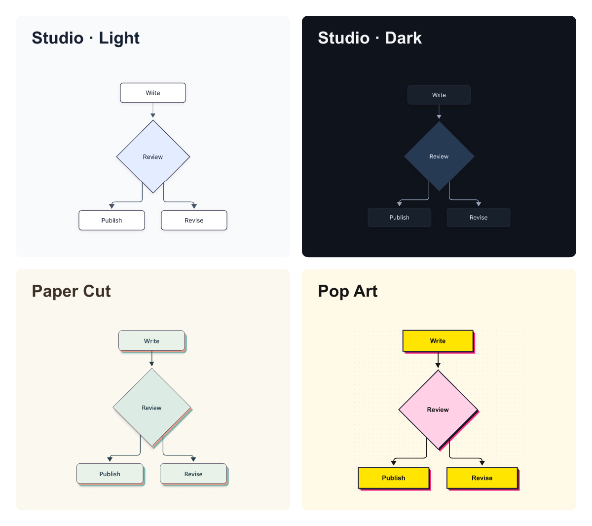
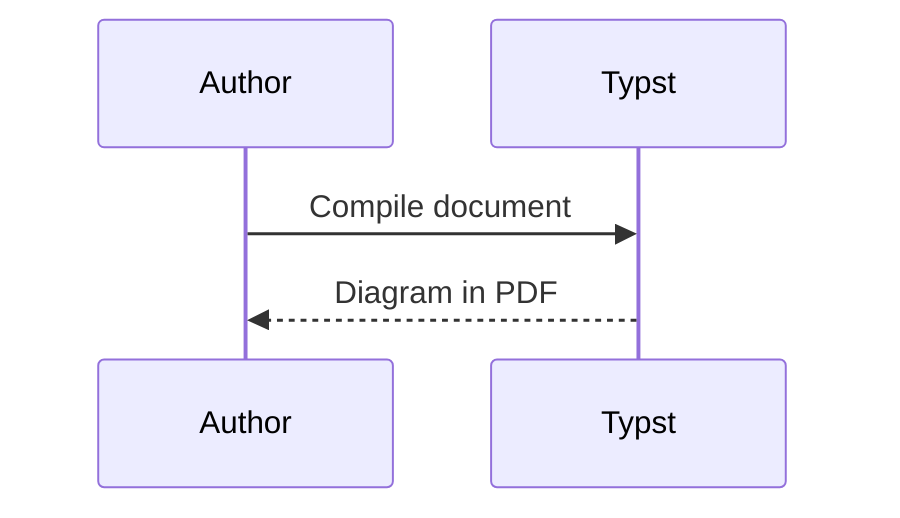
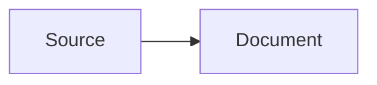

# merman

Render Mermaid diagrams directly in your Typst documents. Write a diagram, choose a theme, and use it as an image, a numbered figure, or a Mermaid code block.

This source tree builds package **0.6.0** with the Merman **0.11.0** Rust renderer as a WebAssembly plugin, targeting Mermaid **12.3.0** behavior. Requires **Typst 0.15.0 or newer**.

## Quick Start

Save this as `document.typ`:

```typst
#import "@preview/merman:0.6.0": mermaid

#mermaid("
flowchart LR
  A[Write Mermaid] --> B[Compile with Typst]
  B --> C[Read your PDF]
")
```

Compile it with `typst compile document.typ document.pdf`, or paste it into the Typst web app.

Next: [choose a theme](#choose-a-theme), [use diagrams in documents](#use-diagrams-in-documents), or [edit a theme document](#edit-a-theme-document). For an existing document, see [Upgrading](#upgrading).

## Choose a Theme

The same Mermaid source can use a Merman preset, a Theme v2 document, or a classic Mermaid theme.



[Open the Playground](https://frankorz.com/merman/) · [Run the Typst gallery](examples/theme-gallery.typ)

```typst
#import "@preview/merman:0.6.0": mermaid

#let source = "flowchart TD
  A[Write] --> B{Review}
  B --> C[Publish]
  B --> D[Revise]
"

#mermaid(source, theme: "studio", appearance: "light")
#mermaid(source, theme: "studio", appearance: "dark")
#mermaid(source, theme: "paper-cut")
#mermaid(source, theme: "forest")
```

Pass a Merman preset ID or a Theme v2 dictionary to `theme`. Set `appearance` to `"light"` or `"dark"` to use a supported appearance. An omitted value uses the theme's default. Get all 13 presets, their appearances, and the available Mermaid names from [theme-catalog](#theme-catalog).

Classic names such as `"forest"`, `"base"`, and `"neutral"` use Mermaid's own styling. Configure Mermaid theme variables with `site-config: (themeVariables: (...))`. Use `theme: "none"` to clear a profile's theme selection. An explicit `background` sets the canvas base for either rendering path. Use a hex color for an opaque background or `"transparent"` to show the page through the canvas base.

A direct `theme` replaces the profile's theme and its `appearance`. Supply only `appearance` to change the appearance of the profile's selected Merman theme. These rules apply to images, figures, SVG/results, and raw blocks.

## Use Diagrams in Documents

### Raw Blocks

Turn Mermaid fences into diagrams with one show rule:

````typst
#import "@preview/merman:0.6.0": show-mermaid-blocks

#show raw.where(lang: "mermaid"): show-mermaid-blocks(
  theme: "studio",
  document-context: true,
  width: 100%,
)


````

Raw-block handlers default to `error-mode: "placeholder"`: an invalid fence stays visible as a marked block. Use `error-mode: "panic"` to fail the compile on the first rendering error. Avoid a fixed `id` in a document-wide show rule unless it handles only one diagram; otherwise the SVG IDs repeat.

### Set document defaults

As an ordinary Typst function, `mermaid` takes reusable defaults through `.with(...)`. Bind a profile to your own `diagram` function and use that same profile in the raw-block rule:

````typst
#import "@preview/merman:0.6.0": mermaid, mermaid-profile, show-mermaid-blocks

#let diagram-style = mermaid-profile(
  theme: "studio",
  appearance: "light",
)
#let diagram = mermaid.with(
  profile: diagram-style,
  document-context: true,
  width: 100%,
)
#show raw.where(lang: "mermaid"): show-mermaid-blocks(
  profile: diagram-style,
  document-context: true,
  width: 100%,
)

#diagram("flowchart LR\n  Source --> Document")


````

Single calls can still override arguments, for example `diagram("flowchart LR\nA --> B", theme: "paper-cut")`; the [theme source and appearance rules](#choose-a-theme) still apply. For chapters, keep the profile and configured function in a shared `diagrams.typ`, import them where needed, and install the raw-block show rule in the main document.

### Figures and Profiles

Keep common diagram settings in a profile, then reuse them for images, figures, and raw blocks:

```typst
#import "@preview/merman:0.6.0": (
  mermaid, mermaid-figure, mermaid-profile, show-mermaid-blocks,
)

#let source = "flowchart LR\n  Draft --> Review\n  Review --> Publish"
#let diagrams = mermaid-profile(
  theme: "studio",
  background: "#ffffff",
  typography: (font: ("Arial", "sans-serif"), size: "16px"),
  figure: (caption-position: top, gap: 1em, outlined: false),
)

#mermaid(source, profile: diagrams, width: 100%)

#mermaid-figure(
  source,
  profile: diagrams,
  caption: [The publishing workflow.],
  width: 100%,
  alt: "Draft, review, and publish",
) <publishing>

See @publishing for the workflow.

#show raw.where(lang: "mermaid"): show-mermaid-blocks(profile: diagrams)

#raw(source, lang: "mermaid", block: true)
```

Profiles also work with `mermaid-svg`, `mermaid-result`, and `analyze-mermaid`. The optional `figure` dictionary is consumed only by `mermaid-figure`; it does not change SVG exports or ordinary images. Direct figure parameters override `profile.figure`. See [option precedence](#option-precedence) before mixing full configuration objects and shorthands.

### Document Fonts

Rendering is explicit by default. Set `document-context: true` to forward the current Typst font, text size, and finite available width, or supply font intent yourself:

```typst
#import "@preview/merman:0.6.0": mermaid

#set text(font: "Arial", size: 12pt)
#let source = "flowchart LR\n  Document --> Diagram"

#mermaid(source, document-context: true, width: 100%)

#mermaid(
  source,
  theme: "studio",
  typography: (font: ("Arial", "sans-serif"), size: "16px"),
  width: 100%,
)
```

`typography.size` accepts CSS `px` strings, absolute Typst lengths, or numeric CSS pixels. Typst lengths use SVG's 96-DPI coordinates, so `12pt` becomes `16px`. With a Merman theme, the wrapper applies font and size as a Theme v2 `typography` patch, using the `sans` slot for body text. A single font name gets a `sans-serif` fallback. Inferred document typography uses up to eight font families and a size between 10 and 24 CSS pixels. Family-specific typography can override these values. With classic Mermaid rendering, the wrapper sets Mermaid typography variables. Font descriptors supply their family names. Font files and Typst `covers` constraints stay in the Typst document.

The renderer uses its built-in `deterministic` measurer. Check wrapping in the final document when font metrics matter. On an auto-width page, the context bridge keeps the renderer's default width.

## Edit a Theme Document

Use the [Playground](https://frankorz.com/merman/) to preview themes and export Theme v2 JSON. Keep the export beside your document and pass the loaded dictionary to `theme`.

```typst
#import "@preview/merman:0.6.0": mermaid

#let source = "flowchart LR\n  SavedTheme --> Diagram"
#mermaid(source, theme: json("custom.theme.json"), width: 100%)
```

A short document can inherit a preset and override specific values.

```typst
#import "@preview/merman:0.6.0": mermaid, resolve-theme

#let source = "flowchart LR\n  Theme --> YourDocument"
#let custom = (
  schema_version: 2,
  extends: "studio",
  seed: (accent: "#0052CC"),
  typography: (sans: ("Arial", "sans-serif")),
)
#let check = resolve-theme(custom, appearance: "dark")
#assert(check.ok, message: repr(check))
#mermaid(source, theme: custom, appearance: "dark", width: 100%)
```

Use `export-theme-preset("studio")` for a complete editable document or `json.encode(custom, pretty: true)` to copy a smaller patch into a JSON file. See [theme-authoring.typ](examples/theme-authoring.typ) for a round trip.

## Examples

Each file is a runnable document:

| Example | What it shows |
| --- | --- |
| [basic.typ](examples/basic.typ) | A minimal `mermaid` call. |
| [theme-gallery.typ](examples/theme-gallery.typ) | The four theme samples pictured above. |
| [theme-authoring.typ](examples/theme-authoring.typ) | Preset export, resolution, and an editable theme document. |
| [raw-block.typ](examples/raw-block.typ) | Document-wide Mermaid fences. |
| [figure.typ](examples/figure.typ) | Typst figures and reusable figure defaults. |
| [profile.typ](examples/profile.typ) | Shared settings for direct calls and raw blocks. |
| [document-context.typ](examples/document-context.typ) | Opt-in document typography and width bridging. |
| [dagre.typ](examples/dagre.typ), [elk.typ](examples/elk.typ) | Explicit layout selection. |
| [print.typ](examples/print.typ), [presentation.typ](examples/presentation.typ) | White-background print output and a dark slide. |
| [options.typ](examples/options.typ) | Themes, stable IDs, result handling, and placeholder errors. |
| [svg-export.typ](examples/svg-export.typ) | SVG strings and structured render payloads. |

The relative image and example links are intended for both the repository and Typst Universe. Examples and gallery assets are included in the package submission for documentation, but `examples/**` is excluded from the runtime download. To run a linked example, copy or download its source into your project.

## API

| Task | Entry point |
| --- | --- |
| Insert a diagram image | [`mermaid`](#mermaidsource-) |
| Number, caption, or reference a diagram | [`mermaid-figure`](#mermaid-figuresource-) |
| Reuse settings | [`mermaid-profile`](#mermaid-profile) |
| Render Mermaid fences | [`show-mermaid-blocks`](#show-mermaid-blocks) |
| Export SVG text | [`mermaid-svg`](#mermaid-svgsource-) |
| Handle render errors in code | [`mermaid-result`](#mermaid-resultsource-) |
| Check Mermaid source | [`analyze-mermaid`](#analyze-mermaidsource-) |
| Discover installed themes | [`theme-catalog`](#theme-catalog) |
| Export an editable preset | [`export-theme-preset`](#export-theme-presetpreset-id) |
| Validate and inspect a theme document | [`resolve-theme`](#resolve-themedocument-appearance-none-auto-fix-contrast-false) |
| Inspect compiled capabilities | [`merman-capabilities`](#merman-capabilities) |

### `mermaid(source, ..)`

Renders a Mermaid string or raw block as an SVG image through Typst `image`.

| Parameter | Meaning |
| --- | --- |
| `width`, `height`, `fit`, `alt` | Forwarded to Typst `image`. |
| `scale` | Wraps the image in Typst `scale`; accepts ratios such as `120%` or numbers such as `1.2`. |
| `document-context` | `false` by default; `true` opts into document font, text size, and available-width bridging. |
| `profile` | Reusable settings from `mermaid-profile`. |
| `typography` | Font family stack and size for the selected rendering path. |
| `theme` | A Merman preset ID, a classic Mermaid theme name, `"none"`, or a Theme v2 dictionary. |
| `appearance` | Optional `"light"` or `"dark"` for a Merman preset or document. |
| `id`, `diagram-id` | Stable SVG root ID. Priority goes to direct `diagram-id`, direct `id`, profile `diagram-id`, then profile `id`. |
| `background` | Canvas base color, as a hex string or `"transparent"`. |
| `error-mode` | `"panic"` by default, or `"placeholder"` / `"text"` to display structured renderer errors. |

Error modes handle errors returned by Merman. Missing WASM files, plugin loading failures, invalid `error-mode` values, and SVG image decoding failures still fail the Typst compile. [Advanced controls](#renderer-controls) cover layout, environments, SVG pipelines, and raw options.

### `mermaid-profile(..)`

Returns a reusable settings dictionary, normalized into the same binding options as direct parameters. It does not create a second rendering path. See [Figures and Profiles](#figures-and-profiles) and [option precedence](#option-precedence).

### `mermaid-figure(source, ..)`

Wraps a rendered diagram in a native Typst `figure`. Forwards `placement`, `scope`, `supplement`, `numbering`, `gap`, and `outlined`. `caption-position` and `caption-separator` customize the caption. Direct figure parameters override `profile.figure`. Set `document-context: true` to use the same context bridge as `mermaid`.

### `show-mermaid-blocks(..)`

Returns a raw-block show handler for `raw.where(lang: "mermaid")`. It accepts the image/theme/profile controls above, defaults to `width: 100%` and `error-mode: "placeholder"`, and supports `document-context: true`. See [Raw Blocks](#raw-blocks).

### `mermaid-svg(source, ..)`

Returns the SVG as a string. This value-returning API does not enter Typst `context`: pass `typography`, a theme source and optional appearance, `layout`, or `container-width` explicitly. Render failures panic; use `mermaid-result` for programmatic handling.

### `mermaid-result(source, ..)`

Returns a structured render payload, including `ok`, `svg`, `message`, `operation`, `kind`, and `capability_id`. The latter fields distinguish missing capabilities, invalid input, and general errors without parsing the message. Resource failures expose `details.resource` with the stable limit ID, profile, and actual/max values.

```typst
#import "@preview/merman:0.6.0": mermaid-result

#let source = "flowchart LR\n  Input --> Output"
#let result = mermaid-result(source)
#if result.ok {
  image(bytes(result.svg), format: "svg", width: 100%)
} else {
  [Diagram error: #result.message]
}
```

### `analyze-mermaid(source, ..)`

Returns canonical diagnostic analysis schema 1. Invalid Mermaid stays in this payload with `valid: false`; transport, options, and missing-capability errors instead use the structured operation envelope.

```typst
#import "@preview/merman:0.6.0": analyze-mermaid

#let source = "flowchart LR\n  Input --> Output"
#let analysis = analyze-mermaid(source)
#analysis.version
#analysis.valid
#analysis.summary.errors
#analysis.diagnostics
```

### `theme-catalog()`

Returns catalog schema 2 with `presets`, `mermaid_themes`, and `families`. Each preset has an ID, display name, description, category, supported `appearances`, `default_appearance`, and six `swatches` for the default appearance. `families` lists the native theme capabilities of each diagram family.

### `export-theme-preset(preset-id)`

Returns the complete editable Theme v2 dictionary for a Merman preset. Pass the result to `theme` or serialize it with `json.encode`.

### `resolve-theme(document, appearance: none, auto-fix-contrast: false)`

Validates a Theme v2 dictionary and returns `ok: true`, `resolved`, and `notices` on success. Document errors return `ok: false` with a `message`, `path`, and any available `line` and `column` in the encoded document. Enable `auto-fix-contrast` to inspect adjusted colors. Rendering still uses the document you pass as `theme`. Transport errors from these helpers contain `code_name`, `kind`, and `message`.

### `merman-capabilities()`

Returns the compiled capability payload, including capability, output, operation, registry, and resource sets:

```typst
#import "@preview/merman:0.6.0": merman-capabilities

#let capabilities = merman-capabilities()
#capabilities.capabilities.text_measurement.provider_ids
```

Shared profile capacities are unchanged: `constrained` still reports 125,000 layout work units. Typst's effective SVG default combines that base profile with the `interactive` layout allowance described below; all other ceilings remain enforced.

## Advanced Configuration

### Option Precedence

Raw `options` always wins. A profile containing `options` is an opaque bundle that bypasses profile and call-site shorthands; direct `options` replaces it. Include theme and SVG settings in that same bundle, or use structured profile fields for field-level overrides.

Without raw options, precedence is field-specific:

- **Site config.** Direct `site-config` replaces the entire profile object. A selected classic `theme` sets its `theme` field.
- **Environment.** Profile object, profile measurement and math shorthands, direct object, then direct measurement and math shorthands.
- **Theme.** Direct `theme` replaces the profile's theme and appearance. Direct `appearance` overrides the profile mode when no new theme is supplied.
- **Typography.** Document context, then profile typography, then direct typography contribute font and size. Explicit shorthands override the corresponding inferred values.
- **Layout.** Container shorthands extend profile layout. A direct `layout` supplies the full object. Context width applies when these options leave width unset.
- **Scalars.** Direct value, then profile value, then renderer default.

### Renderer Controls

| Parameter | Meaning |
| --- | --- |
| `pipeline` | `"resvg-safe"` by default for Typst images; `"parity"` for Mermaid-like SVG DOM, or `"readable"` for inspection. The latter two can emit SVG structures that Typst warns about. |
| `site-config` | Bounded Mermaid site configuration, including algorithm selection. |
| `layout` | Full binding layout object for container geometry; overrides container shorthands. |
| `container-width`, `container-height` | `layout.container_width` / `layout.container_height` shorthands. |
| `environment` | Full render-environment object, including `text_measurement` and `math_renderer`. |
| `text-measurement`, `math-renderer` | Environment shorthands; direct values override direct environment fields, which override profile values. |
| `drop-native-duplicate-fallbacks` | Removes duplicate native fallback text in SVG post-processing. |
| `fixed-today`, `fixed-local-offset-minutes` | Deterministic date controls for date-sensitive diagrams. |
| `options` | Raw Rust binding options; bypasses shorthand generation but retains general binding validation and resource policy. |

General bindings reject host-owned `site-config.themeCSS` and `site-config.secure`, along with the raw SVG fields `scoped_css` and `css_override_policy` and their camelCase variants. Use a Theme v2 document, `site-config.themeVariables`, or `background` for document styling. Use `text-measurement: "deterministic"` and `math-renderer: "none"` to select the render environment explicitly.

### Resource Limits

SVG rendering defaults to **14,100,000 layout work units**, using the shared `interactive` allowance while retaining `constrained` as its base profile. Analysis retains the constrained defaults. Theme resolution uses the shared Theme v2 compiler budget.

An omitted or null `resources.profile` inherits the Typst SVG default. Explicit `resources.profile: "constrained"` keeps **125,000** layout work units unless overridden. In either case, a finite positive integer `resources.limits.max_layout_work_units` can lower **or raise** the allowance:

```typst
#import "@preview/merman:0.6.0": mermaid, mermaid-profile

#let source = "flowchart LR\n  Source --> Diagram"
#let layout-options = (
  version: 3,
  resources: (limits: (max_layout_work_units: 20000000)),
  svg: (pipeline: "resvg-safe"),
)
#mermaid(source, options: layout-options)

#let diagrams = mermaid-profile(options: layout-options)
#mermaid(source, profile: diagrams)
```

The 20,000,000-unit override illustrates raising the allowance; it is not a measured cost or required value. Work accumulates across iterations, including Mindmap's COSE layout. A failure's `actual` is the first rejected charge, not the diagram's total cost. Zero, negative, fractional, null, and overflowing limit values are rejected.

**Other limits may only be tightened.** Looser profiles, unknown IDs, and hard-cap overrides remain rejected. Resources may appear directly or inside one `analysis` or `merman` object wrapper; the options root and wrapper must be objects, and malformed or mixed wrappers return structured options errors. Rendering and analysis use the shared options-byte budget. [Issue #300](https://github.com/Latias94/merman/issues/300)

### Choose a Layout

Both Dagre and ELK are bundled. Since Mermaid 12.0, Flowchart, State, Class, ER, Requirement, Usecase, and Agentflow default to ELK when available. Other families keep their own layout behavior. `flowchart LR` chooses a direction, not an algorithm.

Select Dagre with Mermaid site configuration, or explicitly select ELK through frontmatter:

```typst
#import "@preview/merman:0.6.0": mermaid, mermaid-profile

#let source = "flowchart LR\n  Source --> Layout\n  Layout --> SVG"
#mermaid(source, site-config: (layout: "dagre"))

#let diagrams = mermaid-profile(site-config: (layout: "dagre"))
#mermaid(source, profile: diagrams)

#mermaid("---\nconfig:\n  layout: elk\n---\n" + source)
```

Use the same profile in a raw-block handler for a document-wide Dagre choice. A direct `site-config` replaces the profile's entire dictionary, so include `layout: "dagre"` there to retain it. To request the earlier theme and look too, use `site-config: (layout: "dagre", theme: "default", look: "classic")`; this does not promise identical historical output.

The wrapper's top-level `layout` controls container geometry; use `site-config.layout` to select Dagre or ELK. Runtime Dagre selection requires no custom build and does not remove ELK from the WASM. ELK is an embedded, modified Rust translation of Eclipse ELK with a separate [component license](#license).

## Upgrading

### Theme v2 migration

| Old input | Theme v2 input |
| --- | --- |
| `theme-preset`, `theme-appearance` | Use `theme` with a current preset ID and optional `appearance`. For example, use `theme: "studio", appearance: "dark"` for a paired preset. |
| `theme-name`, `base-theme` | Pass a classic Mermaid name such as `"forest"` to `theme`. |
| `theme-variables` | Use `site-config: (themeVariables: (...))`. |
| `theme-recipe`, `diagram-theme`, `mermaid-theme-definition` | Create a Theme v2 dictionary, then render with `mermaid(source, theme: document)`. |
| `materialize-theme`, `describe-theme-support` | Validate a document with `resolve-theme` and discover family capabilities with `theme-catalog`. |
| Raw `theme.spec` or `theme.recipe` | Use a Theme v2 document, or a selector with `document` and optional `appearance`. |
| Raw `svg.root_background_color` | Use top-level `background` to override the canvas base. |

### Upgrading from 0.5.0

Use the wrapper and WASM from the same package. Update the import to `@preview/merman:0.6.0` and use `version: 3` in explicitly versioned options. The minimum Typst version is `0.15.0`.

| Old input | Current input |
| --- | --- |
| `presentation-profile` or raw `presentation` | Use `theme` with a preset ID or a Theme v2 document. |
| `host-theme` | Use `typography` for font intent and `theme` for colors and roles. |
| `theme` shorthand for Mermaid variables | Move the variables to `site-config: (themeVariables: (...))`. |
| `scoped-css` or `css-override-policy` | Use `theme`, `site-config.themeVariables`, or `background` for styling. |
| `mermaid-context(source, ..)` | Use `mermaid(source, document-context: true, ..)`. |
| `show-mermaid-blocks-context(..)` | Use `show-mermaid-blocks(document-context: true, ..)`. |

Review geometry, wrapping, typography, and document snapshots after the Mermaid and ELK update. See the [package changelog](CHANGELOG.md) for rendering changes.

### Upgrading from 0.4.0

Package `0.5.0` bundled Merman `0.9.0`, keeping ABI 2, options schema 2, and Typst `0.15.0`. It improved Unicode line breaking, Markdown code/escaped markup, hollow relationship markers, and Block metadata. SVG backgrounds are transparent; pass `background: "white"` for opaque artwork. See the [0.5.0 changelog](CHANGELOG.md#050---2026-10-13). A direct jump to `0.6.0` also requires the migration above.

### Earlier 0.3.0 to 0.4.0 Migration

- Merman moved from `0.8.0-alpha.6` to stable `0.8.0`, targeting Mermaid `12.1.0`; Agentflow and Usecase joined the supported families.
- Mermaid 12.0 changed layout and appearance defaults. The package targets 12.1 behavior, including ELK defaults and Redux/Neo presentation for supported families. Review geometry, colors, and spacing; [Choose a Layout](#choose-a-layout) explains explicit Dagre and classic appearance.
- Replace family-local `defaultRenderer` with top-level Mermaid `layout`. Typst diagnostic analysis stays at schema 1; analysis facts elsewhere in Merman use schema 2. Operation envelopes, binding options, and plugin ABI have separate versions.
- Existing wrapper entry points remained in `0.4.0`. Embedded images still default to `resvg-safe`; math remains unavailable. See the [Merman 0.8.0 upgrade guide](https://github.com/Latias94/merman/blob/v0.8.0/docs/release/V070_TO_V080_UPGRADE_GUIDE.md).

## Version Mapping

| Typst package | Merman source | Typst plugin ABI | Notes |
| --- | --- | --- | --- |
| `0.6.0` | `0.11.0` in this checkout | `3` | Options 3 and Theme v2. |
| `0.5.0` | `0.9.0` | `2` | Options 2 and Mermaid 12.1 rendering. |
| `0.4.0` | `0.8.0` | `2` | Mermaid 12.1; requires Typst `0.15.0` or newer. |
| `0.3.0` | `0.8.0-alpha.6` | `2` | Previous size-optimized WASM package. |
| `0.2.0` | Previously published source revision | `2` | Registry channel; do not infer alpha.6 source provenance from this version. |
| `0.1.0` | `0.8.0-alpha.1` | `1` | Previous package API. |

The package version tracks the `@preview/merman` wrapper API; the source version identifies the Rust workspace build. Plugin ABI tracks WASM exports and byte payloads. Wrapper-only breaks do not require an ABI bump when that plugin surface stays stable.

Binding options schema 3 includes top-level `theme`, `background`, `site_config`, `layout`, and `environment`. Theme documents and the theme catalog use schema 2. Operation envelopes use schema 1. These schemas have separate version numbers from the package and plugin ABI.

## Current Limits

- Diagrams are SVG images embedded through Typst `image`, rather than Typst-native vector elements.
- RaTeX math rendering is unavailable: the package does not compile `math`, and `math-renderer: "ratex"` reports a missing capability. Its upstream closure currently depends on browser system-font discovery; admission requires a zero-browser-import implementation.
- Browser-only Mermaid interactions such as script callbacks and popups do not work in static output.
- Typst 0.15 HTML export remains experimental and is not a package promise. The supported document path is SVG embedded in Typst/PDF.
- Native theme capabilities vary by diagram family. `theme-catalog()` reports them for the installed plugin.

## Development

Build the publish package locally:

```sh
cargo run --locked -p xtask -- build-typst-package --profile publish
```

Output: `dist/typst/merman/0.6.0`. The build requires `wasm-tools` and Binaryen `wasm-opt version 133`; the builder applies pinned `wasm-opt -Oz` before stripping custom sections and records both tool versions in the artifact manifest.

For a manual local install, copy that directory to a preview package path:

```text
<package-root>/preview/merman/0.6.0/typst.toml
<package-root>/preview/merman/0.6.0/lib.typ
<package-root>/preview/merman/0.6.0/merman_typst_plugin.wasm
```

Compile with `typst compile --package-path <package-root> document.typ`. The package smoke command creates this layout automatically:

```sh
cargo run --locked -p xtask -- typst-package-smoke --profile publish --skip-wasm-build
```

Append `--typst /path/to/typst` when the CLI is outside `PATH`. Each run owns an independent temporary directory under `target/typst-package-smoke/`. Positive fixtures preserve nested output paths; `tests/compile-fail/` fixtures must fail with their adjacent `.error.txt` diagnostic. Successful runs remove artifacts unless `--keep-artifacts` is passed.

Source fixtures cover API, options, themes, environments, context, errors, figures, raw blocks, README examples, historical issues, and visual smoke behavior. The package submission includes the examples. Find the fixtures in the [source repository](https://github.com/Latias94/merman/tree/main/distribution/typst/merman/tests).

The builder verifies artifact-recipe provenance in its private build directory, stages only the runtime wrapper, WASM, examples, and legal materials, then snapshots and verifies their complete file shape and contents. It rechecks live source identity before atomically replacing the version directory. Build receipts are not published.

The sole package profile, `publish`, includes SVG rendering, analysis, the complete Mermaid language catalog, and Cytoscape and ELK layouts. There are no alternate bridge-only or SVG-only profiles. ASCII, PNG, JPEG, and PDF operations are not compiled because this wrapper exposes none of them. Maintainer experiments use direct Cargo features without creating another package identity or release recipe.

## License

The wrapper and Merman-authored code are available under **MIT OR Apache-2.0**. The embedded ELK-derived implementation is a separate component under **EPL-2.0**; this does not relicense the rest of the package. Preserve `THIRD_PARTY_NOTICES.md` and the matching `THIRD_PARTY_LICENSES/` files when redistributing the package or a derivative artifact. They record exact source revisions, relationships, scopes, and applicable legal texts for embedded or translated components.

The machine-readable Cargo dependency report lives in the source repository's release evidence instead of being duplicated in the downloaded package.
