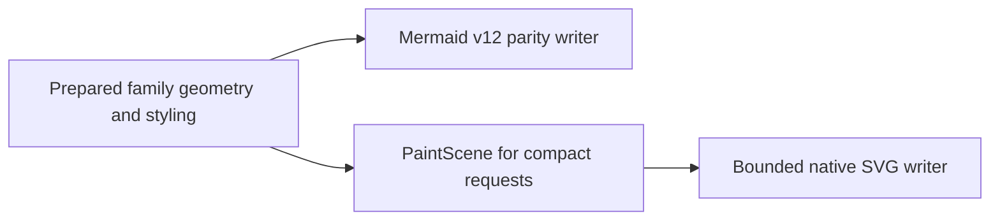

# ADR 0104: PaintScene Vector IR and Dual Output Profiles (Native Compact vs Mermaid v12 Parity)

- Accepted for the v0.11 development line on 2026-11-26.
- Extends: [ADR-0102](0102-native-theme-v2.md) and [ADR-0078](0078-headless-svg-security-capability-boundaries.md)
- Preserves: Mermaid v12 parity contracts for callers requesting compatibility output, deterministic resource bounds, and SVG output security validation

## Context

1. **SVG emission is worth measuring independently of solving.** A historical Windows `fan-in-500` timing run placed most end-to-end time outside the Shoal solver. A separate allocation run also put most requests outside the solver. Neither observation establishes a whole-corpus baseline or a competitor result.
2. **Legacy Mermaid v12 DOM parity has a payload cost.** Scoped compatibility CSS, Base64 JSON `data-points`, HTML label wrappers, and empty placeholders serve DOM consumers. A native output contract does not need those same bytes.
3. **Native hosts need native paint primitives.** Editors and headless exporters can use pure SVG without HTML-in-SVG, and future consumers can use a typed vector scene without serializing XML only to parse it again.

Keeping a single monolithic SVG emission contract forces modern native users to pay legacy Mermaid v12 byte volume, latency, and `<foreignObject>` portability penalties forever.

## Decision

### 1. Dual Output Profiles (`SvgOutputProfile`)

Separate SVG emission explicitly into two named, well-defined output profiles at the render contract boundary:

| Profile | Purpose | Emission Contract |
| --- | --- | --- |
| **`MermaidV12Parity`** | Drop-in compatibility with Mermaid 12.x DOM/CSS expectations and parity goldens | Preserves full Mermaid v12 DOM structure, `<foreignObject>` HTML labels (when configured), `data-points` Base64 edge payloads, empty edge-label wrappers, and Mermaid compatibility `<style>` rules. Remains available without regression for parity tests, CLI compatibility, and legacy consumers. |
| **`NativeCompact`** | Portable output for Theme v2, editors, and non-browser hosts | Emits native SVG primitives (`<rect>`, `<path>`, `<circle>`, `<polygon>`, `<text>`/`<tspan>`) with **zero `<foreignObject>`**, **zero `data-points` Base64 payloads**, **zero empty unlabeled edge-label wrappers**, and only the styles needed by the scene. Preserves prepared geometry and visible content for admitted inputs without promising pixel-identical font rendering across hosts. |

- `MermaidV12Parity` remains the default, including for Theme v2. Callers select `NativeCompact` explicitly through `SvgRenderOptions` / `SvgRequest` or the corresponding binding options.
- Pilot capability is per family and output feature. An explicit compact request outside the supported profile returns an unsupported-profile error rather than silently emitting parity SVG or losing content. Reuse existing family layout and route results, including Shoal results, without changing those layout backends.
- Both profiles continue to enforce `OperationControl` cancellation, `OperationWorkMeter` ceilings, `BoundedSvgOutput` pre-write limits, and strict markup/SVG security validation.

### 2. Family-Independent `PaintScene` Vector IR in `merman-render-core`

Introduce a lightweight, value-oriented, zero-DOM vector scene intermediate representation (`PaintScene`) in `merman-render-core` behind an explicit feature seam:

- **Core primitives**:
  - `SceneViewport` (`view_box`, `width`, `height`, canvas background / texture metadata);
  - `SceneGroup` (`id`, semantic `role` such as Node / Edge / EdgeLabel / Cluster / Note / Canvas, optional `source_span` for editor/Agent GUI hit-testing and bidirectional navigation, `transform`, `opacity`, `clip`);
  - `SceneShape` (`Rect` with corner radii, `Circle`, `Ellipse`, `Polygon`, `Path` using typed curve/line segments or compact command buffers—never requiring callers to re-parse `d="..."` strings for bounds or arc length);
  - `SceneText` (positioned `TextRun` lines with resolved font style, anchor, fill, and optional backplate rect);
  - `SceneDefs` (reusable arrow/cardinality markers, gradients, and elevation/shadow descriptors).
- **One scene, multiple consumers**:
  1. `PaintScene -> NativeCompact SVG` streaming writer (zero `<foreignObject>`, single-pass formatting, zero full-SVG `memmove` for Theme v2 canvas insertion);
  2. Future native GPU / canvas backends (Zed GPUI, Skia, Flutter, CoreGraphics) and direct `merman-export` raster/PDF painting without XML round-tripping;
  3. Interactive editor / Agent GUI hit-testing and live state overlays (highlighting active steps or nodes by semantic ID without re-running layout).

### 3. Incremental Adoption Strategy (No Big-Bang Rewrite of 34 Families)

- **Phase 1 (v0.11)**: Define and stabilize the internal `PaintScene` data types and `SvgOutputProfile` contract in `merman-render-core` / `merman-render`, and complete end-to-end `PaintScene` + `NativeCompact` SVG emission for **Flowchart** and **Sequence** (the two highest-traffic families across editors, AI agents, and benchmarks), verified with geometry, visual, security, and benchmark comparisons.
- **Phase 2 (v0.12+)**: Migrate remaining core families (`class`, `state`, `er`, `architecture`, `block`, `c4`, `gantt`, `mindmap`, charts, structured diagrams) onto `PaintScene` incrementally without breaking `MermaidV12Parity`, and expose a stabilized public `RenderTarget::Scene` / `PaintScene` Rust API for native GPU hosts.

## Alternatives considered

- **Strip or rewrite parity SVG after emission.** This pays the original formatting cost, repeats parsing, and makes it hard to preserve geometry or reject unsupported label content deliberately.
- **Replace parity SVG or move every family to the new IR at once.** This risks regressing existing consumers before the scene abstractions have been proven by distinct family layouts.

## Consequences

- **Performance**: Measure SVG bytes and stage latency with the same admitted inputs and pinned options, using the [benchmark contract](../performance/BENCHMARKING.md). Separate compiler/solver changes from output-profile changes and compare competitors only in equivalent drawing lanes.
- **Portability**: Require well-formed SVG and terminal target checks, including native rasterization, exact byte admission, and cancellation. Parity retains its existing DOM gates. Compact has its own geometry and visible-content checks.
- **Future-readiness**: Editors and Agent GUIs gain a clean path to direct GPU rendering, interactive node/edge hit-testing, and source-span linking without coupling to SVG XML strings.
- **Controlled risk**: Qualify Flowchart and Sequence first, with the unchanged parity output as a control. Do not interpret missing compact support for another family in a mixed workload as a performance win.
