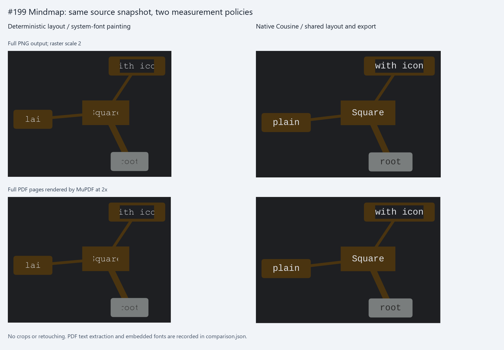
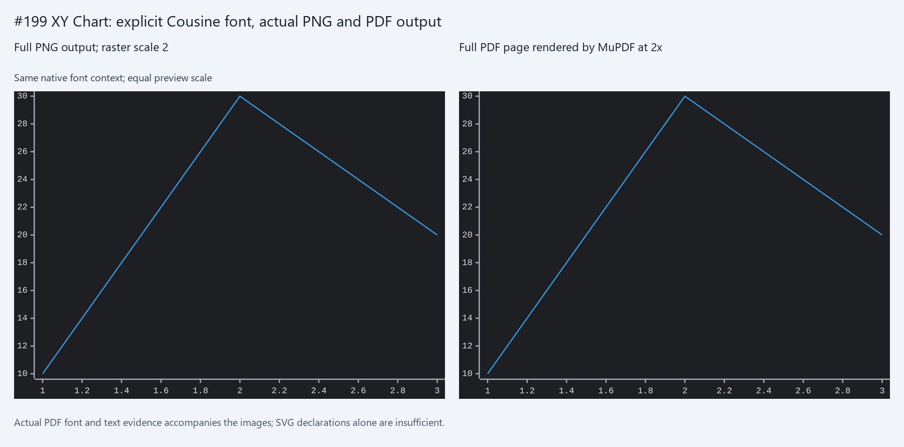
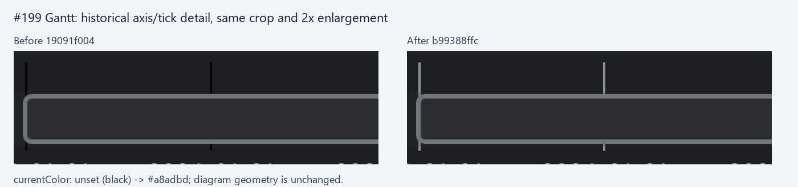

# Issue #199: font measurement and native export

Actual binding-engine outputs captured on October 14, 2026, supplement the immutable
[#201 captures](../presentation-issues-197-200/README.md). Both Mindmap policies use the same
working-tree source snapshot: base `051c435fe79c32dc63aa9876969a09ed5661606e` plus the changed
source hashes in [comparison.json](comparison.json). The captures do not claim a later commit.

Full SVG, PNG and PDF files are retained unchanged. The manifest records the capture binary,
inputs, options, font hashes, source snapshot identity, output dimensions and PDF text/fonts.
PDF preview images come from rendering the actual PDFs with MuPDF at 2x. Captions sit outside
the outputs; previews receive no recoloring, retouching or added diagram canvas.

## Mindmap: two measurement policies

The unchanged issue input includes `Square`, `plain` and `with icon`. Deterministic measurement
and system-font painting disagree at fixed label viewports; the original clipping remains
visible in both PNG and PDF. Its PDF extracts `lai` and `ith ico` for the latter two labels.

Native mode loads the checked-in Cousine Regular/Bold/Italic test fonts and shares that context
across layout, SVG conversion and native export. The native PNG and PDF show complete labels;
the PDF embeds `Cousine-Regular` and extracts `root`, `Square`, `plain`, and `with icon`.
The measured layout sizes change, rather than disabling source clipping to conceal overflow.
Cousine fixtures use the [SIL Open Font License 1.1](../../../crates/merman-export/tests/fonts/OFL.txt);
their pinned source is recorded in the [font README](../../../crates/merman-export/tests/fonts/README.md).



## XY Chart: actual font evidence

The historical comparison recorded requested SVG font-family declarations. The old PNG alone
does not prove which font face painted the text. This separate current capture explicitly loads
Cousine Regular: the actual PDF embeds `Cousine-Regular` and retains the numeric axis labels as
extractable text. PNG and PDF share the native font context. SVG does not embed fonts, and its
appearance in another consumer still depends on that consumer's installed fonts.



## Gantt: historical axis color detail

This is the original `19091f004` / `b99388ffc` pair, not a current capture or a layout redesign.
The axis domain and tick strokes inherit `currentColor`: unset black becomes `#a8adbd`.
The diagram geometry is unchanged. Both detail panels use crop `[140, 60, 460, 160]` from the
unchanged historical PNGs and nearest-neighbor 2x enlargement; the manifest records the crop.



## Reproduction

Build `capture.rs` as a temporary binary using the two current path dependencies:

```toml
[package]
name = "issue199-native-capture"
version = "0.0.0"
edition = "2024"

[workspace]

[[bin]]
name = "issue199-native-capture"
path = "/path/to/merman/docs/assets/issue-199-font-bounds/capture.rs"

[dependencies]
merman = { path = "/path/to/merman/crates/merman", default-features = false, features = ["all-diagrams", "svg", "png", "pdf", "native-fonts", "layout-cytoscape"] }
merman-bindings-core = { path = "/path/to/merman/crates/merman-bindings-core", default-features = false, features = ["all-diagrams", "svg", "png", "pdf", "native-fonts", "layout-cytoscape"] }
```

Copy the repository's `Cargo.lock` into that temporary project. Establish the temporary root
package's lockfile on the first build with `cargo build --offline --manifest-path /path/to/capture/Cargo.toml`.
Subsequent builds use `cargo build --locked --offline --manifest-path /path/to/capture/Cargo.toml`.
The recorded temporary lockfile hash is in the evidence manifest.
Run from this assets directory, replacing `capture` with the absolute built executable path:

```console
capture deterministic ../presentation-issues-197-200/issue-199-mindmap.mmd mindmap.json deterministic-mindmap
capture native ../presentation-issues-197-200/issue-199-mindmap.mmd mindmap.json native-mindmap /path/to/merman/crates/merman-export/tests/fonts/Cousine-Regular.ttf /path/to/merman/crates/merman-export/tests/fonts/Cousine-Bold.ttf /path/to/merman/crates/merman-export/tests/fonts/Cousine-Italic.ttf
capture native ../presentation-issues-197-200/issue-199-xychart.mmd xychart.json native-xychart /path/to/merman/crates/merman-export/tests/fonts/Cousine-Regular.ttf
```

Each command writes `.svg`, `.png` and `.pdf` files. Raster scale is 2 in the shared options;
PDF geometry retains its own units. These are review illustrations, not golden fixtures or
cross-platform pixel-identity claims. Font behavior beyond these explicit test fonts is not
established by the screenshots.
