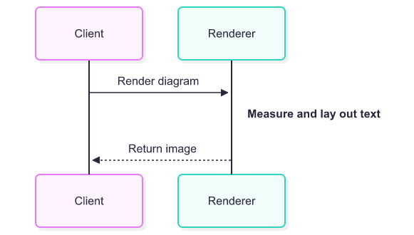
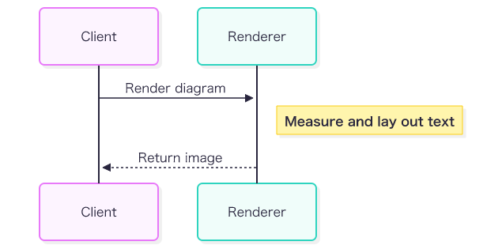

# Native export font defaults and visible note frames

These are actual native CLI PNG exports on macOS from [the same Sequence source](sequence.mmd),
with a white export background. Font selection remains host-dependent.

| Previous layout and filter behavior | Corrected default export |
| --- | --- |
|  |  |

The previous image uses the pre-fix Sequence writer with explicit deterministic measurement,
which retains the former default layout estimates. The new image uses the current default
Mermaid-to-PNG path: a native context supplies both measurement and painting. Its note frame is
also visible because the built-in shadow URL now resolves to the diagram-owned definition.
These changes address separate causes: font-agnostic layout could underestimate the label,
and an unresolved filter URL could cause native SVG parsing to discard the frame entirely.

From the repository root, reproduce the corrected image with a matching default CLI:

```text
merman-cli render docs/assets/native-export-fonts/sequence.mmd -f png --background white -o after.png
```

The current `--font-measurement deterministic` option retains approximate layout but includes
the corrected filter reference; it does not reproduce the historical missing-frame defect.
Explicit font files are preferable when output must use a controlled font set. No fonts are
embedded or bundled by these examples.

## Maintenance scope and evidence

The CLI change applies to Mermaid PNG/JPEG/PDF through `render`, `mmdc`, and Markdown batches.
SVG keeps its deterministic default; raw SVG conversion cannot relayout existing geometry.
Post-layout CSS remains incompatible with native measurement; explicitly choose deterministic
measurement to retain admitted legacy CSS behavior. The maintenance patch preserves Mermaid
12.1, Options schema 2, C ABI 3, and the published library codec feature semantics.

Main already scoped Sequence's built-in shadow. The maintenance backport uses the existing
`scoped_drop_shadow` helper for actors, notes, loop labels, and backgrounds. A related GitGraph
tag background defect exists on both lines and uses the same fix. Custom filter URLs and CSS
shadow functions retain their values.

CI's Chromium paint audit also found ten Sequence group-box fixtures whose restored shadow
extended below the root viewport. Main already included this paint in its root bounds. The
maintenance backport now shares rectangle geometry between box emission and its paint bounds,
including the actual one-pixel stroke and four-pixel zero-blur shadow. It leaves layout and
title anchors intact rather than introducing extra diagram padding.

Four existing Sequence entries in
[`browser-text-layout-residuals.json`](../../../fixtures/_verification/browser-text-layout-residuals.json)
needed new local signatures. Each affected output changes exactly four CSS filter references.
Reversing only those references and running the repository's existing canonical signature
function reproduces every previous signature exactly. Input and upstream hashes, text,
geometry, comparison modes, and precision are unchanged; no comparator rule was relaxed.

Local verification includes all 573 CLI tests (one separate intentional skip), three fixed-font
Sequence containment tests covering nine placements/wrapping combinations, 166 Sequence
contracts, the GitGraph reference contract, and the complete structure/parity/parity-root SVG
comparison. Exact SVG, PNG, JPEG, PDF and parallel-PDF process profiles, archive/install
Python contracts, generated CLI assets, Clippy, dependency closures, and legal materials were
also checked. Remote CI remains the owner of the complete cross-platform matrix.
