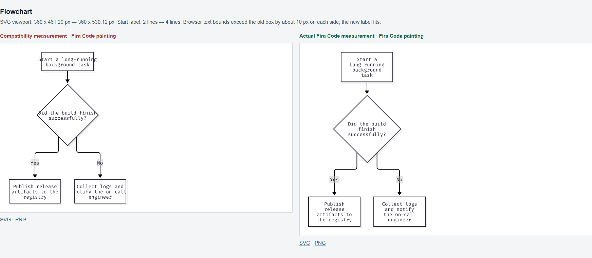
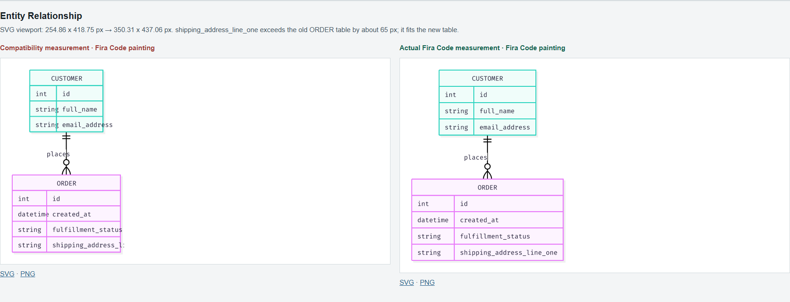
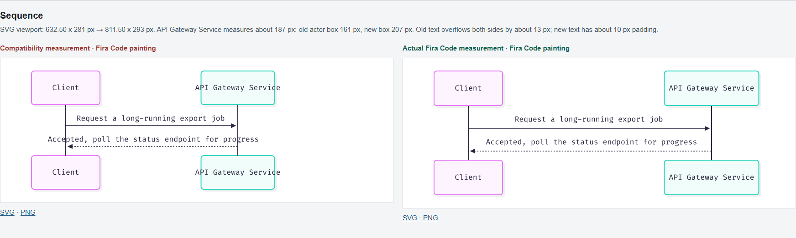

# Native Font Measurement: Same-Font Visual Comparison

Verified on October 10, 2026, Windows 11, Chromium 154.0.8037.98.
These user-provided Flowchart, ER, and Sequence inputs compare deterministic
measurement (left) with native measurement (right). Both sides are painted with
the same Fira Code font, not different fonts. Only the measurement policy changes;
the shared configuration and original diagram content are retained.

| Comparison PNG | Pixel dimensions | Deterministic SVG viewport | Native SVG viewport |
| --- | --- | --- | --- |
| [Flowchart](flowchart-comparison.png) | 1744 x 761 | 360 x 461.20 | 360 x 530.12 |
| [Entity Relationship](entity-relationship-comparison.png) | 1744 x 668 | 254.86 x 418.75 | 350.31 x 437.06 |
| [Sequence](sequence-comparison.png) | 1744 x 523 | 632.50 x 281 | 811.50 x 293 |







## Font Identity and Scale

The local font sources are `C:/Windows/Fonts/FiraCode-Regular.ttf` and
`C:/Windows/Fonts/FiraCode-Bold.ttf`. Their SFNT name tables identify Fira Code
**Version 5.002**, with PostScript names `FiraCode-Regular` and `FiraCode-Bold`.
These are installed Windows files; the original download/installer was not
recorded. Their upstream project is [Fira Code](https://github.com/tonsky/FiraCode).
No machine font binaries are redistributed in this directory.

| File | Bytes | SHA-256 |
| --- | --- | --- |
| FiraCode-Regular.ttf | 299152 | `28c3ae21a853f1d74673384c7a0d620abb0e877b8c6cd8b64173a95512476824` |
| FiraCode-Bold.ttf | 324328 | `37a609b7e27516ce0cf55cb7550edd1a1cbd8cd5bc028415a1d520c426c10357` |

Chromium's `CSS.getPlatformFontsForNode` confirmed `FiraCode-Regular` for
rendered text on **all six** saved SVGs, rather than merely reading the CSS
`font-family` declaration. Bold is an available source, not a claim that every
sample uses bold glyphs. Rasterized PNGs do not require fonts on the reader's
machine; SVGs retain text and require compatible installed fonts.

The source diagram PNGs were 2x raster previews: Flowchart 720 x 924 / 720 x
1062, ER 510 x 838 / 702 x 876, and Sequence 1266 x 562 / 1624 x 586. The
comparison page displayed each at half its natural pixel dimensions, retaining
the same CSS-pixel scale across both columns, not fit-to-column scaling. The
committed comparison PNGs are captures of those paired previews. The original
capture command and device scale factor were not retained, so exact screenshot
reproduction is not claimed. Unrelated index/mobile captures are omitted.

## Bounds Check

Measurements below were rechecked against the saved SVGs with the same installed
Fira Code. SVGs were displayed at their viewBox width; `getBoundingClientRect()`
provided text and containing-shape bounds in CSS pixels. Small float differences
depend on Chromium. Overflow is `max(shape.left - text.left, 0)` and
`max(text.right - shape.right, 0)`; padding uses the inverse differences.

| Probe | Deterministic measurement | Native measurement |
| --- | --- | --- |
| Flowchart Start node | 2 rows; text width 172.58, box 152.00; left/right overflow 10.10 / 10.48 | 4 rows; text width 103.70, box 152.00; left/right padding 24.34 / 23.95 |
| ER `shipping_address_line_one` in ORDER | text width 215.23; table width 238.84; right overflow 64.84 | text width 215.23; table width 334.29; right padding 12.64 |
| Sequence `API Gateway Service` | text width 187.08; actor width 161.00; left/right overflow 13.04 / 13.04 | text width 187.08; actor width 207.00; left/right padding 9.96 / 9.96 |

The ER shape is the first path under `demo-er-entity-ORDER-0`, not a rect.
Flowchart uses the Start node's rect. Sequence uses the actor rect containing
the Gateway label. These checks demonstrate label containment and font-aware
wrapping/sizing, not browser pixel parity or arbitrary HTML/CSS support.

## Reproduction Recipe

The original invocation log was not retained. The following supported CLI recipe
recreates the measurement/painting separation; newer code can change geometry.
Use a CLI compiled with `svg,png,native-fonts,diagram-flowchart,diagram-er,diagram-sequence`.
Run from this directory, point `$cli` to the built executable, and use font files
matching the hashes above. No system discovery is needed for explicit fonts.

```powershell
$cli = '../../../target/debug/merman-cli.exe'
$regular = 'C:/Windows/Fonts/FiraCode-Regular.ttf'
$bold = 'C:/Windows/Fonts/FiraCode-Bold.ttf'
foreach ($family in @('flowchart', 'er', 'sequence')) {
    & $cli mmdc -i "$family.mmd" -o "$family-deterministic.svg" -c config.json --svgId "demo-$family" --font-measurement deterministic
    & $cli mmdc -i "$family.mmd" -o "$family-native.svg" -c config.json --svgId "demo-$family" --font-file $regular --font-file $bold --font-system off
    foreach ($mode in @('deterministic', 'native')) {
        & $cli render "$family-$mode.svg" --input-kind svg --format png --output "$family-$mode.png" --scale 2 --font-file $regular --font-file $bold --font-system off
    }
}
```

The first deterministic command has no explicit font sources because supplying
fonts selects native Mermaid measurement. The second step paints both already
laid-out SVGs with the identical explicit font context; it does not relayout them.
For a paired comparison, display both 2x previews at half their natural size
before taking a screenshot. This recipe writes SVG/PNG output, so use a scratch
copy of these inputs when preserving the committed evidence.
