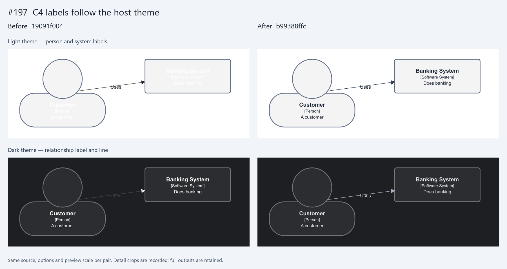
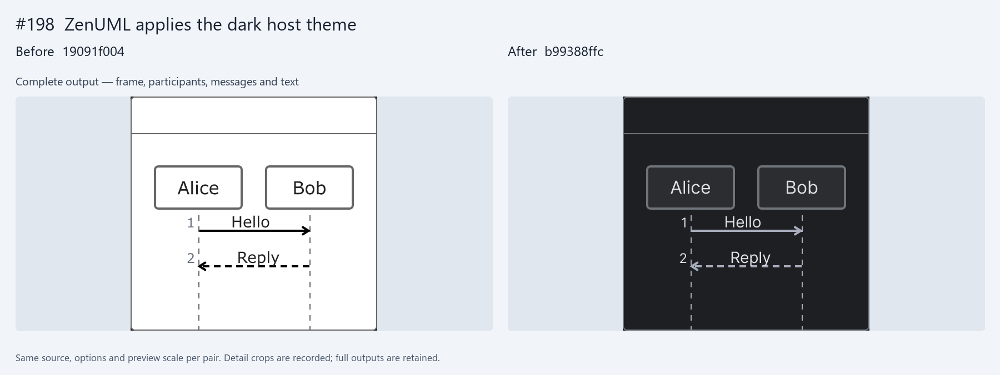
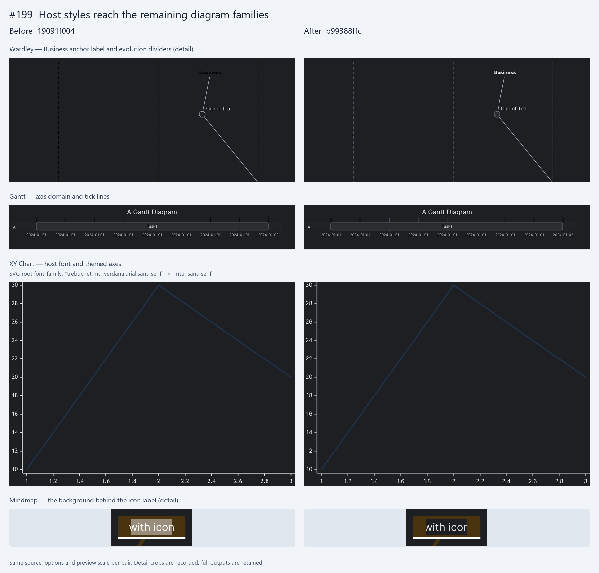
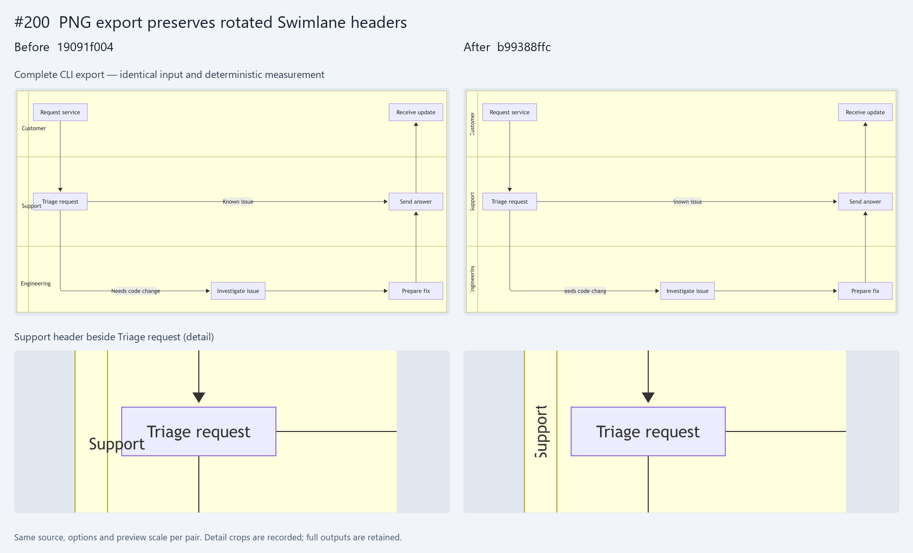

# Presentation and export: issues #197–#200

Actual SVG and PNG output from `19091f004d0f234d4fd59a64f0ed7cd04bfa4cdd` (before)
and `b99388ffc63fe5dcf8cb761ad57313a58f66bdb3` (after), captured on October 14, 2026.
The before revision is the Mermaid 12.2 alignment base of PR #201. It is not a
different Mermaid release or a recreation of the reporter's screenshots.

Every pair uses the original issue source, the same options, deterministic
measurement, and the same Windows host. The theme cases use the public
`merman-bindings-core::render_svg` and `render_png` APIs. The Swimlane case uses
the original CLI commands. PNG scale is 2 on both sides.

The four comparison PNGs are review illustrations, not golden fixtures.
Full, unmodified SVG and PNG outputs are retained in `before/` and `after/`.
`comparison.json` records the inputs, options, commits, binary and output hashes,
pixel dimensions, and detail crop coordinates. Each pair uses the same crop
and resize factor; output pixels are not recolored or retouched.

## #197: C4 text follows the actual themed background

The light theme no longer leaves white labels on light elements. In the dark
theme, the relationship label and line use the supplied host colors.



## #198: ZenUML applies the host theme

The frame, participants, message lines, and text follow the dark theme instead
of retaining the plugin's white frame. Plain Mermaid configuration remains a
separate contract; this example exercises Merman's presentation theme API.



## #199: Family-owned colors and fonts reach the renderer

Wardley anchor labels and dividers, Gantt axis lines, XY Chart root typography,
and Mindmap icon-label backgrounds receive their respective host values.
The XY Chart caption quotes the font-family declarations from the saved SVGs;
the PNG alone does not prove which font family was requested.



## #200: Export retains the rotated lane headers

The Support title stays in its rotated header strip rather than running into
Triage request. The overview and detail both come from the unchanged CLI PNG.



## Inputs and options

| Issue | Source | Options | Capture surface |
| --- | --- | --- | --- |
| #197 | [C4Context](issue-197-C4Context.mmd) | [Light](issue-197-light.json), [dark](issue-197-dark.json) | Binding APIs |
| #198 | [ZenUML](issue-198-zenuml.mmd) | [Dark](issue-198-dark.json) | Binding APIs |
| #199 | [Wardley](issue-199-wardley.mmd) | [Dark](issue-199-dark.json) | Binding APIs |
| #199 | [Gantt](issue-199-gantt.mmd) | [Dark](issue-199-dark.json) | Binding APIs |
| #199 | [XY Chart](issue-199-xychart.mmd) | [Dark](issue-199-dark.json) | Binding APIs |
| #199 | [Mindmap](issue-199-mindmap.mmd) | [Dark](issue-199-dark.json) | Binding APIs |
| #200 | [Swimlane](issue-200-swimlane.mmd) | Default theme; `-s 2` | CLI |

The options files retain the issue's presentation roles, palettes, and root
background. `raster.scale: 2` is the only added binding option. The capture
helper removes that PNG-only group when calling `render_svg`. The #197 dark
variant changes exactly the appearance and colors described in the issue.

## Reproduce the binding captures

Check out each recorded revision in its own worktree. Use the same capture
helper from this directory for both revisions. Save this manifest as
`Cargo.toml` in a temporary directory, replacing the two absolute paths:

```toml
[package]
name = "pr201-capture"
version = "0.0.0"
edition = "2024"

[workspace]

[[bin]]
name = "pr201-capture"
path = "/path/to/review-assets/capture.rs"

[dependencies]
merman-bindings-core = { path = "/path/to/revision/crates/merman-bindings-core", default-features = false, features = ["all-diagrams", "svg", "png", "layout-cytoscape"] }
serde_json = "1"
```

Copy the checkout's `Cargo.lock` into that temporary directory before the
first build. The recorded workspace lockfile has SHA-256
`0ffb737ac1ad0aa9cff246fefe73e3f22e702606fec46df04b579d2467ce2168`.
Build serially, reusing the repository target directory:

```console
cargo build --offline --manifest-path /path/to/capture/Cargo.toml --target-dir /path/to/merman/target
```

Run the capture commands from this assets directory. In the commands below,
`pr201-capture` means the newly built `/path/to/merman/target/debug/pr201-capture`
binary (`pr201-capture.exe` on Windows); use that full path instead of a PATH
installation from another revision.

```console
pr201-capture issue-197-C4Context.mmd issue-197-light.json before/issue-197-C4Context-light
pr201-capture issue-197-C4Context.mmd issue-197-dark.json before/issue-197-C4Context-dark
pr201-capture issue-198-zenuml.mmd issue-198-dark.json before/issue-198-zenuml-dark
pr201-capture issue-199-wardley.mmd issue-199-dark.json before/issue-199-wardley-dark
pr201-capture issue-199-gantt.mmd issue-199-dark.json before/issue-199-gantt-dark
pr201-capture issue-199-xychart.mmd issue-199-dark.json before/issue-199-xychart-dark
pr201-capture issue-199-mindmap.mmd issue-199-dark.json before/issue-199-mindmap-dark
```

Create the output directory first. Select the other revision in the manifest,
rebuild, and repeat the commands with `after/` output paths. The helper produces
both `.svg` and `.png`; it does not modify the renderer's output.

## Reproduce the Swimlane captures

Build the CLI with `cargo build --locked -p merman-cli --all-features` at each
revision. Run these original issue commands from this assets directory with
the newly built `target/debug/merman-cli` binary (`merman-cli.exe` on Windows),
substituting its full path for `merman-cli`:

```console
merman-cli render -t default -f png -s 2 -o before/issue-200-swimlane-default.png issue-200-swimlane.mmd
merman-cli render -t default -f svg --svg-pipeline resvg-safe -o before/issue-200-swimlane-default.svg issue-200-swimlane.mmd
```

Repeat with the after binary and `after/` paths. Neither side adds native font
measurement, a custom theme, or a layout override.

## Recompose the review panels

The recorded compositor uses Pillow and Segoe UI for headings outside the
diagram previews. No font files are redistributed. To recreate the panels,
install Pillow and supply the path to an installed TrueType font:

```console
python compose.py --font /path/to/heading-font.ttf
```

Using another heading font can change the panel captions, but does not change
the saved SVGs or PNGs. The recorded font hash and Pillow version are in
`comparison.json`.

## Font and HTML boundary limits

The issue options request `Inter, sans-serif`; Inter is not bundled with these
captures. The codec uses the same installed system fonts for both revisions.
SVG font declarations, captured colors, and transformed positions are the
evidence here; cross-platform pixel identity is not claimed.

The adapter retains source HTML overflow and width constraints. Consumer
glyph bounds can disagree with deterministic layout metrics, so some text
edges remain clipped in these exact reproductions. The full outputs retain
that behavior. Native font measurement can improve metric agreement, but was
not substituted into either side of these comparisons.
