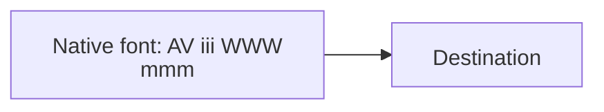

# Native font runtime checkpoint — 2026-11-22

This checkpoint covers the native font runtime at
`dbe6f4e03af8aaea5866d2ddffdc11a02df42aef`. It includes the ordered-family changes
from closed PR #337, direct macOS queries, selected-face snapshots, operation-local
selection identity, and Linux runtime-availability handling. It does not change
the CLI provider defaults or describe the already published v0.11.0 artifacts.

## Work and ownership

On macOS, platform discovery no longer constructs Fontique's full system catalog.
Core Text supplies descriptors for one requested family at a time; `fontdb` ranks
their style metadata in CSS order. Missing families do not silently consume a
later authored family. Character fallback uses the actual missing scalar and the
retained native base face, followed by its ordered native cascade. An unregistered
explicit font can use a generic cascade only when system fallback is authorized.

The adapter retains the selected Core Text face and serializes its tables into a
standalone SFNT with `write-fonts`. Original native identity and the admitted data
index are separate. With `N` installed font files, `K` selected faces, and `S`
selected table bytes, this removes Merman's application-owned discovery loop over
all `N` files. Merman acquires data for the selected faces instead of copying their
whole TTC containers. Family-local descriptor work and OS-owned index/cache work
remain; no constant-time claim is made for Core Text itself.

The cumulative admitted-data limit remains 64 MiB. Table serialization preserves
glyph IDs and shaping, variation, color, and unknown tables; only the invalidated
DSIG is omitted. Native framework allocations and table acquisition cannot be
preempted by that owned-data limit. In particular, reconstructing one face does
not make a large bitmap table small.

Successful primary and fallback selections are pinned for the operation and
copied into its export context, independently of the optional measurement cache.
Cold lookup, admission, and pinning are serialized within the operation. A new
operation resets dynamic state. Selection metadata has separate terminal limits
of 16,384 entries and 4 MiB; negative answers are not retained. Tests cover
replacement/deletion, aliases, disabled measurement caching, concurrent first use,
and measurement/painting identity.

This follows the separation used by [Skia's Core Text manager][skia-mac]: system
selection and selected-face data access have different owners. It preserves the
existing usvg shaping and raster/PDF chain; a new renderer fork was unnecessary
for this delivery. Skia's implementation also enumerates family names, so it is
not evidence that native services perform zero enumeration.

## Output qualification

The 19-case CLI corpus covers named and generic Latin, Sequence, CJK, rare Han,
Arabic, Devanagari, combining symbols, emoji, an unassigned scalar, explicit closed
fonts, PNG/JPEG/PDF, native and deterministic SVG, and raw SVG conversion.

Against the frozen #337 platform implementation, all 14 previously successful
outputs remain byte-identical. Two formerly failing cases now succeed under the
unchanged admitted-data limit:

| Input | Previous platform | Current platform | Current bounded |
| --- | --- | --- | --- |
| `Latin 中文 日本語 한글` | Font-data resource error | 720 × 150 PNG; Arial, PingFang SC, Apple SD Gothic Neo | 720 × 146 PNG; Arial, Apple SD Gothic Neo |
| `Latin 𠮷野家` | Font-data resource error | 720 × 120 PNG; Arial, PingFang SC | 720 × 112 PNG; Arial, STHeiti TC |

These are availability repairs, not equal-output speedup samples. Generic sans
and symbol fallback also differ between bounded and platform; their successful
platform output remains unchanged from #337. The native emoji, explicitly named
emoji, and native raw-SVG emoji cases still fail their font-data limit on both
revisions. The ordinary raw-SVG default uses a different legacy loading path and
is not evidence that the bounded native path supports those fonts.

Named Latin PNG/JPEG/PDF, the three primary timing inputs, deterministic SVG, and
explicit Cousine controls preserve their applicable byte-equality checks.
Deterministic Mermaid SVG still performs no native discovery. Resource-limit
controls retain terminal failures and empty stdout.

## macOS measurements

The host is an Apple M4 running macOS 27.0 build 26A428 on AC power. Rust is
1.100.0. The executable uses the locked `cli-release` descriptor and `dist`
profile, including the repository's existing usvg patch. Workspace owners and
vendored usvg were rebuilt in the shared target directory; Cargo artifact
messages verified their source paths and fresh compilation before the executable
was copied to an immutable experiment path.

The 66,188,368-byte executable has SHA-256
`745ca45ae773bb0536a137b683dbd472241b7b057ca2fb071772dec224ce0177`.
Its lockfile SHA-256 is
`dd5ba5d40b7405f064c6c2f1cdd922619681e307ac1d4b3779af2950458ba55d`.
The later CI-driven `url` 2.5.9 security update is outside this frozen timing
comparison. The recorded source revision and lockfile, rather than the current
branch head, reproduce these measurements.

The same executable runs with `--font-system=bounded` and
`--font-system=platform`. Measurements span fresh process startup through captured
stdout/stderr, with a warm filesystem and no font-cache flush. Each paired side
is the median of three sequential processes. The preregistered schedule uses two
warmups, eight independent A/A pairs per provider, then a power-sized fixed even
A/B schedule of 8–32 pairs in alternating order. The improvement margin is jointly
10% and 15 ms, with 10,000 bootstrap resamples and seed 336. Only equal-output
inputs qualify for this comparison.

| Primary input | Bounded median | Platform median | A/B pairs | Result |
| --- | ---: | ---: | ---: | --- |
| Tiny Flowchart PNG | 397.741 ms | 17.832 ms | 8 | Confirmed improvement |
| Small Flowchart PNG, Arial | 410.150 ms | 30.210 ms | 4 | Diagnostic; bounded A/A failed |
| SVG with explicit native measurement | 395.038 ms | 13.353 ms | 8 | Confirmed improvement |

The simultaneous intervals for elapsed-time reduction are 95.29–95.56% and
96.57–96.70% for the first and third rows, respectively. The second row's bounded
A/A absolute intervals extend to about 23 ms, outside the registered 15 ms noise
margin; its large observed difference does not override that qualification rule.
The native SVG row is explicitly opted into font discovery and is not the normal
deterministic SVG default.

A separate comparison keeps platform enabled in both executables. The baseline
binary has SHA-256
`d63f614ec633201343545423a8b6f096b85c7623e06d8f24ea204e3731909471`.
It was built at `2ce0fa4589f13c6c80c4e0be9d3292eedfbc4471` with recorded working
changes whose production inputs and lock match #337's final
`62a876a14868187338cde0d0622c2bfa3138afbc`; it is not a clean build of that latter
commit. The same Rust/toolchain recipe applies. This comparison registers a
stricter joint 10%/1 ms margin, independent eight-pair A/A calibration per side,
and eight fresh alternating A/B pairs, each the median of three new processes.

| Input | Previous platform median | Current platform median | Result |
| --- | ---: | ---: | --- |
| Generic sans-serif PNG | 34.338 ms | 17.211 ms | Inconclusive; A/A failed |
| Small Flowchart PNG, Arial | 46.976 ms | 30.136 ms | Confirmed improvement |
| Native SVG | 29.476 ms | 12.688 ms | Confirmed improvement |

An additional five-round diagnostic rotates bounded, platform, and a fixed
`/System/Library/Fonts/Supplemental/Arial.ttf` with `--font-system=off` on the same
Latin PNG. All output bytes match. `/usr/bin/time -l` records:

| Font source | Median elapsed time, including the time wrapper | Median process peak RSS |
| --- | ---: | ---: |
| Bounded system discovery | 402.268 ms | 456.828 MiB |
| Platform system discovery | 20.071 ms | 32.453 MiB |
| Explicit Arial, system off | 15.541 ms | 27.047 MiB |

This control supports attributing most of the bounded invocation cost to discovery
on this host. It does not isolate shaping time. Peak process RSS is not retained
font bytes, allocation traffic, or physical bytes read; these diagnostic samples
do not establish an allocation or cold-cache guarantee.

The PNG inputs use `flowchart_tiny.mmd` and `flowchart_small.mmd` from
`crates/merman/benches/fixtures/`; the latter prepends config with `fontFamily:
"Arial"` and `htmlLabels: false`. Render with `--format=png --scale=2
--svg-id=font-provider-probe --output=- --quiet` and the selected font-system flag.
The native SVG and Latin PNG control use:

For SVG select `--format=svg`, omit scale, and keep the same ID and explicit
font-system flag. Feed input on stdin and capture stdout to reproduce the measured
process boundary. These host-specific findings do not imply a speedup on every
font inventory or diagram size.

## Linux behavior and remaining work

Ubuntu 22.04.5 ARM64 in Lima verified the availability policy using the same
dynamic-loader result as Fontique. A CLI configured to default to platform
successfully retries bounded when `libfontconfig.so.1` is absent; automatic,
`on`, and explicit bounded produce identical PNG bytes in that environment.
Explicit platform returns the specific unavailable-service error with no output.
A valid empty Fontconfig configuration remains empty for automatic, `on`, and
platform: it does not trigger a directory-scan fallback. Explicit bounded still
means the user requested bounded discovery.

This increment does not replace Linux family matching or establish a new Linux
speedup. The [previous checkpoint](platform_font_query_2026-11-22.md) retains its
ordered-family file-access and latency evidence. Full Fontconfig matching must
preserve alias binding strength and authored-family precedence. The resolved
`yeslogic-fontconfig-sys` 6.0.1 binding lacks `FcPatternGetWithBinding` and a usable
`FcValue` union layout; fix and validate that binding before adding this route.
[Skia's Fontconfig manager][skia-fontconfig] is a reference for that alias policy,
not a reason to implement a second partial matcher.

## Verification and default policy

macOS passed 321 export tests including host contracts, 60 native-only tests,
90 bounded tests, and 29 CLI contracts. Linux passed 236 export unit tests,
11 host contracts, 29 CLI contracts, and the additional empty-configuration
regression. Windows targets cross-compiled; native Windows execution remains a
CI responsibility. Clippy, formatting, the feature matrix (46 descriptors,
57 builds), representative artifact dependency closures, and generated legal
reports and synchronization passed locally. Local cross-compilation does not
replace native CI or the Security Audit workflow.

Official Windows archives retain platform by default; macOS/Linux archives and
ordinary Cargo installs retain bounded. Platform-capable binaries can use
`--font-system=platform`; the capability-only `platform-system-font-query`
feature does not itself switch the default. A default change should assess
common-input success, font/geometry choices, resource behavior, and supported
artifact/OS coverage independently of whether every workload becomes faster.

Native non-default variation instances, large bitmap emoji data, and broader
cluster/language fallback context remain separate interface work. A published
usvg fork would need a single package identity across Merman, resvg, and
krilla-svg; the existing root patch does not propagate to ordinary crates.io
consumers. See [dependency policy](../DEPENDENCY_POLICY.md) and
[CLI font policy](../FEATURES.md#optional-cli-fonts).

Raw manifests, output hashes, samples, source receipts, and local verification
logs are under ignored
`target/bench/experiments/native-font-runtime-2026-11-22/`.

[skia-mac]: https://skia.googlesource.com/skia/+/026cef465735b4dfb51bfd64b748017e902d2a67/src/ports/SkFontMgr_mac_ct.cpp
[skia-fontconfig]: https://skia.googlesource.com/skia/+/026cef465735b4dfb51bfd64b748017e902d2a67/src/ports/SkFontMgr_fontconfig.cpp
