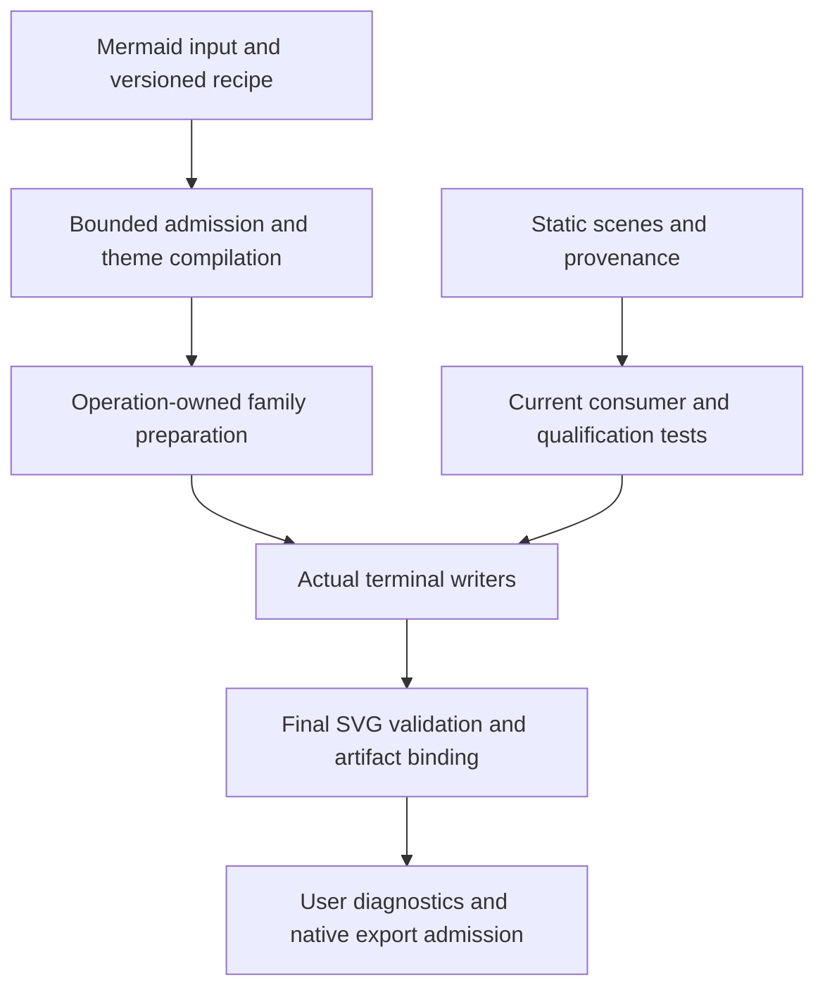

# Justify Theme Additions and Retire Remaining Debt

## Summary

Audit the entire theme PR by module, retain additions with current consumers and distinct
contracts, and remove obsolete migration machinery and demonstrated duplication. The
October 9 implementation removed the old visual readers and passed delivery verification,
but its blanket U5 completion statement overstated the retirement of generic cutover proofs.
This plan closes that gap and addresses further debt found in the full-module review.
The October 10 focused test review adds U9 before final reconciliation in U8; existing
unit IDs remain stable. Implementation stays within the maintainer-authorized refactor scope;
execution receipts are recorded separately from this plan.

**Reopened after code review at `a987774ff`.** The first implementation removed substantial
debt, but its module inventory and passing checks did not establish complete retirement.
The [remaining-code review](../performance/theme_remaining_code_review_2026-10-10.md)
traces additional dead construction paths, redundant receipt work and an exact-declaration
proof gap. U2, U4–U7 and U9 have further unimplemented work below; U8 cannot close the
overall plan until that work receives its own verification. Earlier receipts remain valid
only for their recorded revision and scope.

Implementation decisions and local verification for the reopened work are recorded in the
[remaining cleanup execution](../performance/theme_remaining_cleanup_execution_2026-10-10.md).
The subsequent eight-finding review and its implementation have a separate
[October 11 execution record](../performance/theme_followup_cleanup_execution_2026-10-11.md).
Neither receipt certifies all remaining code as minimal.

The frozen comparison is main `2928265122d5a3d35e239e3ddbce885c7e342c59` against
branch `8664ff06ea234da73c59de99fb12a76034e301d3`: 1,683 changed paths,
421,112 added text lines, 40,358 deleted text lines, and 104 binary paths.
The [module review](../performance/theme_pr_addition_necessity_review_2026-10-10.md)
accounts for this complete diff. A module with a necessary responsibility is not thereby
certified to have the smallest possible implementation.

---

## Goal Capsule

- **Objective:** Every changed module has an evidence-backed retain, simplify, retire, or
  unresolved disposition; demonstrated historical debt and duplicate algorithms are removed
  while user-visible theme and output contracts remain intact.
- **Means:** Trace real callers and independent invariants, delete complete obsolete ownership
  chains, share only algorithms with identical semantics, and verify changed consumers.
- **Authority:** Maintainer instructions, current public contracts and pinned Mermaid behavior,
  current consumer tests, then historical plans and evidence. Historical migration IDs do not
  define a current runtime requirement.
- **Stop conditions:** Do not silently change source precedence, recipe bytes, sharing versions,
  supported facets, resource/error ordering, SVG/native output, or proof integrity. Resolve
  any conflict explicitly; do not preserve an obsolete layer merely to satisfy its own tests.
- **Delivery:** Focused commits on the existing branch. No merge, release, or new public
  compatibility lane. No arbitrary source-line reduction or artifact-budget relaxation target.

---

## Product Contract

### Problem Frame

The PR delivers Mermaid-compatible theme inputs, structured authoring, presets, recipe exchange,
family-local presentation, and actual-output evidence across Rust and language bindings. Its
large diff also contains private historical catalogs, cutover models, repeated local algorithms,
test fixtures, generated interfaces, and dated records. Passing CI proves selected contracts;
it does not prove that every added helper or validation pass is necessary.

### Requirements

- R1. Account for all frozen changed paths and all added/deleted text lines exactly once in a
  primary module partition; keep test-only and binary classifications as separate views.
- R2. For each module, identify a current consumer, distinct user or engineering contract,
  evidence inspected, necessary/mixed/unresolved assessment, and retained uncertainty.
- R3. Remove generic historical projection/cutover execution, its exports, wiring, and self-tests;
  preserve actual-artifact integrity and the independent Architecture Text evidence.
- R4. Retain Mermaid input derivation, explicit-source precedence, look/layout, public
  support discovery, preset appearance, definition/complete-spec exchange, and published shares.
- R5. Retire self-consuming fixture catalog execution once static assets and source/license
  records have independent owners and every current consumer has migrated.
- R6. Reduce demonstrated local duplication and unreachable private success states without
  introducing a universal evidence framework, CSS engine, or speculative feature scaffolding.
- R7. Preserve cancellation, bounded allocation, final-output safety, unknown-input rejection,
  native filter/text/math integrity, terminal applicability, and exact-artifact receipt binding.
- R8. Report actual source deletions, additions, dependency changes, and matched runtime/artifact
  measurements separately. Do not convert candidate file sizes into promised savings.
- R9. Review unconfirmed modules to an explicit disposition during execution; new findings
  may join their owning unit. Do not claim that a bounded static audit excludes all other debt.
- R10. Simplify test implementation while preserving independent behavioral coverage. Retire
  obsolete phase assertions, avoid locking private storage choices, and strengthen weak output
  assertions. Measure source reduction separately from case coverage and execution cost.

### Acceptance Examples

- A Mermaid `themeVariables` input, equivalent preset, and exchanged structured recipe retain
  their existing precedence and SVG/native results after obsolete route types disappear.
- A source-owned text style still prevents an unrelated typed facet from claiming Applied;
  a missing writer branch or mutated artifact cannot acquire a valid receipt from its plan.
- Cyberpunk source scenes continue to drive renderer, facade, browser, installed language
  consumers, qualification, and benchmarks after the private catalog crate is retired.
- Invalid, oversized, duplicate-field, ambiguous-selector, and unsupported embedded-font
  inputs retain their current error ordering and resource behavior after decode simplification.
- Replacing an internal evidence index preserves identity, order, deduplication and writer
  completion tests without requiring a particular collection type.
- An incorrect source-derived color fails at the intended Sequence terminal even if the same
  color appears elsewhere in the SVG; its expected value is independent of runtime derivation.
- Removing a historical projection list does not remove current unsupported-rule, missing-writer,
  source-ownership or artifact-mutation rejection coverage.

### Scope Boundaries

Keep current source provenance, reference assets, licenses, supported host contracts and
published wire versions. This is not a redesign of the public theme schema, a font-feature
restoration, a promise of pixel equivalence across hosts, or a replacement layout engine.
Tests that observe different boundaries remain separate even when they use the same scene.

---

## Planning Contract

### Key Technical Decisions

- KTD1. **Full-diff accounting is independent of judgment.** Use the frozen Git diff with rename
  detection and binary separation. Changing to a no-renames view is diagnostic only; it must not
  replace the PR denominator. Modules include their tests unless a table explicitly says otherwise.
- KTD2. **Current routes have two runtime states.** After the generic historical consumers are
  removed, keep typed support and Unsupported. Prove the full current selector/facet/value domain
  and public support descriptors unchanged before dropping the legacy paint/exclusion dictionaries.
- KTD3. **Fixture data outlives obsolete fixture execution.** Move shared public scenes without
  altering bytes; retain pinned provenance/license records. A private Rust parser consumed only
  by its own tests is not required merely because historical source evidence is valuable.
- KTD4. **Share concrete local algorithms.** Flowchart bookkeeping, Sequence effect resolution,
  Kanban typography facts, single-title static fill, and inherited-font role counts are candidates
  with real repeated consumers. Preserve family-specific geometry, sources, and emission sealing.
- KTD5. **Admit once within one trust boundary.** Preserve raw JSON preflight before allocation,
  typed semantic validation, stricter-session re-admission, and final artifact validation as distinct
  checks. Remove only replay of the same invariant on the same immutable admitted value or bytes.
- KTD6. **Supported state determines private representation.** Embedded-font compilation currently
  ends in `EmbeddedFontsUnavailable`; the sole successful catalog is asset-free system fonts.
  Remove unreachable private success machinery while retaining readable wire types, explicit
  rejection and still-promised host/export contracts. Trace prepared-text callers before deletion.
- KTD7. **Writer evidence cannot be plan evidence.** For State and private SVG observation,
  prefer existing final traversal or actual emission facts over a second CSS/DOM interpretation
  layer. Never seal Applied solely from the expected plan. Retain an observation layer if its
  contract cannot be reproduced safely with a simpler owner.
- KTD8. **Keep behavioral fallbacks explicit.** GitGraph's BestEffort static-fill fallback actually
  executes. It is not a dead enum branch; characterize static/ordinal/source/strict outcomes and
  retain it as intentional behavior unless a separately reviewed semantic change is justified.
- KTD9. **Tests own independent behavior, not migration history or storage layout.** Share small
  local setup/observation algorithms, keeping explicit case IDs and independent expected values.
  Route admission, actual SVG emission, native pixels and transport are different boundaries.
  Do not generate all expectations from the production support matrix, canonical encoder or
  effective configuration. Do not build a universal test DSL or CSS interpreter to reduce LOC.

### High-Level Technical Design

The sketch names responsibility flow, not a required new class or API:

The historical projection catalog has no place in this current flow. Expected values and
actual output facts remain independently owned. Evidence follows prepare, emit, validate,
seal; failed or missing emission remains residual, and later mutation invalidates sealing.

### Deferred Technical Decisions

State's existing post-writer observer remains the default until a prototype preserves all
occurrence, HTML/source, special-shape, filtering and artifact-binding contracts. Compare reuse
of the final traversal against a narrow emission-owned observer during U7; do not commit an
untested replacement architecture now. Treemap's pre-allocation JSON budget cannot be replaced
by a counting serializer that runs only after constructing the expanded object.

---

## Implementation Units

### U1. Close module ownership and uncertain necessity assessments

- **Goal:** Satisfy R1, R2 and R9 before claiming global cleanup complete.
- **Files:** Entire frozen changed-path set; module review and dated completion records.
- **Approach:** Use the module partition as an index. Deepen unresolved fallback, graph-label,
  shape, prepared-text, native-filter, comparator and release-script surfaces. Record live callers,
  input/output facts and removal consequences; promote only demonstrated candidates to later units.
- **Verification:** All paths and binary assets assigned once; totals reconcile; uncertain
  assessments have explicit retain/simplify/retire decisions with a reason, not a blanket signoff.

### U2. Remove generic historical cutover proof and legacy runtime classification

- **Files:** `crates/merman-render/src/theme_route_cutover.rs`,
  `diagram_theme/family_mechanism_matrix.rs`, its `audit.rs`/`tests.rs`, `resolved.rs`,
  `family.rs`, `lib.rs`, affected family consumers and private API tests.
- **Approach:** Per KTD2 and R3, separate Architecture Text observations from old projection IDs;
  preserve the non-replayable current artifact assertion before removing the old route chain.
  Replace runtime third-state handling only after full-domain equivalence is established.
- **Test scenarios:** Current supported/unsupported cells and selector values agree; missing
  writers remain residual; altered/cross-document artifacts cannot reuse a receipt; public imports
  cannot access retired private types; Mermaid inputs retain their existing output.

- **Remaining code-review work:** Remove Core's production-inaccessible host/fallback overlay
  contribution graph and its test-only provenance. `Engine.post_detection_config_overlay`
  has no production setter; its only non-default construction is under `cfg(test)`.
  Preserve detector mutations and the GitGraph/ER paint-input ownership freeze through a small
  current owner. Do not remove raw source/site ownership or keyword-driven ELK selection.
  Also remove ER's never-written `ErRuleObservation.incomplete` field and unreachable branch.

### U3. Retire the private source catalog and migrate its live static assets

- **Files:** `crates/merman-theme-fixtures/`, workspace/lockfiles, `fixtures/themes/`, current
  qualification, tests/benches, Playground and Node/Apple/Python scene consumers.
- **Approach:** Per KTD3 and R5, verify no external catalog parser or generator owner remains.
  Move scene bytes to a stable fixture location, update all references, retain provenance/license
  evidence, then remove the private catalog, its alternate CSS/directive parser and lineage tests.
  Keep `merman-theme-authoring-fixtures` and current native qualification independent.
  The static owner must retain all 24 reference themes and 18 mechanism translations, pinned
  upstream paths/revisions/hashes, precedence and font provenance, MIT/OFL/NOTICE material,
  and explicit supported/residual mappings required by the original R38/R39. Preserve font bytes
  and attribution if retained. Update renderer/facade tests and benches, qualification include paths,
  Playground URLs, both Node smokes, Apple, Python and debug-tool readers before deleting the crate.
- **Test scenarios:** Same scene hashes and qualification outputs; real browser/language
  consumers still read scenes; authoring golden vectors unchanged; no dangling workspace/member
  dependency or license projection; reference assets remain attributable.

### U4. Converge retired font success state and immutable text validation

- **Files:** Renderer `diagram_theme/assets.rs`, `admission.rs`, `compiler.rs`, `environment.rs`,
  `text/prepared.rs`, `text/terminal_receipt.rs`, their actual consumers and current font docs.
- **Approach:** Per KTD6, distinguish readable exchange schema, callable public host contract,
  actual system-font rendering, and unreachable embedded success state. Remove only proven
  unreachable private machinery. Apply KTD5 to immutable ledger range replay only after checking
  all production and synthetic construction points.
- **Test scenarios:** Font/resource rejection order and host-dependent system typography remain
  stable; no false Portable claim; existing host contract compiles; modified artifact/face identity
  fails sealing; no new embedded-font capability is advertised.

- **Remaining code-review work:** `PreparedTextLayout` has no constructor, and every production
  session initializes its layout/error slots to `None`. Retire the remaining private candidate,
  backend-response, fallback and catalog preparation chain, including State/Flowchart catalog
  branches and the entirely inactive Sequence text sidecar. Simplify the catalog's permanently
  empty private maps/vectors and constant capability-inference branches. Keep callable public
  schema/report types where required, explicit unsupported-font rejection and error order.
  Normal host measurement, source-to-visible projection, ordinary prepared labels, math and
  exact-artifact binding remain independent live owners. Native export must still reject unknown
  prepared IDs or unexpected receipts after removing its unreachable asset-face success matcher.

### U5. Share demonstrated local theme and facade algorithms

- **Files:** Flowchart evidence; Sequence prepared/text effects; Kanban typography receipt;
  Treemap/Venn/ZenUML title plans; Cynefin/Wardley font facts;
  `crates/merman/src/render/document.rs` and their real consumers.
- **Approach:** Per KTD4, extract only identical rule resolution/accounting or final document
  sealing. Keep terminal-specific expected/actual facts distinct. Do not replace unrelated family
  interfaces with one generic renderer or evidence framework. Characterize GitGraph per KTD8.
- **Test scenarios:** First residual reason, source precedence, Clear/Rule/Binding semantics,
  role/CSS-surface counts, absent titles, source-owned titles, no-op and duplicate emissions,
  strict/BestEffort output and public/native document digests all retain their contracts.

- **Remaining code-review work:** Resolve Ishikawa's single Text style and winning fill once,
  outside its terminal loop; reuse the existing direct-static paint owner. With N visible labels
  and R family rules, the repeated winner search currently costs up to O(NR); the proposed
  preparation is O(N + R), without a whole-render speed claim. Carry a small Kanban run-summary
  value through writer emission instead of six primitive parameters; actual emitted facts must
  stay independent from expected facts. Evaluate a family-local GitGraph label/tag event iterator,
  retaining each receipt's own cursor and property checks. Simplify Venn's redundant stylesheet
  state, TreeView's unread icon counter and Timeline's equivalent palette counter. Remove the
  repeated series-shape check inside `ResolvedTokensV1::resolve` after admission has checked it.
  Consolidate the duplicate `share.externalThemeLimit` explanation in Playground's export menu;
  retain the limitation and make it visible once when a structured theme is selected.

### U6. Remove duplicate binding decode and unpublished share compatibility

- **Files:** `crates/merman-bindings-core/src/theme.rs`, `common.rs`, selection/wire consumers;
  `playground/src/lib/share.ts` and its tests.
- **Approach:** Per KTD5, retain bounded raw admission and decode one typed selector within that
  boundary. Eliminate repeated Value construction and union validation. Remove only the
  explicitly open-branch `renderViewportMode` compatibility, keeping published s2 and current s3.
- **Test scenarios:** Duplicate fields, unknown versions, null/omitted inputs, mutually exclusive
  selectors, encoded budgets, CLI and binding error parity; published shares and recipe round-trips
  remain valid. Compare decode allocations only with equal input and output.

- **Remaining code-review work:** Raw complete-spec validation currently constructs and discards
  `DiagramThemeSpecWireV1`, then the typed options path constructs it again. Carry the admitted
  payload to its normal decoding position rather than removing raw duplicate-key detection.
  Preserve version, union, layout/CSS and payload error precedence; do not substitute an incomplete
  hand-written duplicate-field/schema scanner for Serde.
  Evaluate Playground's fixed-Flowchart recipe-validation probe against an existing pure admission
  owner before adding any new public operation. Retain Flutter's raw options projection until an
  equivalent constructor/request boundary preserves duplicate fields and original byte budgets;
  the scanner's existence alone does not justify deletion or an unreviewed wire-contract change.

### U7. Bound artifact observation, comparator and budget implementations

- **Files:** State evidence and SVG writer; private `svg_artifact_receipts.rs`;
  `svg/pipeline/`; exporter native filter receipt; `xtask/src/svgdom.rs`;
  `crates/merman-core/src/diagrams/treemap.rs`.
- **Approach:** Per KTD5/KTD7, prototype only demonstrated duplicated interpretation. Keep
  actual artifact observation, pinned comparator semantics and pre-allocation resource limits.
  Validate unchanged SVG bytes once only when identity and validation facts are retained by an
  existing operation owner; external postprocessors remain separate trust boundaries.
  Keep unknown CSS outside any deliberately bounded observation grammar fail-closed.
- **Test scenarios:** State HTML overrides/special shapes/filtered occurrences; late mutations;
  unknown CSS/at-rules; native shadow primitive/region mismatch; painted root containment;
  comparator positive and negative cases; Treemap oversized nested input and cancellation before
  amplification. Retain the existing implementation if an alternative cannot preserve these facts.

- **Remaining code-review work:** Gantt/Journey/Requirement/ER/Block validate complete receipts
  before immutable storage, then repeat full checkpoint scans in per-rule/property queries.
  Validate once and let later queries use the admitted local facts. The supported static selector
  sets bound pending winners: this is repeated linear work, not a demonstrated unbounded quadratic
  defect. Remove `SvgArtifactReceipt::proves_artifact`'s redundant canonical rehash while retaining
  construction-time identity and target-artifact comparison. Gate Block's shell XML observer on
  actual paint-proof demand; preserve expectations for terminal bindings and independent writer
  geometry/count/typography/label checks. Register scoped work counters or matched measurements
  before claiming a performance benefit; preserve missing/duplicate/mutated writer rejection.

### U9. Simplify test ownership and improve independent output checks

- **Goal:** Satisfy R10 and KTD9 without reducing current user, resource or artifact guarantees.
- **Dependencies:** Retire historical tests together with their U2/U3 owners. Apply local test
  cleanup after the corresponding U4-U7 implementation settles; complete U9 before U8's final
  accounting. U9 does not require unrelated runtime simplifications to be accepted.
- **Files:** Renderer matrix and family tests; `diagram_theme/canonical.rs`; Sequence, State,
  GitGraph and other affected family integration tests; support discovery; directly affected
  facade/consumer tests. Expand only where the same concrete duplication is demonstrated.

#### U9.1. Establish coverage ownership before removal

Use a short before/after mapping in the relevant commit or review evidence: behavior, boundary,
old named test/case, retained named test/case, and reason for retirement or consolidation.
This is review evidence, not a generated manifest, parser or permanent coverage framework.
Count test functions separately from looped cases. Preserve feature-gated discovery and helpful
case/origin/property failure messages; moving a file does not count as source reduction.

| Boundary | Retained responsibility | Simplification rule |
| --- | --- | --- |
| Matrix/support | Current selector, facet and value admission; compiled consumer availability | Remove historical projection IDs and retired bridge phases with U2; keep independent current-domain expectations |
| Family operation | Required identity, order, deduplication, missing writer, cancellation and final artifact binding | Test observable outcomes rather than private Vec/set representation |
| Family SVG | Exact terminal paint, source precedence, typography/geometry and distinct look/shape branches | Share local execution and DOM observation; retain explicit independent case data |
| Native export | Actual pixels, transparent markers, filters, text/math and mutation rejection | Keep negative controls even when SVG attribute tests already pass |
| Public transport/browser | Exchange, admission/errors, packaging and actual page behavior | Avoid copying every inner visual combination into every wrapper; require concrete redundancy evidence before deleting |

#### U9.2. Retire historical and implementation-coupled assertions

- Matrix `legacy_replacing_typed_routes_are_derived_from_the_matrix` is about 1,813 lines;
  `qualified_cutover_routes_are_bounded_and_projection_local` adds about 482. Their roughly
  2,449-line historical neighborhood overlaps U2 and is not an additional savings estimate.
  Remove these lists with their old owner; do not preserve them as a shorter permanent table.
- `legacy_compatibility_stays_within_the_bridge_probe_domain` is subsumed by the current zero-legacy
  inventory while the old state exists. With U2's enum removal, retain real typed/unsupported and
  dispatch checks; do not replace removed logic with an always-empty function to satisfy a test.
- In `native_evidence_requirements_preserve_order_and_mixed_facet_ownership` and the adjacent
  empty/many-rules test, remove direct `required_index` layout assertions when behavior is covered.
  Keep required identities/order, mixed-facet deduplication, empty input, 512-rule coverage and
  initially-unapplied state. Rename stale `legacy_only` wording to the current typed behavior.
- Fixture catalog self-tests retire only after U3 migrates current scenes and provenance consumers.
  Keep original bytes, licenses, source hashes and real consumer qualification.

#### U9.3. Consolidate repeated execution without erasing distinct cases

- Sequence explicit-source and derived-source precedence tests contain approximately 602 lines
  together. Share compile/parse/session/render and evidence comparison where identical; keep
  origin, role, facet and ownership expectations explicit. Reuse one completed render for DOM
  and evidence checks of that same case.
- State already uses case tables; its roughly 447-line special-terminal test is not solved merely
  by another table. Share source construction and actual-terminal observation, retain named
  classic/neo/hand-drawn and inner/outer/composite cases, and split responsibilities where useful.
  Make SVG-only helpers avoid layout JSON serialization/deserialization when callers discard layout;
  geometry tests still obtain and validate layout through the appropriate owner.
- GitGraph unsupported-font tests share an execution algorithm. Retain fill-only, stroke-only and
  fill-plus-stroke, source ownership, actual terminal checks and both Strict/BestEffort outcomes.
  These modes require their own operations; one result cannot prove the other.
- Canonical recipe field-sensitivity tests reuse baseline construction and named changes instead
  of repeating complete left/right builders. Keep every intentional field case plus ordering,
  negative zero, schema/resource identity checks; never derive expected identity using a copied encoder.
- Apply the same rule to support discovery only where repeated mechanics are proven; do not infer
  that long case data is redundant or mechanically enumerate every possible cross-product.

#### U9.4. Strengthen assertions and verify coverage preservation

Sequence derived-source tests currently read expected color from `effective_config` and use broad
SVG `contains` checks. Add independent expected source-derived values for the affected cases and
check the exact terminal/property. Validate configuration derivation separately where it is itself
under test. Preserve known source-owned partial surfaces; do not invent a universal CSS cascade.

**Verification scenarios:** A wrong derived color must fail; a correct color on the wrong terminal
must fail; a missing writer must remain residual; an unsupported font must not become certified by
an applied fill; changing an internal index must not break behavior-only tests; every retained
fingerprint field change must change identity. Use existing parsing/DOM helpers and focused negative
controls where practical, without a mutation-testing framework or broad new visual snapshots.

Run affected existing locked nextest owners serially with the required feature combinations,
then existing change-scoped CI checks. Record retained/retired cases and actual source changes.
Default/private/release jobs are not redundant merely because their test names overlap: first
identify the feature, optimization or trust-boundary contract. Any CI narrowing needs separate
concrete equivalence evidence. Measure matched test workloads before claiming runtime improvement;
no timing or allocation benefit has yet been established by this static review.

#### U9.5. Remaining test-review work

Consolidate the three Flowchart unsupported node-geometry tests at family test lines
1931, 2076 and 2255 in the reviewed revision: three patches, two source surfaces and two
portability modes remain distinct executions. Preserve their exact residual/error expectations.
Remove only the radius-8/choice-node case from the later unsupported-style test at line 4961:
it repeats the same source, patch and both portability outcomes from line 2255. Keep the later
mixed gradient/stroke case, which checks a distinct combination.
Merge the two State gradient cases at lines 8117 and 8676: move the former's Unverified and
empty-source-residual assertions to the latter, keeping its Strict pre-layout rejection. This
removes one duplicate BestEffort render without losing an asserted contract.
Share local execution mechanics for Flowchart/Swimlane ordinal-palette cases (5044/5095) and
Sequence Activation/Note source precedence (7064/7132), retaining both actual consumers and
their family/target-specific assertions; do not count this as fewer behavioral cases.
Fix Sequence's exact-writer proof to count every matching property in a rule rather than
`declaration()`'s last match. Add a same-rule duplicate-property counterexample, including an
earlier `!important` value; the existing test only duplicates the entire rule. Keep native PNG
checks separate. Replace whole-SVG `<path` assertions in compiled math tests at lines
10553, 10739 and 10869 with nonempty-geometry checks inside each prepared-native math subtree.
Keep terminal/semantic occurrence checks; add a negative control with empty math groups and
unrelated surviving paths. This review has not read every integration test body; remaining limits
are explicit in the linked review and must not be described as globally minimal.
Strengthen Swimlane's math reuse test at line 10015 with a backend call counter: SVG emission
must not increase the count recorded after preparation. Constant backend HTML alone cannot
prove reuse; preserve its current sidecar and output assertions.

### U8. Reconcile tests, documentation and final cost evidence

- **Files:** Affected test owners; docs archive/index/current guides; prior completion claims;
  performance reports and generated dependency/license projections.
- **Approach:** Reconcile U9's retained/retired cases and actual test-source changes. Remove tests
  only with their obsolete owner or a proved equivalent current assertion. Split family tests
  by responsibility if it improves ownership without adding a framework. Correct overbroad completion claims and dependency-cost explanations. Report the
  actual final diff by module; keep historical receipts bound to their original source revisions.
- **Verification:** Retained current consumer gates pass serially; affected remote owner jobs
  pass at the shipped source. Rebuild changed artifacts with the existing canonical recipes and
  fixed budgets; measure claimed latency/allocation improvements rather than infer them from LOC.

---

## Verification Contract

Use existing owners in `.github/workflows/ci.yml`, `docs/development/CI.md` and the project PR
skill. Do not create another release/acceptance framework for this cleanup.

| Surface | Owner and required evidence |
| --- | --- |
| Matrix and local algorithms | Serial locked nextest of affected renderer modules and real family SVG consumers; fmt and change-scoped strict clippy |
| Fixture retirement | Current source hashes/license attribution, qualification SVG/PNG, changed real Rust/browser/installed language consumers |
| JSON/share boundaries | Bindings raw/schema/error/resource cases, public facade/CLI consumers, published share vectors and browser interaction |
| Writer/observer/export | Full blocking SVG structure/parity/parity-root owner, root containment, native filters/text/math and optimized evidence rejection |
| Feature/dependency changes | Existing feature and dependency-closure owners, external public/private import boundary, generated legal freshness |
| Cost claims | Equal-feature matched revision measurements and A/A calibration; canonical native/Web/Typst artifact recipes with unchanged budgets |
| Test refactoring | U9 behavior/boundary mapping, independent terminal expectations, preserved named cases and feature-gated discovery; matched timing only for claimed speedups |
| Documentation/accounting | Relative links, accurate source identities, disjoint module totals and candidate-vs-actual deletion distinction |

Do not claim the already-passing CI at `3a2a2de46` verifies implementation changes from this plan.
No tests or runtime measurements are performed merely to produce this planning document.

---

## Definition of Done

- Every frozen module has an explicit, evidenced disposition; unresolved entries are closed
  by a technical decision or an explicitly retained current contract.
- Old generic projection models and production LegacyCompatibility state have no live caller
  or export; Mermaid input compatibility and Architecture Text/current artifact evidence survive.
- The catalog crate is retired or a concrete independent owner justifies retention; its static
  scenes, reference provenance and licenses remain available to all current consumers.
- Unreachable private font success paths and repeated local/decode algorithms are removed where
  proven; retained public host contracts are documented honestly as supported or unavailable.
- Changed contracts pass their real owner checks and affected remote delivery gates; test deletion
  does not lower current user, security, resource or non-replayable artifact guarantees.
- Test cleanup removes obsolete phase/representation constraints and demonstrated duplication,
  preserves independent output and boundary coverage, and reports source size separately from
  case count and measured execution cost. No blanket claim that all remaining tests are minimal.
- Completion reports distinguish actual deleted lines, retained necessary modules, unresolved
  measurement lanes, dependency changes and verified artifact sizes. No arbitrary reduction target
  or positive performance claim substitutes for evidence.
