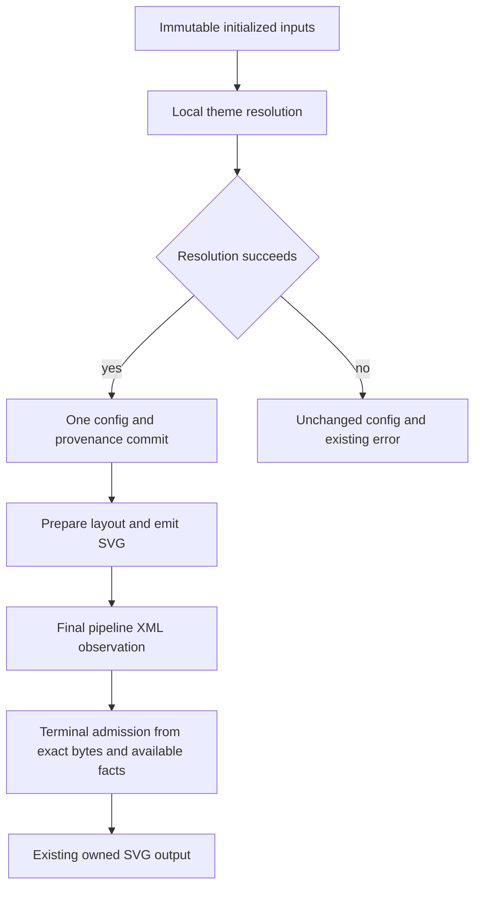

# SVG Owned Preparation and CLI Startup - Plan

## Goal Capsule

- Objective: reduce avoidable work in ordinary SVG rendering and full CLI startup while preserving existing output, error, capability and resource contracts.
- Means: repair theme calculation ownership, transfer exact-byte SVG validation facts through existing artifacts, and test optional Windows DLL delay-loading independently.
- Authority: the maintainer approved the researched directions and requested a goal-backed implementation with isolated branches.
- Completion: each direction has a reproducible disposition, and at least one retained implementation passes correctness/review and proves reduced owned work or an admitted complete-operation improvement.
- Stop condition: stop a candidate if it changes semantics, exposes a new public policy, fails correctness or cannot demonstrate reduced owned work; do not expand it into a new framework to force a result.
- Delivery: reviewable local diffs and a dated execution report. Commits require maintainer confirmation; release publication and merge are separate actions.

## Product Contract

### Summary

Default SVG generation does not run PNG encoding or discover the system font catalog.
Improve work that the real SVG operation performs, with distinct evidence for a reused renderer and a fresh CLI process.

### Problem Frame

The current Windows CLI pays tens of milliseconds for process launch and publication, whereas small native diagrams render in less than a millisecond.
The frozen theme ownership branch adds configuration copying and terminal work that merits an ownership repair.
One generic cache or an across-the-board fast mode would mix different lifetimes and weaken contracts rather than solve these costs.

### Requirements

**Behavior**

- R1. Preserve exact SVG/configuration results, authored and detector ownership, error ordering, cancellation and resource admission for every retained optimization.
- R2. Preserve the full CLI capability recipe and platform DNS/certificate behavior in startup experiments.
- R3. Keep the main CLI baseline and the frozen theme-branch renderer baseline distinct.

**Evidence and scope**

- R4. Give each causal candidate its own disposition, raw evidence and public-operation controls.
- R5. Prove structural reductions with exact work/allocation observations; claim latency improvements only after the repository's calibrated complete-operation acceptance procedure.
- R6. Build serially and exclude compilation/profiling from timing; retain existing ordinary CI ownership without adding broad timing gates.
- R7. Preserve unrelated workspace files and keep changes on isolated feature branches.
- R8. Keep caches, persistent protocols and file-publication policy changes outside the first implementation unless the selected repairs prove they are necessary.

### Scope Boundaries

Implement private core/render ownership repairs and a full-capability Windows linker experiment.
Preserve public method and CLI option contracts.
Do not change fonts, themes, trust roots, supported diagrams, default publication durability, resource limits or comparator normalization to obtain a speedup.

Deferred follow-up: finite initialization-owned theme reuse, static dependency indexing after attribution, persistent editor protocols, and publication-stage APIs.
These require independent memory/lifecycle or error-contract decisions and are not prerequisites for this goal.

## Planning Contract

### Key Technical Decisions

- KTD1. Use three independent owner changes instead of one shared optimization framework (session-settled: user-approved — chosen over a generic cache/daemon: the researched costs have different lifetimes). Governs R3, R4, R8.
- KTD2. Resolve theme variables and executed provenance locally, then commit only after all fallible work succeeds. This replaces the extra whole-config transaction rather than adding a parallel calculation path. Governs R1, R5.
- KTD3. Preserve the existing SVG artifact types and transfer their private exact-byte facts. Start at adjacent final-check/terminal stages before retaining facts across callbacks. Governs R1, R4.
- KTD4. Any retained SVG observation is optional: exceeding its internal retention bound falls back to existing terminal scanning and does not introduce an earlier admission error. Governs R1.
- KTD5. Test Windows delay imports using the same feature/source/profile/CRT recipe. Only retain a narrowly scoped build setting after actual capability/error checks and complete-operation evidence. The standard MSVC helper is preferred over a custom loader. Governs R2, R5.
- KTD6. No clean-revision latency admission can be claimed from an uncommitted candidate. Before commit authorization, report work reductions and diagnostics with source/patch hashes. Governs R4, R5, R7.

### High-Level Technical Design

CLI process loading is an independent experiment before this render lifecycle.
Input detection still observes initialized global config before scoped appearance is selected.
Host callbacks and byte mutations invalidate relevant SVG facts; terminal budget/error decisions keep their current order.

### Baselines and Assumptions

Main is `3a4b8c393939b69372a8f05a2b971f7cdf6ae529`.
Theme PR #178 is `f47abded02b540d7fe563af7bc75f2fa1bb90c51` and remains an open independent branch.
Core/render candidates branch from the latter without editing or pushing the upstream branch.
CLI experiments use the existing main-based performance branch and frozen full CLI artifact.

Existing evidence is diagnostic: small Class SVG bytes match but theme-branch end-to-end cost is greater; five other SVG outputs differ.
Existing Criterion `end_to_end` omits an explicit pipeline, whereas the CLI explicitly requests parity.
A new explicit-parity attribution surface, if needed, stays a small public-operation benchmark and is identical on both measured sides.

## Implementation Units

### U1. Pure theme resolution and exact provenance guard

**Requirements:** R1, R3-R5, R7. **Dependencies:** none.

**Files:** `crates/merman-core/src/theme.rs`, `crates/merman-core/src/config/mod.rs`; existing tests in those files and `crates/merman-core/src/parse_pipeline.rs`.

**Approach:** follow KTD2; preserve the staged-versus-legacy distinction, default constructor behavior and executed ownership ordering. Use an owner-defined predicate for the exact domain where provenance propagation has no possible observable effect. Do not bypass value calculation or detection.

**Execution note:** characterize true extended-legacy late failure before replacing the transactional path.

**Test scenarios:**

- A late invalid `cScale2` on `neo-dark` or `redux-dark` returns the existing error and preserves complete JSON plus compatibility ownership.
- Default/redux-color values and SVGs remain identical with no overrides and with authored theme-variable overrides.
- Empty explicit ownership plus absent compatibility binding produces the same result with less provenance work.
- Explicit equal-value detector assignments, transferred ownership, null normalization and transitive derived owners retain their current results.
- Source-selects-same-theme, string `"null"`, JSON null, scoped selection and nested/canceled detector operations retain their current contracts.

**Verification:** focused core nextest and existing oracle/ownership tests pass; test-only counters prove fewer complete JSON copies or eliminated empty-owner work; complete-operation controls use class/flow/sequence tiny and mindmap.

### U2. Terminal SVG ownership and adjacent fact reuse

**Requirements:** R1, R3-R5, R7. **Dependencies:** none; disjoint files from U1.

**Files:** `crates/merman-render/src/svg/pipeline/mod.rs`, `crates/merman-render/src/svg/pipeline/standalone.rs`, `crates/merman-render/src/svg/pipeline/final_validation.rs`, and only necessary private `family.rs` transfer points; tests remain in these files.

**Approach:** first consume terminal validation and move owned fields into its finalization report. Then follow KTD3/KTD4 for adjacent-stage facts. Keep raw and resource digests distinct; do not invent a new identity encoding or public certificate type.

**Test scenarios:**

- Explicit parity unchanged bytes transfer already-validated facts with fewer lexical traversals and the same terminal budget results.
- Omitted-pipeline, readable, resvg-safe and portability-required outputs retain their own validation scopes.
- A custom processor that changes bytes invalidates facts; an equal-byte processor retains existing text/math evidence rules.
- Long ids/hrefs before a shrinking callback do not create an earlier resource rejection.
- Malformed XML, duplicate attributes/namespaces, cyclic/duplicate-id use graphs, marker expansion and raw/expanded budget limits preserve errors and their order.
- Cancellation at existing checkpoints and math/resource/reserved-token precedence remain unchanged.

**Verification:** focused render nextest, single-traversal differential tests and public renderer controls pass; terminal field copies or complete lexical traversals are reduced. If reuse needs broad representation or error-order redesign, retain only the proven ownership repair and record the remaining direction as inconclusive.

### U3. Full Windows CLI delay-load experiment

**Requirements:** R2-R7. **Dependencies:** none; root-owned serialized build.

**Files:** existing `crates/merman-cli/Cargo.toml` and an existing/new CLI build setting only if admitted; relevant `crates/merman-cli/tests` contracts; experiment records under ignored `target/bench/experiments`.

**Approach:** compare frozen full CLI binaries changing only final-link import policy for OLEAUT32, CRYPT32 and IPHLPAPI. Inspect actual PE delay imports. No production build-setting change is required to complete a rejected or inconclusive experiment.

**Execution note:** smoke metadata/output/capabilities and actual import-dependent behavior before timing.

**Test scenarios:**

- Plain SVG/version/help preserve bytes, exit and diagnostics.
- Actual system DNS and platform TLS verification still accept valid content and reject unknown CA/hostname or disallowed network inputs.
- Explicit fonts and PNG/PDF remain capability controls, separate from SVG latency.
- Concurrent first network use has no import-init race or changed failure envelope.
- Non-Windows profiles remain unchanged; unsupported local architectures are recorded rather than claimed tested.

**Verification:** registered complete-operation latency screen/confirmation, PE facts and capability/error checks support the final disposition. A tiny control's 2.6-3.2 ms savings are not full CLI admission. If full startup benefit is below the registered materiality threshold, retain no production loader setting.

### U4. Integration validation and evidence report

**Requirements:** R1-R8. **Dependencies:** U1-U3 dispositions.

**Files:** `docs/performance/PERF_PLAN.md`, a dated `docs/performance` outcome report; existing affected tests, artifact-profile and workflow authorities remain owners.

**Approach:** verify U1 and U2 independently before combined controls; expose every intentionally deferred platform/clean-commit gate. Independent reviewers challenge semantics, complexity, contracts and claimed benefits.

**Test scenarios:**

- Full feature combination and representative no-default leaves compile without altering public API/capability descriptors.
- The full SVG structure comparison has no candidate-introduced difference; known baseline failures are reproduced and attributed rather than hidden.
- Combined candidate preserves exact cross-family public outputs and resource/error outcomes.
- Retained work reduction remains present without diagnostic instrumentation in latency runs.

**Verification:** applicable gates pass, reviewers' actionable findings are resolved, raw artifacts have manifests, and the final report separates structural evidence, diagnostic numbers and admitted latency claims.

## Verification Contract

| Surface | Owner evidence | Done signal |
| --- | --- | --- |
| Rust changes | Scoped locked nextest; `cargo fmt --all -- --check`; production-feature Clippy | No candidate-induced failures |
| Core theme | Existing theme release oracle and ownership tests; exact COW/provenance counters | Values/errors/provenance equal and owned work reduced |
| SVG | Pipeline differential/resource/cancellation tests; full `compare-all-svgs --check-dom --dom-mode structure --dom-decimals 3 --diagnostic-browser-text-layout` | Candidate parity passes or any pre-existing failure is independently reproduced and reported |
| Features | Default and relevant no-default render/core feature checks | No new feature or dependency/API contract drift |
| Native timing | Frozen same-harness/fixture/feature executable pairs, reversed diagnostics; calibrated A/A and at least eight power-sized AB/BA pairs for admission | Only justified claim class retained |
| Fresh CLI | Full recipe, identical output/capabilities and import-dependent controls | Kept/rejected/inconclusive matches complete-operation evidence |
| Hygiene | Diff/path checks and precise file inventory | Unrelated files untouched |

The native default materiality gate is joint >10% and >50 us, or the repository's preregistered low-latency model when appropriate.
The fresh CLI screen uses the previously registered joint >10% and >1 ms gate.
Never reinterpret an inconclusive sample as acceptance or remove functionality to pass either gate.
Structural copy/traversal reductions are reported separately from wall-clock latency.

## Definition of Done

All three directions have explicit dispositions and retained implementations satisfy R1-R7.
At least one retained implementation demonstrates reduced actual owned work or passes the registered complete-operation latency admission.
If all candidates are rejected or inconclusive, the bounded investigation is finished but the performance goal remains unachieved.
The plan, source diffs, evidence and independent review are sufficient for maintainer review without another discovery pass.
No goal completion is inferred merely from finishing a build or spending an experiment budget.
Deferred work remains documented and does not prevent completion of the bounded U1-U4 scope.

## Appendix

Source decisions: `docs/performance/SVG_REFACTOR_DIRECTIONS_2026-10-13.md`, `docs/performance/CLI_STARTUP_INVESTIGATION_2026-10-13.md`, `docs/performance/BENCHMARKING.md`, `docs/performance/RUNBOOK.md`, `.agents/skills/optimize-merman-performance/SKILL.md`, `.agents/skills/contribute-merman-pr/SKILL.md`.
The selected Windows mechanism follows [MSVC delay-load documentation](https://learn.microsoft.com/en-us/cpp/build/reference/linker-support-for-delay-loaded-dlls?view=msvc-170), including first-call failure and initialization limitations.
