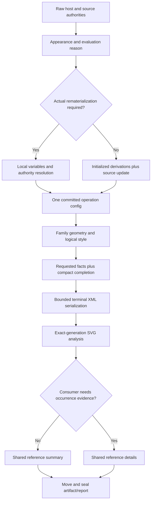
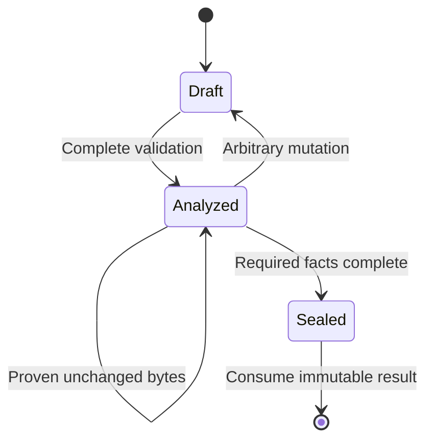

# Native Theme Regression Repair - Plan

## Goal Capsule

**Objective:** Native diagram consumers receive correct theme/configuration behavior and SVGs without the avoidable work identified by the main-versus-branch investigation.

**Means:** Repair selection and output boundaries first, then simplify configuration, family evidence and final SVG ownership at their existing owners (KTD1–KTD6).

**Authority:** The maintainer's request, pinned Mermaid 12.1.0 semantics and existing operation/resource/consumer contracts govern the repair.
The measured main revision is a performance control, not a universal correctness oracle.

**Subsequent baseline decision (2026-10-14):** After the frozen repair and measurements, the
maintainer selected current main and authorized merging it first. That separate integration uses
main's admitted Mermaid 12.2 graph; see the [integration report](../performance/native_theme_main_integration_2026-10-14.md).
The fixed 12.1 repair cohort and its measurements below remain historical evidence. This decision
does not substitute new outputs for the frozen experiment or change its performance conclusions.

**Execution:** Continue on `refactor/theme-ownership-performance` from audited `f47abded02b540d7fe563af7bc75f2fa1bb90c51`.
The maintainer authorizes deep subagent investigation, refactoring and cleanup of every high-confidence finding.
Use exclusive file ownership for implementation workers; the integration owner runs Cargo serially and preserves unrelated edits.
Implementation and verification continue after this plan's review without another scope-approval step.
Update the existing PR only with verified, intentional changes; merging and publishing are separate actions.

**Stop conditions:** Reject a candidate that weakens R3–R5 or manufactures output equality or performance admission.
A rejected candidate does not end the repair: retain its evidence and choose a correct alternative.

---

## Product Contract

### Summary

Fix the confirmed semantic and XML/cascade/geometry defects, retire output metadata whose consumer was deleted, and remove demonstrated repeated work without deleting required validation or terminal integrity.
Close every finding in the immutable [inventory](../workstreams/native-theme-regression-20261014/issues.json) against implementation and verification evidence.

### Problem Frame

The [native benchmark](../performance/native_main_theme_2026-10-13.md) confirms nine same-output regressions versus clean main `3a4b8c393939b69372a8f05a2b971f7cdf6ae529`.
All nineteen exact-output discovery cases are slower; nineteen other cases change SVG bytes.
A seven-agent source investigation, exact SVG/model/layout dump and public native/pinned Mermaid/Chromium probes found correctness defects beyond the measured default fixtures.
For example, legal `A&B` fonts fail XML validation in 28 of 38 fixture variants, and scoped theme switches calculate derived colors before merging source variables.
Existing October ownership and repair checkpoints do not prove these new workloads correct or allocation-free.

### Requirements

**Correct behavior**

- R1. Resolve appearance and rematerialization according to pinned Mermaid's actual selected-theme transition, root source directive truthiness and `theme: "null"` sentinel behavior; preserve ordinary source updates to initialized derivations.
- R2. Serialize logical CSS exactly once as SVG XML character data, preserving legal font names and actual computed CSS values across every admitted family.
- R3. Preserve authored paint/typography precedence, correct palette behavior, source-backed geometry, unique generated DOM identities and local references; retain existing correct repairs when fixing variants.

**Operation and public contracts**

- R4. Preserve XML error precedence, namespace/reference semantics, user resource budgets, saturating effect amplification, first terminal error, cancellation and deadline behavior.
- R5. Preserve exact-artifact identities, current public admission statuses, source/typed ownership and Class/other-family terminal uniqueness/completeness; same counts alone cannot certify completeness.
- R6. Keep unmerged theme version domains at V1 and reject unknown versions; do not add new migrations, compatibility providers, global caches, dependencies or feature reductions to obtain a speedup.

**Scope and evidence**

- R7. Repair or correctly simplify all N01–N25 high-confidence findings; investigate implementation discoveries to the same confidence bar and never silently drop an inventory item.
- R8. Classify all nineteen output-different fixtures individually, retain intentional correct changes and remove only proven retired metadata.
- R9. Demonstrate repeated-work reductions with owner-local evidence and compare performance using frozen same-input/capability lanes; never infer exclusive time from inclusive CPU stacks or stage subtraction.
- R10. Maintain a portable repair plan and durable closeout linked to raw evidence, adjacent implementation commits, tests and the existing PR.

### Acceptance Examples

- AE1. Covers R1: default Flowchart plus source `primaryColor=#123456` calculates Redux node background `#123456`; initialized global Base plus ordinary source color retains initialized derived backgrounds.
- AE2. Covers R1: source `flowchart.theme=base` matching initialized Base retains derived values; truthy root `theme=base` and root unknown-theme fallback recalculate, whereas false and string `null` retain their documented semantics.
- AE3. Covers R2, R4: typed font `A&B` renders valid XML and decoded CSS retains `A&B`; exact byte limits count emitted entities, and cancellation remains effective.
- AE4. Covers R3: non-palette Neo Swimlane respects `clusterBorder`, while palette lanes keep their upstream palette colors.
- AE5. Covers R3: Block node stroke widths 4 and 0 survive the CSS cascade; Neo square padding is X16/Y12 independent of classic padding; round radius 12 applies and numeric zero retains upstream's truthy fallback.
- AE6. Covers R5: Class output missing A and duplicating B fails completeness even when terminal totals match; valid namespace emission reordering remains accepted.

### Scope Boundaries

All native theme/configuration, family rendering, terminal SVG validation and directly affected consumers are in scope.
The original Mermaid baseline and existing published ABI contract remain fixed.
The October 6 ownership plan and October 13 final-review repair remain historical evidence; this plan is a new follow-up, not a rewrite of their checkpoints.

Considered and not built:

- Engine/global theme-result caching: complete source/detector/ownership keys are not established, and local consuming transactions address confirmed work first.
- A grammar-aware renderer or a generic proof registry: the current raw writer cannot certify XML/reference closure; migrating every producer is unjustified for these findings.
- SHA domain changes or replacing one digest with another: artifact and resource digests intentionally differ.
- Family/size/theme-name shortcuts, reduced limits and comparator normalization that hides semantics: these violate R3–R5.
- New routine CI timing gates, new diagrams or baseline upgrades: they do not close the identified repair.

### Success Criteria

Every N-ID has a truthful closure disposition with tests or exact structural work evidence.
Correctness repairs are characterized before implementation where feasible.
The final same-output native lane confirms non-regression against an adjacent repaired control, and reports the remaining difference from main without changing the original gate or hiding changed-output families.
Structural simplifications may close their inventory items without a latency win; a retained mandatory contract cost is reported separately from avoidable work.
An item whose proposed implementation fails its proof requires a different repair, not a waived closure.

---

## Planning Contract

### Key Technical Decisions

- KTD1. **Selection reason and authored ownership are distinct.** Trace pinned `updateCurrentConfig` / `themeWasOverridden` behavior rather than using appearance winner origin as an evaluation predicate (R1).
Merge allowed raw source variables before a real rematerialization; leave inherited initialized updates alone.
- KTD2. **Keep CSS logical until its terminal XML owner.** Deepen the existing small Mindmap XML-text adapter into a bounded reusable writer and migrate early XML escaping in CSS producers (R2).
Do not pre-encode `PreparedCommonCss`, measurement strings or receipt values.
Preserve valid quote bytes where possible; detect split `]]>` and validate the same forbidden XML characters as the finalizer.
- KTD3. **Prefer consuming local transactions over caches.** Default/Extended calculate local variable and ownership results before one successful commit, following the existing staged resolution pattern (R1, R5, R6).
Equal JSON assignments may avoid detaching values only after all authority/mutation bookkeeping is preserved.
An ownership-only pass may be omitted only when its owner proves there are no explicit/compatibility authorities to propagate.
- KTD4. **Make evidence consumer-bound, not absent.** Class keeps compact canonical-slot completion checks and immediate terminal-value checks; additional records follow the union of actual paint, Text/TaskLabel, typography and residual consumers (R3, R5).
Use existing family-local identities and collectors instead of a universal evidence framework.
- KTD5. **One reference algorithm, two result needs.** Ordinary admission needs summary expansion/depth metrics; strict/text/native consumers may require detailed occurrence evidence (R4, R5).
Keep cycle, duplicate-ID candidate union, effect/marker charging, saturation and cancellation in the shared owner.
A reference-free shortcut is allowed only from fully validated semantic collector facts.
- KTD6. **Carry exact-generation facts through private consuming boundaries.** Move owned terminal/style evidence at seal, and retain valid structural proof through no-op explicit pipelines (R4, R5).
Arbitrary mutation invalidates the exact-generation proof; borrowed `Cow` alone proves nothing.
Different digest definitions and source/typed receipts retain their distinct contracts.
- KTD7. **Measure correctness repairs and ownership candidates separately.** Refresh corrected-output identities before candidate confirmation (R8, R9).
For unchanged default fixtures retain the existing corpus and native lane.
Changed output is coverage and correctness evidence until a comparable lane is explicitly defined; it is not discarded from the report.

### High-Level Technical Design

These diagrams describe private ownership, not a new public state machine or permission to skip required final facts.

### Sequencing and Alternatives

U1 and U2 establish correct theme and XML boundaries; U3 and U4 repair family variants and retire proven dead output.
Freeze a clean corrected checkpoint before ownership measurements.
Then U5–U8 remove demonstrated work in independently reviewable units, followed by U9 integration and confirmation.
Shared files, especially `family.rs`, CSS producers and Class emitters, have one owner at a time even when units are developed concurrently.

A reset to main would undo the correct same-global theme behavior, Venn typography, Swimlane palettes, Block classic geometry and collision-resistant IDs.
A broad cache or writer rewrite would add invalidation and grammar responsibilities before confirmed local waste is removed.
Neither alternative is selected.

### Evidence and Unverified Hypotheses

The [root-cause checkpoint](../performance/native_theme_root_cause_2026-10-14.md) owns the issue and fixture evidence.
Raw investigation artifacts remain under `target/bench/experiments/native-main-comparison-20261013/analysis` and `svg-output`.
The invalid 64/65 source-color probes are rejected evidence: generated directive filtering strips `cScale12` and above, so their proposed positive expectation was wrong.
Do not turn them into a passing test by bypassing filtering.

Late cancellation after facade digest work and deep XHTML recursion remain unproved risks.
U8/U6 may add deterministic focused probes while working at those owners; create a repair item only if an existing contract fails.
Digest traversal coalescing and immutable coverage-summary caching remain measured candidates, not promised mandatory speedups.

---

## Implementation Units

### U1. Repair theme evaluation reasons and source merge order

**Goal:** Close N01 with source-backed selection semantics and errors.
**Requirements:** R1, R3–R5; AE1, AE2.
**Dependencies:** none.
**Files:** `crates/merman-core/src/config/appearance.rs`, `crates/merman-core/src/parse_pipeline.rs`, `crates/merman-core/src/theme.rs`, `crates/merman-core/src/tests/misc.rs`, `crates/merman-core/src/tests/detect.rs`, `crates/merman/tests/diagram_theme_layering.rs`.
**Approach:** Replace the overloaded source-selection boolean with evaluation reasons supported by pinned Mermaid.
Preserve secure filtering, detector reads/replay, explicit same-value ownership and null sentinels.
Characterize the existing three-way probes as focused core/facade regressions before changing the branch.
**Test scenarios:**

- Covers AE1/AE2: both scoped transitions, unchanged global theme, scoped same-theme source, root same theme, root unknown truthy fallback, false and string null.
- Invalid source primary color fails during scoped recalculation; unchanged global updates retain upstream's accepted ordinary-update behavior.
- Source/initialize/font legacy conflicts preserve owner provenance; custom detector same-value writes, replacement/deletion and nested parse remain isolated.
- Existing valid raw/site theme evaluator limits, cancellation and transactional failures retain their first terminal classification.

**Verification:** Pinned oracle agreement for the characterized cases, core/facade layering and operation-isolation suites; exact output changes have a reason and refreshed identity.

### U2. Establish one logical stylesheet to XML-text boundary

**Goal:** Close N02 across all admitted style emitters.
**Requirements:** R2–R5; AE3.
**Dependencies:** U1 only where its fixtures select changed appearance.
**Files:** `crates/merman-render/src/svg/parity/output.rs`, `crates/merman-render/src/svg/parity/css.rs`, existing family stylesheet/emission modules under `crates/merman-render/src/svg/parity/`, `crates/merman-render/src/eventmodeling/theme.rs`, `crates/merman-render/src/ishikawa/theme.rs`, `crates/merman-render/tests/theme_resolution_svg_test.rs`, `crates/merman/tests/theme_font_capability.rs`.
**Approach:** Reuse the existing bounded writing and cancellation owner.
Audit producer-level escaping of IDs/class selectors and migrate it with terminal serialization to prevent double escaping.
Apply one XML decode to the resulting style text without altering measurement/receipt logical values.
Use the full 38-fixture font diagnostic as coverage rather than creating a new general rendering framework.
**Test scenarios:**

- Safe and `A&B` typed font stacks across all 38 fixtures under ordinary parity and resvg-safe; retain Mindmap/Venn/Railroad/Wardley controls.
- Source/host fonts and selector/diagram IDs containing XML-sensitive characters, quotes and Unicode; already escaped producers must not double-encode.
- Split writer fragments forming `]]>` and forbidden XML characters retain well-formedness handling.
- Actual emitted entity length passes exact byte budget and fails one byte below it; cancellation and sticky resource failure survive encoding.
- Strict portable output uses real font resources; absent fonts retain `SvgFontsNotSelfContained` rather than an XML error or false success.

**Verification:** XML parsing plus decoded logical CSS and browser-computed font agreement; source/typed receipt identities and stylesheet-only serialization differences documented.

### U3. Repair Swimlane cascade and Block geometry/configuration

**Goal:** Close N03–N06 and N25 without undoing correct default output.
**Requirements:** R3–R5; AE4, AE5.
**Dependencies:** coordinate stylesheet ownership with U2.
**Files:** `crates/merman-render/src/svg/parity/flowchart/css.rs`, `crates/merman-render/src/svg/parity/flowchart/swimlane/cluster.rs`, `crates/merman-render/src/block.rs`, `crates/merman-render/src/block/geometry.rs`, `crates/merman-render/src/svg/parity/block/render.rs`, `crates/merman-render/tests/swimlane_cluster_theme_test.rs`, `crates/merman-render/tests/block_svg_test.rs`, existing browser cascade verification tooling.
**Approach:** Match upstream's non-palette lane selector rather than restoring all-lane `!important`.
Resolve Block look, authored stroke width and radius at the existing configuration/geometry owner; reuse the same prepared dimensions for layout, boundaries and SVG.
Preserve classic padding repair and stroke envelopes.
**Test scenarios:**

- Neo non-palette default and explicit cluster/node colors have correct computed lane stroke; palette lanes keep per-lane colors.
- Block stroke widths 4 and 0 affect actual nodes and bounds, not only edge CSS.
- Neo default and explicit classic `block.padding=20` both follow upstream square padding; classic remains configured.
- Round radius 12 and numeric zero match upstream truthiness; null/string/invalid inputs follow existing typed/legacy validation.
- Markerless diagonal round edges terminate on the upstream rectangular routing boundary; circle/stadium and other shapes keep their own intersections.
- Source and typed geometry conflicts, hand-drawn variants, routing, clipping and element budgets remain correct.

**Verification:** Native and pinned upstream DOM/geometry plus Chromium computed styles; family tests assert visible results rather than attribute presence alone.

### U4. Retire unconsumed bbox and raster proof output

**Goal:** Close N07–N08 and delete comparator exemptions for the retired metadata.
**Requirements:** R3, R5, R6, R8.
**Dependencies:** serialize edits with U2/U3 in shared emitters.
**Files:** `crates/merman-render/src/ishikawa/theme.rs`, `crates/merman-render/src/svg/parity/tree_view/render.rs`, `crates/merman-render/src/svg/parity/flowchart/render/cluster.rs`, `crates/merman-render/src/svg/parity/flowchart/swimlane/cluster.rs`, `crates/merman-render/src/svg.rs`, `crates/xtask/src/svgdom.rs`, corresponding Ishikawa/TreeView/Flowchart SVG tests.
**Approach:** Remove metadata and producer parameters only after confirming the `6ff15c63d` consumer retirement against current code.
Preserve layout bbox values, generated group/marker/filter IDs, source data identity and current-color/source paint behavior.
Delete suffix constants and comparator carve-outs when their last producer is gone.
**Test scenarios:**

- Default Ishikawa has identical layout bounds/text geometry without serialized bbox attributes.
- TreeView lines/icons and hand-drawn Flowchart/Swimlane retain paint and references without native/fill/stroke proof IDs.
- Source currentColor, root paint, author styles and typed font/terminal receipts retain their actual behavior.
- Comparators now report unexpected metadata rather than silently ignoring a retired spelling.

**Verification:** Exact targeted DOM delta, no live suffix consumer/producer, family/native paint tests and parity; no latency claim from byte reduction alone.

### U5. Deepen transactional configuration ownership

**Goal:** Close N09–N12 without result caching.
**Requirements:** R1, R4–R7, R9.
**Dependencies:** U1 and clean corrected checkpoint.
**Files:** `crates/merman-core/src/theme.rs`, `crates/merman-core/src/config/mod.rs`, `crates/merman-core/src/config/appearance.rs`, `crates/merman-core/src/theme_staged/`, relevant inline/core configuration tests.
**Approach:** Evaluate Default/Extended on local theme-variable/authority state and commit only after success.
Retain public same-value bookkeeping while avoiding identical terminal JSON writes.
Use owner-local explicit/compatibility absence to omit ownership-only propagation, including parent and same-value claims.
Replace the misleading legacy transaction test with actual Default/Extended failure coverage, retaining Base coverage separately.
**Test scenarios:**

- Default/Redux failure after variable normalization leaves config and compatibility ownership unchanged.
- Same-value public/detector assignments preserve shadows, explicit paths and replay but do not copy unchanged JSON; parent coercion and dotted-path edge cases stay correct.
- No-authority case avoids dependency-origin construction; parent explicit, same-value explicit, compatibility shadow and frozen source inputs still propagate.
- Theme limits, host/scoped source overrides, invalid colors and nested operations keep exact failure/ownership semantics.

**Verification:** Owner-local COW/work counts or focused allocation evidence and exact configs/metadata; adjacent native parse/end-to-end diagnostics before any speedup claim.

### U6. Make family facts and completion records consumer-bound

**Goal:** Close N13–N18 with compact local evidence and shared text summaries.
**Requirements:** R3–R7, R9; AE6.
**Dependencies:** U2/U3 integration and U5 only for changed configuration fixtures.
**Files:** `crates/merman-render/src/class.rs`, `crates/merman-render/src/class/node_binding.rs`, `crates/merman-render/src/class/theme/evidence.rs`, `crates/merman-render/src/class/theme/terminal.rs`, `crates/merman-render/src/svg/parity/class/render.rs`, `crates/merman-render/src/text/visible_style.rs`, `crates/merman-render/src/kanban.rs`, `crates/merman-render/src/kanban/theme.rs`, `crates/merman-render/src/mindmap.rs`, family-local inline tests and `tests/class_svg_test.rs` / `tests/kanban_svg_test.rs`.
**Approach:** Preserve ordinary Class completion with canonical seen slots, sticky failure and immediate value checks; retain requested typed facts sparsely.
Separate metrics-only XHTML measurement from optional ownership classification.
Replace unused per-run text copies with the minimal summary needed by actual consumers.
Gate Class/Kanban/Mindmap evidence using their complete consumer demand, while preserving real source styles and geometry.
Do not silently deduplicate expected identities or synthesize valid facts when requested data is missing.
**Test scenarios:**

- Covers AE6: missing A plus duplicate B, foreign relation index, duplicate expected ID and valid namespace reorder.
- Typed NodeLabel/Text/TaskLabel and typography alone or together respect full/partial source ownership, CSS-class uncertainty, empty domain and malformed XHTML.
- Unsupported typography still produces the correct applicability/residual result rather than disappearing under a font-only gate.
- Metrics-only label dimensions match the prepared-label path under wraps, HTML styles, math and host measurers.
- Kanban ticket/assigned geometry and Mindmap actual edge paint remain unchanged when evidence demand is absent.
- Existing cancellation/budget failures and Class one-time seal remain terminal; any deep-XHTML probe is deterministic and its result classified before adding a repair.

**Verification:** Exact family output/receipt comparisons, compact-work/allocation evidence and independent integrity review; no total-count substitute for identity completeness.

### U7. Separate ordinary reference summaries from detailed evidence

**Goal:** Close N20–N21 in the existing XML/reference owner.
**Requirements:** R4, R5, R7, R9.
**Dependencies:** clean corrected checkpoint; can proceed independently of U5/U6.
**Files:** `crates/merman-render/src/svg/pipeline/final_validation.rs`, `crates/merman-render/src/svg/pipeline/standalone.rs`, existing inline reference and resource tests, `crates/merman/tests/render_operation.rs`.
**Approach:** Share dependency construction and initial expansion analysis while materializing postorder/occurrence storage only for a detailed consumer.
Retain validated raw structure metrics and a semantic expansion/effect fact for the exact no-expansion case.
Do not introduce a second expansion algorithm, text-pattern gate or family allowlist.
**Test scenarios:**

- Summary and detailed oracle agree on successful expanded count/depth, cycles, errors and observed resource terminals.
- Duplicate parsed IDs versus raw first-ID precedence, namespace/xlink aliases, mixed cyclic/acyclic use DAGs and unresolved ordinary references retain behavior.
- Filter/mask/clipPath/feImage, marker-mid fanout and effect-only documents retain conservative charging and saturation.
- Explicit budgets above native backend ceilings, exact limit boundaries and cancellation/deadline retain first-terminal semantics.
- No-expansion documents retain complete XML validation but avoid graph/planner work; markers/effects correctly prevent this branch.

**Verification:** Existing two-pass/single-pass reference oracle expanded to both result needs, work counters showing no discarded occurrence buffer, full relevant pipeline tests and same-output native confirmation.

### U8. Preserve facts across private consumption and sealing

**Goal:** Close N19 and N22–N24 with local consuming boundaries.
**Requirements:** R4–R7, R9.
**Dependencies:** U2 and U7 for shared finalizer paths.
**Files:** `crates/merman-render/src/family.rs`, `crates/merman-render/src/svg/pipeline/mod.rs`, `crates/merman-render/src/svg/pipeline/standalone.rs`, `crates/merman-render/src/diagram_theme/application.rs`, `crates/merman/src/render/document.rs`, pipeline/family inline tests and `crates/merman/tests/render_operation.rs`.
**Approach:** Move owned terminal validation and final style evidence rather than cloning; use borrowed checks for temporary strict admission.
Carry existing exact-generation XML facts through a private no-op pipeline boundary and invalidate them on arbitrary mutation.
Skip empty prelude allocation only after all root obligations and current terminal checks are satisfied.
Add a deterministic late-cancellation probe before deciding whether facade digest work needs a further operation checkpoint.
Digest traversal or cached coverage-summary changes require independent evidence and are not mandatory mechanisms.
**Test scenarios:**

- Owned-move reports remain equal, including reference occurrences, resource/font closure, order and receipt digests.
- Explicit identity parity/readable stages reuse valid facts; custom stages changing malformed XML, IDs, namespaces or resource refs invalidate them.
- XML errors still precede compatibility errors; observational native failure still completes caller resource accounting.
- Empty/root paint/text/effect/unsupported requests retain correct output and capability results; output mutations never restore typed evidence.
- Strict temporary and final report checks agree, including phase-sensitive missing writers, duplicates and residuals.
- Late cancellation test uses a deterministic internal trigger; no sleep-based race is considered proof.

**Verification:** Strict/resvg/native export and facade admission tests, immutable output/fingerprint/digest identity, copy/work evidence and explicit pipeline diagnostics separately from default lane.

### U9. Integrate, review and renew native regression evidence

**Goal:** Close the inventory against the final implementation and publish an honest measured result.
**Requirements:** R7–R10.
**Dependencies:** U1–U8.
**Files:** `docs/performance/PERF_PLAN.md`, dated native closeout, `docs/workstreams/native-theme-regression-20261014/`, existing benchmark contracts and directly affected verification tests.
**Approach:** Review actual production changes independently for correctness, security/resource semantics and simplicity.
Resolve all high-confidence integration discoveries and delete abandoned experiments from the production diff.
Preserve exploratory raw results under `target`; commit only reviewed production/tests and decision-relevant docs.
**Test scenarios:** Cross-family defaults and typed/source themes, reused-engine isolation, malformed/Unicode/HTML/math/icon inputs, strict/BestEffort paths and resource/cancellation boundaries affected by the final diff.
**Verification:** Complete the contract below and map every N-ID to code, tests, outcome and any rejected candidate evidence.

---

## Verification Contract

Cargo runs are serialized by the integration owner with nextest preferred and existing target reuse.
`cargo fmt --all -- --check`, scoped Clippy, applicable feature/platform checks and `cargo run -p xtask -- verify --strict` remain required for the final shared behavior.
Use focused core/render/facade nextest selections while iterating, then broaden once the final implementation is settled.
Do not rerun unaffected suites without new evidence.

| Gate | Applies to | Required evidence |
| --- | --- | --- |
| Source/config oracle | U1, U5 | Actual pinned Mermaid results, config and provenance/error assertions, secure filtering and nested detector controls |
| XML/CSS/cascade | U2–U4 | Full 38-fixture fonts, parsed style text, selected Chromium computed styles and source-backed geometry |
| Terminal integrity | U6, U8 | Exact identities, missing/duplicate counterexamples, source-owned paint and unsupported typography |
| XML/reference/resource oracle | U7, U8 | Existing analyzer oracle, namespace/duplicate-ID/effect/cycle matrices, user budgets and terminal cancellation |
| Feature and native consumers | Final diff | Correct enabled/disabled-family closure, existing native SVG/resvg/PNG/PDF and binding smoke where impacted |
| Same-output latency | U5–U9 | Existing `long` native lane, frozen clean refs/inputs/features/toolchain, separate profiler data and postflight identities |
| Structural work | Each repeated-work N-ID | Demonstrated removed copies/allocations/classification/storage with unchanged semantic and error contracts |

The latency decision follows `docs/performance/BENCHMARKING.md`: relative >10% **and** absolute >50 us for the existing ordinary lane, stable eight-pair A/A per executable, at least eight fresh balanced AB/BA pairs, power-derived fixed count, preregistered cap and simultaneous 95% paired bounds.
Freeze corpus, thresholds and corrected-output control before measuring a candidate.
Keep native default, explicit parity, strict resvg and new-Engine parse lanes separate.
Additional objectives for tiny public operations must be preregistered using the existing low-latency contract, never selected after seeing confirmation.

Compare final code both with its clean corrected control and with the original main for rows whose output remains exactly comparable.
Do not change the original raw JSON, drop unfavorable controls, widen thresholds or equate an untested/changed-output row with non-regression.
Remaining required validation/admission costs are reported rather than bypassed to regain main's old contract.

---

## Definition of Done

All N01–N25 have verified fixes or owner-local simplification with preserved contracts, and every new high-confidence implementation finding is resolved.
All nineteen output-different fixtures have an explicit preserved/removed/corrected explanation; the font defect is verified across all 38 variants.
The required test, formatting, lint, strict parity and feature/consumer checks for the actual final diff pass, with any genuine external blocker stated precisely rather than claimed as success.
Decision-grade performance evidence and its limits are recorded; structural repairs are not misrepresented as latency gains.
No obsolete consumer bridge, comparator exemption, dead implementation attempt or unrelated user change is staged.
The closeout records the final commit, raw evidence paths, per-N closure and existing PR update.
