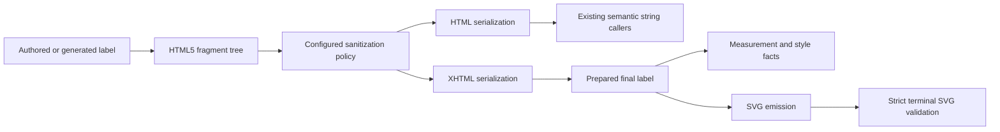

# Shared HTML5 Fragments - Plan

## Goal Capsule

**Objective:** Mermaid diagrams containing browser-recoverable HTML labels render successfully with the same repaired text structure across semantic processing, measurement, and SVG output.

**Means:** Replace streaming source rewriting with a shared HTML5 fragment implementation and explicit HTML/XHTML serialization (KTD1–KTD4).

**Authority:** The Product Contract owns behavior; the Planning Contract owns implementation choices. The pinned Mermaid and DOMPurify reference graph owns parity semantics. Repository resource, feature, and licensing contracts remain applicable.

**Execution:** Implement and verify locally on a feature branch. Preserve unrelated edits. The maintainer reserves commit, push, and publication approval.

**Stop condition:** Report a blocker if the selected parser cannot support bounded parsing, cooperative cancellation, stack-safe lifecycle, or the established security policy. Do not substitute an incomplete HTML tree builder or relax SVG validation.

---

## Product Contract

### Problem Frame

An authored Flowchart node containing `<b>API` reaches SVG emission as `
<b>API
` and fails the terminal `validate-well-formed-svg` pass.
The current sanitizer uses `lol_html`, which preserves the missing closing tag. The renderer's handwritten XHTML normalizer handles attributes, entities, and void tags but does not perform HTML5 tree construction.
The shared paths also serve Mindmap, mathematical markup, icon SVG sanitization, and text measurement.

### Requirements

#### HTML Semantics and Output

- R1. Browser-recoverable malformed fragments receive HTML5 structural recovery consistent with the pinned reference, including missing end tags, misnested formatting, implied closures, and fragment context.
- R2. Mermaid sanitization policy remains effective on the recovered structure, including configured tags, attributes, URI checks, content removal, namespace transitions, and target hooks.
- R3. Semantic HTML output and SVG-embedded XHTML output have distinct serialization contracts. Successful SVG output remains strictly well-formed XML.
- R4. Measurement and SVG emission interpret the same final sanitized label structure. Preserve reference-required Markdown conversion, wrapping, and entity-decoding stages.

#### Resource and Compatibility Contracts

- R5. Parsing, sanitization, serialization, and teardown support bounded work, allocation/output limits, and cooperative cancellation. Deep nesting cannot cause recursive stack overflow. Output-only checks do not establish a parsing bound.
- R6. Preserve the existing public string sanitizer entry points and existing caller-owned resource/error behavior. Internal fallible interfaces may replace the current cross-crate SPI.
- R7. Preserve plain-text fast paths when their configured policy proves them equivalent. Retire replaced rewriting and handwritten HTML normalization machinery after migration.
- R8. Rust native and WASM builds, artifact dependency policies, and generated legal reports cover the replacement dependency graph.

### Acceptance Examples

- AE1. Covers R1, R3: `graph TD; api["<b>API"]` renders successfully, retains bold text, and passes strict XML parsing.
- AE2. Covers R1–R4: the reported nine-node Django architecture graph renders without editing its source, with recovered labels matching the pinned reference's structure.
- AE3. Covers R1–R3: formatting misnesting, optional paragraph/list endings, unquoted attributes, HTML entities, and mixed SVG/MathML fixtures produce the expected sanitized tree and target serialization.
- AE4. Covers R2, R5: a recoverable malformed fragment containing disallowed markup remains sanitized; a canceled or over-budget operation fails with its established terminal error.

### Scope

Shared sanitizer implementation, its direct consumers, affected family regressions, dependency/legal projections, and ADR-0021 are in scope.
Layout algorithms, unrelated Markdown behavior, browser font measurement residuals, and the pinned Mermaid release remain unchanged by this work.
No general-purpose browser DOM, plugin system, or new public HTML framework is required.

---

## Planning Contract

### Key Technical Decisions

- KTD1. Use a mature HTML5 tokenizer/tree builder, initially `html5ever`, behind the shared core sanitizer. Reuse the pinned DOMPurify-derived policy rather than adopt a different sanitizer policy wholesale. (session-settled: user-approved — chosen over local closing-tag patches because shared browser recovery is required.) Governs R1, R2, R7.
- KTD2. Keep the parsed fragment representation private. Expose only the necessary fallible cross-crate HTML/XHTML preparation operations and existing compatibility entry points. Tree storage and traversal must satisfy R5; prefer a flat, index-addressed tree if the available maintained sink does not establish stack-safe teardown and bounded allocation. Governs R3, R5, R6.
- KTD3. Apply recovery before policy traversal and serialize the sanitized tree directly. HTML serialization supports upstream semantic-string behavior; XHTML serialization owns XML characters, escaping, explicit closures, qualified names, and namespace declarations. Do not reinterpret sanitized output with another HTML parser afterward. Governs R2, R3.
- KTD4. Reuse existing prepared-label owners where possible. Eliminate duplicate interpretation of the same final fragment without collapsing semantically distinct upstream sanitization/entity stages. Governs R4, R7.
- KTD5. Extend the resource SPI only with controls needed by real consumers. Integrate limits at tree construction and output, and checkpoints during incremental input and tree traversal. Preserve existing error attribution and reservation reconciliation in prepared math and icon rendering. Governs R5, R6.
- KTD6. Characterize valid existing behavior before replacement. Any baseline change must be justified by the pinned source or a namespace/serialization contract; do not normalize away semantic differences. Governs R1–R4, R7.

### High-Level Technical Design

The following is directional architecture, not an implementation specification.

The same controls apply across the pipeline: parser input and node/attribute storage, policy traversal, output bytes, and cancellation checkpoints.
An ordinary HTML fragment context is not interchangeable with raw SVG/icon input or mathematical foreign content; context and namespace handling must follow the reference use site.

### Existing Evidence

- `crates/merman-core/src/sanitize.rs`: generated allowlists, effective config, target hooks, string adapters, and caller-owned output sink.
- `crates/merman-core/src/diagrams/flowchart.rs`: repeated upstream-aligned semantic/entity sanitization stages.
- `crates/merman-render/src/xml.rs`: handwritten HTML-to-XHTML normalization to retire after all consumers migrate.
- `crates/merman-render/src/svg/parity/flowchart/label.rs` and `svg/parity/mindmap/render.rs`: family HTML preparation.
- `crates/merman-render/src/text/metrics.rs`: independently normalized HTML used for visible typography facts.
- `crates/merman-render/src/math/prepared.rs` and `svg/icon_registry/render.rs`: fallible bounded callers with accounting/reconciliation contracts.
- `docs/adr/0021-html-sanitizer-crate-selection.md` and `0024-dompurify-default-allowlists-and-generation.md`: incumbent choice and reference-policy ownership.
- `repo-ref/mermaid/packages/mermaid/src/diagrams/common/common.ts`: pinned DOMPurify calls and Mermaid hooks.
- HTML5 fragment interface: <https://docs.rs/html5ever/latest/html5ever/driver/fn.parse_fragment.html>.

### Deferred Implementation Questions

The exact parser version, tree sink, control-carrier shape, and reusable prepared-label representation are resolved in U1 and U3.
These are implementation choices within KTD1–KTD5; failure to satisfy R5 invokes the stop condition rather than a silent fallback.

---

## Implementation Units

### U1. Establish Parser and Resource Feasibility

**Requirements:** R1, R5, R8; KTD1, KTD2, KTD5.
**Dependencies:** None.
**Approach:** Admit the replacement dependency and prove fragment recovery, namespace context, bounded construction, incremental cancellation, and iterative teardown behind a private core module. Record matched incumbent/replacement timing and dependency-size evidence for representative workloads.
**Files:** Workspace/core manifests and lockfile; private module beneath `crates/merman-core/src/sanitize/`; existing sanitizer tests.
**Test scenarios:** Unclosed bold; misnested formatting; raw SVG and MathML; nested nodes on a small stack; input/node/attribute growth limits; cancellation during parse.
**Execution note:** Start with the reported failure and characterize existing successful inputs before switching the implementation.

### U2. Replace Source Rewriting with Tree-Based Policy and Serialization

**Requirements:** R1–R3, R5–R7; KTD1–KTD3, KTD5, KTD6.
**Dependencies:** U1.
**Approach:** Apply the existing effective policy to the recovered tree, preserve Mermaid hooks, and provide explicit HTML/XHTML outputs. Keep compatibility wrappers while replacing their implementation. Remove obsolete source-spelling entity workarounds only where parsed-node values supersede them.
**Files:** `crates/merman-core/src/sanitize.rs`, its private modules and existing tests; direct cross-crate sanitizer SPI consumers.
**Test scenarios:** Existing policy/config vectors; keep-content behavior; encoded URI schemes; namespace transitions; target hooks; exact output ceilings; repaired fragments and entity serialization.

### U3. Migrate Render Preparation and Shared Consumers

**Requirements:** R3–R7; KTD3–KTD6.
**Dependencies:** U2.
**Approach:** Route Flowchart, Mindmap, math, measurement, and icon consumers through the appropriate fragment output contract. Share prepared final-label data where the existing lifecycle supports it. Remove handwritten HTML fragment normalization after the last consumer is migrated; retain general XML helpers and strict terminal validation.
**Files:** Affected consumers under `crates/merman-render/src/`, including `xml.rs`, Flowchart preparation/emission, Mindmap, math, typography metrics, and icon registry.
**Test scenarios:** AE1–AE4 through real public render paths; metric/emission consistency; mathematical XHTML; transformed icons; cancellation and output-reservation errors.

### U4. Verify Source-Backed Family and Artifact Compatibility

**Requirements:** R1–R8; KTD6.
**Dependencies:** U3.
**Approach:** Run affected core/render suites, strict SVG corpus comparison, relevant native/WASM feature builds, and representative resource/performance workloads. Investigate changes at their source; update only justified expectations.
**Files:** Existing regression tests and narrowly scoped family-local fixtures; verification evidence under the repository's established documentation location when material.
**Test scenarios:** Existing valid-label corpus; malformed HTML regression corpus; public CLI original graph; raw SVG/icon XML; plain and rich label workloads; deep lifecycle; representative WASM closure.

### U5. Retire Incumbent Decisions and Refresh Legal Projections

**Requirements:** R7, R8.
**Dependencies:** U4.
**Approach:** Remove unused incumbent dependencies, update ADR-0021 with the demonstrated limitation and replacement contract, and regenerate dependency/legal outputs using their owning generators. Document residuals and verification limits honestly.
**Files:** Manifests/lockfile; ADR-0021; generated Rust license and third-party projections selected by the repository generators.
**Test scenarios:** Generated reports are fresh; artifact dependency checks pass; no production caller uses the retired HTML normalization or rewriting implementation.

---

## Verification Contract

Use nextest for Rust tests and cargo fmt for formatting, as required by repository instructions.
The core sanitizer suite owns policy and HTML semantics; the existing Flowchart, Mindmap, math, and icon tests own rendering and resource integration.
Add failing regression coverage in those homes before changing their behavior.
Use the original shared graph as an end-to-end CLI reproducer in addition to minimal cases.

The full structure comparison from `.agents/skills/contribute-merman-pr/SKILL.md` is required for renderer changes. Focused family comparisons guide diagnosis but do not replace that gate.
Native/WASM feature and dependency checks follow `docs/development/CI.md` and the artifact owners in `docs/release/PACKAGE_SURFACES.md`.
Dependency changes require the Rust license report, third-party notices generation, and license verification chain.
Record unsupported local owner lanes explicitly rather than reporting them as passed.

## Definition of Done

- AE1–AE4 pass without changing authored input.
- Existing supported sanitizer policy and relevant rendering tests pass, with explained reference-backed expectation changes.
- Successful fragments and final SVGs satisfy their distinct serialization contracts.
- Resource, cancellation, namespace, and small-stack lifecycle checks pass.
- Replacement performance/size evidence identifies regressions and accepted tradeoffs.
- Replaced rewriting and handwritten HTML normalization are removed.
- Dependency/legal projections and ADR-0021 match the final implementation.
- Formatting, diff hygiene, required owner checks, and independent code review complete.
- Changes remain local for maintainer review and commit approval.
