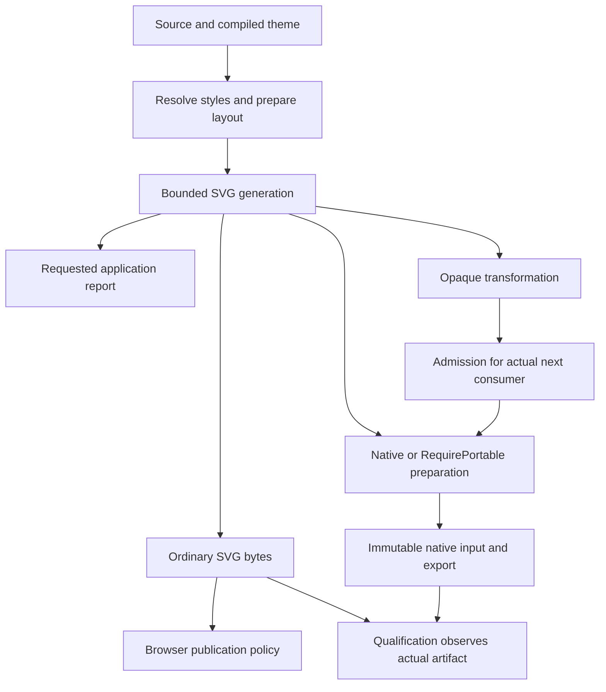
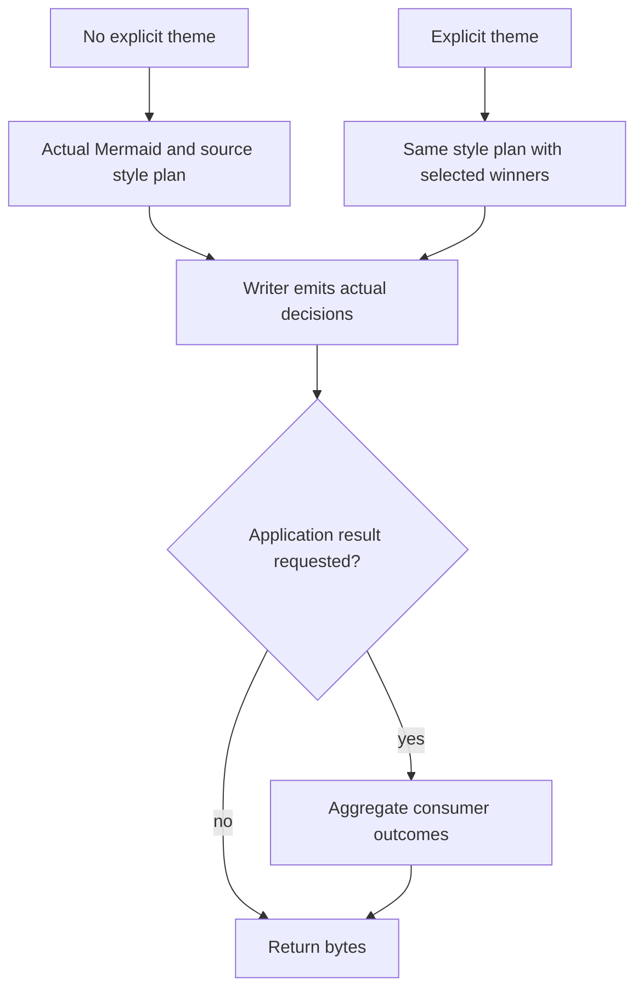

# Theme Runtime Responsibilities - Plan

## Goal Capsule

- Objective: ordinary and themed SVG rendering produces the intended diagrams without paying for unused certification, retired text protocols, or duplicate application proofs.
- Means: separate generation, opaque-input admission, consumer preparation, application diagnostics, and qualification identity (KTD1–KTD5).
- Authority: the maintainer explicitly authorizes deleting redundant production code, experimental APIs, tests, and documentation, including revising incidental validation/error contracts.
- Execution: implement the accepted units, review their surviving behavior, and record fresh performance evidence; local commits are authorized, publication is not requested.
- Stop condition: ask only if implementation exposes a consequential product choice outside the approved cleanup or requires discarding unrelated work.

---

## Product Contract

### Summary

Remove theme-refactor machinery whose results have no real consumer.
Keep actual style selection, Mermaid fallbacks, requested diagnostics, and the checks required by an actual input or output consumer.
Move qualification observation into the qualification tools.

### Problem Frame

The clean theme-merge diagnostic reproduces substantial SVG regressions with identical output: Class medium increases 73.52%, Journey medium 295.86%.
Profiling locates major owners after generation: complete XML/reference observation, retired-prefix scanning, and evidence construction.
Further source audits find per-family expectation/observation protocols even when no theme result can be returned.
The current default contract bundles rendering with requirements originally introduced for strict portability and private acceptance.
The dated measurements establish the regression and attribution, not the benefit of this redesign.

### Key Decisions

- Delete unnecessary contracts with their implementation and dedicated tests (session-settled: user-approved — chosen over preserving every historical validator and optimizing around it: the maintainer approved the first-principles responsibility audit). Governs R1, R2, R7, R9.
- Keep the actual chosen output and actual fallback behavior (session-settled: user-approved — chosen over silently substituting output or claiming that a fallback applied an unsupported request: the approved audit distinguishes generation from consumer assurance). Governs R3–R6.

### Requirements

**Generation and application**

- R1. Ordinary internally generated SVG must not undergo a general completed-document XML/reference readback or unrequested full-output hashing solely for theme certification.
- R2. Remove inactive prepared-text identity, impossible reports, no-op fallback policy, and associated compatibility-only results end to end.
- R3. Preserve effective style precedence, explicit clears, Mermaid configuration/fallbacks, measurement/layout typography, and valid SVG output for supported source inputs.
- R4. Requested application reports must distinguish actually applied, source-shadowed, unsupported, unknown, and inapplicable behavior without requiring duplicate terminal identity ledgers.

**Consumption and limits**

- R5. Native conversion and explicit RequirePortable must check the actual selected output and retain necessary backend, expansion, image, font, and math constraints.
- R6. Opaque SVG and browser publication retain their actual syntax/resource and active-content/network/host-policy boundaries respectively.
- R7. Ordinary generation is bounded by source/model/layout work and serialized-byte limits; `max_svg_elements` becomes an explicitly documented SVG admission/postprocessing and native expanded-work limit, rather than forcing a final observer on every source-to-string operation.
- R8. Cancellation must remain observable during bounded production work, around callbacks, and before successful return; removed observers do not require replacement checkpoint loops.

**Consumers and maintenance**

- R9. Bytes-only APIs must avoid constructing, serializing, decoding, and discarding rich metadata.
- R10. Qualification tools own observations and identities of the actual artifacts they inspect.
- R11. Replace tests and current guidance that exist only to preserve deleted internal protocols; retain revision-scoped measurement history and real behavior coverage.

### Acceptance Examples

- AE1. Default Class/ER/State/Mindmap/Sequence output retains its rendered styles while no no-theme terminal proof tables are built. Covers R1, R3.
- AE2. A label with an ordinary `merman-prepared-state-0` author ID renders under the normal ID rules; it receives no font privilege. Covers R2, R3.
- AE3. A parity SVG with `foreignObject` may render BestEffort, while RequirePortable evaluates those same bytes and rejects when incompatible. Covers R5.
- AE4. A small opaque exponential `use` graph is subject to native expansion limits before backend materialization. Covers R5, R6.
- AE5. Web/Node string and result APIs return identical diagram bytes and requested strict errors; only the result API constructs public metadata. Covers R4, R9.
- AE6. A theme with only EdgeLabelBackground does not depend on a cluster-text completion ledger; unknown cluster text still cannot make its own text request Applied. Covers R3, R4.

### Scope Boundaries

All current diagram families and first-party Rust, CLI, Web/WASM, Node, native export, and private theme acceptance consumers are in scope where the audited deletion reaches them.
Experimental Rust report/getter and qualification schema migrations are intentional; do not retain zero-valued compatibility fields or fake certificates.
No release, dependency upgrade, unrelated parser/layout redesign, global cache, SVG proof DSL, second CSS engine, or browser expansion interpreter is included.
`max_prepared_text_retained_bytes`, active prepared math, host measurement provenance, real font loading/glyph fallback, and stable unrelated ABI ordinals remain useful independent contracts.

#### Deferred to Follow-Up Work

Direct authoring-to-typed lowering and a semantic replacement for JSON-encoded authoring byte budgets are compilation-specific work.
They are documented in D31–D32 below and are not prerequisites for eliminating runtime certification.
Purely declarative text-capability wire requirements need a separate explicit schema decision; remove no-op HostMeasurementFallback now without pretending a replacement text backend exists.

### Sources

- `docs/research/2026-10-16-theme-rendering-runtime-responsibilities.md`
- `docs/performance/native_theme_root_cause_macos_2026-10-16.md`
- Local Mermaid: `repo-ref/mermaid/packages/mermaid/src/config.ts`, `themes/theme-default.js`, and `mermaidAPI.ts` separate theme calculation from browser sanitation.
- `docs/adr/0063-extensible-svg-output-pipeline.md` and `docs/adr/0078-headless-svg-security-capability-boundaries.md` provide existing consumer seams.

---

## Planning Contract

### Key Technical Decisions

- KTD1. Generated SVG stays producer-owned; arbitrary `process(&str)` and custom callback bytes enter explicit admission paths. Reuse the existing bounded writer and sanitizers, with no trust boolean or parallel unsafe path. Implements R1, R3, R6.
- KTD2. Keep `max_svg_elements` at SVG admission/postprocess/native consumption and update descriptors, guides, and tests together. Do not add a new streaming XML counter merely to reproduce an unnecessary ordinary-output contract. Model/layout/byte guards continue to bound generation. Implements R7.
- KTD3. Producers own actual paint/font choices and aggregate application outcomes during emission. Delete same-value expectation/observation comparisons and independent coverage domains; keep winner indices required for cascade order. Implements R3, R4.
- KTD4. Plain output carries only useful outcome data. Remove production digest chains and internal report-to-input fingerprint comparisons; qualification hashes its own immutable observed bytes. Implements R1, R9, R10.
- KTD5. The family owns the requested-mechanism set once; local consumers contribute only their own outcomes. Metadata demand is selected at existing data/result entry points, without a general execution framework. Implements R4, R9.
- KTD6. Merge support claims into the existing mechanism authority and validate catalog availability without compiling every returned descriptor. Do not add a registry generator or global cache. Implements R11.

### High-Level Technical Design

### Assumptions

The current same-host benchmark corpus remains the primary regression diagnostic; extending it with family-local fixtures is useful only where existing rows do not exercise an audited owner.
No fixed latency recovery percentage is promised before a fresh comparison, because this redesign intentionally changes observation/error contracts.
Current public appearance, source precedence, and strict/native semantics provide the behavioral reference; historical proof implementations do not.

### Audited Cleanup Inventory

These IDs identify evidence and ownership, not a second progress tracker.

| ID | Evidence and candidate | Disposition / owner |
| --- | --- | --- |
| D01 | `svg/pipeline/prepared_text.rs`, `text/prepared.rs`: no prepared-label producer; two whole-output rejection scans | Delete protocol, parser, scans, ID special cases and native counters; U1 |
| D02 | `environment.rs`: `PreparedTextLayoutReport` and `TextLayoutFailure` always None and never constructed | Delete types, report/error/reason projections and tests; U1 |
| D03 | `admission.rs`, `environment.rs`: HostMeasurementFallback setter no-op and resolved policy empty | Delete strategy, intersections, setters, fields and compatibility tests; U1 |
| D04 | `assets.rs`, `merman-export/font_environment.rs`: embedded-font result objects/modes cannot be produced | Remove impossible output projections; keep supported font input rejection and real native fonts; U1 |
| D05 | `svg/pipeline/standalone.rs`: ordinary BestEffort XML/reference analysis ends Unverified | Remove generated-output observation; U2 |
| D06 | `SvgPipelineBuffer`, retained XML facts and run options exist to avoid duplicate observations | Delete obsolete propagation types with D05; U2 |
| D07 | `svg/parity/output.rs`: stylesheet deliberately leaves forbidden XML scalars to final validation | Handle scalars in the existing producer escape loop; U2 |
| D08 | Pipeline raw entry, builtins, and callbacks repeatedly parse after each transform | Admit at actual opaque/structural consumer boundaries; U2 |
| D09 | Readable/icon/static preflight mixes raw accounting with native depth/node caps | Split generation/admission from native capability checks; U2 |
| D10 | `root_svg.rs`: finite ordinary SVG coordinates inherit backend f32 magnitude ceiling | Keep finite geometry checks; move backend magnitude admission to native consumption; U2 |
| D11 | Formatter/prefix/XML observer checkpoint counts treated as contracts | Keep bounded work and sticky failures, delete observer-specific count tests; U2 |
| D12 | Class `CompletionOnly` builds node/relation/cluster domains then discards result | Delete default completion protocol; U3 |
| D13 | Class node expectation -> binding observation -> equality -> terminal receipt repeats one source | Separate actual bindings from proof metadata, delete duplicate chain; U3 |
| D14 | Class text completeness and checkpoint reductions repeat scans | Aggregate actual facts once; U3 |
| D15 | Flowchart TextSurface background/generic result depends on unrelated cluster ledger | Independent consumer outcomes, no cross-consumer completeness gate; U3 |
| D16 | Flowchart child plans each build/clone complete family request evidence | One family request owner; child deltas only; U3 |
| D17 | Flowchart ordinal reporting reparses selection after emitting a different static style | Resolve once or retain honest residual for unrendered ordinal paint; U3 |
| D18 | Flowchart base typography maintains five overlapping occurrence sets | Aggregate per-property outcomes at actual writer events; U3 |
| D19 | State default builds and normalizes signatures before retaining an empty request set | Delete default signature construction; U4 |
| D20 | State explicit theme has a complete SVG/CSS signature interpreter | Delete producer readback; emit outcomes from actual branches; U4 |
| D21 | Sequence default recorder locks/merges/clones before checking theme absence | Operation-local optional outcomes and actual style plan; U4 |
| D22 | Sequence typed base typography reparses final XML/CSS inheritance | Producer-owned effective typography and actual outcome aggregation; U4 |
| D23 | Mindmap always copies font/CSS and records a node palette ledger | Remove absent-demand receipt; simplify active outcomes; U5 |
| D24 | ER no-theme renderer builds relation and marker proof maps then discards | Remove unused domains; move actual marker paint out of receipt; U5 |
| D25 | Railroad reparses its own root and repeatedly searches emitted CSS | Direct producer state; remove root/CSS proof parser; U5 |
| D26 | Ishikawa creates/clones terminal text domain before checking theme | Move real CSS writing out of receipt; remove copied domain; U5 |
| D27 | Wardley/Cynefin/Venn/EventModeling scan layout to prove nonexistent theme coverage | Delete baseline coverage work and empty observations; U5 |
| D28 | Block explicit theme parses every label and copied shell fragment to recognize its own output | Move actual shell/label decisions into producer; delete reverse recognizer; U5 |
| D29 | `ResolvedThemeStyle::MatchedThemeRules` carries full diagnostic match history in every style | Remove history while preserving actual winning origin/order; U3/U8 |
| D30 | `support_manifest.rs` independently duplicates mechanism matrix; catalog compiles every preset then discards | Derive support from existing authority; validation-only discovery; U8 |
| D31 | Authoring -> materialized wire -> typed spec reparses colors/typography | Confirmed compile-only debt; explicitly deferred |
| D32 | Typed authoring serializes again for compact JSON byte budget | Current explicit compile contract; defer a semantic-budget redesign |
| D33 | `document.rs`, `target_admission/digest.rs`: multi-layer hashes do not drive ordinary decisions | Delete runtime digest fields/module and API projections; U6 |
| D34 | Native export constructs standalone SVG admission before native target admission | Build only requested target result; preserve reusable prepared document; U6 |
| D35 | Export report copies resource fingerprint and artifact kind, facade compares same-origin values | Remove self-equality branches/reasons using immutable ownership; U6 |
| D36 | bindings-core/Web/Node bytes calls construct full metadata then discard it | True data path through existing operation entry points; U7 |
| D37 | Renderer embeds private acceptance DOM observer and generic retired-prefix receipt flag | Move observer into private acceptance; delete production sidecar and prefix assertion; U6/U9 |
| D38 | Qualification schema binds redundant runtime digest chain despite hashing bytes itself | Qualification owns source/recipe/font/binary/artifact correlation; migrate schema; U9 |
| D39 | Tests and active backlog demand old scans/digests/checkpoint counts | Remove white-box contracts, update actual behavioral owner tests and current guidance; U9 |
| D40 | Pure declaration TextLayoutCapability has public wire/catalog consumers but no executing backend | Record separate schema decision; do not present it as a real backend capability or casually delete reachable input |

### Sequencing

U1, U3, U4, U5, and the bindings-local portion of U7 can proceed independently with explicit file ownership.
U2 waits for U1's shared pipeline signature cleanup.
U6 follows the pipeline artifact shape from U2; U7 then integrates the facade demand path.
U8 removes matched-history only after U3–U5 no longer consume it.
U9 updates qualification and the single current guide after the owning runtime changes; U10 verifies the integrated candidate.

---

## Implementation Units

| Unit | Change | Primary files | Depends on |
| --- | --- | --- | --- |
| U1 | Retire inactive text/font contracts | text, environment, admission, exporter font reports | none |
| U2 | Generation and consumer boundaries | SVG pipeline, output, resources, root/icon/fallback | U1 |
| U3 | Class/Flowchart outcome ownership | class, flowchart, family evidence | none |
| U4 | State/Sequence producer outcomes | state, sequence, their writers | none |
| U5 | Remaining family proof cleanup | ER, Mindmap, Railroad, Ishikawa and other family writers | none |
| U6 | Output/native identity and document simplification | merman render, native export, private observer | U1, U2 |
| U7 | Real data-only bindings paths | bindings-core, WASM, Node transport and wrappers | U6 for full facade bypass |
| U8 | Shared theme ownership cleanup | resolved styles, support manifest, preset discovery | U3–U5 |
| U9 | Qualification and documentation retirement | acceptance, scripts, rendering/ADR/performance guides | owning runtime units |
| U10 | Review and measured closeout | existing tests, benches, one dated checkpoint | U1–U9 |

### U1. Retire inactive text and font contracts

**Goal:** remove D01–D04 without leaving a consumer that still grants or rejects retired text identity.
**Requirements:** R2, R3, R5, R11.
**Dependencies:** none.
**Files:** `crates/merman-render/src/text/prepared.rs`, `src/svg/pipeline/prepared_text.rs`, `src/environment.rs`, `src/diagram_theme/admission.rs`, `src/diagram_theme/assets.rs`, `crates/merman-export/src/font_environment.rs`, facade report/re-export callers, `crates/merman-render/tests/flowchart_svg_test.rs`, `crates/merman/tests/theme_font_capability.rs`, and existing inline protocol tests.
**Approach:** delete the protocol closure and impossible projections; retain active CSS font parsing, math, sidecar-byte budgets, measurement provenance, and real font results.
**Test scenarios:** ordinary author IDs obey regular ID normalization; entity-encoded IDs grant no font privilege; active math projection and real missing-glyph/native-font behavior remain covered; custom font input still receives its actual unsupported result.
**Verification:** no runtime references to retired token types/fields remain; targeted existing SVG and font tests pass after protocol-only tests are removed.

### U2. Make ordinary SVG a generation operation

**Goal:** implement KTD1–KTD2 and delete D05–D11.
**Requirements:** R1, R3, R5–R8.
**Dependencies:** U1.
**Files:** `crates/merman-render/src/svg/pipeline/mod.rs`, `standalone.rs`, `final_validation.rs`, `src/svg/parity/output.rs`, `root_svg.rs`, `src/svg/icon_registry/render.rs`, `src/svg/fallback.rs`, `src/resources.rs`, existing inline pipeline/output/resource tests, and `crates/merman/tests/render_operation.rs`.
**Approach:** fix producer scalar handling and preserve bounded allocation/cancellation; route internally generated bytes without default XML facts/readback; consolidate genuine raw/callback checks at structural consumers and final opaque admission; separate native caps from vector generation.
**Execution note:** characterize actual output and strict/opaque controls before deleting the old observation protocols.
**Test scenarios:** stylesheet delimiters, split `]]>`, forbidden scalars and Unicode produce valid XML; ordinary byte/model/work limits reject at their real boundary; opaque malformed XML is rejected where promised; strict parity checks actual foreignObject bytes; native exponential use/filter/image work is rejected before backend allocation; ordinary finite vector geometry does not acquire a backend-only magnitude cap; cancellation remains sticky and prevents partial success.
**Verification:** ordinary generated default/parity output has zero completed-document general XML observations and no mandatory resource SHA; native and opaque controls remain enforced under the documented R7 migration.

### U3. Replace Class and Flowchart self-proofs with actual outcomes

**Goal:** remove D12–D18 and their dependence on D29.
**Requirements:** R1, R3, R4, R11.
**Dependencies:** none.
**Files:** `crates/merman-render/src/class/theme*`, `src/class/node_binding.rs`, `src/flowchart/theme_evidence.rs`, `text_surface_paint.rs`, `base_typography.rs`, `src/svg/parity/class/`, `src/svg/parity/flowchart/`, `src/family.rs`, `tests/class_svg_test.rs`, `tests/flowchart_svg_test.rs`, and `tests/flowchart_cluster_label_theme.rs`.
**Approach:** follow KTD3/KTD5; leave real style bindings and cascade winners intact, remove same-origin observation/expectation comparisons and unrelated consumer gates.
**Test scenarios:** no-theme output remains identical; source fill/stroke/HTML labels retain precedence; background-only Flowchart requests succeed independently of cluster text; unknown text keeps its own property residual; ordinal paint that was not emitted is never Applied; empty visible domains remain NotApplicable; hidden/debug nodes and math do not fabricate success.
**Verification:** default Class completion arrays and duplicate node paint proof slots are gone; reports still describe actual output in existing integration tests.

### U4. Remove State and Sequence output reinterpretation

**Goal:** delete D19–D22 and producer-owned state machines that exist only to re-prove emission.
**Requirements:** R1, R3, R4, R11.
**Dependencies:** none.
**Files:** `crates/merman-render/src/state/style_plan.rs`, `theme_evidence.rs`, `src/sequence/theme_evidence/`, `src/sequence.rs`, `src/svg/parity/state/render.rs`, `src/svg/parity/sequence/render.rs`, `tests/state_svg_test.rs`, and `tests/sequence_svg_test.rs`.
**Approach:** use actual styles and operation-local outcome aggregation; remove default build-then-retain-empty work and explicit SVG/CSS reverse interpretation.
**Test scenarios:** special/composite/visible State targets preserve paint and source ownership; user HTML descendants are not counted as generated targets; Sequence actors/messages/notes/title retain actual typography; source-local overrides and unsupported properties remain honest; no-theme and explicit presets preserve intended SVG.
**Verification:** no complete SVG parse is used solely to certify these families' own theme output; no default Sequence evidence locking/cloning remains.

### U5. Remove remaining family completion machinery

**Goal:** delete D23–D28 without removing drawing values hidden inside receipts.
**Requirements:** R1, R3, R4, R11.
**Dependencies:** none.
**Files:** theme modules and matching `src/svg/parity/` writers for ER, Mindmap, Railroad, Ishikawa, Wardley, Cynefin, Venn, EventModeling, and Block; `tests/er_svg_test.rs`, `mindmap_svg_test.rs`, `block_svg_test.rs`, and corresponding inline/family SVG tests.
**Approach:** move actual marker paint, fonts and CSS emission to existing visual plans; delete no-demand domain collection and producer root/CSS/shell parsing.
**Test scenarios:** ER marker paint and references remain correct; Mindmap node shapes/source edges preserve styles; Ishikawa's fixed head size remains distinct from base text; Railroad special font characters are escaped and scoped; Block hand-drawn double paths and HTML/SVG labels retain actual paints; default and explicit styling across remaining families match existing behavior.
**Verification:** absent-demand ledgers and own-output recognizers are removed, rather than wrapped in another shared proof framework.

### U6. Simplify output and native document ownership

**Goal:** implement KTD4 and remove D33–D35 plus the production portion of D37.
**Requirements:** R1, R4, R5, R9, R10.
**Dependencies:** U1, U2.
**Files:** `crates/merman/src/render/document.rs`, `evidence.rs`, `target_admission/mod.rs`, `target_admission/digest.rs`, `src/render.rs`, `crates/merman-export/src/lib.rs`, renderer artifact wrappers, `crates/merman/tests/render_operation.rs`, `native_font_context.rs`, and `native_export_residuals.rs`.
**Approach:** remove digest fields/module, same-origin mismatch checks, and unconditional standalone-SVG admission during native export; preserve immutable reusable native input and target-specific outcomes; move reports instead of cloning consumed sessions.
**Test scenarios:** one prepared document can export multiple targets with the selected native font context; strict and fallback-quality reasons remain correct; opaque mutation invalidates prior assurance; bytes stay bound by ownership without comparing copied fingerprints; native output does not prebuild an unused SVG target report.
**Verification:** no default full-artifact hash hooks or multilevel digest encoders remain in production; actual target outcomes and reuse tests pass.

### U7. Carry bytes-only demand through bindings

**Goal:** eliminate D36 and the rich-result build/discard route.
**Requirements:** R4–R6, R8, R9.
**Dependencies:** U6 for complete facade demand bypass; bindings-local work can begin earlier.
**Files:** `crates/merman-bindings-core/src/render/request.rs`, `operation.rs`, `crates/merman-wasm/src/lib.rs`, `crates/merman-node/src/wire.rs`, `platforms/node/src/engine.mjs`, both transport adapters, `platforms/node/tests/api-contract.test.mjs`, `transport-wire-contract.test.mjs`, and existing bindings/Web operation tests.
**Approach:** dispatch data/result at existing entry points and share actual rendering/error handling; preserve public result APIs and introduce no generic execution framework.
**Test scenarios:** reused/one-shot and async/sync string APIs return result.data bytes; strict errors, AbortSignal, timeout and version errors agree across N-API and Node-WASM; requested result metadata remains complete; data calls do not serialize metadata JSON.
**Verification:** the string path reaches the data operation directly; existing cross-language contracts pass with any intentional transport migration documented.

### U8. Remove duplicate shared theme bookkeeping

**Goal:** finish D29–D30 while preserving true cascade authority.
**Requirements:** R3, R4, R11.
**Dependencies:** U3–U5 for matched-rule consumers.
**Files:** `crates/merman-render/src/diagram_theme/resolved.rs`, `family_program.rs`, `support_manifest.rs`, `family_mechanism_matrix.rs`, `presets.rs`, `compiler.rs`, `tests/theme_support_discovery_test.rs`, and existing preset discovery/order-oracle tests.
**Approach:** remove MatchedThemeRules history; derive support projection from the existing mechanism matrix; use the existing validation-only compile entry for catalog availability.
**Test scenarios:** common/variant/ordinal interleaving and Clear match the eager oracle; resource-rejected presets keep exact unavailable reasons; public support vectors and unsupported/applicable distinctions remain stable; dark/light compatibility fallbacks do not override typed paints.
**Verification:** no independently maintained mirror manifest or compile-and-discard catalog artifacts remain; ordinary rendering does not aggregate the full support matrix.

### U9. Move qualification ownership and retire obsolete guidance

**Goal:** implement D37–D39 under R10–R11.
**Requirements:** R2, R7, R10, R11.
**Dependencies:** the corresponding runtime units.
**Files:** `crates/merman-render/src/svg_artifact_receipts.rs`, `crates/merman-theme-acceptance/src/support/`, `preset_qualification.rs`, `scripts/qualify_theme_presets.py`, `verify_theme_acceptance_boundary.py`, associated script tests, `docs/rendering/preset-qualification.md`, ADR 0063/0078/0082, current rendering/resource/API guides, and `docs/performance/PERF_PLAN.md`.
**Approach:** qualification observes actual bytes and computes useful artifact/source/recipe/font/binary identities; delete production acceptance sidecars and retired-token claims; migrate qualification schema explicitly; correct current guidance and supersede incompatible sections of older plans without rewriting measurements.
**Test scenarios:** qualification records validate their own actual artifact hash and reject modified artifacts; actual preset SVG/native cases still run after observer relocation; Python schema/verification tests use the new contract; package boundary checks keep private tools out of published dependencies; local documentation links resolve.
**Verification:** no test-only observer obligations are imposed on production types, no active guide prescribes retired fields/scans, and dated failed/inconclusive measurements remain intact.

### U10. Review and measure the integrated cleanup

**Goal:** establish fresh behavior and performance evidence for R1–R11.
**Requirements:** R1–R11.
**Dependencies:** U1–U9.
**Files:** existing Rust/Node/Web tests, `docs/performance/PERF_PLAN.md`, and one dated closeout report; raw measurements stay under `target/bench/experiments/`.
**Approach:** run focused checks first, then affected cross-family/native/bindings checks and independent correctness/simplicity review; benchmark fixed old/new executables on matched SVG bytes with explicit contract labels.
**Test scenarios:** use AE1–AE6 and the owning units' real edge cases; remove abandoned approaches and obsolete tests rather than carrying legacy execution routes.
**Verification:** report structural removals separately from timing; a speedup claim requires the existing calibrated acceptance protocol, while inconclusive timing remains honestly open.

---

## Verification Contract

Cargo builds/tests run serially, using the shared target directory and immutable saved executables for comparisons.
No new tracing/profiling dependency or benchmark framework is needed.

| Surface | Existing verification | Required result |
| --- | --- | --- |
| Rust style | `cargo fmt --all -- --check`, `git diff --check` | Clean affected work |
| Renderer/facade | `cargo nextest run --locked` for affected crates with the matching SVG/all-diagrams/layout/math features | Real source/style/strict/cancel/resource behavior passes |
| Native | Existing PNG/JPEG/PDF/native-font suites with matching enabled features | Expansion/image/font/math controls survive before backend work |
| Production diagnostics | `cargo clippy --locked` with the production feature set | No new warnings introduced by deleted types/paths |
| Web/Node | Existing package scripts and `node --test` contract tests | Data/result, sync/async, N-API/WASM agreement |
| Qualification | Existing private acceptance and Python qualification/boundary tests | New schema and actual artifact observations agree |
| SVG parity | Existing strict/DOM fixture verification for affected families | Same intended diagram bytes/DOM; intentional ID/error migrations identified |
| Structural work | Source/call-path review plus existing test-only observation counters where useful | R1/R2/R9 true; no replacement proof framework |
| Latency | Existing `pipeline` / `theme_operations` benches, fixed optimized artifacts, matched inputs/capabilities, balanced run order | Fresh diagnostic first; calibrated confirmation before admitted timing claims |

Ordinary SVG and explicit strict/native operations are separate comparison lanes after R7.
The historical regression remains a historical observation; deleting contracts is not an equivalence claim about old error behavior.

---

## Definition of Done

All accepted D01–D30 and D33–D39 have their owning implementation units completed and reviewed.
D31/D32/D40 remain explicitly deferred with the reasons above, rather than silently implemented or misreported as dead runtime work.
Ordinary generation has no certification-only completed-document XML/ref walk, retired-prefix scan, or unrequested full-output hash.
No-theme families do not construct terminal coverage domains for an absent theme report.
Actual requested diagnostics, source/fallback behavior, native/strict/opaque/browser boundaries, resource policies as revised by R7, and bounded cancellation are verified.
Private acceptance owns its observation and identity needs.
Obsolete protocol tests, compatibility-only APIs, conflicting current documentation, temporary instrumentation, and abandoned implementations are removed.
The closeout records exact validation scope, deliberate API/error/resource migrations, measured results and limits, and any unresolved failure without claiming completion prematurely.
