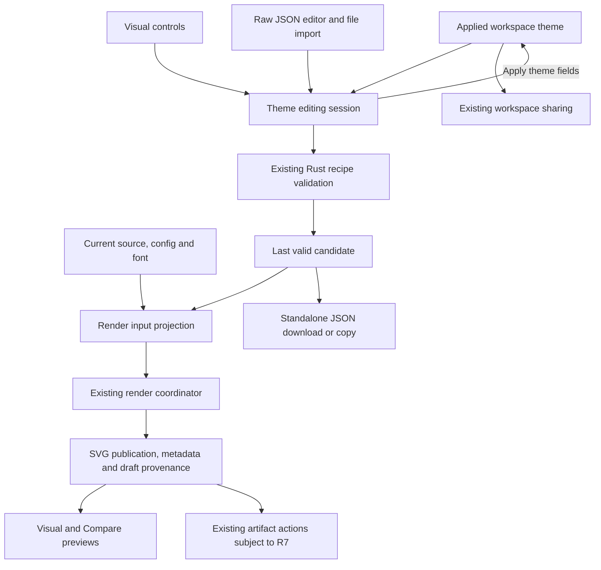
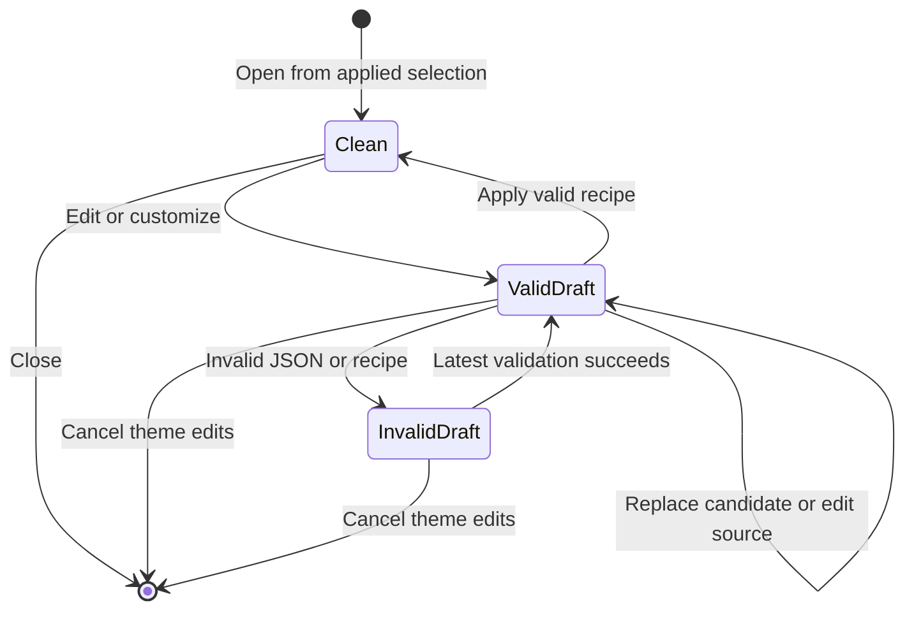

# Playground Theme Editing Workbench

## Goal Capsule

- **Objective:** Playground users can choose a theme, customize it while observing the diagram, and share or reopen the resulting theme without losing its visual settings.
- **Means:** Extend the existing recipe/compiler and render-publication owners with a responsive editing workbench (KTD1–KTD7).
- **Authority:** Requirements below govern this work. `docs/adr/0082-versioned-theme-authoring-facade.md` remains the theme-contract authority. This plan replaces the theme-menu/JSON-dialog interaction and the white-background suppression in `docs/plans/2026-08-16-1459-refactor-playground-infinite-canvas-plan.md`; its camera, geometry, canonical render environment, and finite-export boundaries remain in force.
- **Execution profile:** Implement in a focused feature branch, preserve unrelated edits, reuse existing build targets, and run any required Cargo work serially. No renderer theme-language redesign is required.
- **Stop conditions:** Do not introduce a new persisted theme format, infer preset parameters from concrete colors, hide renderer differences, or declare unsupported styling applied. A necessary change to the established product scope needs a maintainer decision.
- **Delivery:** The implementation owner completes code, documentation, focused verification, simplification, and review. Publishing, merging, and release preparation are separate actions.

---

## Product Contract

### Summary

Replace the theme dropdown and JSON-only dialog with a workbench for preset discovery, visual editing, JSON editing, and recipe exchange.
Keep the current diagram visible during editing and make the distinction between a draft, the applied theme, Mermaid compatibility configuration, and preview background explicit.

### Problem Frame

The current theme system already supports portable JSON recipes, complete preset export, bounded validation, scoped rules, and actual rendering diagnostics.
The Playground exposes much of this through a long menu and a textarea dialog, making iterative customization difficult and hiding the difference between a preset, a compatibility theme, and the final rendering outcome.
The preview also removes a root background solely when its CSS value is `white`, while the backing-surface tone follows Mermaid theme selection rather than explaining Merman-only styling.
These behaviors make appearance comparison and theme sharing harder to understand.

### Key Decisions

- **Use the existing recipe as the editable and exchange document.** Governs R1, R2, R6. (session-settled: user-approved — chosen over reducing a preset to a palette or inventing a new format: complete recipes preserve canvas, effects, and scoped styling.)
- **Provide a persistent editing surface with Visual and JSON views.** Governs R3, R4, R5. (session-settled: user-approved — chosen over expanding the existing dropdown and textarea dialog: users need to inspect the diagram while adjusting its theme.)
- **Keep background owners separate and explain Compare scope.** Governs R9, R10. (session-settled: user-approved — chosen over forcing equal-looking SVG backgrounds: host presentation and authored theme paint have different owners.)

### Requirements

**Recipe editing and preservation**

- R1. `ThemeRecipeV1` remains the canonical editable and exported document, preserving its representation and required version fields; Rust remains the authority for schema, semantic, duplicate-field, and resource validation.
- R2. Customizing a preset creates an independent complete recipe snapshot, preserving unrelated canvas layers, effects, compatibility fields, typography, assets, and family rules without catalog-dependent inheritance.
- R3. Visual and JSON views edit the same draft. Supported form edits preserve unrelated values and distinguish omission, Clear, and explicitly transparent paint according to the existing contract.

**Editing experience and publication**

- R4. Provide preset cards, a visible Customize action, and a responsive workbench that leaves a useful diagram preview visible on desktop and narrow screens. Keep application appearance, Mermaid compatibility theme, and Merman recipe selection distinguishable.
- R5. Valid draft recipes update the preview without changing the applied workspace theme until Apply. Invalid text stays editable while the last valid recipe continues rendering with the latest source/config/font; Cancel restores only the applied theme selection and preserves unrelated workspace edits.
- R6. Import, Download JSON, and Copy JSON operate on standalone recipes. Recipe validation and Apply do not require the current diagram to parse or render successfully; invalid imports and failed validation leave the applied theme unchanged.
- R7. Workspace links continue to carry the applied recipe through the existing bounded `s2`/`s3` codecs. While a changed draft is being previewed, workspace/issue sharing and SVG/image copy/export require explicit Apply first; valid recipe-file actions and existing source/ASCII actions remain available.
- R8. Superseded imports, validations, and renders cannot replace a newer draft or publication. Closing or cancelling the editing session invalidates its pending work, and a failed render remains a visible error rather than reverting the selected recipe silently.

**Comparison and feedback**

- R9. Visual and Compare offer a common host backing-surface control, shared by both Compare panes. Changes affect presentation only, preserve authored SVG backgrounds, and never enter theme JSON or image-export paint.
- R10. Compare clearly states when a Merman preset/custom recipe affects only Merman. Choosing the existing no-Merman-theme selection provides native-style comparison through an explicit user action without silently discarding custom edits.
- R11. Show static family design/support information separately from actual theme execution diagnostics obtained from the same render as the displayed SVG. Unknown outcomes remain unknown, and successful preview does not certify export portability.
- R12. Explain source/configuration precedence without claiming unavailable per-field provenance. Show a definite override only when existing authoritative evidence establishes it; otherwise identify the selected input and explain that authored Mermaid settings can take precedence.

**Integration and retirement**

- R13. Preserve canonical render geometry, viewport navigation, artifact identities, source editing, existing share-link decoding, and existing SVG/PNG/JPEG export behavior outside the explicit draft restriction in R7.
- R14. Retire the replaced theme dialog/menu ownership, keep the UI usable in English and Chinese with keyboard and touch input, and document both simple-theme creation and complete-preset customization.

### Acceptance Examples

- AE1. Covers R1–R3. Customize Cyberpunk, change the canvas base and append a Class Node border override, export/import the result, and retain every unrelated canvas layer, effect, and Sequence rule.
- AE2. Covers R3, R5. Change a simple definition's text token in Visual, observe it in JSON and the diagram, then enter invalid JSON; the text remains editable and subsequent diagram edits render with the last valid recipe.
- AE3. Covers R5, R8. Change source and font while a theme draft is open, then Cancel; only the theme returns to its applied selection, and a late import completion cannot reopen or overwrite the session.
- AE4. Covers R6. With an invalid diagram, import a valid recipe and download/copy or apply it successfully; an unsupported recipe version is rejected without changing the applied theme.
- AE5. Covers R7, R13. With a changed draft visible, every diagram copy/export/share entry explains Apply is required. After Apply, sharing and export use the resulting current publication, and reopening the workspace link restores that recipe.
- AE6. Covers R9, R10. Compare an unthemed diagram on a shared backing, then select an explicit white or layered Merman canvas; genuine renderer paint remains visible, and the Merman-only styling is labeled.
- AE7. Covers R11, R12. A recipe with a conditional/unsupported facet shows its actual execution explanation without presenting a static support result as success or inventing a source-override location.
- AE8. Covers R4, R14. On a narrow Chinese-language screen, select/customize a preset, adjust a color, see the preview, edit JSON, and reach Apply/Cancel/import/export without page overflow or lost focus.

### Scope Boundaries

This work covers the existing visual-theme contract and Playground integration, including standalone recipe exchange and bounded form editing of complete recipes.
The ASCII theme system and source-owned diagram styles retain their current owners.

Considered and not built:

- Runtime preset-plus-patch inheritance or reverse reconstruction of generator parameters: complete snapshots already provide the required exchange behavior, and equal literal colors do not establish shared semantic roles.
- A general CSS editor, effect-graph designer, capability-proof framework, or second Mermaid configuration interpreter: existing JSON and Rust operations cover advanced recipes without duplicating renderer semantics.
- A registry, cloud sync, theme installation, or a new URL format: local JSON and existing workspace links cover the agreed sharing workflow.
- Automatic global recoloring or contrast correction: current recipes contain independent roles, and execution diagnostics do not provide complete paint provenance.
- Automatic thumbnail rendering for every preset whenever the panel opens: cards can use fixed illustrative swatches/thumbnails without multiplying WASM render work.

#### Deferred to Follow-Up Work

Arbitrary effect/canvas-layer visual designers and preset-builder brand parameters require a separate demonstrated authoring journey.
They do not block lossless JSON editing or the scoped controls in this plan.

---

## Planning Contract

### Current Evidence

| Existing owner | Verified behavior | Consequence for this work |
| --- | --- | --- |
| `crates/merman-theme-contract/src/theme_recipe.rs` | Closed, versioned `definition` and `complete_spec` envelope | Preserve kind and versions rather than flattening either document |
| `crates/merman-render/src/diagram_theme/compiler.rs` | Current preset export returns a validated `complete_spec`; both kinds compile | Customize by copy; keep full snapshot contents |
| `playground/src/components/ThemeEditorDialog.tsx` | Import generation guard, draft validation, preset copy, independent download | Reuse the behavior and retire its modal-only ownership |
| `playground/src/runtime/merman-browser.ts` | Current rendering consumes SVG-only APIs; validation already delegates to Rust | Add result metadata to the same render rather than a second render |
| `crates/merman-bindings-core/src/render/request.rs`, `crates/merman-wasm/src/lib.rs`, `platforms/web/src/runtime-render.ts` | SVG result and theme execution metadata remain implemented end to end | No new public diagnostic protocol is needed |
| `crates/merman-render/src/svg/parity/root_svg.rs`, `crates/merman-render/src/svg/pipeline/policy.rs` | Ordinary root is unpainted; typed canvas can add SVG geometry or explicit transparency | Do not diagnose every Merman background as an unwanted default |
| `playground/src/lib/svg-geometry.ts` | Preview clone deletes an inline background based on `white` | Remove the heuristic; preserve raw authored paint |
| `playground/src/lib/mermaid-config.ts`, `playground/src/lib/mermaid-canvas-tone.ts` | Existing bounded compatibility-theme projection and authored precedence | Reuse existing owners and keep provenance claims limited |

Existing theme diagnostics explain residual or unverified work, not every fully overridden rule.
They cannot reliably mark every form field with its source-level winner.
Earlier browser observations used an older build and do not establish current output behavior.
The local development failure from stale Web package output is an execution prerequisite, not evidence that current source lacks theme export.

### Key Technical Decisions

- KTD1. **Keep document editing separate from compilation.** Add a small recipe-editing module that preserves the complete decoded document and applies explicit field/rule edits, retaining raw JSON text when invalid. Reuse the existing facade validation before accepting imported text; never normalize away duplicate fields before Rust checks the original bytes. Governs implementation of R1–R3, R6.
- KTD2. **Give the editing session its own baseline and generation.** Keep applied workspace fields as the existing durable/share projection and derive render input from the active session's last valid candidate. Only the theme fields are committed or rolled back, and only the newest session generation may validate/publish. Governs R5, R8, R13.
- KTD3. **Use one renderer and publication path.** Feed the candidate through the existing coordinator; carry draft provenance and execution metadata with its publication. Enforce R7 at shared action owners and existing entry points, including an already-open export workbench, without adding another renderer or reconstructing exports from live controls. A dirty-theme transition closes or invalidates an existing image-export dialog; reopening after Apply captures the new publication rather than retargeting the old frozen target. An action already dispatched before that transition may complete against its captured publication.
- KTD4. **Build a bounded Visual editor.** Definition controls expose the existing color/series/typography tokens. Complete-spec controls edit canvas base and explicit rule facets for a curated set of documented semantic targets, exposing family scope and rule order. Preserve all other rules and fields through R3; advanced content stays editable in JSON. Complex paints without a form representation stay read-only until the user explicitly replaces them, and Visual mutation is disabled while raw JSON is invalid. Clear is offered only for clearable facets, never for non-null tokens or canvas base. Unsupported/conditional facets use existing support discovery and actual diagnostics rather than guessed target support.
- KTD5. **Compose the workbench from existing UI primitives.** Use a docked desktop panel and an adaptive narrow-screen surface with a visible compact preview, reusing Radix, the existing resizable layout, and Monaco JSON editing. Use preset cards with fixed illustrative previews and runtime catalog design-scope labels; apply no export-qualification claim to those cards.
- KTD6. **Use presentation state for host backing.** Offer Automatic, Light, Dark, and Transparency backing choices with the existing grid treatment where appropriate; Automatic reuses the bounded current Mermaid tone resolver. Both Compare panes receive the same choice. Preserve every renderer-owned root style and canvas element under R9; these local presentation preferences do not require a new workspace-link schema.
- KTD7. **Use existing outcome metadata without inventing provenance.** Extend the Playground facade/publication result with the existing SVG metadata and pass the corresponding measured or headless result API once. Support/design scope, input precedence guidance, theme outcome, and target outcome remain separate UI facts under R11–R12.

KTD2 follows the existing separation between a frozen export target and its mutable dialog inputs in `playground/src/components/ExportDialog.tsx`.
An eager mutation-and-rollback design would let current sharing read an unapplied theme and would risk restoring stale source/configuration; the explicit session avoids those existing ownership conflicts.
This does not require a competing implementation prototype because the shared workspace/publication boundaries already determine the required separation.

### High-Level Technical Design

InvalidDraft retains the last valid candidate for new renders under R5, while recipe-file actions and Apply require a valid current draft under R6.
The session's baseline advances after Apply, so subsequent Cancel cannot undo an already applied change.
An unchanged editing session does not restrict artifact actions.

### Assumptions

- Drafts are session-local; reload recovery and a saved-theme library are outside this increment. File export is the durable draft-saving path.
- Apply keeps the workbench open for continued editing. Cancel closes it; replacing a modified custom draft with another preset/new/imported document requires an explicit discard-or-replace decision.
- R7 uses an inline Apply-first explanation at blocked actions rather than automatically committing a theme through an export/share action. Existing Mermaid Live/Markdown transfers retain their source/configuration-only behavior and explain that they do not include Merman styling.
- A narrow-screen workbench can reserve a compact preview region while editing; exact panel dimensions and focus placement are resolved through implementation screenshots and touch/keyboard checks.

### Dependencies and Risks

Restore matching Web/WASM and generated package-entry artifacts through the existing build owners before browser verification.
Rebuild only stale inputs, reuse shared targets, and do not repair this by adding ad hoc exports or altering the theme ABI.

The main correctness risks are stale session completions, document loss during structured edits, and a draft artifact escaping through an unguarded export/share entry.
U1, U3, and U4 own those boundaries.
If authoring support is unavailable in a loaded runtime, preserve the current applied selection and explain the unavailable operation rather than silently substituting a theme.

### Deferred Implementation Details

Exact component names, panel sizing, debounce timing, and the first curated rule-target control set may follow existing code conventions.
The complete recipe, transaction/publication boundaries, and acceptance examples are fixed by the requirements rather than those UI details.
No launch-blocking product question remains.

---

## Implementation Units

### U1. Preserve recipe documents and theme editing transactions

**Goal:** Establish lossless editing and explicit applied-versus-draft state.

**Requirements:** R1–R3, R5, R8; KTD1, KTD2.

**Dependencies:** None.

**Files:** Create `playground/src/lib/theme-document.ts`, `playground/src/lib/theme-document.test.ts`, `playground/src/lib/theme-edit-session.ts`, and `playground/src/lib/theme-edit-session.test.ts`; update `playground/src/store/index.ts`, `playground/src/store/index.test.ts`, and `playground/package.json` test wiring.

**Approach:**

1. Represent the editing baseline, raw document text, latest validated candidate, validity, and session generation in one owner.
2. Implement explicit token, canvas-base, and scoped-rule edits against the existing recipe representation, following KTD4.
3. Add theme-only Apply/Cancel operations and a render-input projection distinct from the existing share snapshot selector.

**Patterns to follow:** Existing `ThemeRecipeV1`, `ThemeEditorDialog` validation/import generation handling, and store snapshot isolation.

**Test scenarios:**

1. Covers AE1. Exported complete-spec edits retain unrelated fields, ordered rules, and canvas layers through serialization.
2. Omission, null Clear, transparent paint, and zero-valued numeric fields retain distinct meanings.
3. Covers AE2. Invalid raw JSON remains intact while the last valid recipe is retained.
4. Covers AE3. Apply/Cancel affect only theme fields, and an older generation cannot modify a replacement session.
5. A duplicate-field or unknown-version import reaches existing Rust validation as original text and does not become an accepted normalized document first.

**Verification:** Focused pure-state tests and existing store/share tests establish R1–R3/R5/R8 without introducing a second theme validator.

### U2. Carry actual theme outcomes with render publications

**Goal:** Make the existing same-execution theme metadata available to the Playground.

**Requirements:** R11, R12, R13; KTD3, KTD7.

**Dependencies:** None; integrate with U3 after both are complete.

**Files:** Update `playground/src/runtime/merman-browser.ts`, `playground/src/runtime/merman-core.ts`, `playground/src/runtime/merman.test.ts`, `playground/src/runtime/render-coordinator.ts`, `playground/src/runtime/render-coordinator.test.ts`, and the existing publication selectors/types in `playground/src/runtime/use-render-coordinator.ts`.

**Approach:** Use current measured/headless SVG result APIs and retain their metadata beside the admitted artifact; project it through immutable coordinator publications and existing error boundaries.

**Patterns to follow:** Existing render-result failure stages, publication identity, `ThemeExecutionEvidence` wire handling, and `projectError`.

**Test scenarios:**

1. Each browser/headless operation makes one renderer call and publishes the SVG together with that call's evidence.
2. An older completion cannot attach its evidence to a newer artifact.
3. Covers AE7. Missing/unknown evidence and residual theme/target outcomes remain distinguishable and do not become portable/success labels.
4. Recipe application errors and SVG-mount errors retain the existing structured failure behavior.

**Verification:** Current coordinator/runtime tests prove evidence and artifact ownership without an additional render or new public wire.

### U3. Replace the theme dialog with a responsive editing workbench

**Goal:** Deliver preset browsing, structured/JSON editing, and continuous preview.

**Requirements:** R3–R5, R8, R11, R12, R14; KTD2–KTD5, KTD7.

**Dependencies:** U1, U2.

**Files:** Update `playground/src/App.tsx`, `playground/src/components/ToolbarControls.tsx`, `playground/src/components/Preview.tsx`, `playground/src/runtime/RenderCoordinatorBridge.tsx`, `playground/src/components/StatusBar.tsx`, `playground/src/i18n/locales/en.json`, and `playground/src/i18n/locales/zh.json`; create focused workbench components in `playground/src/components/`; retire `playground/src/components/ThemeEditorDialog.tsx` after migration; extend `playground/tests/custom-theme.spec.ts`, `playground/tests/theme-design-scope.spec.ts`, and `playground/tests/mobile.interactions.spec.ts`.

**Approach:**

1. Add the responsive workbench shell and preset cards; preserve runtime availability and current-family design-scope information.
2. Connect Visual controls and Monaco JSON to U1, with the current diagram remaining visible under R4.
3. Feed the candidate through the existing coordinator bridge; label draft previews and display U2 outcomes with bounded precedence guidance.
4. Preserve keyboard focus and explicit replacement/cancellation behavior when switching recipes or layout breakpoints.

**Patterns to follow:** Existing Radix controls, lazy Monaco feature boundaries, responsive workspace tabs, and export workbench focus restoration.

**Test scenarios:**

1. Covers AE2. A Visual edit appears in JSON and preview without changing the share snapshot until Apply.
2. Covers AE3. Invalid theme text does not freeze subsequent source/font edits, and Cancel preserves those unrelated edits.
3. A current-diagram syntax error is shown while valid theme Apply remains available.
4. Modified-draft replacement has explicit keep/discard behavior; changing responsive layout does not create a second editing session.
5. Covers AE8. Chinese mobile controls, JSON editor, compact preview, and Apply/Cancel stay reachable without document overflow; keyboard closing returns focus to the opener.

**Verification:** Desktop and narrow-screen browser journeys establish the interaction and focus behavior; opening the preset chooser does not render every preset.

### U4. Connect recipe exchange and enforce applied-artifact actions

**Goal:** Support standalone theme files and consistent sharing/export during editing.

**Requirements:** R6–R8, R13; KTD1–KTD3.

**Dependencies:** U3.

**Files:** Update workbench exchange controls, `playground/src/components/ToolbarArtifactActions.tsx`, `playground/src/components/Preview.tsx`, `playground/src/components/CompareView.tsx`, `playground/src/components/ExportDialog.tsx`, `playground/src/runtime/artifact-actions.ts`, `playground/src/runtime/artifact-actions.test.ts`, `playground/src/lib/share.test.ts`, `playground/tests/custom-theme.spec.ts`, `playground/tests/playground.ui.spec.ts`, and `playground/tests/svg-geometry.spec.ts`, which already own export-workbench and artifact-background flows.

**Approach:**

1. Move import, validated file download, and Copy JSON onto the new session owner, retaining the existing encoded-byte and URL limits.
2. Enforce R7 in shared action availability and execution paths, covering toolbar, Preview, Compare, and an export dialog opened before the draft changed.
3. Use the applied workspace snapshot for link creation and require the matching current publication after Apply before enabling artifact actions.

**Patterns to follow:** Existing `themeRecipeOptionsJson`, `copyWorkspaceShareUrl`, artifact publication IDs, and frozen export targets.

**Test scenarios:**

1. Covers AE4. Valid recipe import/download/copy/Apply works with an invalid current diagram; invalid recipes preserve applied state.
2. Covers AE1. Customize/export/import Cyberpunk retains its complete recipe graph and scoped edits.
3. Covers AE5. Dirty-draft restrictions cover every SVG/image and workspace/issue-share entry; a previously opened export dialog cannot start another action, while an already-dispatched action retains its captured publication under KTD3.
4. After Apply, actions wait for the current applied publication and cannot use a stale prior artifact.
5. Oversized recipes retain existing rejection behavior; a recipe within file limits but beyond URL limits can still be downloaded independently.
6. Existing preset-only `s2` and custom-recipe `s3` links reopen with their existing semantics.
7. Source/ASCII actions remain available during draft editing, and Mermaid Live/Markdown transfers retain their Merman-style limitation notice.

**Verification:** File and link round trips agree with the applied recipe; browser export tests prove exact-publication ownership across editing transitions.

### U5. Preserve authored backgrounds and clarify Compare styling

**Goal:** Make background presentation predictable without modifying renderer-owned paint.

**Requirements:** R9, R10, R13; KTD6.

**Dependencies:** U3 for selection/draft interaction; background preparation work can proceed after U1.

**Files:** Update `playground/src/lib/svg-geometry.ts`, `playground/src/components/SvgViewport.tsx`, `playground/src/components/CompareView.tsx`, `playground/src/components/Preview.tsx`, `playground/src/styles/globals.css`, presentation preference state, locale strings, `playground/tests/render.presentation.spec.ts`, `playground/tests/svg-geometry.spec.ts`, and `playground/tests/theme-initialization.spec.ts`.

**Approach:**

1. Remove value-based background suppression from responsive preview preparation while retaining all geometry and mount-safety behavior.
2. Add the shared backing control under KTD6 and keep its changes outside render-operation identity.
3. Identify Merman-only theme input in Compare and connect native-style comparison to the existing no-theme selection through the editing session.

**Execution note:** Characterize ordinary unthemed output and explicit white/transparent/layered canvases before changing preview preparation; use raw and mounted SVG to distinguish presentation from renderer behavior.

**Test scenarios:**

1. Covers AE6. Ordinary unthemed Compare panes share a host backing while both raw artifacts retain their original paint.
2. Explicit `white`, equivalent white color syntax, transparent canvas, and canvas-prelude geometry survive preview mounting appropriately.
3. Backing changes cause no render request and do not change SVG bytes, PNG/JPEG background planning, or export dimensions.
4. Dark Merman styling is clearly scoped to Merman; clearing it is explicit and cannot silently destroy a modified draft.
5. Infinite Canvas, ViewBox Frame, bounds, zoom, and Fit retain their current geometry contracts.

**Verification:** Existing presentation browser tests cover both panes and raw-artifact isolation; any remaining default-output discrepancy is reported from the matching build rather than normalized away.

### U6. Consolidate verification, documentation, and retired UI

**Goal:** Deliver one supported theme-editing journey with no parallel legacy editor.

**Requirements:** R1–R14.

**Dependencies:** U1–U5.

**Files:** Update `docs/rendering/custom-diagram-themes.md`, `platforms/web/README.md` only where the Playground journey is described, existing affected browser suites, and `playground/package.json` test wiring; remove replaced dialog imports and menu code from their owners.

**Approach:** Document simple-definition creation, complete-preset customization, Apply/Cancel behavior, standalone recipe exchange, Compare styling, and the distinction between preview and portability evidence. Consolidate scenarios in their existing owners rather than duplicating a per-theme/browser matrix.

**Test scenarios:** Reuse AE1–AE8 coverage from U1–U5; add no documentation-only test suite.

**Verification:** The Verification Contract passes against matching current artifacts, obsolete theme-editor ownership is absent, and screenshots confirm desktop/mobile usability.

---

## Verification Contract

These checks belong to implementation; this plan does not claim they have run.
Run relevant pure tests first, prepare matching runtime artifacts before browser checks, and widen coverage only when changes or failures justify it.

| Layer | Existing gate or focused invocation | Required evidence |
| --- | --- | --- |
| Recipe/session/runtime | `npm --prefix playground run test:runtime` with the new pure test files wired into that owner | U1/U2 state, preservation, publication, and action tests pass |
| Mermaid projection/export | `npm --prefix playground run test:mermaid-config` and `npm --prefix playground run test:export` | Existing config precedence and raster planning remain valid |
| Static checks | `npm --prefix playground run typecheck`, `npm --prefix playground run test:browser:typecheck`, and `npm --prefix playground run lint` | Production and test sources typecheck and follow current lint rules |
| Current browser build | Existing `platforms/web` build/assembly owners as needed, then `npm --prefix playground run build` | Exported JS, WASM, opaque realm, and Playground belong to the current source candidate |
| Desktop journeys | Existing `playground/tests` desktop runner scoped to the affected custom-theme, design-scope, initialization, presentation, and export specs | AE1–AE7 pass against the built Playground |
| Narrow screens | Existing mobile-interactions runner plus applicable WebKit mobile smoke | AE8, touch reachability, focus restoration, and preview visibility pass |
| Cross-browser residuals | Existing non-Chromium smoke owners for startup, themes, and export paths affected here | Relevant Firefox/WebKit smoke passes, or a concrete platform residual is reported |

No Rust source change is planned.
If implementation demonstrates a necessary Rust correction, first apply the repository's Rust guidance, run focused `cargo nextest` checks serially, and use `cargo fmt`; do not add unrelated renderer refactors or full-workspace gates to this UI change.
Verify at least one exported recipe through the existing real Web runtime acceptance path, reusing the existing authoring fixtures and complete-preset exchange tests rather than constructing another cross-language harness.

---

## Definition of Done

- AE1–AE8 are covered by focused tests and matching-build observations, with the specified visual controls usable in both recipe representations.
- A complete recipe can be customized, saved, reimported, and shared without losing unrelated theme structure or confusing draft and applied content.
- Compare preserves real authored backgrounds and explains Merman-only styling while using a shared host backing.
- Diagnostics come from the displayed execution, and unavailable provenance or portability remains explicit.
- The replaced JSON dialog/menu ownership and abandoned implementation attempts are removed; existing share, navigation, and export contracts remain covered.
- Documentation describes the shipped controls and their limits, and review resolves material correctness/scope findings before handoff.

---

## Sources and Research

- `docs/adr/0082-versioned-theme-authoring-facade.md`: compact definitions, complete snapshots, and the boundary against runtime preset inheritance.
- `docs/rendering/custom-diagram-themes.md`: current exchange, Clear/transparent, scoped editing, support, and execution-diagnostic semantics.
- `crates/merman-theme-contract/src/theme_recipe.rs`, `crates/merman-theme-contract/tests/theme_recipe_wire.rs`: recipe serialization and closed version/kind behavior.
- `crates/merman-render/src/diagram_theme/compiler.rs`, `crates/merman-render/src/diagram_theme/presets.rs`: complete-preset export and existing preservation tests.
- `crates/merman-bindings-core/src/render/request.rs`, `crates/merman-wasm/src/lib.rs`, `platforms/web/src/runtime-render.ts`: current same-render metadata transport.
- `playground/src/runtime/RenderCoordinatorBridge.tsx`, `playground/src/runtime/render-coordinator.ts`, `playground/src/runtime/artifact-actions.ts`: workspace inputs and publication ownership.
- `playground/src/components/ThemeEditorDialog.tsx`, `playground/src/components/ExportDialog.tsx`, `playground/src/components/ToolbarArtifactActions.tsx`: existing editing, export-target, and sharing boundaries.
- `playground/src/lib/svg-geometry.ts`, `playground/src/lib/mermaid-canvas-tone.ts`, `crates/merman-render/src/svg/parity/root_svg.rs`: preview background handling and current renderer paint ownership.

The plan uses current repository contracts and implementation patterns; no external library selection or new dependency is required.
