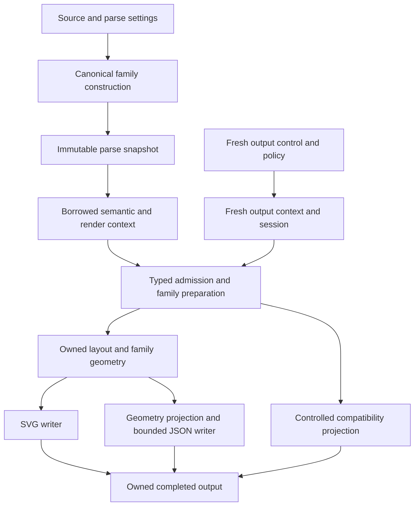
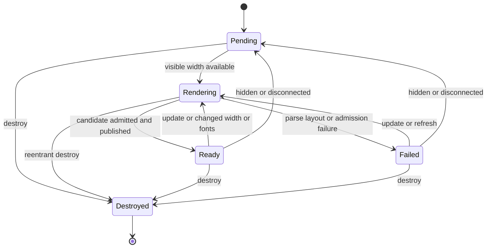
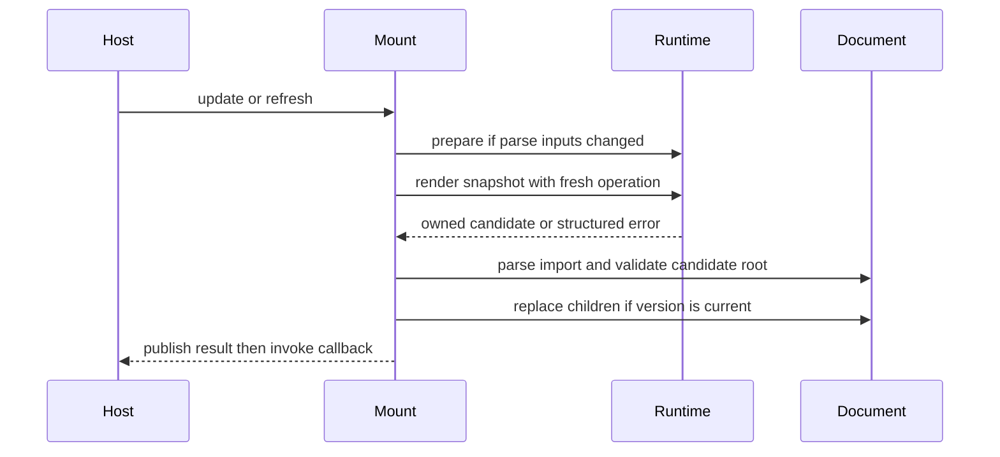

# Render Reuse and Host Integration - Plan

## Goal Capsule

- **Objective:** hosts can redraw a Mermaid diagram as its available width or fonts change, obtain its actual edge geometry, and diagnose compatibility differences through supported Merman APIs.
- **Means:** borrowed canonical semantics, immutable parse snapshots, independently controlled output operations, family-owned geometry, persistent Web mounting, and source-backed differential tests (KTD1–KTD8).
- **Authority:** maintainer-approved fearless refactoring includes deleting redundant implementation, experimental interfaces, tests, and current guidance; Mermaid source and actual consumer contracts remain the behavioral authority.
- **Execution:** the maintainer has authorized continuing with implementation and verification. Commits still require maintainer confirmation; publication, release, and discarding unrelated changes are not authorized.
- **Stop conditions:** stop for a consequential product change outside R1–R16, an unavoidable incompatible stable native ABI change, or any action that would discard another contributor's work. Routine technical choices remain implementation-owned.

---

## Product Contract

### Summary

Remove compatibility-JSON admission and discarded-SVG work from typed rendering paths.
Provide reusable parse snapshots and a Web mounting lifecycle that uses them.
Deliver explicit width adaptation for Kanban and strengthen parser and layout validation against the selected Mermaid reference.
Theme features are excluded from this delivery at the maintainer's request.

### Problem Frame

Native typography admission currently constructs complete compatibility JSON to inspect styles, and edge-geometry queries generate a complete SVG that is discarded.
The high-level semantic artifact carries one operation's cancellation and runtime state, making repeated layout inconvenient despite existing lower-level model reuse.
The Web SDK publishes a single SVG but leaves font readiness, resizing, retained state, and disposal to each host.
The parse fuzz target misses acceptance disagreements and most semantic changes.

Pele demonstrates useful parse-once mounting and generated-input testing, but deliberately uses its own layouts and appearance.
Merman continues to reproduce selected Mermaid semantics, configuration, layout, and SVG structure rather than adopting Pele's narrower compatibility contract.
The inspected baseline is Merman `fe5de3eed7f2af1b734f161507330979634c7282`, Mermaid 12.2.0 at `1fb7869866dd619168d840291c9c54b4f129758b`, and Pele `44da152bbb79b91f03e68016f42499bb25bf6e82`.
These are research identities, not verification results for the eventual implementation.

### Key Decisions

- **Refactor the actual owners and retire redundant paths** (session-settled: user-approved — chosen over compatibility wrappers and isolated patches: the maintainer accepted the architecture findings and authorized removal of unnecessary code and documentation). Governs R2, R3, R4, R15.
- **Keep Mermaid-compatible defaults and make adaptive layout explicit** (session-settled: user-approved — chosen over replacing the layout engine with Pele's visual behavior: the accepted comparison distinguished the libraries' compatibility responsibilities). Governs R1, R10.
- **Exclude new theme behavior** (session-settled: user-directed — chosen over controlled repaint or inherited CSS variables: the maintainer explicitly deferred theme-related work). Governs R16.

### Requirements

**Canonical rendering and output ownership**

- R1. Existing source-to-output defaults retain their source-backed semantic, layout, SVG, sanitization, and native-export behavior, except for the explicit geometry resource-contract migration in R4.
- R2. Native-font typography admission inspects canonical typed declaration owners without constructing compatibility JSON or a generic recursive model walk.
- R3. Layout JSON pairs its semantic projection with the exact canonical artifact that owns its layout; external callers cannot inject arbitrary semantic JSON into that envelope.
- R4. Edge geometry preserves schema 1, occurrence order, points, and label-position semantics while avoiding SVG emission and enforcing budgets for its actual computation and encoded JSON.

**Reusable semantics and fresh operations**

- R5. A reusable parse snapshot freezes successful semantics, effective configuration, parse settings, and genuine parse-time runtime provenance; obtaining fresh parse-time dates or generated IDs requires preparing a new snapshot.
- R6. Each output from a snapshot has independent cancellation, deadline, resource admission, work accounting, and output runtime state; prior success or cancellation grants no quota exemption and cannot poison later output.
- R7. Layout borrows canonical semantic records instead of deep-cloning the model for every redraw, and completed outputs remain usable after the snapshot is released.
- R8. Rust and rendering-capable Web/WASM surfaces expose snapshot reuse through their actual shared owners without accepting exported semantic JSON as a reconstructible snapshot.

**Host integration and adaptive layout**

- R9. A Web mount controller provides update, refresh, disposal, current source/result/error, and last-successful-diagram retention, publishing only safely admitted candidates.
- R10. Explicit fit-width Kanban layout packs whole columns in source order without reducing font size, removing tasks, changing IDs or links, or modifying semantic data; insufficient single-column width reports overflow.
- R11. Width changes and explicitly selected browser-font measurement can refresh a mount without reparsing unchanged inputs; hidden mounts defer work, and a host-notified Document change rebinds document-owned resources.
- R12. Destroyed or superseded work cannot publish or invoke stale callbacks, and one-shot DOM helpers retain their existing safety and utility.

**Validation and maintenance**

- R13. Built-in deterministic semantic and typed parse paths agree on result categories and their lossless public semantic projections, respecting catalog availability and documented extension/lenient contracts.
- R14. Flowchart and Sequence differential checks use the selected real Mermaid parser/DB, persist replayable mismatches, and distinguish oracle failures from parse rejection; generated layout assertions apply only to supported family/backend subsets.
- R15. Migrate affected public interfaces, options, generated projections, examples, and current documentation together; remove code and tests solely preserving deleted mechanisms while retaining behavioral coverage and historical evidence.
- R16. This delivery adds no theme recipe, dynamic color update, CSS-variable output, theme support-query extension, or theme compiler redesign; existing theme behavior remains regression coverage under R1.

### Acceptance Examples

- AE1. A native-font State or Block render rejects the same unsupported declared typography without expanding its compatibility tree. Covers R2.
- AE2. A prepared Gantt reused after the output clock changes keeps its parsed task dates while the output-owned today marker follows the new context. Preparing again can change implicit dates. Covers R5, R6.
- AE3. Cancelling one redraw leaves another redraw usable; rendering the snapshot under a stricter source/model policy rejects it before layout. Covers R6.
- AE4. Geometry JSON preserves duplicate edge IDs and actual label centers; its exact encoded-byte ceiling succeeds and one byte less fails without generating an SVG. Covers R4.
- AE5. A Kanban mount narrows from a horizontal strip to rows of complete columns and restores its original wide arrangement without losing labels or changing fonts. Covers R10, R11.
- AE6. A failed update preserves the last valid SVG and exposes the failure. A callback that destroys or replaces the mount prevents older queued work from overwriting it. Covers R9, R12.
- AE7. A changed local edge endpoint or parser acceptance decision causes a differential mismatch; an unavailable or mismatched reference runtime causes a tooling failure. Covers R13, R14.

### Scope Boundaries

The core/render refactor reaches every compiled family affected by canonical ownership.
New adaptive placement is limited to Kanban; other families retain their current width behavior and reject explicit unsupported adaptation.
New persistent snapshot handles are initially exposed through Rust and Web/WASM; existing Node, CLI, FFI, and mobile operations migrate where shared options, resources, or geometry behavior change.
DOM lifecycle remains a Web concern and does not create a native handle ABI.

Considered and not built: a global model cache, serialized snapshot protocol, universal scene graph, parser/provider registry, second CSS engine, all-family responsive router, production invariant observer, whole-output proof ledger, or automated repository-wide documentation pruning.
Each lacks a consumer that justifies replacing the existing owners; reassess only with a concrete additional use case.
Pele benchmark integration and speed/size claims are outside this delivery; implementation measurements compare matched Merman operations through the existing benchmark framework.

### Deferred to Follow-Up Work

Theme-related ideas from the comparison are deferred per R16.
Further adaptive families require their own source/meaning-preservation evidence rather than automatic admission from the Kanban pilot.

---

## Planning Contract

### Key Technical Decisions

- KTD1. **Keep one operation runner and borrow family semantics.** Change family preparation to borrow the closed parsed model/context pair while owning layout, derived working views, and the new render session. Agentflow's concrete derived Flowchart view may remain operation-owned. Reject per-redraw deep cloning, generic leases, and model reconstruction from JSON. Governs R1, R5–R8.
- KTD2. **Separate snapshot facts from operation state.** The snapshot retains immutable parse metadata, effective config, the selected theme binding needed to preserve current behavior, source-size/model-complexity information, and actual typed parse provenance. New output requests supply output-only settings; parse-affecting changes require a new snapshot. One-shot rendering still uses its existing single captured context. Governs R5, R6, R8, R16.
- KTD3. **Move checks and projections to typed owners.** Family-native typography inspection runs only when native measurement is selected. Artifact-owned compatibility projection uses the existing control and preserves original projection errors rather than fabricating empty JSON. Remove the arbitrary-JSON handoff instead of hiding it behind a token. Governs R2, R3, R15.
- KTD4. **Share Flowchart paint geometry before serialization.** Route/label decisions form one family-local result consumed by SVG and geometry queries. Preserve the current distinction between emitted data-points and later cluster path clipping. Do not use raw layout points, a discard writer, or SVG readback. Governs R4.
- KTD5. **Charge the requested geometry output.** Add `max_geometry_json_bytes` and an operation-aware bounded writer for encoded geometry. Geometry scope admits source/model, required layout/prepared-text work, and its encoded-output ceiling, rejecting irrelevant SVG/backend overrides. Typed vectors use actual construction/work limits. Preserve schema 1 and native ABI 3 operation ordinals. Governs R4, R6, R15.
- KTD6. **Use a captured-runtime WASM snapshot wrapper.** Follow the existing retained editor-class ownership pattern, with explicit disposal and current-candidate/last-good retention only. No numeric process-global handle registry or persistent native ABI is introduced. Governs R8, R9, R12.
- KTD7. **Adapt Kanban at its placement owner.** Prepare current labels/column heights once, then pack complete columns in a linear shelf pass using configured section width and existing spacing. Actual bounds produce requested/actual width and overflow observations. Keep the default path byte-compatible. Governs R1, R10, R11.
- KTD8. **Keep mount scheduling outside Rust.** Coalesce observer notifications in the target Document's animation frame and rebind ownerDocument measurement resources on explicit refresh after adoption. Browser measurement remains explicitly selected. Candidate publication reuses current source/root validation and anchor hardening. Governs R9, R11, R12.
- KTD9. **Observe actual reference behavior in tooling.** Reuse verified Mermaid runtime provisioning, real generated Jison parsers and DBs, and managed child-process helpers. One serial browser realm owns mutable Mermaid state for each bounded batch. Stable public projections and scoped layout invariants replace token-stream equality or simulated DB callbacks. Governs R13, R14.
- KTD10. **Retire mechanisms with their consumers.** Remove JSON walkers, arbitrary semantic injection, query-only SVG collection plumbing, and tests dedicated to those paths. Keep matched-output regressions, current consumer admission, and dated evidence. Governs R1–R4, R15, R16.

The ownership alternatives above are sufficiently concrete to judge from the executing source; they do not need competing implementations before planning.
In particular, freeze-and-borrow satisfies parse-once use without the distinct and much larger design of re-instantiating every runtime-dependent family grammar.

### High-Level Technical Design

**Ownership and data flow**

The snapshot owns frozen parse facts; it never owns the active output ledger.
Completed results sever semantic borrows.
Existing completed-document PNG/JPEG/PDF reuse remains an independent, already supported path.

**Mount lifecycle**

Ready and Failed retain the last successful drawing when one exists.
Controller versions invalidate scheduled work; they do not preempt synchronous WASM.
After successful publication, callback failure does not roll the DOM back over a newer reentrant update.

**Publication protocol**

No candidate is inserted before actual-root validation.
This protocol also serves the one-shot DOM helpers through a shared internal publication helper.

### Assumptions and Implementation Discoveries

Internal naming and module splits may change without changing these contracts.
No performance improvement or artifact-size reduction is assumed before implementation measurements.
Output runtime may change render-time presentation while snapshot parse-time dates and IDs stay fixed; requested evidence must distinguish these two real contexts without inventing provenance.
Ordinary update rebuilds the snapshot when source, config, parse settings, or the existing theme selection changes; this delivery adds no selective theme invalidation or repaint mechanism.
The current branch may advance concurrently: inspect the live owner before editing and revise obsolete file targets without restoring earlier code.

### System-Wide Impact and Migration

Borrowed preparation is an intentional low-level Rust source break with mechanical migration of real callers, fixtures, tests, and examples.
Keep closed semantic/layout pairing and flat/deep JSON lifecycle protections.
The geometry options migration changes accepted resource overrides and incidental errors, not its payload schema or operation ID.
Non-geometry families preserve their empty geometry projection after input/query admission, without loading unused render services.
Geometry-only RequirePortable reports that the target lacks that admission instead of certifying an invisible SVG.

New WASM retained-source exports require corresponding runtime type declarations, generated package entrypoints, capability projections, and artifact-input closure checks.
Bump the owning Web transport version if a wrapper now requires exports absent from prior artifacts; determine the version from the live owner rather than copying a research-time integer.
Do not allocate new C ABI handles or require mobile wrappers to expose browser lifecycle methods.
No compatibility alias may silently accept and ignore a removed resource option.

---

## Implementation Units

### U1. Remove JSON-based typography admission and semantic injection

**Goal:** perform native admission and layout semantic projection at their actual typed owners.

**Requirements:** R2, R3, R15; KTD3, KTD10; AE1.

**Dependencies:** none.

**Files:** `crates/merman/src/render.rs`, `crates/merman-render/src/family.rs`, `crates/merman-render/src/lib.rs`, new `crates/merman-render/src/family/native_typography.rs`, relevant family style owners, `crates/merman/tests/native_font_context.rs`, `crates/merman/tests/deep_lifecycle.rs`, `crates/merman-render/src/family/tests/mod.rs`.

**Approach:**

1. Move native-only family typography inspection beside family preparation using borrowed canonical declaration records and the active control; share declaration recognition without retaining a second model inventory.
2. Preserve existing root/inline HTML/CSS restrictions and facade error mapping; avoid interpreting non-CSS enum fields named style as declarations.
3. Make the artifact execute controlled compatibility projection and remove `layout_json_with_compatibility_json`, its arbitrary JSON parameter, and the facade's redundant projection.
4. Delete the recursive JSON style walker and replace tests that only preserve injected-payload reuse with actual pairing/projection/error coverage.

**Patterns to follow:** typed Flowchart HTML admission, managed compatibility writers, family catalog exhaustiveness, current native font regressions.

**Test scenarios:**

- Covers AE1. State/Block deep declared geometry styles still reject, without materializing the compatibility tree for admission.
- Class/ER/Requirement/Usecase relevant declarations retain rejection behavior; paint-only styles and property spellings inside labels remain accepted.
- Deterministic rendering does not perform native admission; a large declaration and many flat records observe cancellation.
- Layout JSON retains its exact semantic/layout envelope and original controlled projection failures; external callers cannot supply an unrelated payload.
- Native layout JSON projects once for requested output, and deep projection/cancellation stays within the existing lifecycle contract.

**Verification:** focused native/projection nextest suites and affected family checks pass; work/allocation attribution establishes removal of admission-only JSON construction without asserting a wall-clock percentage.

### U2. Introduce borrowed preparation and immutable Rust parse snapshots

**Goal:** reuse parsed meaning across independently controlled output operations.

**Requirements:** R1, R5–R7; KTD1, KTD2; AE2, AE3.

**Dependencies:** U1.

**Files:** `crates/merman/src/operation.rs`, `crates/merman/src/render.rs`, `crates/merman/src/lib.rs`, new `crates/merman/src/render/prepared.rs`, `crates/merman-core/src/diagram/mod.rs`, `crates/merman-render/src/family.rs`, `crates/merman-render/src/family/preparation.rs`, real preparation callers, new `crates/merman/tests/prepared_source.rs`, `crates/merman/tests/prepared_render.rs`, `crates/merman/tests/render_operation.rs`, `crates/merman/examples/README.md`, new `crates/merman/examples/redraw_prepared.rs`.

**Approach:**

1. Give family artifacts lifetimes for canonical model/context borrows and keep layouts/session/necessary derived views operation-owned.
2. Add the immutable facade snapshot with private parse provenance and stored input facts; route source rendering, semantic handoff, and snapshot rendering through one target runner.
3. Apply fresh policy admission and execution state per reuse, preserving existing policy precedence; retain only controlled typed complexity facts or counting.
4. Migrate callers directly and ensure completed documents, SVGs, projections, geometry, and prepared exports own their public data.

**Patterns to follow:** closed `ParsedDiagramRender`, `OperationContext`, existing operation runner, completed-document export reuse, flat model lifecycle migration.

**Execution note:** characterize one-shot runtime and cancellation behavior before changing ownership; exercise all compiled family arms as the borrow migration proceeds.

**Test scenarios:**

- Covers AE2. Gantt implicit dates and generated GitGraph IDs stay frozen across redraws; a new preparation can change them and output-time today/seed behavior remains independently scoped.
- Covers AE3. Cancelling or exhausting one output does not affect a later output or mutate the snapshot; stricter current source/model limits still reject.
- Width and measurement changes reuse the canonical parse; a parse-affecting override requires a new preparation.
- Drop the snapshot after completion, then inspect/export each owned result; preserve native font-context matching on completed documents.
- Flowchart contexts, deep State/Block/Treemap/Ishikawa ownership, Agentflow's derived view, custom overlays, no-diagram, and parser failures retain their contracts.
- Feature-disabled and singleton-family builds do not gain unavailable variants or force deep cloning to satisfy lifetimes.

**Verification:** snapshot and existing source paths share behavioral suites; repeated redraw avoids canonical-model cloning, and existing source SVGs remain unchanged.

### U3. Expose snapshot reuse in the rendering Web/WASM closure

**Goal:** make parse reuse available to the actual Web SDK runtime that will own mounts.

**Requirements:** R8, R15; KTD6.

**Dependencies:** U2.

**Files:** `crates/merman-bindings-core/src/engine.rs`, `crates/merman-bindings-core/src/render/request.rs`, relevant retained-source adapter, `crates/merman-wasm/src/lib.rs`, new `crates/merman-wasm/src/render_source.rs`, `crates/merman-bindings-core/src/transport_contract.rs`, `platforms/web/src/runtime-render.ts`, `platforms/web/src/public-types.ts`, `platforms/web/src/index.ts`, `platforms/web/scripts/surface-manifest.mjs`, generated contract owners, new `platforms/web/scripts/prepared-source.test.mjs`, package/type/closure tests.

**Approach:** retain a WASM class backed by the immutable Rust snapshot and a wrapper bound to its creating runtime; share source/options/error conversion with the current binding owner. Publish it in full/render surfaces only, update required transport exports/version and generated input/package closures together, and preserve one-shot APIs.

**Test scenarios:**

- Repeated width/font requests reuse one snapshot while each receives fresh timeout and resource control.
- Disposing the wrapper is idempotent; use after disposal and supplying an unrelated package runtime fail explicitly.
- Failed preparation publishes no handle; structured clone/exported JSON cannot forge one.
- Full/render package imports expose the new type and actual WASM export; analysis/editor/ascii packages keep their intended closure.
- A stale artifact lacking required exports is rejected through existing transport validation rather than failing on a later redraw.

**Verification:** generated contract checks, type tests, package closure and real full/render WASM smoke agree; stable native ABI ordinals remain unchanged.

### U4. Compute edge geometry without emitting SVG

**Goal:** return the current geometry contract while performing only required work.

**Requirements:** R4, R6, R15; KTD4, KTD5; AE4.

**Dependencies:** U1, U2.

**Files:** `crates/merman-render/src/family.rs`, `crates/merman-render/src/family/preparation.rs`, `crates/merman-render/src/svg/parity/flowchart/svg_emit.rs`, `crates/merman-render/src/svg/parity/flowchart/render/root.rs`, `crates/merman-render/src/svg/parity/flowchart/render/edge_label.rs`, existing Flowchart geometry/context owners, `crates/merman-render/src/model.rs`, `crates/merman-render/src/resources.rs`, `crates/merman/src/render.rs`, `crates/merman-bindings-core/src/render/request.rs`, `crates/merman-bindings-core/src/operation.rs`, resource contract/schema owners, `crates/merman-render/src/family/tests/mod.rs`, new `crates/merman/tests/edge_geometry_output.rs`, existing bindings geometry tests.

**Approach:**

1. Extract bounded route caches, hierarchy transforms, actual label visibility/placement and needed prepared labels into one family-local geometry preparation.
2. Have SVG serialization consume it; have Flowchart/Swimlane/Agentflow geometry project the same decisions without root/defs/CSS emission, postprocessors, or SVG admission.
3. Move metering with actual geometry construction and add the controlled encoded-output writer and KTD5 resource migration atomically.
4. Remove query-only collectors and optional geometry plumbing through SVG writers; preserve real route caches and positioning tests.

**Test scenarios:**

- Covers AE4. Duplicate IDs, occurrence order, nested-group coordinates, hidden labels, parallel edges, complex endpoint shapes, Swimlane hops/label nodes, ELK missing sections, and hand-drawn label placement agree with independent extraction from actual SVG in tests.
- Exact geometry JSON bytes pass and one-byte-smaller limits reject; long IDs/point lists observe cancellation during encoding.
- Actual layout work remains bounded; SVG-only overrides are rejected as irrelevant in encoded geometry options, and a renderer's tiny SVG output limit does not reject a typed geometry request.
- Unsupported geometry families return the documented empty result without requiring unused layout/font services; no geometry-only portable certificate is fabricated.
- Existing SVG byte limits and SVG parity remain unchanged; bindings/Web/Node/native dispatch preserve payload schema 1 and ABI operation IDs.

**Verification:** focused geometry and resource suites pass through both typed and encoded consumers; a query performs no SVG emission, and final family SVG comparisons establish shared-geometry equivalence.

### U5. Close internal parser equivalence and generated-layout gaps

**Goal:** detect semantic disagreements and legal topology combinations missing from fixed fixtures.

**Requirements:** R13, R14; KTD9; AE7.

**Dependencies:** U2 for final ownership integration; parser assertion work may proceed independently.

**Files:** `fuzz/fuzz_targets/parse_mermaid.rs`, `fuzz/src/lib.rs` only if a shared helper is needed, new `crates/merman-core/tests/parse_projection_contract.rs`, `crates/merman-core/tests/diagram_features.rs`, `crates/merman-render/tests/flowchart_layout_test.rs`, `crates/merman-render/tests/swimlane_layout_test.rs`, minimized seeds under `fuzz/seeds/mermaid`.

**Approach:** compare strict and paired lenient result categories and managed lossless compatibility projections under identical deterministic built-in settings; derive family availability and model kind from the catalog. Generate bounded legal small graphs beside the existing Dagre/Swimlane tests with fixed replayable seeds. Fix discovered discrepancies at the actual owner, never by widening comparison tolerance.

**Test scenarios:**

- Covers AE7. One-path success and changed node/edge/label semantics fail the assertion; aliases sharing a model do not create false mismatches.
- Common config/title/accessibility/style/link/warning fields preserve ordering and null/empty distinctions across both parse paths.
- Custom semantic/render overlays, unsupported families, unknown detection, preprocessing failures and lenient error diagrams retain their explicit distinct contracts.
- Generated rectangular Dagre DAGs and supported Swimlane subsets have finite geometry, applicable containment/order and deterministic output; only guaranteed sibling non-overlap/orthogonal routes are asserted.
- Nested compounds, cross-lane edges, parallel edges and directions replay from emitted source; self/ancestor edges and source-backed degenerate cases are not rejected by universal invariants.

**Verification:** stable projection-contract tests pass in all-diagram and narrow family closures; fuzz remains in-process and does not launch a browser per input.

### U6. Add bounded upstream parser differential replay

**Goal:** compare unseen Flowchart/Sequence input against the selected real Mermaid behavior.

**Requirements:** R14, R15; KTD9; AE7.

**Dependencies:** U5.

**Files:** new `crates/xtask/src/cmd/parser_differential.rs`, `crates/xtask/src/main.rs`, `crates/xtask/src/cmd/mod.rs`, new `tools/mermaid-cli/parser-oracle.mjs` and `parser-oracle.test.mjs`, existing verified reference-runtime/process helpers, `.github/workflows/ci.yml`, `.github/workflows/fuzz.yml`, `scripts/ci_plan.py`, `scripts/test_ci_plan.py`.

**Approach:**

1. Run real generated parsers with real DBs in the verified runtime and explicit two-family public-observation adapters; reset mutable state between cases.
2. Keep the family grammar/DB lane free of frontmatter/init directives and supply identical site settings. A separate whole-source public-parse lane checks directive/frontmatter acceptance and configuration behavior; `getDiagramFromText` alone is not an init-config oracle.
3. Persist actual mismatch bytes, family/site settings, selected identities, corpus digest, seed and mutation operations; distinguish mismatch from timeout, browser/process failure, invalid protocol and stale provenance.
4. Add deterministic replay before discovery and an explicit bounded minimization mode. Reuse managed process-tree/output limits and pinned provisioning rather than adding a new framework.

**Initial campaign limits:** 256 mutations per family in merge replay, 5,000 per family or 15 minutes in scheduled discovery, and 4 KiB mutated input; these are tooling bounds to calibrate once against CI duration. Preserve headers in discovery, and keep intentionally malformed headers as explicit classification cases.

**Test scenarios:**

- Covers AE7. Changed acceptance, endpoints, multiplicity, actors, messages or control records produce useful saved mismatches; generated DOM IDs and function identity are not semantic comparisons.
- CRLF, missing final newline, comments, entities and Unicode execute the real source wrappers rather than copied preprocessing.
- Consecutive conflicting diagrams do not leak DB/config state; stale runtime identities and unknown response schema fail the tool.
- Replay is independent of later generator changes because source bytes are retained; reduction preserves the same mismatch class and honors its bound.
- Windows paths with spaces, child failure/timeout and bounded-pipe cleanup use the existing process owner; Linux CI owns authoritative scheduled discovery.

**Verification:** Node protocol tests, xtask comparison/replay tests and CI-plan tests pass; merge replay and scheduled discovery use separate jobs from libFuzzer cells.

### U7. Deliver explicit adaptive Kanban placement

**Goal:** preserve readable task columns as available width changes.

**Requirements:** R1, R10, R11, R15; KTD7; AE5.

**Dependencies:** U2.

**Files:** `crates/merman-render/src/kanban.rs`, relevant `crates/merman-render/src/kanban` layout owners, `crates/merman-render/src/family/preparation.rs`, `crates/merman-render/src/lib.rs`, shared layout options/metadata projections in bindings, `platforms/web/src/public-types.ts`, generated contract owners, new `crates/merman-render/tests/kanban_adaptive_layout_test.rs`, existing Kanban SVG tests and binding options tests.

**Approach:** add default-none and explicit fit-width layout adaptation in the existing typed options owner; apply KTD7 after label/column preparation. Expose narrow support and actual width/overflow observations through current capability/result owners rather than a handwritten Web family table. No graph direction rewrite or theme mechanism is involved.

**Test scenarios:**

- Covers AE5. Narrow then wide rendering restores source-order arrangement, task contents, IDs, links and font size; the canonical snapshot remains unchanged.
- Zero/one/many columns and unequal heights place rows below the prior row's tallest column without sibling overlap.
- Exact packing thresholds and sub-column width report actual overflow without shrinking, truncating or splitting columns.
- Unicode, multiline/HTML labels, ticket URLs and selected native/browser measurements use the existing prepared labels.
- Default mode preserves current SVG bytes; explicit adaptation on another family and invalid nonfinite/nonpositive widths fail clearly.
- Placement observes cancellation/work limits and does not render candidate SVGs to discover support.

**Verification:** Kanban layout/SVG, binding option and capability projections agree; default family parity remains unchanged.

### U8. Add persistent validated Web mounting

**Goal:** hosts can maintain diagrams through updates, resize, font loading and disposal.

**Requirements:** R9, R11, R12, R15; KTD6, KTD8; AE5, AE6.

**Dependencies:** U3, U7.

**Files:** new `platforms/web/src/runtime-mount.ts`, `platforms/web/src/runtime-render.ts`, shared internal DOM publication helper, `platforms/web/src/public-types.ts`, `platforms/web/src/index.ts`, surface generator owners, new `platforms/web/scripts/mount.test.mjs`, existing text-measurement/DOM-safety/package tests, new `playground/tests/mounted-diagram.spec.ts` under the current browser-test owner.

**Approach:**

1. Factor one-shot validated publication and ownerDocument-aware measurement probes into shared helpers.
2. Retain one controller per target/package instance, its captured runtime, current candidate and last successful snapshot/result; expose structured status/errors without inserting a new error overlay.
3. Coalesce genuine width/font changes and invalidate stale callbacks/scheduled work by controller version. Unchanged parse inputs reuse U3; changed inputs prepare a replacement.
4. Defer disconnected/zero-width work, rebind Document-owned observers/probes on host refresh after adoption, and make destroy idempotent while leaving published DOM in place.

**Test scenarios:**

- Covers AE5. Resize uses adaptive Kanban without reparse; deterministic default and explicitly selected browser-font measurement keep distinct behavior.
- Covers AE6. Parse, layout, deadline, resource or DOM-admission failure preserves the last good SVG and reports the new failure.
- Callback-triggered update/destroy, remount, queued font completion and resize after destroy cannot publish stale state or dispose a newer controller.
- Hidden-to-visible and explicit cross-Document refresh use the target realm's observers, fonts, parser and measurement probes.
- Multiple mounts have IDs unique after SVG-ID normalization; current base-URI checks and navigation hardening still apply.
- A callback throwing after publication preserves that published result; all retained WASM/probe/listener resources are released on destroy.
- One-shot DOM helpers still work, and full/render package entries expose the actual controller without broadening other package closures.

**Verification:** targeted Node tests, built-package smoke, type/closure checks and real-browser lifecycle/font/safety tests pass through the public API.

### U9. Consolidate migration guidance and verify the integrated result

**Goal:** ship one coherent ownership and usage contract with no retired-path remnants.

**Requirements:** R1, R15, R16; KTD10.

**Dependencies:** U1–U8.

**Files:** `README.md`, `platforms/web/README.md`, rendering package READMEs as links, `docs/rendering/SVG_OUTPUT_PIPELINE.md`, `docs/integration/RESOURCE_POLICY.md`, `docs/bindings/OPTIONS_JSON.md`, `docs/security/FUZZING.md`, `docs/workstreams/PARITY_BOUNDARY.md`, applicable family coverage reports, current release migration owner, a new architecture decision record under `docs/adr`, scoped benchmark evidence under `docs/performance` when measured.

**Approach:**

1. Document snapshot-frozen parse facts, fresh redraw operations, borrowed Rust API migration, geometry resource migration, explicit Kanban adaptation and mount lifecycle at their maintained owners.
2. Remove the independently maintained obsolete baseline literal in PARITY_BOUNDARY and link to selected-source authority.
3. Remove obsolete active instructions and implementation-only tests with their deleted owners; preserve historical ADRs, release-tag facts, completed plans and dated successful/failed measurements.
4. Correct current guidance without rewriting a published upgrade guide as though its historical release had different behavior; add a current migration note and link from the historical geometry section if needed.
5. Record matched-output work/allocation evidence for native admission, geometry and snapshot redraw; use the established calibration process for any timing claim.

**Test expectation:** no new tests merely for prose cleanup. Surviving behavioral coverage is mandatory for removed tests; feature-bearing behavior is verified by U1–U8 and the integrated gates below.

**Verification:** current examples and generated projections agree with the implemented API; no JSON fallback, arbitrary semantic injection, discarded-SVG geometry path, per-redraw canonical clone, new theme feature, or abandoned experimental helper remains.

---

## Verification Contract

No implementation tests or performance experiments were run to produce this plan.
Before modifying Rust, apply `rust-best-practices`; use `contribute-merman-pr` for the actual change-scoped checks and the owning workflows as authority.
Run Cargo workloads sequentially and prefer nextest; format with cargo fmt.

| Surface | Required evidence | Owner |
| --- | --- | --- |
| Typed admission/projection | Focused nextest suites for native_font_context, deep lifecycle, family projection and parse_projection_contract | U1, U5 |
| Borrowed preparation/snapshot | Facade/render nextest, all-diagram family paths and meaningful no-family/singleton/shared-model feature closures | U2 |
| Web/WASM lifecycle | Real full/render artifact build, transport checks, type tests, package/input closure, prepared-source and mount smoke | U3, U8 |
| Geometry/resource changes | Typed/encoded consumers, exact bytes and work limits, controlled cancellation, bindings/Node/Web/native ABI contract checks | U4 |
| Parser differential | Existing verify-mermaid-reference, xtask replay/protocol tests, actual fixed reference batch, Node and CI-plan tests | U6 |
| Adaptive layout | Kanban layout/SVG cases, options admission, actual browser resize/font cases and unsupported-family checks | U7, U8 |
| Default output compatibility | Existing compare-all-svgs structure/parity/parity-root policies and semantic/root gates on the final revision; ZenUML retains its separate owner | U1–U8 integration |
| Safety/native output | Existing sanitizer, opaque SVG admission, actual DOM mount, native font identity and PNG/JPEG/PDF consumer suites where shared owners changed | U1–U4, U8 |
| Packaging and generated facts | Existing feature/artifact matrix, binding contract generators, package surface/input closure and strict owner checks | U3, U4, U7, U8 |
| Hygiene and evidence | git diff check, cargo fmt check, scoped lint/path-length checks and matched-operation measurements | U9 |

Use focused family checks during development, then the full required default-output gates once at the final integrated revision.
A local Windows result does not substitute for the repository's Linux parity/browser owner; record platform evidence honestly.
Do not regenerate reference baselines, relax normalization, or add fixture-specific exceptions to make new tests pass.
No benchmark threshold is invented: demonstrate removal of the identified unnecessary work, and substantiate any latency claim through the existing calibrated adjacent comparison.

---

## Definition of Done

- R1–R16 and AE1–AE7 have corresponding passing implementation evidence or an explicitly unresolved blocker; no blocker may be hidden as successful completion.
- All feature-bearing units have public-consumer coverage and their actual generated/package/resource contracts migrated.
- Default Mermaid behavior and existing native/DOM boundaries pass the required owner gates.
- Snapshots freeze parse facts, each output is independently controlled, and completed results own their data.
- Geometry queries avoid SVG serialization and enforce the migrated actual-output contract.
- Public mounting and Kanban adaptation work through built full/render packages with disposal, error retention and actual browser evidence.
- Parser equivalence/differential and family-scoped generated cases produce replayable, source-backed failures without production observers.
- Deleted mechanisms leave no fallback, compatibility-only field, orphaned dedicated test, stale active guide, or abandoned experiment in the change.
- Theme features remain excluded, and unrelated contributor changes remain untouched.
- Commits, publication and release remain separate maintainer-authorized actions.

---

## Sources and Prior Decisions

| Evidence | Design consequence |
| --- | --- |
| `docs/adr/0073-family-owned-diagram-architecture.md`, `docs/adr/0091-selectable-diagram-families.md` | Preserve family ownership, closed pairing and catalog-derived availability; no new provider registry. |
| `docs/migrations/deep-diagram-lifecycle.md` | Keep flat semantic ownership and managed deep JSON; do not reintroduce recursive projection work into admission. |
| `docs/adr/0074-browser-runtime-and-benchmark-ownership.md`, `docs/adr/0078-headless-svg-security-capability-boundaries.md` | Captured runtime, cooperative control and actual Document publication retain distinct owners. |
| `docs/plans/2026-10-16-1800-refactor-theme-runtime-responsibilities-plan.md`, `docs/plans/2026-10-16-refactor-demand-driven-theme-rendering-plan.md` | Reuse completed responsibility/writer cleanup; do not resurrect receipts, output readback, hashing or default diagnostic allocations. |
| `crates/merman/src/render.rs`, `crates/merman-render/src/family.rs`, `crates/merman-core/src/runtime.rs` | Current native JSON scan, arbitrary layout JSON handoff, geometry emission and parse/output runtime separation determine U1–U4. |
| `fuzz/fuzz_targets/parse_mermaid.rs`, `crates/merman-core/src/preprocess/mod.rs`, `tools/mermaid-cli/reference-runtime.mjs` | Internal lossless equality and real selected-runtime differential use existing semantics and provisioning. |
| `repo-ref/pele/src/mount.ts`, `repo-ref/pele/tests/flowchart/oracle.test.ts`, `repo-ref/pele/tests/layout/compound.test.ts` | Borrow model reuse, mount lifecycle and generated-input testing; reject render-based capability probes and universal geometry assumptions. |
| [Pele compatibility](https://pele.run/compatibility), [Pele API](https://pele.run/api) | Its own visual/layout contract limits which simplifications transfer to Merman. |
| [Resize Observer](https://www.w3.org/TR/resize-observer/), [CSS Font Loading](https://www.w3.org/TR/css-font-loading-3/) | Element sizing and Document font readiness inform mount scheduling; arbitrary Document adoption or all metric-changing CSS is not automatically observed. |

## Delivery evidence — 2026-10-20

U1–U9 are implemented. The [consumer migration](../migrations/render-reuse-host-integration.md)
and [ownership ADR](../adr/0095-prepared-source-output-ownership.md) describe the resulting APIs.
New theme behavior remains excluded. Changes are uncommitted; release and publication are separate.

| Requirements | Completed evidence |
| --- | --- |
| R1 | All 37 comparison families pass structure, parity and parity-root; Chromium audits all 3,729 resulting SVGs with zero blocking failures and the existing exact residual unchanged. |
| R2–R4 | Typed native admission, artifact-owned projections and shared painted geometry pass native, encoded-byte, cancellation and occurrence-completeness checks. The actual Swift projection includes append-only geometry override ordinal 24. |
| R5–R8 | Borrowed family preparation and immutable Rust/Web snapshots pass runtime provenance, independent control/resource and completed-output ownership checks. Five actual WASM surfaces were rebuilt and verified at transport 8. |
| R9–R12 | Real full/render consumers pass 20 desktop/mobile mount cases, including width/font refresh, failure retention, Document resources and same-target remount inside an active measurement callback. |
| R13–R14 | Managed parse equivalence, bounded generated layouts and real selected Mermaid differential checks pass. Persistence regressions cover exact Unicode/CRLF bytes, stale identity/hash rejection and generator-independent replay; an actual one-attempt reduction and retained-class replay also ran. |
| R15–R16 | Current migration owners, generated interfaces and examples agree; redundant implementation paths are removed, historical evidence is retained, and no theme feature was added. |

AE1–AE4 are covered by native admission, frozen-date/ID, fresh-control and exact geometry-output
contracts. AE5–AE6 have real desktop/mobile resize and candidate-publication evidence. AE7 has
internal projection checks, real upstream acceptance/semantic comparisons and replay evidence.

The integrated nextest run passed 12,919 of 12,920 tests with 10 existing skips; its only failure
was the stale WASM transport-version assertion. That assertion was migrated, then all 47 WASM
full-feature tests and the combined 58-test contract follow-up passed. The independently selected
WASM default closure also passes 11 tests; its full-family catalog assertion now requires
`all-diagrams`. The complete workspace run was not repeated after these test-only corrections.
Both CI doctest commands pass, totaling 44 examples and compile-fail contracts. Workspace check,
scoped strict Clippy, 45 feature/isolated-consumer recipes, generated/native/binding contracts,
dependency checks, formatting and path checks pass. Web Node tests pass 160 cases with two
existing Windows skips; package smoke, input/provenance checks, DOM safety, types and Playground
production build pass against the rebuilt artifacts.

The ten-lens code review completed with two confirmed migration findings: the Swift override
projection and the WASM test literal. Both were fixed and independently rechecked. Swift source,
header and module map were generated twice from the matching compiled UniFFI library and agree
byte-for-byte. The added Swift example checks the typed geometry ceiling and structured error.

The [matched allocation diagnostic](../performance/render_reuse_allocation_windows_2026-10-20.md)
records 660 fresh-process samples and 30 exact output groups. It retains preparation/retention
costs and observed Info/geometry regressions alongside reduced cumulative allocations. It makes
no timing claim or formal performance-admission claim.

These are Windows results. Android Rust target checks and actual C consumers pass. Full Flutter
verification stops because the installed Dart 3.9.2 is below the package's required 3.10.0;
that requirement was not relaxed. Actual Swift compilation and the new Apple smoke require the
existing macOS CI owner. Linux and non-Chromium results are not implied by local success.
