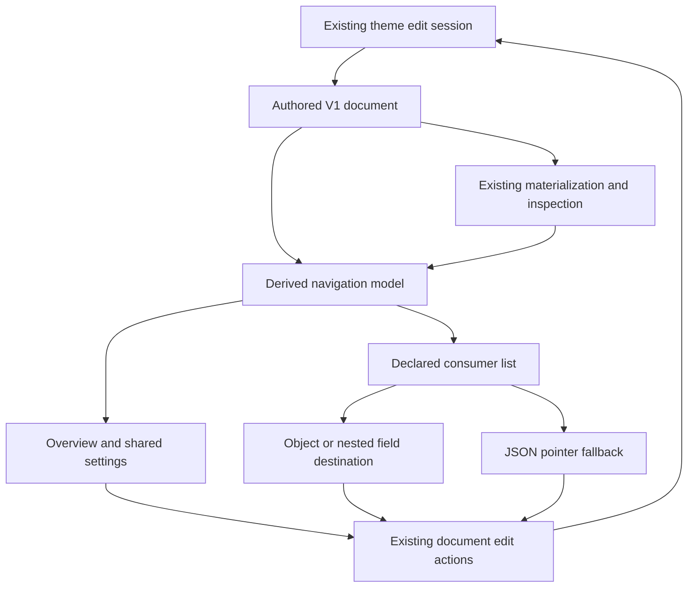

# Theme Designer Navigation - Plan

## Goal Capsule

- **Objective:** Theme authors can find a meaningful setting, understand its declared bindings, and make either a shared or local change without searching a long form.
- **Means:** A compact overview, searchable shared settings, and navigable object styles over the existing design document (KTD1–KTD4).
- **Authority:** This plan governs the next designer iteration; ADR 0095 governs theme semantics. The earlier workbench plan remains historical context for session and publication behavior.
- **Execution profile:** Preserve unrelated local changes, reuse the existing target directory, and serialize Cargo work. Finish focused verification, simplification, review, and local commits; publishing remains separate.
- **Stop condition:** A required new rendering behavior or incompatible contract decision needs separate justification rather than being hidden in UI code.

---

## Product Contract

### Summary

Reorganize visual theme creation around an overview, shared settings, and object styles.
Expose declared consumers and navigation while retaining the same portable V1 recipe, generic controls, and existing editing session.

### Problem Frame

The current editor can express complex themes, but presents shared resources, canvas, typography, semantic targets, and rules as a long form.
Built-in presets place core and family-detail colors in one group, and a usage count does not tell an author where a binding lives.
Pele demonstrates an understandable semantic entry point, while its CSS and Mermaid compatibility choices differ from Merman's requirements.

### Key Decisions

- **Improve creation within V1.** Governs R1, R2. (session-settled: user-directed — chosen over adding an unreleased V2: V1 has no released compatibility burden.)
- **Use generic authoring across themes.** Governs R3, R4. (session-settled: user-directed — chosen over preset-specific controls: community themes need the same editing path.)
- **Present semantic roles and their consumers.** Governs R3–R6. (session-settled: user-approved — chosen over exposing more equally prominent controls: the accepted Pele comparison identified navigation and explanation as the next authoring gaps.)

### Requirements

**Document and fidelity**

- R1. `ThemeRecipeV1` and `ThemeDesignV1` remain the sole editable/exchange document, with `schema_version: 1` and explicit references.
- R2. Presentation changes preserve existing preset paint, rule order, source precedence, complete-spec editing, and Mermaid parity behavior.

**Finding and editing settings**

- R3. Visual offers an overview, shared settings, and object styles without requiring navigation through every control to make a common edit.
- R4. Built-in themes organize core values, category palettes, and family details through ordinary metadata. Imported themes retain arbitrary labels/groups, including absent metadata, and remain fully discoverable.
- R5. A shared setting lists its declared consumer locations with readable target/property labels. Authors can navigate to a supported field or its exact JSON location and return to the setting.
- R6. The consumer view distinguishes direct references, references inside another shared value, and reachable downstream consumers. It describes bindings rather than claiming each consumer wins on a rendered object.
- R7. Shared changes, rebinding, and local copies continue through the existing generic controls. Editing a nested consumer must not detach an enclosing reference implicitly.

**Session and presentation**

- R8. Navigation, search, and disclosure state do not change recipe JSON, theme history, or the applied selection. Draft validation, invalid-form repair, undo/redo, Apply/Cancel, and import generation guards retain their current behavior.
- R9. Exported canvas paint, preview backing, node surface, and label paint remain distinguishable. Existing execution diagnostics explain actual support where available; the UI does not invent per-field provenance.
- R10. The new navigation works with keyboard, touch, English, and Chinese while keeping the diagram and Apply/Cancel reachable on narrow screens.

### Acceptance Examples

- AE1. Covers R3, R4, R8. Copy an ordinary preset, open its core-color group, edit Text, and save/reimport without changing any unrelated field or creating a history entry from navigation.
- AE2. Covers R5–R7. In Cyberpunk, open Neon cyan, see role aliases and downstream gradient/effect/style locations, navigate to one stop, and use a local value without recoloring equal unrelated literals.
- AE3. Covers R4–R6. Import a design with a custom group, escaped token ID, nested shared effect, and no recognized role names; find and navigate its bindings without preset-ID branches.
- AE4. Covers R8, R10. In a 320px Chinese layout, navigate between views, repair an invalid form value, undo a theme edit, and Cancel while retaining a source edit.

### Scope Boundaries

This iteration includes preset presentation metadata, visual navigation, declared-binding inspection, and explanatory copy.
It does not add a mandatory role schema, CSS interpreter, theme registry, preset inheritance, automatic recoloring/contrast correction, or a new exchange version.
The existing New recipe document is already a small bound design; reuse it instead of introducing another creation protocol.

Considered and not built:

- Inferring control priority or semantic roles from token names, equal colors, or alias counts: these do not establish author intent. Existing groups and a compact overview are sufficient for this iteration.
- Highlighting actual SVG objects or marking source-fixed winners: declared-reference inspection lacks that provenance. Reconsider only with a concrete family-owned execution mapping.
- Rendering a multi-diagram gallery or every preset when the editor opens: current-diagram preview covers this iteration without additional render work.
- Extending shadow support to Neo or adding spread/inset/backdrop effects: those are renderer changes, separate from finding and editing existing settings.

### Sources

- `docs/adr/0095-general-theme-authoring-and-retained-bindings.md`
- `docs/research/2026-10-19-pele-theming-comparison.md`
- `docs/research/2026-10-19-general-theme-authoring-interface.md`
- `docs/plans/2026-10-18-0859-refactor-playground-theme-workbench-plan.md` — historical session invariants; its replaced compact contract is not the current schema authority.

---

## Planning Contract

### Current Evidence

| Owner | Existing capability | Consequence |
| --- | --- | --- |
| `crates/merman-theme-contract/src/design.rs` | Typed tokens with label/group/description; reference inspection with path and consumer domain | No additional serialized role graph is needed |
| `crates/merman-render/src/diagram_theme/presets/catalog.rs` | Explicit cross-family roles and series palette | Curate metadata without changing rendering bindings |
| `crates/merman-render/src/diagram_theme/presets/cyberpunk.rs` | Explicit color aliases and nested effect/gradient references | Navigation must preserve alias ownership |
| `playground/src/components/theme-workbench/ThemeDesignEditor.tsx` | One materialization memo, grouped resource forms, usage counts, private target/rule selection | Share its inspection result and lift navigation selection |
| `playground/src/components/theme-workbench/ThemeDesignFields.tsx` | Generic typed fields, local-copy action, authored field paths | Reuse field controls and their existing semantics |
| `playground/src/components/theme-workbench/ThemeWorkbench.tsx` | Session-matched invalid visual draft and publication guards | Keep session ownership here |

### Key Technical Decisions

- KTD1. **One derived navigation model.** For R1, R3–R6, add a small pure module that projects the design plus existing inspection into groups, reference edges, and editable destinations. It does not resolve token values or compile themes. Unlike another store, it cannot diverge from the authored document.
- KTD2. **Metadata before new schema.** For R2, R4, regroup and describe maintained preset values using existing metadata. Render all group summaries and provide search over every setting; do not interpret a group string as a reserved semantic role or depend on token-map iteration for importance.
- KTD3. **Transient destination, existing mutations.** For R7, R8, keep the selected overview/group/token/field in designer UI state and route mutations through existing document helpers and session actions. Workbench owns pending JSON destinations and the return-to-setting snapshot because switching its tabs unmounts the visual editor. Navigation requests include the session and design revision so a stale positional rule/layer path cannot edit a different entry after an import or reorder.
- KTD4. **A bounded declared-consumer explorer.** For R5, R6, construct edges from inspected reference locations and follow token ownership to describe downstream bindings. Deduplicate paths, track visited tokens, and tolerate invalid/rejected drafts without inventing a second validator. Existing materialization remains authoritative; building, searching, or opening this projection makes no additional Rust call.

### High-Level Technical Design

The overview shows compact group summaries, an explicit canvas entry, and typography access rather than mounting every editor at once.
Shared settings provides search and group navigation; object styles keeps semantic defaults and ordered scoped rules distinct.
Only the selected inspector mounts its existing controls.
Returning from a consumer restores the originating setting and useful focus.

Navigation addresses authored fields, including escaped IDs, nested arrays, and token-to-token references.
For unsupported visual destinations, open the existing JSON editor at the authored pointer; do not silently choose a parent field or expand a reference. This includes inspected target palettes and family typography, which currently have no visual binding controls. The reveal-pointer integration is new work: Workbench prefixes design-relative inspection paths with `/design` for the recipe envelope, then the JSON editor uses the existing Monaco JSON worker's typed `parseJSONDocument` AST and node offsets to reveal the exact value. Check the session, requested document revision, and Monaco model version before accepting an asynchronous result. A removed or unavailable destination stays explicit; do not substitute string search, a parent node, another parser, or a recipe mutation.
When inspection fails, retain visible authored settings and repair controls, but mark the consumer information unavailable rather than showing stale counts as current.

### Sequencing and Impact

U1 and U2 establish data presentation and navigation projection independently; U3 uses both; U4 completes cross-view navigation and session integration.
No new rendering language, external package, support qualification state, or public transport operation is required.
Rust changes in U1 affect preset editor metadata only; their production WASM artifact still needs rebuilding before browser verification.
Font or geometry edits continue to use the existing render lifecycle.

---

## Implementation Units

### U1. Make maintained themes understandable through metadata

- **Goal:** Separate core colors, series palette, and family-detail settings while retaining theme-specific effects and geometry.
- **Requirements:** R2, R4; AE1.
- **Dependencies:** None.
- **Files:** `crates/merman-render/src/diagram_theme/presets/design.rs`, `crates/merman-render/src/diagram_theme/presets/catalog.rs`, `crates/merman-render/src/diagram_theme/presets/brutalist.rs`, `crates/merman-render/src/diagram_theme/presets/spotless.rs`, `crates/merman-render/src/diagram_theme/presets/cyberpunk.rs`, existing preset tests in `crates/merman-render/src/diagram_theme/presets.rs`.
- **Approach:** Apply KTD2 to the ordinary authored documents. Describe meaningful controls without changing IDs, aliases, literal values, or style ordering. Preserve the existing starter; give its metadata the same clarity during U3 integration.
- **Test scenarios:** Check representative plain and complex exported designs retain references and their existing concrete fingerprints after metadata edits. Verify that role relabeling/regrouping changes authoring JSON only.
- **Verification:** Existing supported preset paint remains unchanged and exported editor groups are useful without frontend preset-specific logic.

### U2. Project groups, reference edges, and destinations from the current document

- **Goal:** Give every view one source for readable setting and consumer navigation.
- **Requirements:** R1, R4–R6, R8; AE3.
- **Dependencies:** None.
- **Files:** New `playground/src/lib/theme-designer-model.ts` and `playground/src/lib/theme-designer-model.test.ts`; `playground/src/lib/theme-document.ts`; `playground/package.json` for inclusion in the existing runtime test command.
- **Approach:** Apply KTD1 and KTD4. Keep JSON Pointer decoding and destination classification in this module rather than copying selector logic into each form. Each inspection row names the referenced token, while its path names the authored consumer. A path under `/tokens/{owner}/value` therefore identifies a dependency owned by that token, not a reference to the owner itself. Downstream traversal follows these ownership edges without treating aliases as extra painted objects.
- **Test scenarios:** Cover direct style uses, nested gradient/effect uses, whole-value aliases, several paths reaching one consumer, escaped `/` and `~` IDs, missing metadata, no shared tokens, invalid inspection, and unknown visual destinations. Include prototype-like token IDs and bounded traversal of a cyclic rejected draft.
- **Verification:** The projection does not mutate or resolve the recipe and never requires another runtime operation.

### U3. Replace the long visual form with a compact overview and focused inspectors

- **Goal:** Make common edits reachable while preserving access to every existing setting.
- **Requirements:** R3, R4, R7, R8–R10; AE1, AE4.
- **Dependencies:** U1, U2.
- **Files:** `playground/src/components/theme-workbench/ThemeDesignEditor.tsx`, `playground/src/components/theme-workbench/ThemeDesignFields.tsx`, `playground/src/components/theme-workbench/ThemeVisualEditor.tsx`, `playground/src/components/theme-workbench/ThemeWorkbench.tsx`, new `ThemeDesignOverview.tsx`, `ThemeSharedSettings.tsx`, and `ThemeObjectStyles.tsx` in the same directory, `playground/src/i18n/locales/en.json`, `playground/src/i18n/locales/zh.json`, `playground/tests/custom-theme.spec.ts`.
- **Approach:** Replace the old long-form ownership with a small coordinator, overview, settings browser, and selected inspector. Reuse canvas/effect/typed field controls, lifting only navigation state needed by KTD3. Localize known target/property labels while preserving raw unknown IDs. Imported groups use the same navigation, with readable fallback groups for absent metadata.
- **Test scenarios:** Copy a preset and edit its grouped primary settings; search a custom imported group; clear search and recover all settings; change views without producing history or JSON changes; repair an invalid value without losing its inspector. Check keyboard navigation and a 320px Chinese layout.
- **Verification:** Common editing no longer requires scrolling past all shared resources, and existing complete-spec controls remain reachable.

### U4. Navigate declared consumers without losing binding or session ownership

- **Goal:** Make an edit's declared scope understandable and allow precise local adjustments.
- **Requirements:** R5–R10; AE2–AE4.
- **Dependencies:** U2, U3.
- **Files:** New `playground/src/components/theme-workbench/ThemeBindingUses.tsx`; `ThemeSharedSettings.tsx`, `ThemeObjectStyles.tsx`, `ThemeDesignFields.tsx`, `ThemeWorkbench.tsx`, `ThemeJsonEditorFeature.tsx` in the same directory; `playground/src/lib/theme-designer-model.test.ts`, `playground/tests/custom-theme.spec.ts`, `playground/tests/mobile.interactions.spec.ts`, `docs/rendering/custom-diagram-themes.md`.
- **Approach:** Apply KTD3 and KTD4 to a consumer list and return breadcrumb. Open the relevant setting, semantic default, scoped rule, canvas layer, or nested control before focusing the field. Implement the JSON reveal request and return snapshot in Workbench, with an exact field reveal in the existing JSON editor as specified above. Returning to Visual restores the originating setting from that snapshot. Reset stale positional navigation after document replacement and recompute it after edits; never turn navigation into a recipe mutation.
- **Test scenarios:** Navigate a Cyberpunk alias to a nested gradient stop and detach that consumer; verify other linked uses and equal literals behave independently. Cover rule reorder, token rename/delete, metadata regrouping, import/undo while a consumer is selected, JSON fallback, rejected form recovery, return focus, and Apply/Cancel with simultaneous source edits.
- **Verification:** The displayed binding path and the edited authored field agree, exported/imported JSON retains relationships, and the consumer UI never claims render-time winners.

---

## Verification Contract

Use the repository's existing runtime tests, TypeScript checks, ESLint, and theme browser suite for U2–U4.
Run focused preset nextest cases for U1, formatting with `cargo fmt`; avoid unrelated Cargo workloads.
Build the matching full Web/WASM artifact before building the Playground when U1 changes production source inputs.
Exercise the existing Chromium desktop theme suite and focused mobile theme flows against the production build.

The meaningful proof is AE1–AE4 through real preset export, Rust validation, form edits, and JSON exchange.
Do not replace those paths with mocked materialization or generate a new qualification matrix.
Within an already mounted Visual editor over an unchanged design, check that navigation/search/group expansion causes no additional validation/materialization/render work. Switching Visual/JSON tabs may retain the existing remount and materialization lifecycle; this iteration does not require a cross-view cache. All navigation adds no undo entry.
Rust compiler semantics and preset concrete fingerprints should remain unchanged; a changed fingerprint requires investigation rather than automatic golden replacement.

---

## Definition of Done

- R1–R10 are covered by the implemented flows and scoped verification; the real-runtime acceptance examples pass.
- The designer's main coordinator owns navigation, while session validation/publication and Rust semantics retain their existing owners.
- All imported settings remain reachable, and ambiguous or unsupported destinations use an explicit JSON fallback.
- The old long-form coordinator and abandoned experiment code are removed instead of retained behind a second editor mode.
- The theme guide explains shared bindings, local copies, declared consumers, canvas/backing ownership, and the limits of execution explanations.
- Local changes are reviewed and committed with intentional file lists. This plan alone does not authorize pushing or publishing.
