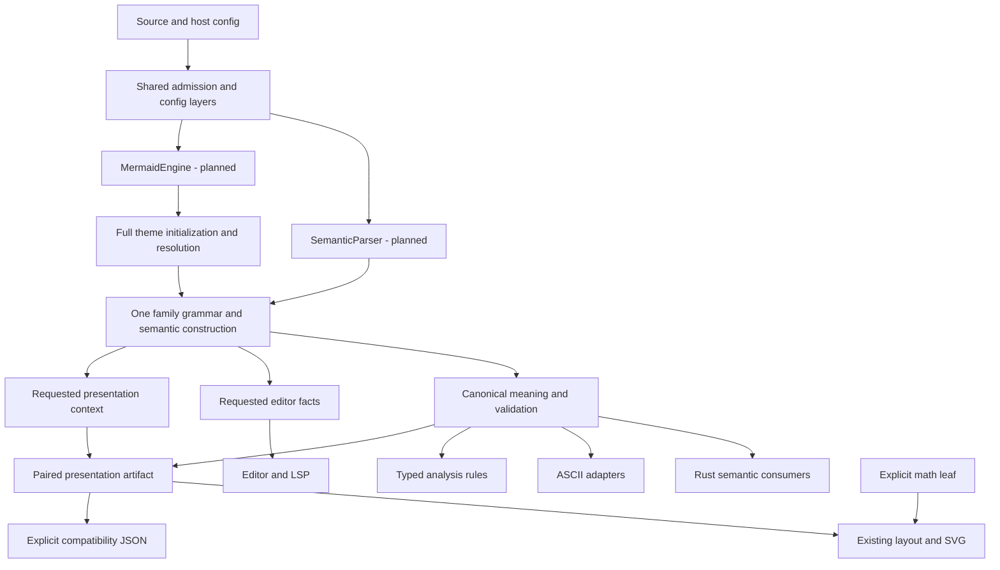
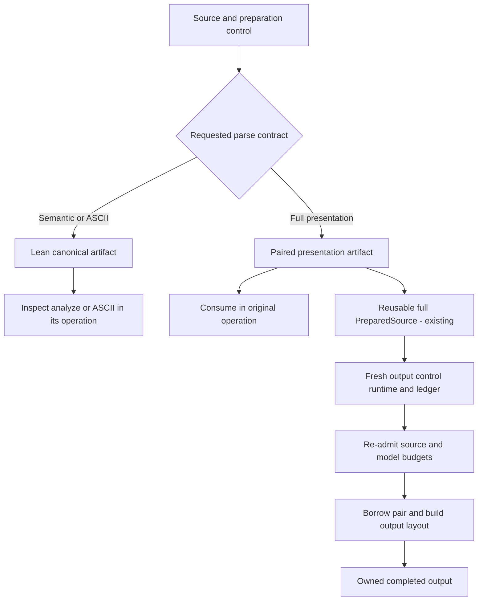

# Semantic Parsing and Capability Boundaries - Plan

Maintainer amendment, 2026-10-25: retain `complete-svg` and `complete-svg-elk` as math-free
output/layout conveniences on the Rust facade and Rustdoc integration. This replaces the
original aggregate-retirement decision, not the explicit-math requirement. Record their changed
behavior in Unreleased and migration guidance; historical verification keeps its measured source.

## Goal Capsule

- **Objective:** Rust hosts can inspect Mermaid diagrams with a smaller verified executable and select rendering capabilities explicitly.
- **Means:** Separate semantic parsing from presentation and requested projections, migrate real consumers, and make math explicit (KTD1–KTD7).
- **Authority:** The approved Product Contract governs outcomes; AGENTS.md and cited parity, capability, lifecycle and performance contracts govern implementation. Required source API breaks are intentional; stable transport ABI/schema changes need an independent demonstrated reason.
- **Execution profile:** After explicit approval, create the requested goal and implement locally through U1–U9 with bounded sequential Cargo work and focused Conventional Commits. No implementation or goal creation is authorized by the planning pass.
- **Finish and ship:** The implementing agent completes local implementation, verification, evidence and commits. PR creation, push, merge, publication and release are outside this execution profile.
- **Stop conditions:** Report a concrete conflict if required behavior cannot be preserved, the security boundary must change, or a required external verification is blocked. Do not resolve it by dropping parity, inventing a second parser or claiming an unmeasured result.

---

## Product Contract

### Summary

Provide a semantic parser for consumers that need Mermaid meaning without theme calculation, render preparation or editor/JSON projections they do not use.
Keep one family-owned semantic construction and security normalization where it affects meaning; migrate ASCII and language tooling to their actual requested projections.
Keep complete Mermaid presentation and compatibility JSON as explicit capabilities with their full behavior.
Remove implicit math from library defaults and generic SVG packages, retain positive math selection, and select math explicitly for the official CLI release.

### Problem Frame

Core already excludes SVG/layout engines and selects diagram families, but its Engine still owns initialized themes, paint provenance, full render metadata and render-model callbacks.
Sequence and State build editor facts for successful requests that discard them; State also transfers consuming DB data through cloned records/maps.
The public typed parser does not perform a diagram JSON roundtrip, so replacing JSON everywhere would target a cost that route does not have.
The reported drawtool size reduction after adopting Ondine identifies a consumer need but does not establish each Merman subsystem's cost or a comparable percentage target.
Current math-bearing defaults and browser recipes also require consumers to understand the full feature graph before excluding an optional backend.

### Key Decisions

- **Use a breaking boundary refactor.** The requested direction favors clear ownership/API changes over isolated patches. Governs R1, R2, R10, R14. (session-settled: user-directed — chosen over isolated minimal fixes: remove the coupling that repeatedly burdens consumers.)
- **Treat math as explicit product selection.** Assess the directive against current backend and distribution ownership; generic output names must not enable it indirectly. Governs R11–R13.

### Requirements

**Semantic contract and requested work**

- R1. A documented Rust parser embedding must expose canonical Mermaid semantics without compiling theme calculation, paint bindings, renderer-only model/context definitions or presentation callbacks. Diagram selection stays independent of output and host adapters.
- R2. Each builtin family retains one successful grammar and semantic construction. Semantic, editor, presentation and compatibility JSON results come from that owner; no source replay, alternate fast grammar or JSON master is permitted.
- R3. Preserve syntax, admitted configuration, identity/order, family validation, source spans, warnings and strict/lenient/disabled-family behavior. Keep security normalization at its original family-owned semantic point when it affects keys, merging, labels or validation.
- R4. Produce editor facts, legacy JSON and presentation sidecars only when requested. Diagnostics-only analysis must stop constructing discarded legacy JSON; an unused lean sibling API does not satisfy this requirement.
- R5. Transfer consuming State records/maps where ownership permits while preserving canonical documents, semantic nodes/edges, getData fields/order, hidden notes and intentional repeated JSON. Required graph construction is not wasted coordinate layout.

**Operation and consumer compatibility**

- R6. Full Mermaid presentation and compatibility JSON preserve config/theme/security behavior, SVG structure, operation phase/error ordering and opaque semantic/layout/theme pairing. Theme errors remain errors at the existing full-operation phase.
- R7. The new semantic API retains admitted authored config but does not evaluate purely visual theme programs. Valid semantics may succeed there while presentation returns its existing theme error. Malformed YAML/directives, security authority and semantic failures remain subject to their existing contracts.
- R8. ASCII, analysis, editor and LSP must use canonical semantics and actual requested facts instead of the full pipeline. Preserve supported output, authored style precedence, recovery and diagnostics; document the removal of presentation-only theme diagnostics from the default lean analysis contract.
- R9. Preserve bounded source/model/output work, cancellation/deadline precedence, resource charging, flat deep ownership, clone/drop/export safety and recovery after failure. Reusable prepared sources freeze parse facts without retaining preparation control; every output has fresh control/runtime/accounting and repeats source/model admission. Omitting a projection must not omit required validation or accounting.
- R10. Migrate Rust APIs/features explicitly. Stable FFI/WASM/Node/UniFFI/JNI envelopes, capability IDs and ABI/schema remain compatible with the synchronized baseline, including Web transport API 8 and its prepared/mount surfaces, unless an independent contract change requires a bump. Legacy custom adapters stay explicitly full-only; lean calls never fall back to them silently.

**Math and delivery**

- R11. Math remains an explicit positive leaf. Library defaults, generic SVG/layout/diagram aggregates, CLI source defaults and CLI's rustdoc leaf must not reach it. Retain complete-svg and complete-svg-elk as math-free output/layout conveniences; document their changed behavior and explicit-math migration.
- R12. Preserve explicit math rendering, formula syntax and typed missing-capability behavior. A math-free build must not silently emit literal fallback for a math-required label, load JS/network fallback or choose another backend. Preserve family-specific literal behavior.
- R13. The official cli-release recipe selects math explicitly. Keep audited full reference/SDK/exhaustive recipes explicit; preserve math-free default native, Node and Typst products. Generic web full/render packages omit math; custom source opt-in is documented without a new published SKU.

**Evidence and cleanup**

- R14. Freeze comparable consumers/corpus before measuring. The same-family semantic embedding must have smaller final stripped executable bytes than the frozen equivalent pre-refactor consumer, and exact removed editor/State work must be demonstrated. No 47% or zero-dependency promise applies.
- R15. Correct Flowchart percent/comment behavior with the pinned Mermaid oracle, including valid percent identifiers and original-source spans. Preprocessing owns ordinary comments; grammar tokens must not silently swallow inline percent input.
- R16. Remove obsolete APIs/fields, abandoned attempts, superseded recipes and transitional shims after migration. Update authoritative capability/artifact manifests, generated legal projections, docs and migration notes together; do not build a general Rust feature/semantic analyzer.

### Acceptance Examples

| ID | Scenario | Expected result | Covers |
|---|---|---|---|
| AE1 | Defaults-off three-family Rust consumer reads ids/edges/messages. | Canonical normalized meaning is available; isolated closure/artifact evidence excludes presentation work/definitions and proves smaller final bytes. | R1–R3, R14 |
| AE2 | Successful Sequence/State semantic or JSON-only call has editor capability compiled but not requested. | One construction, zero editor-fact materializations; requested snapshots produce complete/recovered facts once. | R2, R4 |
| AE3 | Valid Flowchart has an admitted invalid visual color program. | Semantic parse succeeds with source config evidence; full presentation/compat JSON returns the prior theme error before rendering. | R6, R7 |
| AE4 | Malformed YAML, secure-key override attempt or normalized id collision. | Existing admission/error/identity semantics hold; no sanitizer bypass or late identity rewrite. | R3, R7 |
| AE5 | State contains nested/shared docs, duplicates, dividers, hidden notes, styles and links. | Required typed/JSON/SVG nodes/edges/order survive; redundant clones disappear without lifecycle regression. | R5, R9 |
| AE6 | ASCII has duplicate subgraph/vertex style assignments; analysis requests diagnostics only. | ASCII preserves style behavior without presentation; analysis preserves recovery diagnostics without legacy JSON. | R4, R8 |
| AE7 | Custom detector/overlay requires full initialized config. | Explicit full custom analysis/parse works with old precedence/provenance; lean API rejects unavailable adapters instead of falling back. | R10 |
| AE8 | Generic/default/web renderer encounters required math. | Syntax is retained; rendering returns existing MissingCapability with id math; explicit positive build succeeds. | R11–R13 |
| AE9 | Official CLI archive and cargo install source default are inspected. | Archive explicitly reports math; source default omits it; documented opt-in produces math. | R11, R13 |
| AE10 | Unrelated workspace dependency enables presentation/math. | Isolated lean recipe remains the closure proof; transport-owned catalog does not widen from ambient union. | R1, R10–R14 |
| AE11 | Percent id, bare marker, quoted percent and inline marker are passed to pinned oracle. | Tests follow observed upstream outcomes/model; error and symbol spans address original source. | R3, R15 |
| AE12 | Cancel/deadline/resource exhaustion during capture, prepared redraw, projection or export. | Existing outer error precedence/accounting hold; no deferred facts work completes after cancellation. A failed redraw does not poison the snapshot; the next output re-admits frozen source/model facts with fresh control and accounting. | R9 |

### Scope Boundaries

Change source ownership, Rust APIs, capabilities, consumer routing, selected artifact recipes and the identified Flowchart defect.
Keep the pinned Mermaid release, supported diagram families, layout algorithms and completed deep-lifecycle work.
No raw/trusted semantic product, per-family crates, universal plugin framework, custom HTML/URL/YAML replacement, new math SKU or general feature analyzer is introduced.
Source API/default narrowing is intentionally breaking; it does not imply gratuitous transport ABI/schema changes or publication.

### Sources

- Semantics/config ownership: docs/adr/0010-semantic-model-boundary.md, docs/adr/0005-configuration-strategy.md, docs/adr/0073-family-owned-diagram-architecture.md, docs/adr/0091-selectable-diagram-families.md.
- Landed lifecycle/theme constraints: docs/plans/2026-10-10-2342-refactor-deep-diagram-lifecycle-plan.md and docs/plans/2026-10-06-001-refactor-theme-rendering-ownership-and-performance-plan.md; preserve mechanisms and recorded deviations.
- Synchronized reuse/host contract: main at daa7c812d48ef45793f8e21b67cdb9ffe0b840aa (PR #224), docs/adr/0096-prepared-source-output-ownership.md and docs/migrations/render-reuse-host-integration.md. These existing APIs, borrowing and per-output admission are migration inputs, not new refactor deliverables.
- Parser evidence owners: crates/merman-core/tests/parse_projection_contract.rs, crates/merman-core/tests/support/parse_equivalence.rs, crates/xtask/src/cmd/parser_differential.rs, tools/mermaid-cli/parser-oracle.mjs and docs/security/FUZZING.md. Full local projection equivalence and selected independent upstream observations have different scopes.
- Capability authority: capabilities/feature-surface-v1.json and capabilities/artifact-profiles-v2.json; changed clauses in docs/adr/0079-default-native-prebuilt-capability-sku.md, docs/adr/0088-lean-rustdoc-default-features.md and docs/adr/0089-mermaid-12-default-elk-products.md get explicit successors; historical evidence remains.
- Performance authority: docs/performance/BENCHMARKING.md, docs/performance/RUNBOOK.md and tools/bench/corpus.json. Prior diagram-selection SVG measurements are not this parser consumer's baseline.
- Comment authority: repo-ref/mermaid/packages/mermaid/src/preprocess.ts, repo-ref/mermaid/packages/mermaid/src/diagram-api/comments.ts, repo-ref/mermaid/packages/mermaid/src/diagrams/flowchart/parser/flow.jison and upstream comment tests; executable outcomes remain to be captured.
- Prior art: repo-ref/pele/README.md and repo-ref/ondine/AGENTS.md explicitly choose their own layout and appearance; repo-ref/ondine/test/oracles/README.md records compatibility exceptions. These contracts support selective capability boundaries, not replacing Merman's broader parity goal or promising zero dependencies.

---

## Planning Contract

### Key Technical Decisions

- KTD1. **Distinct semantic and presentation APIs.** Planned SemanticParser/SemanticMetadata/ParsedSemanticDiagram provide lean meaning; planned presentation::MermaidEngine/PresentationMetadata/paired artifact preserve the full operation. Rename and migrate rather than change one method's meaning under cfg. Implements R1, R6, R7, R10 and the user-directed breaking-boundary choice. (session-settled: user-directed — chosen over isolated minimal fixes: the ownership boundary removes repeated presentation cost.)
- KTD2. **Normalize at the semantic owner.** Keep HTML/URL/config admission where keys, merging and validation use it; no blanket final sanitizer. Output owners retain SVG/terminal representation safety (R2, R3, R9).
- KTD3. **Positive capabilities inside existing owners.** Add presentation, editor-facts and compat-json, with compat-json -> presentation and empty core defaults. Gate definitions/fields/includes/callbacks as well as calls; keep one family catalog (R1, R4, R10).
- KTD4. **One construction, requested projections.** A private closed demand selects semantic/editor/presentation/JSON observations; migrate actual analysis/ASCII callers. Retain token buffering where grammar/diagnostics need it; no public plugin/optimization switch (R2, R4, R8).
- KTD5. **State ownership transfer.** Consume records into canonical types while retaining document ids, graph nodes/edges, validation/getData and hidden notes. Remove proved intermediates, not output-required work (R5, R9).
- KTD6. **Source defaults differ from exact delivery recipes.** Remove implicit math while retaining math-free complete aggregates, keep the existing positive backend/error vocabulary and explicit CLI/reference math selections (R11–R13).
- KTD7. **Adjacent causal evidence.** Freeze harness, editor-demand and State-transfer changes separately. Full-operation A/B rows retain their contract; new semantic/package rows declare phase/capability differences (R14).
- KTD8. **Pinned comment observations before local assertions.** Fix both unconditional inline swallowing and valid percent tokens using public upstream outcomes (R3, R15).

### Synchronized baseline and preserved work

The plan now targets main at daa7c812d after fast-forwarding from d249bb2dc.
That range adds reusable full prepared rendering, borrowed family preparation, typed native typography admission, direct edge geometry, Web mounting and parser differential infrastructure.
It does not implement the lean semantic boundary, remove eager Sequence/State editor facts, transfer the identified State DB copies, change math recipes or repair the identified Flowchart lexer behavior.
U1 and all adjacent measurements must start from this synchronized implementation; landed borrowing, removed typography JSON and discarded-SVG removal are not new savings attributable to U3–U6.
The render-reuse allocation report is diagnostic evidence from its own frozen source closure, not a clean baseline, latency result or blanket allocation non-regression receipt for this plan.

### High-Level Technical Design

All names described as planned below are new design targets, not existing APIs.
The existing family catalog remains the single alias/detector/implementation owner.

| Consumer | Canonical meaning | Editor facts | Full presentation | Legacy JSON | Math |
|---|---|---|---|---|---|
| Three-family semantic embedding | Required | No | No | No | No |
| Default diagnostics analysis | Typed rule inputs | Recovery facts needed by rules | No | No | No |
| Rich editor/LSP capture | Required | Required once | No | No | No |
| ASCII | Authored style precedence included | No | No | No | No |
| Full SVG facade | Required | Only if requested | Required | Only if requested | Explicit |
| Legacy JSON transport/custom analysis | Required | Per operation | Required | Per contract | No |
| Generic web full/render | Required | Per owned API | Required | Per owned API | No |
| Official CLI release | Required | Per operation | Required | Per operation | Explicit recipe |

The operation lifecycle keeps preparation explicit and prevents a lean artifact from being promoted by reparsing or inventing theme evidence.
A one-shot call keeps its caller control and ledger for that operation. The existing reusable full PreparedSource instead retains immutable canonical data, effective configuration, parse options/theme and genuine parse-time runtime facts; it releases preparation control and accounting.
Each redraw creates a fresh output operation, re-admits original source bytes and model complexity, and observes output runtime, layout and measurement services anew. Parsed dates/IDs remain fixed; output-owned observations may change.

### Config, trust and projection boundaries

Base ConfigInputs keeps upstream raw defaults, trusted overrides and admitted source inputs in one Arc-backed value/provenance owner with bounded iterative merge/drop.
Retain generated directive shape, secure-key authority, legacy font alias normalization, unknown trusted host keys and token-aware CSS admission.
Keep the new public metadata.config projection of upstream-authority-filtered source overrides distinct from hardened effective configuration and original source evidence. Secure keys removed from public source config must never be restored into execution policy by that projection.
Move calculated theme binding/paint state out of base MermaidConfig; detector mutation stamps remain where observable custom ordering needs them.
Keep cheap selected theme/look/layout identifiers because Mindmap default shape, State markers, editor layout facts and known-type behavior consume them.

Planned SemanticMetadata exposes syntax/logical identity, effective layout id, title, semantic configuration, warnings and requested source/runtime evidence.
It does not expose a field claiming full materialized effective_config.
Keep ergonomic canonical family field inspection where it is safe; opaque parsed artifacts and paired presentation contexts prevent forged render admission without requiring hundreds of unrelated getters.
Planned PresentationMetadata contains full effective config and frozen binding/paint evidence.

SemanticParser performs shared admission/detection and semantic configuration, then invokes the family owner without theme calculation or paint freeze.
MermaidEngine preserves initialized config -> source filtering -> detection/checkpoint -> appearance rematerialization/replay -> paint freeze -> construction order.
Full custom detectors continue to observe full initialized config and retain mutation replay behavior.
Invalid visual theme programs retain their existing error phase on full calls; lean semantic/analysis APIs explicitly do not evaluate them, as AE3 specifies.

Keep html5ever, htmlize, url, granit-parser, json5 and cssparser wherever semantic/config normalization needs them.
Sankey sanitizes before map lookup (crates/merman-core/src/diagrams/sankey.rs:62); Class before name split/lookup (crates/merman-core/src/diagrams/class/db.rs:475); GitGraph before id insertion (crates/merman-core/src/diagrams/git_graph.rs:327).
State sanitizes before description/shape decisions and group validation (crates/merman-core/src/diagrams/state/db.rs:628 and :1180).
Late output sanitizing cannot restore these identities or decisions.
Normalized Mermaid text remains untrusted for arbitrary sinks; no universal SafeString or unchecked promotion is added.

Classify fields by actual consumers, not RenderModel names.
Canonical data includes authored attributes/order and State semantic nodes/edges; presentation owns computed paint and SVG-only label/context data.
ASCII uses Flowchart effective_subgraph_css in crates/merman-ascii/src/graph/adapter.rs:302 and crates/merman-ascii/src/graph/style.rs:239, so authored style assignment precedence belongs in canonical facts.
Raw SVG label alternatives remain paired in full Flowchart context and keep the current entity/sanitizer order.

A presentation artifact moves or shares canonical meaning plus sidecar without keeping a second full copy for an old type name.
Preserve the existing Arc-backed reusable owner and borrowed FamilyRenderArtifact lifetimes. Family-local output projections, including Agentflow's Flowchart projection, may remain owned; do not require every representation to borrow or add a second snapshot/cache.
State retains flat document ids, required graph nodes/edges, hidden-note data and resource charges; nested compatibility JSON is produced only on explicit demand.
Editor projection is independently requested; DiagnosticsOnly still needs recovery diagnostics, even when it omits rich symbols and JSON.
Native typography continues to inspect typed declarations without compatibility JSON. Layout JSON remains an explicit projection of its exact paired artifact under active output control; the removed external-JSON injection API stays removed.
Direct geometry continues to share family route/label decisions without serializing SVG, with operation-specific work and encoded-byte limits and admitted empty results for unsupported builtin families.

### Capability and retirement inventory

| Existing surface | Planned boundary | Migration |
|---|---|---|
| Core Engine and full ParseMetadata | Distinct semantic and presentation APIs | Migrate callers and remove obsolete old-name aliases |
| RenderSemanticModel/Context, theme errors/includes and callbacks | presentation-gated definitions | Compile-fail lean imports; retain full pairing |
| Config ThemeCompatibilityState and paint storage | Presentation-owned state | Preserve full detector/theme precedence |
| Eager facts and JSON snapshots | Independent projection demand | Typed analysis rules and requested recovery facts |
| Core geom/euclid | Planned renderer geom module | Update render-only imports and dependency edge |
| theme_color/ryu-js | presentation-only module/dependency | Remove unconditional base error/type edges |
| terminal_text/Unicode width helpers | Positive terminal-text leaf | ASCII/diagnostic owners forward explicitly |
| Legacy mutable detectors and JSON/render overlays | Explicit full adapter | Preserve precedence/provenance; reject lean lookup |
| complete-svg and complete-svg-elk | Retained in facade/Rustdoc without math or diagram selection | Add explicit math to preserve mathematical-label support; direct leaves remain available |

Core default remains empty; diagram selectors select grammar/canonical meaning only.
Presentation selects theme/color/paint/render preparation, not layouts, SVG, math or host adapters.
Compat-json selects presentation because current getData/config output includes presentation-derived fields; preserving that wire contract must pay for it explicitly.
Editor-facts selects neither presentation nor JSON; ASCII selects canonical meaning and terminal-text only.
Renderer explicitly selects presentation; legacy JSON transports explicitly select compat-json; diagnostics/editor defaults must not inherit them from convenience edges.
Cargo union may compile wider capabilities; API identity/demand, not cfg availability, chooses behavior.

### Real consumer and public API migration

| Existing owner | Required change | Preserved contract |
|---|---|---|
| Core public parse/capture/registry APIs | Separate semantic capture from full compatibility capture; full-only legacy adapters | Error/suppression/disabled-family and custom precedence |
| Facade Operation and operation-bound prepare_semantic | Distinct lean and full one-shot artifacts | Caller control/runtime/ledger within each operation; no implicit reparse |
| PreparedSource, prepare_source, render_prepared and SemanticArtifact handoff | Migrate existing reusable full artifact and its explicit full handoff | Frozen parse/theme facts, shared owner and fresh independently admitted outputs |
| Borrowed FamilyRenderArtifact and completed outputs | Borrow the selected full pair for output preparation | Family-local projection exceptions, active output control and owned outputs surviving snapshot drop |
| Analyzer default DiagnosticsOnly/RichFacts | Typed rule inputs plus requested recovery/symbol facts; no discarded JSON | Diagnostics, failure/panic/source evidence and generation atomicity |
| Analyzer custom Engine overlays | Explicit compat/full adapter behind capability | Existing custom tests and shared downstream diagnostic projection |
| ASCII graph/style/model adapters | Canonical authored precedence and semantic models | Terminal/color/style/layout/resource behavior |
| Editor-core/LSP sessions | Lean capture metadata and source facts | Effective layout, spans, edits, cancellation and recovery |
| Binding caches, FFI/WASM/Node/UniFFI/JNI | Explicit full JSON/presentation where existing wire contract needs it | Owned catalog, stable envelope/ABI/schema |
| BindingPreparedSource, Web prepareSource/mountDiagram | Existing full/render-only surfaces use migrated paired artifacts | Creating runtime, frozen options, disposal/reentry, last-good DOM and versioned publication |
| Rustdoc/CLI/render consumers | Explicit full prepared operations and selected capabilities | Existing target behavior and explicit math errors |

Do not make lean prepare_semantic promise later graphical rendering it cannot support.
Migrate the existing full PreparedSource and late-graphics handoff to the presentation owner; never replay source or synthesize theme evidence during conversion. Its current Semantic target spelling is not proof of lean parsing.
Legacy render overlay > semantic overlay > builtin precedence and CustomJsonProvenance remain on the full adapter.
Default Analyzer goes lean; custom analysis remains explicit full compatibility, not silently dropped and not a generic multiprovider framework.

### Math recipe changes

| Recipe group | Planned selection |
|---|---|
| Facade default | Direct all-diagrams,svg,layout-cytoscape,layout-elk; no math; convenience aggregates remain separate |
| Rustdoc default and generic native/static SVG profiles | Existing direct nonmath defaults; remove generic profile math |
| CLI source default and rustdoc leaf | No math; independent positive math leaf remains |
| Official cli-release/cargo-dist | Explicit math retained with matching dist metadata |
| Explicit C reference/native SDK/rust-all recipes | Math retained only as audited positive selections |
| Published web full/render | No math; existing custom source math leaf documented |
| Default native SKUs, Node and Typst | Preserve existing math-free selection/rejection |

Exact removals include rust-native-svg, rust-render-native-svg, rust-static-svg, rustdoc-static-svg, web-full and web-render in capabilities/artifact-profiles-v2.json.
Keep explicit positive selections for cli-release, c-abi-native, rust-bindings-core-native-sdk, rust-native-sdk and rust-all; default native SKU recipes remain math-free.
Keep stable math capability id, ratex environment selection, family-sensitive admission and transport-owned catalogs.
Formula parsing stays independent of backend compilation; preserve literal families rather than rejecting every dollar character.
No-math package size changes have a changed capability set and are not same-capability performance wins.
Cargo.lock may retain optional/tooling ratex packages; prove each final artifact's closure and font payload independently.

### Assumptions, sequencing and risks

The three-family embedding is an acceptance workload, not permission to leave other supported families coupled indefinitely.
Keep known-family identity, disabled-family errors and shared Flowchart/Swimlane/Agentflow selector ownership from ADR-0091.
Review config reads at each family owner and extend small ParseConfig patterns; no generated read-set/Rust analyzer is needed.
If an identity/topology/validation decision requires calculated theme data, preserve it until a source-backed semantic extraction is proved; do not substitute defaults or claim lean admission prematurely.

U1 freezes observations, then U7 removes implicit math as the first independent capability change.
U2 corrects the known comment behavior; U3 editor demand and U4 State transfer have separate adjacent evidence.
U5–U6 implement capability/config ownership and migrate real consumers; U8 closes distribution/generated contracts; U9 verifies integration and removes temporary shims.
Existing full-operation benchmark recipes select math explicitly where needed, so the U7 default change cannot masquerade as a same-capability parse improvement.
Temporary internal migration wrappers may keep an intermediate slice buildable, but none remain on the final lean dependency/call path.
Custom config visibility, source spans, model-resource counts and full theme error ordering are the main regression risks.
Exact owning tests and frozen artifacts control these risks; smaller bytes with changed meaning do not pass.
No implementation or benchmark outcome is asserted by this plan.

---

## Implementation Units

### U1. Freeze comparable operations and missing observations

- **Goal:** Establish snapshot/allocation observations and source/consumer receipts before measured behavior changes.
- **Requirements:** R2, R4, R5, R9, R14; AE1, AE2, AE5, AE12; KTD7.
- **Dependencies:** None.
- **Existing files:** crates/merman/benches/pipeline.rs and crates/merman/benches/native_memory/allocator.rs; tools/bench/corpus.json, tools/bench/compare_self.py, tools/bench/run_native_memory.py and tools/bench/fixtures/diagram-selection/.
- **Planned files:** crates/merman/benches/parse_memory.rs; one bounded parser consumer recipe beside existing artifact fixtures if the SVG recipe cannot express it.
- **Approach:** Reuse warm/cold full typed parse, known-type JSON and E2E lanes; add one editor snapshot lane and allocator-only typed/JSON/snapshot lanes. Reuse drivers and corpus discovery.
- **Baseline:** Freeze the synchronized daa7c812d implementation plus harness-only changes. Layout/render benches already borrow parsed data; do not compare an earlier clone-based lifecycle as though only the planned parser work changed. Separate snapshot preparation, retained snapshot and redraw windows if touched; do not import the old reuse report's numbers as current receipts.
- **Measurement:** Keep returned results alive through retained/peak checkpoints; hash/export after measurement and verify drop releases operation-owned growth. Distinguish reused-engine from fresh-engine setup.
- **Recipe:** Freeze toolchain/target/features/locks/profile/LTO/panic/strip, corpus and artifact hashes. Compare the same runtime-fed consumed meaning; do not pull full compat projection into the lean binary merely to hash it.
- **Test files:** tools/bench/test_perf_contracts.py; (planned) parse-memory contract cases in the existing tools/bench test owner; crates/merman-core/tests/diagram_features.rs for consumer selection.
- **Test scenarios:** Lane lifecycle/schema mismatch, zero mode, snapshot success/recovery identity, peak/retained/drop accounting and isolated feature closure.
- **Verification:** python tools/bench/test_perf_contracts.py; existing discovery/native-memory contract tests; harness-only correctness and frozen baseline receipts.
- **Done:** Commit the harness-only baseline; keep hypotheses and unmeasured outcomes separate from receipts.

### U2. Align Flowchart percent/comments with the pinned oracle

- **Goal:** Correct the lexer/preprocess inconsistency without redefining legal percent punctuation.
- **Requirements:** R3, R9, R15; AE4, AE11, AE12; KTD8.
- **Dependencies:** U1.
- **Existing files:** crates/merman-core/src/preprocess/mod.rs; crates/merman-core/src/diagrams/flowchart/{lexer,lexer_iter,lex}.rs; crates/merman-core/src/tests/{flowchart,flowchart_shared}.rs; crates/merman-core/tests/editor_semantic_facts.rs; parser_differential.rs, parser-oracle.mjs and their fixed corpus/tests; existing comment fixtures/goldens when warranted.
- **Approach:** Reuse the merged parser differential and pinned oracle for full-line/indented/EOF comments, inline markers, bare markers, percent ids and quoted/Markdown labels before local assertions. The public lane observes whole-source acceptance/config; the grammar lane observes actual Flowchart/Sequence database fields for inputs allowed by that lane. Do not describe public mermaid.parse as a complete model oracle.
- **Oracle identity:** Add the exact upstream preprocess/comment authority files to the existing bounded source identity list and CI/scheduled sparse checkout. Add the missing fixed percent/comment cases and retain exact replay bytes, runtime identity and tooling-failure separation; no second oracle or generic provenance framework.
- **Repair:** Remove unconditional lexer %% swallowing and add source-backed percent token coverage together. Preserve directive parsing and unrelated comment-preserving families.
- **Spans:** Assert original UTF-8 token/selection boundaries after frontmatter/directives, deleted comments, Unicode and CRLF normalization; do not copy upstream UTF-16 offsets/error strings.
- **Test scenarios:** Detected/known-type and strict/lenient typed, JSON and snapshot entrypoints; failed inline input retains original error/recovery and suppresses only via existing Error-family behavior.
- **Verification:** Focused core Flowchart/lexer/editor nextest; existing oracle Node tests and cargo run --locked --release -p xtask -- parser-differential --cases 256 with the pinned runtime/browser prerequisites; parser generation check only if grammar changes; integrated family snapshots/parity later.
- **Done:** Every local outcome is supported by oracle evidence; no comparator relaxation hides a mismatch.

### U3. Request editor facts independently

- **Goal:** Remove discarded facts allocations from non-editor operations while retaining one construction and failure recovery.
- **Requirements:** R2–R4, R8, R9, R14; AE2, AE6, AE12; KTD4.
- **Dependencies:** U1, U2.
- **Existing files:** crates/merman-core/src/{parse_pipeline,family}.rs and crates/merman-core/src/diagram/mod.rs; State/Sequence/Class/ER/Pie construction modules/tests; capture call sites.
- **Approach:** Pass private projection demand from operation ownership into family construction; guard facts observers without alternate scanner/grammar. Keep tokens/spans still required for warnings/diagnostics/grammar.
- **Failure:** Requested capture retains original error/recovered facts; typed/JSON-only routes preserve diagnostics without building unused recovery symbols.
- **Evidence:** Narrow facts invocation/item counters plus existing syntax construction count exactly one; assert actual outcomes/facts, not only a branch flag.
- **Test files:** crates/merman-core/src/diagrams/state/tests.rs; crates/merman-core/tests/editor_semantic_facts.rs; crates/merman-core/tests/deep_lifecycle.rs.
- **Test scenarios:** Success, grammar/DB failure, disabled family, suppression, cancel/deadline and deep input; facts once for requested capture, zero otherwise.
- **Verification:** Focused family/editor/snapshot/lifecycle nextest; U1 allocations plus full warm/cold/JSON/E2E non-regression controls under normative timing rules.
- **Done:** Exact facts work and affected stable allocations decrease; capture remains equivalent; freeze the post-U2 correctness baseline-to-U3 receipts before U4; changed correctness invalidates earlier confirmation receipts.

### U4. Transfer State ownership and retain required graph data

- **Goal:** Remove redundant consuming copies/intermediates without dropping output-required projections.
- **Requirements:** R2, R3, R5, R9, R14; AE5, AE12; KTD5.
- **Dependencies:** U3.
- **Existing files:** crates/merman-core/src/diagrams/state/{db,parse,render_model,tests}.rs; State render/ASCII adapters; corpus/memory fixtures.
- **Approach:** Destructure consuming DB, move descriptions/records/relations/styles/links and retain ordering/id vectors and flat documents. Preserve semantic nodes/edges and hidden-note inputs.
- **Projection:** Typed requests materialize no nested compatibility docs. Direct JSON projection needs exact family-local output/resource equivalence and real eliminated work; no general JSON rewrite is required.
- **Validation:** Keep group-description errors and same-operation semantic complexity/layout-work accounting when decoration is omitted.
- **Test scenarios:** Nested/shared depth 1/16/64/128 and wide cases; dividers, duplicates, notes, styles/links, Unicode/entities, v1/v2, foreign ids, cancel/export/clone/drop; deep lifecycle cases remain subprocess correctness tests.
- **Verification:** Typed projected-document count stays zero; narrow removed-work counters/allocations compare U3-to-U4; existing State core/render/ASCII/lifecycle and exact JSON/SVG controls.
- **Done:** Work removal is proved and stable memory controls do not grow; required nodes/edges and repeated JSON are never misreported as removed cost.

### U5. Split semantic API, config and presentation capability

- **Goal:** Establish the compile-time boundary and retire ambiguous engine/metadata ownership across all builtin families.
- **Requirements:** R1–R3, R6, R7, R9, R10, R16; AE1, AE3–AE5, AE7, AE10, AE12; KTD1–KTD3.
- **Dependencies:** U3, U4.
- **Existing files:** crates/merman-core/Cargo.toml, crates/merman-core/README.md, crates/merman-core/src/{lib,parse_pipeline,family,error,theme,theme_color}.rs and modules under crates/merman-core/src/{config,diagram,generated,diagrams,models}/.
- **Planned modules:** crates/merman-core/src/semantic/ and crates/merman-core/src/presentation/ API/config owners; family-local presentation modules where existing types mix meaning and visual preparation.
- **Approach:** Introduce distinct planned semantic/presentation engine, metadata and artifacts. Move calculated theme/paint definitions behind positive capabilities; keep cheap selection identifiers and security/config admission in base.
- **Construction:** Consume family DB/AST into canonical types once; pair presentation sidecars without another successful grammar or duplicate complete semantic model. Preserve ergonomic inspection outside admission artifacts.
- **Config audit:** Record real family config reads and their tests at the owner; preserve full detector/rematerialization/replay/freeze order, admitted public source config versus hardened effective policy, new Agentflow declaration/edge facts and bounded Kanban config arithmetic. Do not silently default semantic-affecting values.
- **Reuse:** Migrate the shared full snapshot and borrowed family pair without retaining preparation control, cloning complete canonical models or changing frozen parse-time facts. Include retained parse-context text in existing complexity accounting.
- **Test files:** crates/merman-core/tests/diagram_features.rs; crates/merman-core/src/tests/registry.rs; crates/merman-core/tests/{managed_semantic_json,parse_projection_contract,public_parse_config,kanban_config_bounds}.rs and support/parse_equivalence.rs; (planned) isolated capability compile-fail fixtures under crates/xtask/tests/fixtures/.
- **Test scenarios:** Lean imports compile and presentation imports fail without capability; AE3 visual error phase; malformed directives/security/id normalization; disabled families/shared selectors; legacy full custom visibility.
- **Verification:** Isolated no-family/singleton/three-family/editor/compat/presentation/union fixtures; full JSON/config/theme/sanitizer/editor/lifecycle and family suites, serialized. Preserve complete full-JSON/full-typed equivalence in tests and fuzz adapters; compare new lean/full APIs on their shared semantic contract with AE3 scoped explicitly.
- **Done:** Lean compilation excludes presentation types/fields/callbacks/includes/errors; all families use the selected ownership; no same-name API silently changes meaning under cfg.

### U6. Migrate real operations, language tooling and host adapters

- **Goal:** Make ordinary consumers use the boundary while preserving supported transport behavior.
- **Requirements:** R4, R6–R10, R16; AE2, AE3, AE6, AE7, AE10, AE12; KTD1–KTD4.
- **Dependencies:** U5; bounded consumer migrations may accompany its family slices.
- **Existing files:** crates/merman/src/{lib,operation,render,diagnostic}.rs; crates/merman-ascii/src/{lib,graph/adapter,graph/style}.rs; analysis analyzer/rules; editor-core/LSP; render family APIs; bindings-core semantic/render services and transport manifests/adapters.
- **Operation:** Split parsing by requested target. Semantic/ASCII uses canonical artifact; SVG uses presentation; full legacy JSON hosts select compat-json explicitly. Preserve one control/runtime/resource ledger per operation, with fresh output operations and source/model re-admission for retained snapshots.
- **Late graphics:** Replace the old format-neutral prepare_semantic promise with distinct lean and full artifacts while migrating existing PrepareSourceRequest, prepare_source/render_prepared, SVG-data/resource-policy variants and full artifact handoff. Retain parse options/theme/dates/IDs, independent output runtime and shared immutable ownership; no implicit source replay, second cache or synthesized theme evidence.
- **Analysis:** Replace DiagnosticsOnly legacy JSON with typed family diagnostic inputs and requested recovery facts. Rich capture adds symbols; preserve failure/panic/config edits/spans/generation ordering.
- **Custom analysis:** Provide explicit full compat adapter behind required capability; preserve custom overlays and shared downstream diagnostic projection. Default analysis remains lean; no generic multiprovider framework.
- **ASCII:** Canonical Flowchart authored style precedence replaces its full context dependency; preserve terminal normalization, color/style/layout rules and resource checks without theme initialization.
- **Render:** Preserve borrowed family lifetimes, exact paired layout JSON, typed native typography admission and direct geometry. Keep max_geometry_json_bytes operation-local, exact encoded writer bounds/cancellation, empty geometry admission and RequirePortable ordering; do not restore discarded SVG or JSON-only native inspection.
- **Hosts:** Migrate retained binding/WASM sources and Web full/render prepareSource/mountDiagram. Preserve runtime affinity, frozen-input rejection, output control recovery, deferred free/reentry, last-good DOM, versioned publication, document/font resources, hidden-width deferral and existing explicit Kanban fit-width behavior. No new retained native-handle ABI is needed.
- **Dependencies:** Move geometry to renderer, gate theme-color/ryu and terminal helpers, update manifest edges/standalone Node explicitly. Preserve owned catalogs and stable host ABI/envelopes/schema.
- **Test files:** Existing analysis/ASCII/typed-family tests; crates/merman/tests/{prepared_source,prepared_redraw_contract,edge_geometry_output}.rs; crates/merman-render/tests/edge_geometry_completeness.rs; crates/merman-bindings-core/tests/{prepared_source,edge_geometry}.rs; platforms/web/scripts/{prepared-source.test,mount.test,prepared-source-smoke}.mjs; playground/tests/mounted-diagram.spec.ts.
- **Test scenarios:** Facade semantic/ASCII/SVG and late graphics, default/custom analysis, rich LSP edits/config, registry precedence/provenance, per-operation runtime/control, cancellation/resources and ambient union. Retained outputs survive snapshot drop; failed/cancelled outputs recover, frozen parse facts and fresh output facts remain distinct, and host callbacks cannot publish stale work or free active borrows.
- **Verification:** Affected core/analysis/editor/LSP/ASCII/render/facade nextest; binding/native ABI contracts where touched; owned transport build/package tests.
- **Done:** Ordinary semantic/diagnostics/ASCII calls no longer route through presentation/legacy JSON; full-only host operations are explicit and compatible.

### U7. Remove implicit math and retain SVG convenience aggregates

- **Goal:** Make math explicit without changing formula syntax or positive backend behavior.
- **Requirements:** R10–R13, R16; AE8–AE10; KTD6.
- **Dependencies:** U1. Existing math leaves and output/layout selectors suffice; this unit does not depend on the new parser API or presentation capability.
- **Existing files:** Facade/Rustdoc/CLI/renderer/bindings transport Cargo manifests; crates/xtask/src/cmd/{feature_matrix,artifact_profiles}.rs; capabilities/feature-surface-v1.json and capabilities/artifact-profiles-v2.json; existing closure verifier/tests.
- **Approach:** Keep complete aggregates as math-free output/layout conveniences, use direct generic output/layout defaults, and remove math from CLI default and rustdoc leaf. Preserve positive backend and exact official CLI/reference/SDK/exhaustive recipes.
- **Recipes:** Remove generic native/static/Rustdoc SVG and web full/render math; retain default native/Node/Typst exclusions. Do not globally forbid packages legitimately used elsewhere or assert Cargo.lock absence.
- **Runtime:** Preserve label-sensitive math admission, MissingCapability id/schema and explicit RaTeX installation; no silent fallback or blanket dollar rejection.
- **Test files:** crates/merman-rustdoc/tests/regressions.rs; crates/merman-cli/tests/ratex_math.rs; scripts/test_verify_artifact_dependency_closures.py; in-module tests in crates/xtask/src/cmd/feature_matrix.rs.
- **Test scenarios:** Rustdoc hint names math only; no implicit default/aggregate/CLI-rustdoc closure; explicit Flowchart/Sequence/Usecase math success; ambient renderer capability does not widen owner catalog.
- **Verification:** verify-feature-matrix, verify-artifact-profiles and representative isolated closure checks; exact CLI release math/process tests plus targeted no-math tests. Add math explicitly to positive test recipes so narrowed defaults cannot silently skip them.
- **Done:** Source defaults and exact recipes match the matrix; only explicit positive recipes include ratex/math font payload.

### U8. Update installed products, generated contracts and migration docs

- **Goal:** Align source/build/package capabilities and legal material with the refactor.
- **Requirements:** R10–R13, R16; AE1, AE7–AE10; KTD3, KTD6.
- **Dependencies:** U6, U7.
- **Existing files:** README.md, docs/FEATURES.md, Rust embedding/Rustdoc/CLI/web docs, affected ADRs/new successor ADR, package build descriptors/descriptions, CI lanes, generated declarations, dependency/license reports and generators.
- **Migration:** Explain new semantic/full phase and late-graphics APIs, updating the existing render-reuse guide for renamed full snapshot/handoff types rather than introducing another lifecycle. Retain output/layout aggregates and require explicit math, or select direct leaves. Supersede only changed policy clauses and preserve historical performance evidence.
- **Distribution:** Keep cargo-dist/cli-release explicit math; document cargo install source-default difference and opt-in. Inspect Homebrew/Nix/container/binstall fallback recipes instead of assuming archive/source capability identity.
- **Web/Node/Typst:** Update web full/render no-math expectations and installed one-shot/prepared/mount smoke; preserve standalone Node math-free ownership and Typst rejection/import boundary. Keep transport API 8, options schema 3, geometry schema 1, native ABI 3 and their current resource/metadata projections unless an independent change requires otherwise. Custom WASM math stays a source build, not a new SKU.
- **Generated:** Update authoritative descriptors first, regenerate changed declaration/capability/legal projections/package copies, inspect diffs. Keep positive math notices; never hand-delete ratex notices globally.
- **CI:** Adjust generic no-math lanes and retain explicit positive math/parity, ABI/ambient-union and exact artifact lanes; no redundant new validator framework.
- **Test files:** platforms/web/scripts/web-surface-descriptor.test.mjs; platforms/web/scripts/legal-projection.test.mjs; scripts/test_generate_rust_license_report.py; scripts/test_sync_release_legal_materials.py.
- **Test scenarios:** Installed plain labels work, required-math error is typed, official positive CLI works, legal reports match selected closure, documented recipes work and old alias migration is explicit.
- **Verification:** Existing web descriptor/legal/package smoke; Node package tests; CLI distribution/install/process matrix; generated-license and binding declaration/contracts; affected workflow commands.
- **Done:** API/docs/recipes/generated/legal material agree without publication or unrelated default changes.

### U9. Confirm integrated evidence and remove transitional code

- **Goal:** Prove the approved outcome and complete the breaking migration.
- **Requirements:** R1–R16; AE1–AE12; KTD7.
- **Dependencies:** U1–U8.
- **Existing files:** Integrated source/tests/docs, benchmark/corpus contracts, artifact/feature/closure validators; new evidence under docs/performance/.
- **Cleanup:** Delete old engine/metadata aliases, migration wrappers, duplicated projection plumbing and abandoned experiments. Existing reusable sources, borrowed family artifacts, mount controllers and paired output projection are supported ownership mechanisms, not transitional shims. Stage intended changes only and preserve unrelated edits.
- **Correctness:** Run affected family/consumer/lifecycle/parity gates once after focused checks; investigate failures rather than relaxing normalization or broadening work automatically.
- **Evidence:** Confirm U3/U4 adjacent allocations and integrated size; existing SVG-requiring pipeline rows migrate to full MermaidEngine with the same contract. New semantic lane records its phase difference separately.
- **Size:** Isolated same-family runtime-fed consumer proves final bytes/closure. Workspace/all-feature benchmark does not prove lean compilation; no-math packaging rows declare changed capabilities.
- **Test files:** crates/merman-core/tests/deep_lifecycle.rs; crates/merman-render/tests/state_svg_test.rs; crates/merman-render/tests/typed_family_api_test.rs; tools/bench/test_perf_contracts.py.
- **Test scenarios:** Feature union, full output/config/theme identity, semantic view equivalence on shared contract, presentation-only errors, no post-drop growth, deep failure/cancel/export and installed catalogs.
- **Verification:** Applicable Verification Contract checks and explicit passed/failed/inconclusive/platform-deferred receipts; no unverified metric claims.
- **Done:** No heavy legacy shim remains on lean paths; final evidence/migration docs and focused Conventional Commits reflect the intended implementation only.

---

## Verification Contract

### Correctness and security

Reuse family/source parity, full config/theme ownership, sanitize/entity/navigation, editor snapshot and deep lifecycle contracts.
Projection omission still preserves validation, model/resource charges, layout-work W/W-1 behavior and outer cancellation/error precedence.
AE3 is the documented phase distinction; it does not excuse malformed config, authority or identity changes.
Observe pinned Mermaid outcomes before writing percent/comment assertions; static-source expectations remain provisional until that oracle pass.
Keep full/full projection/config equality and the existing fuzz assertion; scope lean/full comparisons to shared semantics rather than weakening the full comparator.
Prepared-source regression distinguishes frozen parse context from fresh output context/control/accounting, repeats source/model admission and preserves independent completed outputs. Existing typed typography and direct geometry paths must not regain compatibility JSON or discarded SVG work.

| Gate | Command or existing owner | Applicability |
|---|---|---|
| Format/diff/path | cargo fmt --all -- --check; git diff --check; python scripts/check_path_lengths.py | Rust/manifests and added/renamed paths |
| Focused core | cargo nextest run -p merman-core --no-default-features --features diagram-flowchart,diagram-sequence,diagram-state; add new capability leaves per target | U2–U6; selected family assertions |
| Editor/lifecycle | Existing editor_semantic_facts, snapshots, deep_lifecycle, grammar_carrier_lifecycle, managed JSON and family projection tests | Shared capture/ownership; small-stack deep success/failure/drop/export |
| Consumer output | Targeted Flowchart/State adapter/layout/SVG, typed-family/layout-snapshot, ASCII, analysis/editor/LSP and facade tests | Affected consumers, with asserted engines selected |
| Prepared/render/hosts | Existing prepared_source/prepared_redraw_contract, edge geometry/native typography, Web prepared/mount unit and built-WASM smoke, playground mounted-diagram browser tests | U5–U9 ownership/API migration; frozen/fresh lifecycle, budgets and runtime/publication safety |
| Parser differential | Existing parser-oracle Node tests; cargo run --locked --release -p xtask -- parser-differential --cases 256 | U2 parser fix and U5 full parser/config migration; pinned source/runtime/browser identity, exact replay and tooling-failure separation |
| Grammar | cargo run --locked -p xtask -- verify-lalrpop-parsers | Grammar/generated parser change |
| Features | cargo run --locked -p xtask -- verify-feature-matrix; cargo run --locked -p xtask -- verify-artifact-profiles | Capabilities/aliases/math recipes |
| Closure | python scripts/verify_artifact_dependency_closures.py --representative-targets | Isolated recipe/package selection |
| Bindings/native ABI | cargo run --locked -p xtask -- verify-native-abi; cargo run --locked -p xtask -- verify-binding-contract; python scripts/verify-platform-bindings.py | Touched adapters/declarations/ABI |
| Legal | python scripts/generate-rust-license-report.py --check; python scripts/sync-release-legal-materials.py --check; python scripts/verify-third-party-licenses.py | Dependency/feature/artifact projections |
| Generator tests | python -m unittest scripts.test_generate_rust_license_report scripts.test_sync_release_legal_materials; web descriptor/legal tests | Generated expectations |
| Perf contracts | python tools/bench/test_perf_contracts.py; corpus/native-memory discovery | Harness and recipes |
| Strict parity | cargo run --locked -p xtask -- verify --strict | Integrated correctness; strict already covers DOM modes |
| Production quality | Affected crates then workspace nextest and production-feature Clippy with exact owned selections | Final integrated Rust change, serialized |

Use release validation only for local artifact/package preflight required by changed projections; no publication or credential action is authorized.
If a target runner/tool is unavailable, retain its CI owner and report the precise unverified gate rather than claim another target proves it.
Run Cargo serially with shared target and bounded jobs; no parallel agent Cargo.
Existing artifact revision drivers may keep isolated consumer targets as the bounded artifact-only exception; freeze/hash each executable before a later build overwrites it.

### Measurement admission

Apply preregistered latency/A-A calibration/allocation/resource rules in docs/performance/BENCHMARKING.md and schema-v2 contracts in docs/performance/RUNBOOK.md; do not duplicate or weaken their formulas.
Freeze clean independent base/head recipes, corpus bytes, phase/lifecycle, output destruction and operation divisor.
Use the synchronized implementation and harness-only U1 commit for this refactor's baseline. Already-landed renderer borrowing/typed typography/direct geometry and diagnostic reuse-allocation results cannot be counted as this plan's new improvements.
Small initial AB/BA runs diagnose only; noisy/underpowered rows stay inconclusive and cannot be dropped after seeing results.
Allocation-only claims need exact work removal and public-operation non-regression controls; private timing does not prove speed.

Existing warm full typed parse and cold-engine rows are U3/U4 same-contract controls; cold engine is not cold process.
Known-type JSON remains a separate lane because it excludes detection.
Add snapshot/allocation observations to existing registries with identity export outside measurement and no global retained state.
New SemanticParser rows remain separate from full MermaidEngine because metadata/theme error phases differ; an old-engine equivalent-output adapter records that difference.
SVG-compiled benches may time semantic runtime but cannot prove no-presentation closure/final bytes.

State reports source/statement/state/document/output counts and work proportional to required output.
Nested/shared legacy JSON can require repeated descendants; do not claim whole-pipeline linearity in source bytes while emitting repeated output.
Typed parse retains zero nested compatibility-document projections and result drop releases operation-owned growth.
Freeze allocation bounds from the measured baseline before candidate confirmation, require exact removed-work signal and no stable peak/retained-growth regression.

Size acceptance uses isolated Flowchart/Sequence/State final raw/stripped bytes and resolved normal packages/features under fixed toolchain/target/profile/lock policy.
R14 needs smaller final bytes and equivalent exercised meaning; source lines, generated grammar size and package counts alone do not pass.
Keep full SVG same-capability size controls and attribute growth before accepting integration.
No-math package payload claims declare the changed capability set and prove removal of that recipe's ratex/math fonts, not optional packages from Cargo.lock.

---

## Definition of Done

- External Rust consumers can use the documented semantic embedding, and R14 proves smaller final bytes with required normalization retained and presentation definitions/callbacks/calculation absent.
- One family construction serves every requested result; non-editor/diagnostics-only paths stop allocating discarded facts/legacy JSON.
- Family meaning, State graph/getData, spans/recovery, security, resource/cancellation and deep lifecycle pass owning checks.
- Reusable full sources retain frozen parse facts while outputs independently admit/account/drop; borrowed family preparation, typed typography, direct geometry and Web mount/disposal contracts pass their existing owning checks.
- ASCII/default language tooling use actual demanded projections; full Mermaid JSON/presentation and explicit custom adapters retain their phase/behavior contracts.
- Math defaults, positive builds, official CLI and generic web/native/Node/Typst recipes match installed capability evidence.
- Rust source breaks have a migration inventory; stable host ABI/schema/envelopes remain unless a justified independent change is recorded.
- Capability/artifact sources, declarations/legal projections, CI, README/reference/migration docs agree.
- Adjacent editor/State receipts prove removed work; every metric statement is measured or clearly inconclusive/unmeasured.
- U1–U9 satisfy their Done criteria; old-name shims, duplicate masters and abandoned attempts are removed.
- Focused Conventional Commits contain task-owned changes only; unrelated edits remain untouched. Completion implies no push, PR, merge or release.
