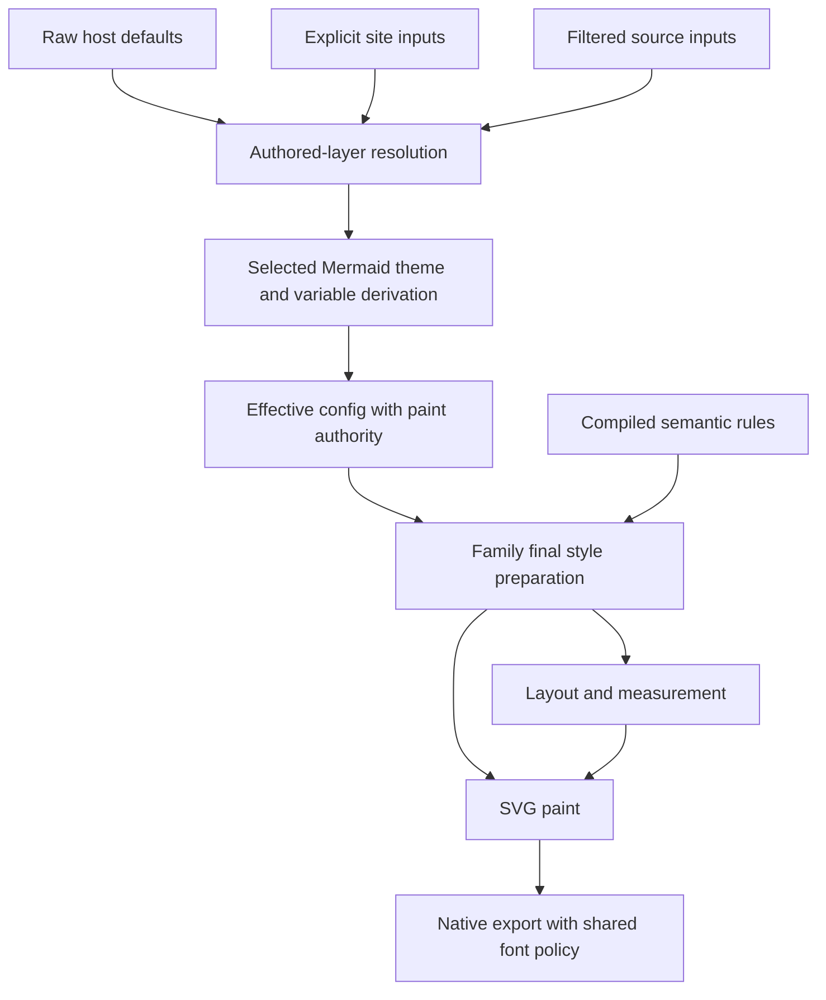
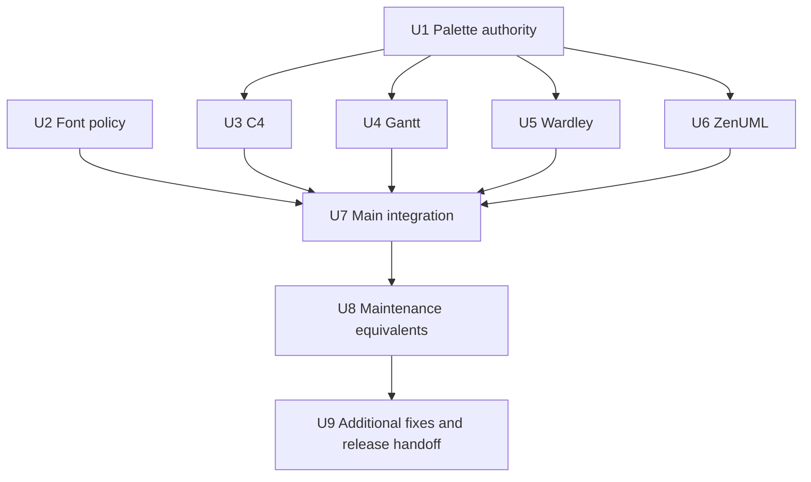

# Host Theme Correctness and Maintenance Backports - Plan

## Goal Capsule

- Objective: Host applications receive readable, semantically correct diagrams for issues #228–#232 on main and the 0.9.x maintenance line.
- Means: Repair shared theme provenance and family-owned style preparation, then port equivalent behavior through the maintenance API (KTD1–KTD5).
- Authority: Agreed user scope, this Product Contract, each branch's selected Mermaid source, then existing implementation and tests.
- Execution: Complete local implementation, focused commits, independent review, and verification on both branches; prepare a documented v0.9.2 backport selection and release-readiness handoff.
- Delivery boundary: No publication, remote messages, tag movement, package upload, or API migration of maintenance consumers. The maintainer owns the final release action.
- Stop condition: Ask only for an irreducible product/API conflict or missing essential input; report unavailable environment evidence honestly while continuing independent work.

---

## Product Contract

### Summary

Repair the five reported font and host-theme defects on both development and maintenance lines.
Use Mermaid's official cascade and derivation behavior while completing Merman's host-theme adapters.
Review other post-v0.9.1 fixes for safe maintenance inclusion after the issue repairs.

### Problem Frame

IDE and document hosts supply one theme across diagram families, but current output can hide children, erase task-state distinctions, render unreadable labels, or substitute Greek glyphs for Latin text.
The maintenance line uses a different internal theme architecture, so a shared behavior contract must survive different implementations.
The diagnosis and current-head reproduction evidence are recorded in `docs/research/2026-10-20-docgen-and-host-theme-defect-diagnosis.md`.

### Requirements

**Official configuration and host defaults**

- R1. Official theme selection and variable derivation follow the branch's selected Mermaid version, preserving raw explicit initialization/source inputs while discarding superseded derived values.
- R2. An externally selected source/site palette remains coherent through final paint selection, with source taking precedence over site and host defaults filling unowned values.
- R3. Explicit family/source styles retain property-level precedence; palette selection does not globally disable typography, geometry, assets, or effects.

**Reported output defects**

- R4. Implicit generic/default font selection does not select explicitly symbolic or pictorial faces for ordinary text, while deliberate named Symbol selection remains available (#228).
- R5. C4 filled boundary backgrounds appear behind all descendants, and host colors reach boundary labels, relationship labels, lines, and markers (#229).
- R6. Gantt host presets preserve ordinary/active/done/critical and combined-state semantics with appropriate inside/outside label colors (#230).
- R7. Wardley anchor labels receive host text styling while explicit anchor and evolved-component styles remain effective (#230).
- R8. ZenUML host themes style the frame/header, participants, messages, notes, groups, activations, and relevant typography coherently (#231).
- R9. The Quadrant base, ER forest, and maintenance Timeline custom-palette examples preserve matching source-derived foregrounds and backgrounds under host themes (#232).

**Maintenance and evidence**

- R10. All five issues are addressed on main and 0.9.x while retaining the maintenance public Presentation API and its pinned Mermaid baseline.
- R11. Tests may be restructured to express the repaired behavior, with original user inputs, pure host presets, explicit overrides, and final visible outcomes covered.
- R12. Other fixes after v0.9.1 receive an explicit include/exclude/defer decision based on applicability and dependencies, producing a verified v0.9.2 candidate without publishing it.

### Key Decisions

- Repair scope is determined by user-visible defects, including necessary internal refactoring. (session-settled: user-directed — chosen over excluding adapter work as features: all reported issues deserve maintenance consideration.) Governs R4–R10.
- Correctness tests may replace tests that encode defective behavior. (session-settled: user-directed — chosen over preserving every historical assertion: both branches should test the intended contract.) Governs R11.
- Maintenance consumers keep their existing API. (session-settled: user-approved — chosen over importing the new theme architecture: fixes should not require a consumer migration.) Governs R10.

### Acceptance Examples

- AE1. With editor-dark and source `theme: base` plus light Quadrant fills, point labels use the newly selected source palette. Covers R1, R2, R9.
- AE2. An explicit initialization text variable survives a later source theme selection when Mermaid retains that raw input. Covers R1, R3.
- AE3. Nested C4 boundaries with opaque fills leave descendant nodes and relationship arrows visible. Covers R5.
- AE4. ActiveCrit and DoneCrit preserve their active/done fills plus critical borders; outside labels use their surrounding surface. Covers R6.
- AE5. A Unicode Symbol fixture mapping ASCII to Greek is rejected by implicit selection despite complete a-z coverage, but remains usable by explicit name. Covers R4.
- AE6. A plain dark host preset styles a titled ZenUML diagram without manually supplied family config. Covers R8, R11.

### Scope Boundaries

The docgen commit uses older alpha.7 resource defaults; main and v0.9.1 already include recalibrated limits and facade exports.
No default unbounded policy or further budget increase is planned without the actual failing source and measurement.
No universal contrast-repair heuristic, SVG recoloring postprocessor, new fontconfig interpreter, or general-purpose proof engine is introduced.
Fontique default-provider migration is deferred: the symbol-selection repair must preserve bounded discovery and existing feature/linkage contracts.

---

## Planning Contract

### Key Technical Decisions

- KTD1. Retain minimal authored-layer and selected-palette authority in the existing core config/provenance path; consume it in common and family-specific final paint resolution. This closes R1–R3 without a second Mermaid JSON cascade. (session-settled: user-approved — chosen over per-family color patches: the ownership error crosses families.)
- KTD2. Prepare each affected family's final styles before SVG emission, with shared typography used by measurement and paint. Extend existing semantic targets where they already express the role, rather than introducing parallel styling APIs. Governs implementation of R5–R8.
- KTD3. Use one implicit-font selection policy with classification metadata captured during existing font admission. This preserves explicit font requests and bounded providers under R4, without introducing Fontique into default export dependencies.
- KTD4. Define preset task-state fills and foregrounds explicitly while retaining user-authored unqualified Task rules; resolve critical stroke independently of fill state. This preserves the existing customization contract under R6.
- KTD5. Port behavior specifications to a branch created from `v0.9.1`; cherry-pick independent commits only where dependencies agree, otherwise make release-local equivalents. This satisfies R10 without importing typed-theme functionality.
- KTD6. Extend owner tests with failing reproductions before fixing behavior, and keep oracle tests separate from Merman host-theme assertions. This implements R11 without treating upstream adapter limitations as correct host-theme output.

### High-Level Technical Design

### Implementation Constraints and Risks

Main starts at `a933b02c1976a5034350d96574aea048e393c04e`, selecting Mermaid 12.2.0; v0.9.1 is `f6202f702dbde0a75049b1a62b3124feae709b3d`, selecting Mermaid 12.1.0.
Use exact Git objects when `repo-ref/mermaid` is checked out elsewhere.
Run Cargo commands sequentially in the shared target directory with a modest job count.
Workers may edit disjoint owner files, but canonical verification and commits remain coordinated.
Protect all unrelated user changes; no reset, restore, stash, or cleanup of another actor's files.

Palette precedence changes deliberately invalidate some existing tests; update their contract rationale rather than silently replacing snapshots.
New semantic target support requires discovery/evidence updates matching actual terminal consumption.
Symbol classification is an exclusion signal, not a proof about every font's glyph semantics; retain explicit unresolved behavior when no admitted implicit face is suitable.

### Assumptions and Deferred Execution Details

The v0.9.2 candidate is prepared locally; publication requires a later maintainer action.
The original docgen graph is unavailable, so no claim is made that it fits the current finite budget.
Linux-specific font integration will use an available Linux runner or be recorded as an explicit environment gap with deterministic cross-platform coverage and an executable Linux test.
Exact private helper names and whether legacy assertions can be simplified are resolved during owner implementation.

---

## Implementation Units

### U1. Preserve selected palette authority through final paint

**Goal:** Satisfy R1–R3 and R9 on main.
**Dependencies:** None.
**Files:** `crates/merman-core/src/config/appearance.rs`, `crates/merman-core/src/config/mod.rs`, `crates/merman-core/src/config/paint_inputs.rs`, `crates/merman-core/src/parse_pipeline.rs`, `crates/merman-render/src/quadrantchart/text_paint.rs`, `crates/merman-render/src/er/theme.rs`, `crates/merman-render/tests/theme_resolution_svg_test.rs`, `crates/merman-render/tests/theme_materialization_operation_test.rs`, `crates/merman-render/tests/quadrantchart_svg_test.rs`, `crates/merman-render/tests/er_svg_test.rs`.
**Approach:** Implement KTD1 using the existing AppearanceDecision and raw-input materialization paths; reconcile ER's raw paint bitset with shared authority.
**Test scenarios:**
- Covers AE1 and AE2 with frontmatter and directives.
- Source same-value theme selection acquires ownership; recipe compatibility selection does not suppress its own typed paint.
- Secure-filtered, null, and invalid selections retain selected-version behavior.
- HTML/native ER labels and repeated renders preserve the same effective colors without disabling independent typography/effects.
**Verification:** Original Quadrant and ER failures pass through renderer and binding owners; existing unrelated theme behavior remains covered.

### U2. Share implicit font selection and reject symbolic defaults

**Goal:** Satisfy R4 independently of theme code.
**Dependencies:** None.
**Files:** `crates/merman-export/src/font_environment.rs`, `crates/merman-export/src/lib.rs`, `crates/merman-export/src/fonts.rs`, `crates/merman-export/src/fonts/system.rs`, `crates/merman-export/src/fonts/resolver.rs`, `crates/merman-export/Cargo.toml`, `crates/merman-export/tests/native_fonts.rs`, `crates/merman-export/tests/platform_font_context.rs`, `crates/merman-export/tests/fonts/README.md`, licensed test fixtures.
**Approach:** Implement KTD3 across system-only and native contexts; preserve resolver identity and metadata after source bytes are released.
**Test scenarios:**
- Covers AE5 with a poisoned generic mapping and insertion-order controls.
- A valid serif generic remains selected; symbol-only implicit resolution does not claim success.
- Bounded discovery retains classification without rereading fonts.
- Linux isolated fontconfig and ZenUML fallback select an actual text face; direct serif behaves the same.
**Verification:** Actual selected faces and rendering outcomes pass owner tests; feature closure and generated dependency/license checks remain valid if a direct dependency is added.

### U3. Repair C4 background layers and theme terminals

**Goal:** Satisfy R5.
**Dependencies:** U1 for final palette integration; painter correction is independently committable.
**Files:** `crates/merman-render/src/svg/parity/c4/render.rs`, `crates/merman-render/src/c4/typography.rs`, `crates/merman-render/src/c4/text_paint.rs`, `crates/merman-render/src/diagram_theme/semantic.rs`, `crates/merman-render/src/diagram_theme/family_mechanism_matrix.rs`, `crates/merman-render/tests/c4_svg_test.rs`, `crates/merman-render/tests/c4_relation_geometry_test.rs`.
**Approach:** Split boundary background from foreground; bind the existing edge/label/marker and cluster-label roles under KTD2.
**Test scenarios:**
- Covers AE3 with multiple nested boundaries and explicit filled-boundary source styles.
- Light/dark presets reach boundary labels, relationship labels, line and marker paint.
- Explicit site colors and UpdateRelStyle win; no-theme transparent baseline remains compatible.
**Verification:** DOM paint order and final relation paints pass, with a representative raster visibility check.

### U4. Preserve Gantt state and foreground semantics

**Goal:** Satisfy R6.
**Dependencies:** U1.
**Files:** `crates/merman-render/src/diagram_theme/presets/catalog.rs`, `crates/merman-render/src/gantt/task_bar.rs`, `crates/merman-render/src/gantt/theme.rs`, `crates/merman-render/src/gantt/theme/css_binding.rs`, `crates/merman-render/src/svg/parity/gantt/render.rs`, `crates/merman-render/src/svg/parity/css.rs`, applicable semantic/discovery owners, `crates/merman-render/tests/gantt_svg_test.rs`.
**Approach:** Implement KTD4 with existing normalized task states and prepared terminal styles; bind foregrounds to actual inside/outside surfaces.
**Test scenarios:**
- Covers AE4 across light/dark presets and all six states.
- User-authored unqualified Task fill still overrides all applicable tasks.
- Source state variables, milestone/vertical terminals, clickable labels, and narrow-bar outside labels retain their contracts.
**Verification:** State fills remain distinct where defined by the preset, critical strokes compose correctly, and no stale CSS winner hides text.

### U5. Bind Wardley anchor label styling

**Goal:** Satisfy R7.
**Dependencies:** U1.
**Files:** `crates/merman-render/src/wardley/theme.rs`, `crates/merman-render/src/svg/parity/wardley.rs`, applicable semantic/discovery owners, `crates/merman-render/tests/wardley_svg_test.rs`.
**Approach:** Add anchor text to the existing family plan under KTD2 while retaining no-host upstream defaults.
**Test scenarios:** Business/Public anchors follow pure light/dark host presets; explicit anchor colors and evolved-component labels retain precedence.
**Verification:** Actual anchor terminal fills and ordinary component controls pass through resvg-safe output.

### U6. Complete coherent ZenUML host styling

**Goal:** Satisfy R8.
**Dependencies:** U1.
**Files:** `crates/merman-render/src/zenuml/theme.rs`, `crates/merman-render/src/zenuml.rs`, ZenUML typography owners, `crates/merman-render/src/svg/parity/zenuml.rs`, applicable semantic/discovery owners, `crates/merman-render/tests/zenuml_svg_test.rs`, `crates/merman-render/tests/theme_support_discovery_test.rs`.
**Approach:** Replace the title-only adapter with a unified family plan under KTD2, including actual source ownership for the title.
**Test scenarios:**
- Covers AE6 and explicit ZenUML text, participant, note, and frame overrides.
- Typography changes use matching measurement/paint values; empty/title-only diagrams report accurate support.
- Plain upstream-style output remains unchanged without host theme input.
**Verification:** Whole-family color assertions and representative native output agree with truthful capability reports.

### U7. Verify main integrations and document the repaired contract

**Goal:** Satisfy R11 across public entry points.
**Dependencies:** U1–U6.
**Files:** `crates/merman-bindings-core/tests/host_render_contract.rs`, `crates/merman-bindings-core/tests/native_fonts.rs`, `docs/rendering/custom-diagram-themes.md`, `docs/bindings/OPTIONS_JSON.md`, relevant coverage records and changelog.
**Approach:** Replace manual-config masking with pure preset cases while retaining explicit override coverage; document intentional precedence and support changes.
**Test scenarios:** The original six-family inputs pass with no preset/light/dark, source/site overrides, repeated calls, and SVG/native output controls.
**Verification:** Focused owner suites, shared core/export suites, formatting, Clippy, and applicable SVG structure/parity checks pass; independent review finds no unresolved blocker.

### U8. Port all issue repairs through the maintenance architecture

**Goal:** Satisfy R10 without changing maintenance consumers.
**Dependencies:** U7.
**Files:** On v0.9.1: `crates/merman-render/src/presentation/compiler.rs`, `crates/merman-render/src/presentation/mod.rs`, legacy family SVG owners, `crates/merman-core/src/engine.rs`, core config owners, `crates/merman-export/src/lib.rs`, `crates/merman-export/src/fonts.rs`, corresponding family/binding/export tests.
**Approach:** Implement KTD5, preserving host projection separately from explicit raw site/source inputs; port independent painter/font corrections and implement family equivalents through legacy owners.
**Test scenarios:** Repeat AE1–AE6 through the legacy API, including Timeline cScale0..2 and maintenance Gantt state behavior.
**Verification:** The maintenance branch passes its owner suites and appropriate full checks without a public schema, API, or Mermaid-baseline migration.

### U9. Assess additional fixes and prepare the v0.9.2 candidate

**Goal:** Satisfy R12.
**Dependencies:** U8.
**Files:** A backport decision report under `docs/release/`, maintenance changelog, accepted fix-owned files and their tests.
**Approach:** Inspect actual post-tag diffs and dependencies; record include/exclude/defer decisions and apply only compatible fixes with focused evidence.
**Test scenarios:** Accepted behavior-bearing fixes retain their regression checks; excluded new functionality does not enter the candidate.
**Verification:** Final branch heads, commit mapping, selected fixes, test results, remaining environment gaps, and release prerequisites are documented without publication.

---

## Verification Contract

Use `cargo nextest run --locked` for the affected core/render/export/binding owners, adding only the features required by each owner.
Use `cargo fmt --all -- --check`, scoped Clippy with warnings denied, and `git diff --check` for Rust changes.
Run the repository's full SVG structure gate after renderer changes, then applicable parity/root gates; do not alter comparator normalization to hide paint semantics.
Run dependency/legal generation and feature/target checks when dependency ownership changes.
Replay branch-local tests on the maintenance candidate, rather than treating main evidence as maintenance proof.
Record each red reproduction, final passing command, source head, and environment-only omission in execution evidence outside this decision plan.

## Definition of Done

All R1–R12 have implementation and verification evidence on the branches to which they apply.
All five issue repairs are represented on both branches, with public maintenance compatibility retained.
Independent review findings are fixed or explicitly resolved with evidence.
The v0.9.2 candidate has an explicit additional-fix selection and release-readiness handoff.
No abandoned experimental implementation, unrelated user edit, or generated unreviewed baseline enters the commits.
Publication and remote communication remain outside the completed local work.

## Sources

- `docs/research/2026-10-20-docgen-and-host-theme-defect-diagnosis.md`
- `tools/upstreams/MERMAID_REFERENCE_BUNDLE.json` and `tools/upstreams/REPOS.lock.json`
- Selected Mermaid `packages/mermaid/src/config.ts`, theme derivation modules, Gantt styles, C4 and Wardley renderers.
- Selected ZenUML plugin `a86a2bf4d8fd2a9045f564b5b37c4c70cde18ca6`.
- GitHub issues `https://github.com/Latias94/merman/issues/228` through `https://github.com/Latias94/merman/issues/232`.
