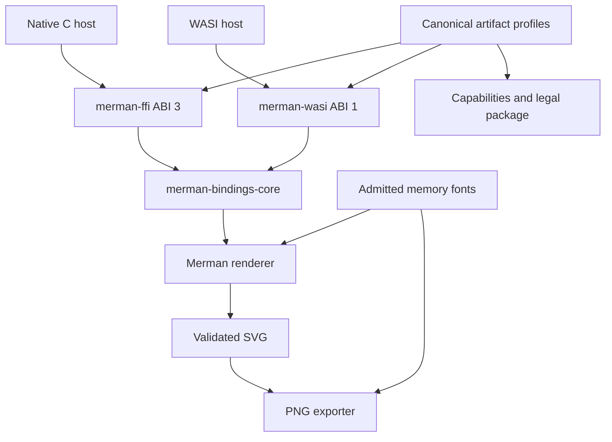
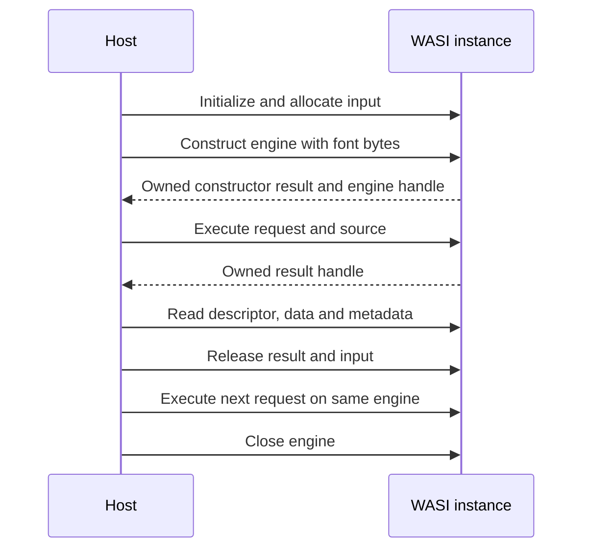

# Headless SDK Delivery - Plan

## Goal Capsule

- Objective: downstream applications can render complete labels and embed a documented, ready-to-use Merman runtime without maintaining their own Rust distribution.
- Means: fix the Swimlane regression, share bounded memory-font services, and package native C and WASI SDKs with explicit capability profiles (KTD1-KTD5).
- Authority: maintainer instructions, this Product Contract, existing public contracts, and the pinned Mermaid source, in that order.
- Execution: implementation and verification on feature branches based on `main` and `release/0.9.x`; the integration owner runs Cargo sequentially.
- Stop conditions: preserve and report unexpected user edits; never weaken a test or advertise an unverified target to make a deliverable appear complete.
- Delivery: reviewable commits, local artifacts and CI/release recipes; registry publication and immutable release tags remain a separate release operation.

---

## Product Contract

### Summary

Repair issue #242 on both supported lines.
Add reusable WASI and native C SDK delivery for issue #243 and other language-neutral consumers.
Ship artifact-specific capability, font and license information so downstream users can choose whether to include ELK and math.

### Problem Frame

Swimlane edge labels reserve wrapped layout space but emit unwrapped HTML, causing clipped text in the resvg-safe pipeline.
Non-JavaScript hosts currently choose between an external CLI, platform-specific source builds, a browser binding, or a Typst-specific protocol.
Existing native packages omit specialist outputs, while the complete CLI and C reference include dependencies that some downstream users cannot accept.

### Key Decisions

- Work on the two active release lines and exclude the independent DrawingList branch. Governs R1, R2. (session-settled: user-directed - chosen over waiting for DrawingList: the maintainer requested independent bug fixes and SDK delivery.)
- Provide explicit artifact choices instead of requiring downstream users to rebuild. Governs R3, R4, R8. (session-settled: user-approved - chosen over source-only custom features: downstream integration and license selection should be supported by the project.)

### Requirements

**Compatibility and rendering**

- R1. Wrapped Swimlane edge labels remain complete and use the same wrapping constraints in layout, HTML emission and resvg-safe fallback.
- R2. The maintenance implementation preserves Mermaid 12.1, Options JSON schema 2 and existing ABI layouts; main retains its current development contracts.

**Embedding**

- R3. A `wasm32-wasip1` reactor exposes a versioned scalar ABI for construction, execution, catalog discovery, input allocation and result release.
- R4. A native C SDK provides matching headers, libraries, integration examples and target/runtime requirements.
- R5. The WASI standard artifact renders SVG and PNG with one admitted font database for measurement and painting, accepts additional font bytes and performs no ambient font, file or network discovery.
- R6. Normal failures return structured errors and permit later calls; successful results retain owned bytes and size metadata until explicit release.
- R7. One WASI instance supports sequential repeated calls; traps and allocator exhaustion do not promise structured recovery.

**Capabilities and distribution**

- R8. Standard excludes ELK and math; math adds only mathematical rendering; full additionally admits ELK.
- R9. Each artifact includes its actual capabilities, target, schema/ABI versions, checksums, font inventory, third-party notices and source-availability information.
- R10. Packaged native C and WASI output comparisons use identical source, fonts, options and deterministic environment; only supported targets and formats are advertised.
- R11. SDK delivery on `release/0.9.x` is additive and explicitly documented as the maintainer-authorized exception to the ordinary bug-fix-only maintenance policy.

### Scope Boundaries

DrawingList migration, a new shaping engine, general HTML/CSS layout, SVG font embedding and a dynamic plugin ABI are outside this work.
Keep existing language package defaults unchanged.
Do not generate every possible feature combination or add a second release framework.
Additional CJK/emoji font packs may follow; the initial bundled font declares its actual coverage and accepts caller-supplied additions.
Do not describe the standard configuration as MIT-only: MPL and font notices remain artifact facts.

### Acceptance Examples

- AE1. A long Swimlane HTML edge label wraps into visible fallback lines rather than losing its beginning or end. Covers R1.
- AE2. A Go host loads the standard WASI artifact with no preopened filesystem, renders SVG and scaled PNG, then reuses the instance after a parse error. Covers R3, R5-R7.
- AE3. A standard consumer receives a typed missing-capability error for explicit ELK or math requests; a math consumer can render formulas without linking ELK. Covers R8.
- AE4. A C application links a packaged SDK using only its include/lib contents and obtains the artifact's runtime catalog. Covers R4, R9.

---

## Planning Contract

### Key Technical Decisions

- KTD1. Use separate feature branches for main implementation and maintenance adaptation; forward-port the behavior, not development-only APIs. R2 and R11 explicitly permit additive SDK delivery without importing the theme migration.
- KTD2. Repair the label writer using existing HTML measurement and overflow conventions; preserve family-specific wrapping width, padding and style precedence. Follow `createText.ts` and the ordinary Flowchart node writer.
- KTD3. Extract memory-font admission from file acquisition inside `merman-export`; share validation, deduplication, face limits and selection precedence. Preserve the exhaustive public `FontSource` enum by adding a constructor/builder rather than another enum variant.
- KTD4. Separate codecs from system-font discovery on main; on maintenance preserve existing native behavior through explicit product recipes or a compatibility feature route.
- KTD5. Implement `merman-wasi` over safe `merman-bindings-core`, independently version its ABI, and register a distinct transport. Do not expose the native C function-pointer table to WASM hosts.
- KTD6. Use fixed-width offsets/lengths and result handles; input buffers belong to the module and results own their payloads until release. Bound allocations before copying and validate live input ranges before borrowing.
- KTD7. Reuse canonical artifact recipes and legal projections for standard/math/full; publish only combinations whose imports, output and legal closure pass their owner checks.
- KTD8. Record SVG logical viewport size separately from PNG pixel size through shared output metadata. Preserve parser-provided byte spans rather than inventing universal exact line/column diagnostics.
- KTD9. Bundled fonts are production resources with pinned provenance and license text; caller-provided fonts precede bundled defaults. Reject unsupported strict-font operations instead of silently claiming exact measurement.
- KTD10. Add a new C font constructor through an appended ABI 3 function slot and a separately named record; preserve every existing record and minimum-prefix digest. Its owned font context supplies measurement and painting without a host callback.

### High-Level Technical Design

### Assumptions and Risks

The required native SDK targets are `aarch64-apple-darwin`, `x86_64-apple-darwin`, `aarch64-unknown-linux-gnu`, `x86_64-unknown-linux-gnu` and `x86_64-pc-windows-msvc`, each with a dynamic and static C library.
The required WASI target is `wasm32-wasip1`.
Both lines support standard, math and full on those targets; a failed qualification blocks that configuration rather than producing a placeholder download.
Cross-platform acceptance belongs to CI, not a macOS-only local build.
The existing default native language SDK remains SVG/analysis/ASCII-oriented.
WASI math/full use the existing cooperative `interactive` resource profile with host memory/execution limits.
Their real host smokes must render a formula to SVG and PNG and verify that an explicit `constrained` request receives the existing structured rejection.
Rust WASI stdlib can import filesystem calls, so target selection alone does not satisfy R5.
Dependency resolution and platform tools may block local builds; record the exact command and error rather than changing the lockfile speculatively.

---

## Implementation Units

### U1. Repair wrapped Swimlane HTML edge labels

**Goal:** fix AE1 on main and maintenance.
**Requirements:** R1, R2; KTD1, KTD2.
**Dependencies:** none.
**Files:** `crates/merman-render/src/svg/parity/flowchart/render/edge_label.rs`, `crates/merman-render/tests/swimlane_svg_test.rs`, `crates/merman-render/tests/svg_fallback_transform_test.rs`.
**Approach:** use the existing natural-width/HTML wrapping decision and explicit label overflow; avoid changing global fallback clipping.
**Execution note:** add a regression that fails through the public SVG and fallback paths before the writer change.
**Test scenarios:**
1. A long HTML label at narrow wrapping width creates multiple visible fallback lines and preserves the complete text.
2. Short labels keep single-line behavior; explicit breaks and long words keep existing whitespace semantics.
3. Custom font size and wrapping width remain consistent with the measured content box.
4. Existing rotated lane titles and explicit outer clipping still work.
**Verification:** focused Swimlane/fallback tests and the renderer-owned SVG structure gate.

### U2. Admit bounded font bytes and isolate font discovery

**Goal:** provide memory-only fonts for SVG measurement and PNG painting.
**Requirements:** R2, R5; KTD3, KTD4, KTD9.
**Dependencies:** none.
**Files:** `crates/merman-export/src/fonts.rs`, `crates/merman-export/src/font_environment.rs`, `crates/merman-export/src/lib.rs`, `crates/merman-export/Cargo.toml`, `crates/merman-export/tests/native_fonts.rs`, affected facade/product feature recipes.
**Approach:** extract shared byte admission and add an additive construction API; compile system acquisition only where selected.
**Test scenarios:**
1. The same fixture supplied as bytes and as a file yields equal measurement and PNG output.
2. Malformed fonts, duplicate data and face/byte limits use existing structured errors.
3. PNG with only memory fonts performs no system discovery and remains usable after a normal error.
4. Existing native system-font product recipes retain their advertised behavior.
**Verification:** memory-font and export tests, native regression tests, WASI closure and compilation.

### U3. Implement the reusable WASI transport and production font resource

**Goal:** deliver AE2 through a documented memory-safe ABI.
**Requirements:** R3, R5-R7; KTD5, KTD6, KTD9.
**Dependencies:** U2.
**Files:** `crates/merman-wasi/`, `Cargo.toml`, `Cargo.lock`, `crates/merman-bindings-core/src/transport_contract.rs`, `crates/merman-bindings-core/src/service_contract.rs`, `capabilities/feature-surface-v1.json`, `contracts/abi/merman-wasi-v1.json`, corresponding generated projections and integration tests.
**Approach:** keep allocation and scalar exports in the transport; shared execution, options, errors and font services stay in existing owners.
**Test scenarios:**
1. Construct, render SVG/PNG, read and free results, close, and repeat without stale state.
2. Input lifetime, invalid ranges, stale result handles and independent result ownership behave as documented.
3. Added fonts remain valid after input release; ordinary parse/option errors do not poison the engine.
4. The final artifact has only admitted WASI imports and runs without preopened paths.
**Verification:** ABI contract tests and real WASI execution in wazero and a second runtime.

### U4. Share output dimensions and validate actual artifact behavior

**Goal:** return useful metadata and prove transport parity.
**Requirements:** R6, R10; KTD8.
**Dependencies:** U1, U3, U7.
**Files:** `crates/merman/src/render/document.rs`, `crates/merman-bindings-core/src/render/request.rs`, `crates/merman-bindings-core/src/operation.rs`, `crates/merman-bindings-core/tests/native_fonts.rs`, `platforms/wasi/`.
**Approach:** carry authoritative SVG viewport information through the existing result; reuse PNG sizing metadata and existing structured diagnostic fields.
**Test scenarios:**
1. SVG viewport and scaled PNG dimensions reflect the returned artifact.
2. Packaged C and WASI use the same font bytes and deterministic settings for representative diagrams.
3. PNG comparisons inspect decoded pixels; SVG comparisons preserve semantic structure.
**Verification:** real host comparisons and metadata regression tests.

### U5. Package C and WASI SDKs with capability and legal profiles

**Goal:** deliver AE3 and AE4 as installable archives.
**Requirements:** R4, R8-R10; KTD7.
**Dependencies:** U3, U4.
**Files:** `capabilities/artifact-profiles-v2.json`, `scripts/sdk_archive.py`, `scripts/test_sdk_archive.py`, `scripts/release_surface_contract.py`, `.github/workflows/release-sdk.yml`, `.github/workflows/release-preflight.yml`, `distribution/sdk/`, `docs/release/THIRD_PARTY_COMPONENTS.json`, artifact-specific legal projections.
**Approach:** add exact standard/math/full recipes, archive existing built libraries/modules with headers and manifests, and use the current release trust/provenance conventions.
**Test scenarios:**
1. Archive contents match the selected artifact and reject missing/mismatched binaries or headers.
2. Standard excludes ELK/RaTeX; math excludes ELK; full includes its EPL source-availability material.
3. A C consumer compiles against the staged archive and queries/renders through ABI 3.
4. Actual WASI math/full archives render formulas to SVG and PNG under the qualified resource policy, and reject explicit constrained math requests.
5. The preflight SDK job builds, archives and tests every required target/configuration before a release can qualify.
**Verification:** Python packaging contracts, native consumer smoke, artifact closure/legal checks and workflow analysis.

### U7. Expose memory fonts through an additive C constructor

**Goal:** make the delivered C SDK exercise the same closed font service as WASI.
**Requirements:** R4, R5, R10; KTD10.
**Dependencies:** U2.
**Files:** `contracts/abi/merman-v3.json`, `crates/merman-ffi/src/lib.rs`, `crates/merman-ffi/Cargo.toml`, generated C/Rust ABI projections, `crates/merman-bindings-core/src/artifact_contract.rs`, `crates/merman-bindings-core/src/transport_contract.rs`, `crates/merman-ffi/tests/c_consumer_smoke.c`.
**Approach:** append an independent memory-font constructor with copied input bytes and optional bundled fallback; retain old constructors and all frozen ABI prefix layouts.
**Test scenarios:**
1. The archived C consumer constructs with supplied font bytes, releases input storage, and renders SVG/PNG with the retained context.
2. An older minimum-prefix consumer still discovers and uses the original table.
3. Invalid font buffers and absent font capability return ordinary owned error results without publishing an engine.
**Verification:** generated ABI verification, old/new C consumer smokes and native/WASI output comparison.

### U6. Adapt the SDK delivery to the maintenance implementation

**Goal:** make both lines reviewable without merging main's breaking refactors.
**Requirements:** R2, R11.
**Dependencies:** U1-U5.
**Files:** the U1-U5 ownership paths on a feature branch based on `origin/release/0.9.x`, `docs/release/RELEASING.md`, `docs/release/PACKAGE_SURFACES.md`, `CHANGELOG.md`.
**Approach:** select compatible units and adapt constructor/metadata plumbing locally while retaining published options and ABI prefixes.
**Test scenarios:**
1. Existing schema-2 maintenance requests still succeed through native C ABI 3.
2. Both maintenance SDKs pass AE1-AE4 with their own generated contracts.
3. Previously published product defaults and Mermaid baseline remain unchanged.
**Verification:** maintenance-focused Rust/host tests and its own generated/legal gates.

---

## Verification Contract

Run Cargo sequentially, reuse the repository target directory, and prefer nextest.
Every result records source branch/head, exact command, outcome and any environmental limitation.

| Scope | Owner verification |
| --- | --- |
| All changes | `git diff --check`, `python3 scripts/check_path_lengths.py` |
| Rust | `cargo fmt --all -- --check`, focused `cargo nextest run --locked` |
| Renderer | focused Swimlane/fallback tests, full `xtask compare-all-svgs --check-dom --dom-mode structure --dom-decimals 3 --diagnostic-browser-text-layout` |
| SDK ABI | `xtask verify-native-abi`, `xtask verify-binding-contract`, new WASI ABI and host smokes |
| Features | `scripts/verify_artifact_dependency_closures.py`, `xtask verify-feature-matrix` |
| Legal | existing license report, legal projection and third-party verification commands |
| Packaging | `python3 -m unittest scripts.test_sdk_archive`, staged C consumer |
| Workflows | release security contracts, actionlint and zizmor where installed |

---

## Definition of Done

Both feature branches contain the bug fix and compatible SDK delivery with focused commits.
AE1-AE4 pass on supported owner environments; unrun platform lanes remain explicitly unverified.
Capability catalogs and archive manifests agree with the actual built artifact.
No ambient WASI font/file/network acquisition is introduced.
Notices include bundled font licenses and the actual linked dependency/source obligations.
Documentation distinguishes maintenance schema 2 from main's development schema and independent WASI ABI 1.
Independent code review has no unresolved blocking finding.
No abandoned implementation, unrelated edit, release tag or registry publication is included.

---

## Sources

- Issues: https://github.com/Latias94/merman/issues/242 and https://github.com/Latias94/merman/issues/243.
- Upstream wrapping: `repo-ref/mermaid/packages/mermaid/src/rendering-util/createText.ts`.
- Release policy: `docs/release/RELEASING.md`.
- Existing native SKU: `docs/adr/0079-default-native-prebuilt-capability-sku.md`.
- Font/provider policy: `docs/adr/0086-deterministic-text-measurement-without-vendored-font-tables.md`.
- Artifact recipes: `capabilities/artifact-profiles-v2.json`.
- WASI target behavior: https://doc.rust-lang.org/stable/rustc/platform-support/wasm32-wasip1.html.
- WASI host lifecycle: https://github.com/wazero/wazero/blob/main/config.go.
- EPL: https://www.eclipse.org/legal/epl/epl-v20.html.
- Font licensing: https://openfontlicense.org/ofl-faq/.
