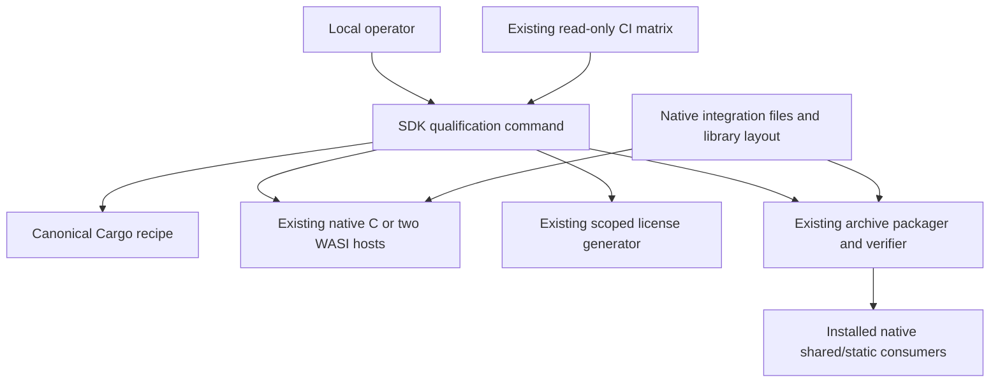

# SDK qualification refactor

Date: 2026-10-24.
Scope: follow-up to issues #242/#243 and the completed headless SDK delivery plan.

## Outcome

The same repository command builds and qualifies a single native C or WASI SDK
on both supported source lines. CI schedules the existing 18 target/profile
combinations; local callers run the same command serially with their installed
tools. Neither caller duplicates staging or installed-consumer behavior.

The completed rendering fixes, standard/math/full choices, artifact-specific legal
material and source-line compatibility remain acceptance constraints. No renderer,
Cargo feature, ABI, Mermaid baseline or resource-policy migration is needed.
DrawingList and remote mutation/publication remain outside this goal.

## Design

`scripts/sdk_qualify.py` owns procedural sequencing only: resolve the exact source,
validate the recipe and native host, reserve a fresh working directory, build,
stage and normalize the library, run the existing host harness, generate the actual
catalog sidecar and exact legal report, package, verify, then test the extracted
native SDK. It installs no tools and never deletes or replaces an existing run.

`scripts/sdk_archive.py` retains payload and archive authority. A public helper
returns the small native integration files used by both consumers and archives;
one layout helper owns binary installation paths, including Windows import/static
library differences. The packager remains build-free.

The existing parity job continues comparing outputs from independent native and
WASI matrix jobs. Local native qualification may additionally use `--wasi-dir`
with the existing host harness. This is not a new release framework, job scheduler,
source analyzer or proof system.

## Alternatives

1. Keep workflow snippets and document a separate local script. Rejected because
   normalization, Windows layout and installed-consumer checks already have two
   implementations; documenting them does not prevent drift.
2. Move the existing sequence into one repository command and share payload
   generation. Selected: CI owns scheduling/trust, existing modules own their
   contracts, and a small orchestration command is reproducible locally.
3. Build a resumable universal SDK/release orchestrator. Rejected: profiles,
   publishing, approvals, retries and tool installation already have owners.

## Work

1. Extract shared native integration files and binary installation layout; prove
   staged contents equal the archive using the existing small package fixtures.
2. Add the single-profile qualification command with source/host validation,
   fresh-run refusal and failure propagation; keep genuine host and archive checks.
3. Replace workflow staging/consumer/package snippets with the command and update
   workflow contracts, CI routing and downstream/operator documentation.
4. Adapt the same tooling to the maintenance branch without changing its own math
   policy or schema. Review both diffs, commit locally and run both source lines'
   six locally available native/WASI profiles through the new command.

## Verification

- Python package, recipe, workflow security/preflight and CI planner contracts pass.
- New tests exercise fresh-run refusal, host/recipe mismatch, stage failure ordering,
  relocatable macOS identity, Windows consumer paths and shared archive payload.
- `actionlint`, offline `zizmor` at high severity, path length and whitespace checks pass.
- Both lines produce six exact-source archives on macOS ARM64/WASI; every archive
  passes its verifier, both real WASI hosts and native C smokes, with shared/static
  extracted consumers. Native/WASI decoded pixels remain equal.
- Renderer behavior, features and ABI inputs are unchanged; prior Rust and complete
  SVG gates remain applicable. Linux, Windows and Intel macOS execution stays with
  the existing remote matrix and is not claimed by this local refactor.
- Final local commits, evidence paths, limits and any justified review finding
  are reported. Stop dependent writes on unexpected user modifications.
