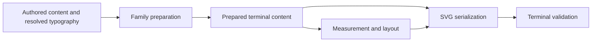

# Prepared label ownership

## Problem

Several confirmed rendering defects share a lifecycle error: layout measures one
interpretation of a label while emission reconstructs another. Sharing a parser
function alone leaves separate preparation, wrapping, fallback, and measurement
decisions in both phases. This is an ownership problem within the renderer;
browser-dependent font metrics are a separate, bounded residual.

## Decisions

- Extend existing family-owned artifacts and label plans. Do not introduce a
  universal scene graph, a CSS engine, or a second rendering pipeline.
- Prepare terminal content before measuring it. Retain the exact prepared
  fragment or styled words until emission, together with the geometry already
  owned by that family. Emission performs serialization rather than reparsing.
- Keep source provenance explicit: authored text, preprocessor placeholders,
  decoded text, sanitized XHTML, and SVG words are not interchangeable strings.
- Preserve pinned Mermaid wrapping and conditional fallback behavior. Probe
  measurements used by wrapping remain distinct from final drawn measurements.
- Reuse typed presentation configuration at family preparation boundaries;
  avoid reconstructing configuration from cloned JSON for each label.
- Apply correctness repairs to both release lines. Main-only artifact changes
  stay on main unless maintenance needs them to enforce the same correctness
  contract without a public API or layout JSON change.

## Implementation

1. Complete the current Unicode math, native projection, Sequence entity,
   Class Markdown, Block HTML, and reference-budget repairs. Validate minimal
   counterexamples against pinned upstream semantics before refreshing goldens.
2. Retain Class SVG title and relationship label preparation in a private family
   sidecar. Remove reconstruction in the SVG writer. Keep the existing public
   label-plan enum and layout wire format unchanged; preserve HTML, note paths,
   and wrapping checkpoints. Class terminal row geometry uses literal SVG bbox
   operations. Other families keep their established wrapping and host callback
   contracts rather than inheriting a new vertical composition rule implicitly.
3. Retain Block sanitized label fragments for nodes and edges within the family
   preparation lifecycle. Measurement and emission consume the same fragment.
   Reuse the resolved presentation configuration.
   Apply retained inline font declarations during unwrapped Block HTML
   measurement, including inheritance, through existing typography resolution.
   This does not expand the wrapped HTML or native CSS capability boundary.
4. Move native math geometry into a private prepared payload transported by the
   existing evidence lease. Remove both the native HTML template and its reader;
   the projector consumes the retained payload directly. Keep terminal SVG
   parsing for actual occurrence placement and validation. Preserve extension
   invalidation, independent expected occurrence counts, clipping, fingerprint
   validation, cancellation, and retained-memory accounting. Do not migrate this
   main-only evidence architecture into the maintenance line. Reimported native
   SVG remains ordinary vector content: inert occurrence attributes confer no
   preparation authority or receipt; browser projection still requires the
   private payload and family evidence.

## Verification and delivery

- Use independent style-sensitive host measurements and inspect emitted text,
  runs, viewport clipping, and sanitization through public rendering entry points.
- Run Cargo serially using the existing shared target directory. Use nextest,
  focused regression suites, full renderer tests, strict Clippy, and cargo fmt.
- Regenerate only source-owned layout changes through the existing generator.
  Run the SVG structure/parity owners without comparator or tolerance changes.
- Review ownership changes independently before committing. Keep commits scoped
  to the implementation unit and document maintenance inclusion decisions.
- Keep source and binary provenance for before/after artifacts. Report remote
  CI against the actual pushed revision. No performance claim follows from
  correctness tests or refreshed input hashes.
