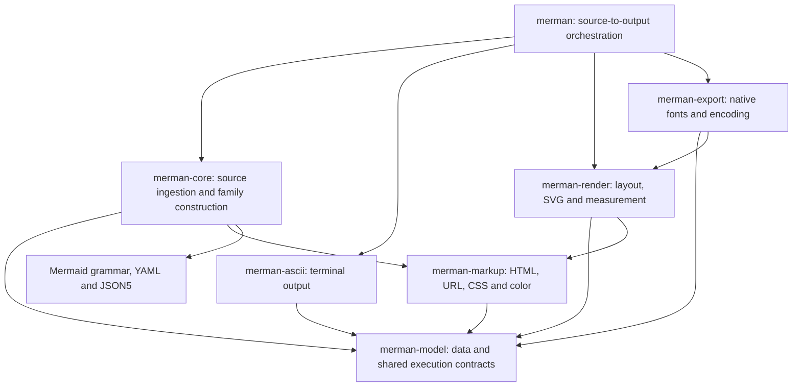

# Model, Source, and Consumer Boundaries

## Status and authorization

Implementation began with M0 baseline preparation on 2026-10-30; the [implementation record](../reviews/2026-10-30-model-source-boundaries-implementation.md) tracks actual completed slices and evidence. The maintainer explicitly authorized a development-line architecture cleanup, including breaking Rust APIs. Remove obsolete import paths, adapters and duplicate ownership after migrating their consumers; preserving unpublished Rust source compatibility is not an acceptance requirement. This authorization covers implementation and local Conventional Commits without another design-approval checkpoint. Publication, tags and changes to released artifacts remain separate release operations.

As of 2026-10-31, shared ownership, all family data, model-driven ASCII, requested fixes,
parser-independent graphics and API retirement are implemented and validated. The strict matrix
passed 765 checks over 46 profiles; final correctness, six fixed-consumer comparisons, four cold
observations and recorded installed products passed their respective controls. The continuation
also passed Linux Node GNU/musl installed packages and Android API 29/34 instrumentation.
Implementation was merged in [#258](https://github.com/Latias94/merman/pull/258); both Apple
Swift/UniFFI PR CI owners passed on the final PR head. M6/M8 remain open for complete Flutter
Apple slices and the macOS Dart consumer, owned by Release Preflight's `flutter-dry-run`. See
[outstanding qualification](../reviews/2026-10-30-model-source-boundaries-implementation.md#outstanding-applicable-qualification);
missing environments are not treated as successful or not-applicable execution.

Start from `8888358b1873c89049c0e430615c91d406dac224`, the verified dependency-review candidate on top of main `4e9fa48139361bb30f81cb86d413597643978a4f`. Integrate that prerequisite, or explicitly establish its equivalent, before freezing the implementation baseline. Fetch and inspect any newer main commits before integrating them. Do not modify the primary worktree's unrelated files or historical experiment worktrees.

The [dependency review](../research/2026-10-30-dependency-review.md) supplies the evidence and the [successor architecture decision](../adr/0099-model-and-source-boundaries.md) records the selected ownership. The task table below is the execution status; historical plans and performance reports retain their original completion and measurement boundaries.

## Objective

Give model consumers an independently usable Rust package, let ASCII and graphical output owners compile without Mermaid source ingestion, and let diagnostic consumers omit fix generation. Clean up the public Rust modules, feature forwarding and capability queries around those responsibilities. Preserve the precise source-to-output product and one family-owned semantic construction.

The recent work already established semantic versus presentation execution, requested editor facts, explicit math and a shared controlled parse kernel. Retain [ADR-0098](../adr/0098-semantic-presentation-capabilities.md) and the [October 29 simplification](../reviews/2026-10-29-simplification-audit.md). This plan changes compilation and ownership; it does not restart those pipelines.

At the reviewed prerequisite, the facade's Flowchart ASCII closure contains 84 external package versions and its Flowchart SVG closure contains 114. The default facade contains 116. These are normal/build graph observations on the review's declared host/target, not size or timing targets. Freeze new direct-consumer baselines before implementing; a facade count is not interchangeable with a direct model consumer's count.

## Required outcomes

| ID | Requirement |
| --- | --- |
| R1 | A new `merman-model` package owns canonical family data and the minimum shared configuration-value, lifecycle, identity and resource contracts needed to use it. Its production graph has no dependency on `merman-core`, a grammar, a source parser or a renderer. |
| R2 | `merman-ascii` consumes that package directly. Direct construction of a supported model and terminal rendering works without core, YAML, JSON5, HTML5 recovery, URL normalization or source CSS admission in the production dependency graph. Entity decoding and terminal Unicode rules remain where they have actual consumers. |
| R3 | The complete family inventory migrates. Flowchart/Swimlane identity sharing, Agentflow's distinct meaning, State flat documents, managed JSON, source-order witnesses, Class provenance and deep clone/drop/export behavior remain intact. Every model has one definition. |
| R4 | Core owns source preprocessing, detection, source-config authorization, sanitization, family grammar/DB construction, original-source remapping, requested editor facts, theme evaluation and source failure/recovery. These responsibilities do not migrate into the model package. |
| R5 | Source, model, terminal and graphical capabilities report their actual owners. Model availability never advertises a source parser. Source-to-output availability is the intersection of the parser and requested output owner. Cargo feature union cannot fabricate host-owned capabilities. |
| R6 | Cancellation, deadline, budget and arithmetic failures continue competing for the same sticky terminal state. Preserve independent output scopes, cumulative primary/fallback accounting and admission before derived allocation. Shared types do not create a new execution pipeline. |
| R7 | `merman-analysis/fixes` is a positive, default-off capability. Diagnostic-only builds exclude the YAML writer; a fixes-capable build still generates replacements only when the diagnostic projection requests them. Detection, suppression and severity selection precede fix materialization. |
| R8 | Diagnostic and fix projections reuse the same immutable analysis generation, source buffers, maps and fence identities. Preserve full-action coordinate mapping, shared edit provenance, cancellation, retention budgets and configuration release. Do not reparse or cache mutable fixes in canonical facts. |
| R9 | Migrate all Rust consumers, installed-product recipes, generated contracts, examples and docs. Remove obsolete core model namespaces and compatibility forwarding APIs at closeout. Explicit Mermaid-compatible JSON output remains supported. |
| R10 | Keep supported Mermaid syntax, admitted configuration, deterministic layout, SVG DOM, security normalization, error order, runtime/font ownership and resource policy. Raw caller-constructed models receive model/output admission; constructing or deserializing a type is not source-admission evidence. |
| R11 | Freeze and verify real independent consumers. Structural dependency exclusions are mandatory. Measure artifact size and cold compilation separately and report their actual results; no zero-dependency or percentage-speedup target is assumed. |
| R12 | Retire superseded implementations and temporary migration scaffolding before closeout. Existing manifest, feature, closure, parser, parity and installed-consumer owners prove the result; no second Cargo resolver, Rust analyzer or broad new validation framework is introduced. |
| R13 | `merman-render` and `merman-export` have neither direct nor transitive production dependencies on core's source parser. Render and core use one shared markup-safety, CSS structural-policy and Khroma color implementation. Render retains SVG sealing/measurement ownership and export retains native fonts/encoding. |

## Target ownership

### Shared model package

Use one model/shared-contract package, with empty default features and the existing positive `diagram-*` selection vocabulary. A second package owns the existing shared markup implementation needed by both source and SVG processing. Keep related implementation modules inside those packages instead of publishing a crate for every utility or diagram family.



Arrows are production dependencies. `merman-markup` retains HTML5 recovery, URL normalization, shared CSS structural predicates and Khroma-compatible color operations where its actual consumers require them; parser-free output still pays for this work. It does not imply an XML/CSS/math/font-parser-free renderer or guarantee a large source-to-SVG package-count reduction.

| Module in `merman-model` | Owns | Current source |
| --- | --- | --- |
| `families::<family>` | Canonical models, payload enums, public family vocabulary, flat document data, pure model-derived views and required lifecycle behavior | `merman-core/src/diagrams/**`, `src/models/class_diagram.rs` |
| `semantic` | `SemanticDiagramModel`, `SemanticMetadata`, `ParsedSemanticDiagram` and data-only warning facts | `src/semantic.rs`, data declarations under `src/diagram/` |
| `config` | The one `MermaidConfig` value container, read/mutation/merge behavior, bounded iterative cloning and disposal | Pure parts of `src/config/mod.rs` and `src/json_value/` |
| `operation` | Operation control, phase, cancellation, sticky terminal and common resource-error vocabulary | Production part of `src/operation.rs` |
| `runtime`, `time` | Existing operation context/policy, deterministic defaults, civil time and explicitly selected host adapters | `src/runtime.rs`, `src/time.rs`, `src/time/civil.rs` |
| `resources` | Profile/limit values, model complexity, pure family statistics and common admission methods | Data/model portions of `src/resources.rs` |
| `family` | One pinned declaration of logical identity, aliases, metadata/model-kind associations and selector facts | Identity portion of `src/family.rs` |
| `text`, `source` | Entity visitors and terminal-neutral text/value facts used by direct consumers; `SourceSpan` | `src/entities.rs`, relevant terminal helpers, `src/source_span.rs` |
| `presentation` behind `presentation-data` | Pure full-model payloads required by existing borrowed terminal views and irrecoverable empty/presence/order projection facts; M5 adds frozen output metadata/context facts, with no theme evaluator or parser construction state | Data declarations currently gated by core `presentation` and compatibility witnesses currently gated by `compat-json` |
| `compat_json` behind an explicit projection feature | Pure controlled Mermaid-JSON serialization from existing model/config/evidence; a local projection error rather than core's parse error | Data-projector portions of the current full model methods |

Core forwards its family selection into model data while independently selecting its own grammar and construction. ASCII selects model data and its local terminal handler. Core's `presentation` forwards `presentation-data`; selecting data alone does not compile core presentation. System adapters remain opt-in and retain the same capability identities and default runtime policy.

Config source filtering becomes core-owned functions around the shared container. Parser-specific sanitization and warning/source remapping likewise become family/core functions. The foreign-type inherent-impl rule is a design constraint: core cannot keep adding methods to types defined in `merman-model`. Move pure methods with the type and replace source-owned methods with functions at their actual owner.

Keep one ordinary Rust definition for each shared type. Introduce narrowly documented constructors/accessors only where moving a formerly crate-private field requires a real cross-package construction API. Do not expose new `__private` escape modules, universal mutation traits or one setter layer per field merely to bypass visibility. Existing cross-package private bridges are resolved by the explicit output/engine split below.

The [complete family inventory](2026-10-30-family-data-inventory.md) is the M2 checklist: 34 canonical payloads, nine distinct full-data groups, fourteen terminal adapters and six compatibility-only full wrappers. Shared payloads do not become new logical languages or new ASCII handlers.

### Public Rust surface and retirement

The canonical model namespace is `merman_model::families::<family>`. Shared contracts use the corresponding `merman_model::{config,operation,runtime,resources,...}` modules, with a small intentional package-root export set. The workflow facade may expose `merman::model` as the model package; it must not reproduce the old scattered module tree.

| Existing surface | Final owner/action |
| --- | --- |
| Public `merman_core::diagrams::*` model/vocabulary paths and `merman_core::models::*` | Move to the canonical model namespace; make core's grammar/construction modules private; delete old re-export paths. |
| Core-root model/config/operation re-exports used only to preserve their old location | Migrate imports to the defining package and remove forwarding aliases. |
| `MermaidConfig::{authored_source_overrides,source_filtered_overrides}` | Core source-policy functions; no sanitizer dependency on the value container. |
| Model methods taking `PreprocessedSource`, parser errors or parser metadata | Core construction/remapping adapters. Pure data methods remain with their types. |
| `ModelComplexity::from_parsed_render` and `InputResourcePolicy::check_parsed_render` | During M1/M2, core adapters around shared complexity/admission. M5 moves pure frozen-input/context accounting with `PresentationDiagram`; source-input adapters remain core. |
| Terminal views and Class topology | Keep pure borrowed data/derivation with the family owner. Their full-payload branch selects `presentation-data`, retaining the existing full-context behavior. |
| Capability queries that require `has_semantic_parser` to admit an existing model | ASCII-local handler/model queries; source facades explicitly intersect parser and handler availability. |
| Eager fix-bearing internal diagnostic candidates and `config_for_rewrite` capture accessor | Replace with bounded fix evidence and request-selected projection; delete the eager implementation. |
| Info, Pie, Journey, Timeline, Packet and Radar compatibility-only full wrappers | Use canonical payloads in the full enum; keep irrecoverable empty/presence/order facts in `presentation-data`, captured by full construction independently of the serializer feature. Do not change canonical serde defaults to emulate removed wrapper APIs. |
| `PacketRenderBlock` | Rename the canonical value to `PacketBlock`, without a legacy alias. |
| Facade `pub use merman_core::*` | Replace with explicit workflow exports and the intentional `merman::model` namespace. |

Preserve explicitly requested `compat-json`, full custom-parser overlays and core's closed parsed-result guarantee. The shared presentation value checks data pairing; it does not authenticate its producer. Do not obtain a built-in model through JSON conversion or source replay to make an adapter compile. The model package is a Rust data contract, not a new universal serialized-model import protocol.

### Graphical output and shared markup

This is a separate bounded implementation slice in the same initiative, after the model/ASCII cut is independently verified. Merely removing export's direct core edge would leave `export -> render -> core`; completion requires removing the render edge too.

| Current coupling | Final owner |
| --- | --- |
| `sanitize.rs`, `sanitize/fragment.rs`, DOMPurify defaults and shared URL/HTML rules used by core and Render's `HtmlSanitizeSink` | `merman-markup`, retaining one existing implementation, sink contract and controlled budgets. Copy only sanitizer-owned generated defaults; do not import all core generated configuration or source parsing. |
| `style.rs` structural predicates used by Class source construction and Packet rendering; `theme_color.rs` Khroma operations used by core themes and SVG | `merman-markup`, including local color errors. Core and Render call the same algorithms. Render's stricter token-aware output CSS policy stays Render-owned. No model-to-markup edge is introduced. |
| Navigation serialization, tooltip/output normalization and output-only style helpers | Render, delegating shared safety rules to markup. Pure entity visitors stay in the model text owner. |
| `PresentationConfig` value plus detector mutation history | Keep the mutable initialization/detector journal and freeze computation in core; freeze the resolved values and exact paint/theme ownership facts into model presentation data. Equal final values do not reconstruct authored ownership or detector history. |
| `ThemeCompatibilityRecipe` versus `ThemeCompatibilityPlan` initialization cache | Recipe value/comparison belongs to shared presentation data. Core owns site-config initialization/cache and theme evaluation. Render compiles/exposes the recipe; the facade installs it on the engine. Delete Render's `install_parse_compatibility(MermaidEngine)` bridge. |
| `ParsedDiagramRender`, full model enum and parser-produced context consumed by layout | Core's closed parsed result contains a shared immutable `PresentationDiagram`: full model, frozen metadata, resolved presentation family and required context facts. Render accepts the shared value. Core retains actual parse-origin guarantees, callbacks/registries and construction scratch. |
| `BuiltinRenderSemantic::compatibility_json*` used for layout JSON | Share the data projector with model-owned evidence and projection errors. Core's source APIs adapt their errors; Render never imports a core parse error merely to serialize existing data. Source replay/detection/projection wrappers remain core. |
| Export's use of control/resources and Render SVG/measurement types | Import shared contracts from model; retain `export -> render` for the actual SVG seal, font/measurement interface and wrapping implementation. No extra interface crate. |

Keep two distinct contracts. Core's parsed-result type has private construction and contains the shared presentation value; only this source-owned wrapper guarantees that the actual preprocessing, detector, theme and family-construction stages produced it. Borrowing or extracting its data does not transfer that guarantee to caller-assembled values. This is retained source ownership, not a second model or a legacy import adapter.

`PresentationDiagram` owns immutable render data, distinct from the facade's operation-owning `PresentationArtifact`. It retains no parse control, engine initialization cache or runtime operation ledger. Its authored `try_new` route validates model/context kind, logical versus presentation family, IDs/declaration ordinals and the complete normalized theme recipe. Supplied configuration is caller-owned; equal values or matching recipe fingerprints never infer source-derived theme residuals. Render compares the complete recipe with its session and performs actual model/output admission.

Core assembles the shared value through a bounded frozen-data constructor that checks the declared facts' structural relationships, including ownership paths, residual/recipe associations and model/context references. This cross-package API is also available to independent producers, explicitly as declared output data: it cannot certify the producer's history. It exposes no `Parsed`, source-admitted or trusted flag and cannot manufacture core's closed result. Exact source paint authority comes from core's real journal/freeze computation and is verified there, including same-value explicit/framework assignments and site/source/detector ownership. No public fields, unchecked constructors or fingerprint-only substitute bypass these checks. Shared construction does not perform source CSS admission; source and output owners retain their actual policies. Ordinary authored construction uses no source-derived residuals; callers choosing explicit frozen facts own those declared semantics and still gain no source-origin or security authority.

Custom JSON model values and their explicit provenance can live in shared presentation data; custom source callbacks, registry overlays and reserved builtin identity admission remain core-owned. Custom models never acquire a builtin typed handler by copying a family name, and a semantic request does not fall back to a full custom parser. Include the current custom-parser cancellation/error cases when changing callback metadata or adapting projection errors.

Pure family compatibility serialization may move after M2 into the model package's explicit projection feature because both core and Render consume it. Minimal irrecoverable empty/presence/order facts belong to `presentation-data`, beside the family payload or in its presentation bundle. Core's full presentation construction always freezes and carries them, even when its `compat-json` feature is off; the serializer feature selects projection/routing, not capture of otherwise lost facts. Semantic-only construction does not gain unrelated presentation capture. A manually constructed model defaults to the declared full-model projection, never an inferred parsed-empty history; bounded explicit projection facts may represent a different declared result. Do not put DBs, detector callbacks, `PreprocessedSource`, parser errors or source-config parsing into the projector feature. Typed serde, terminal fallback and Mermaid compatibility JSON retain their distinct contracts.

`ResvgCompatibleSvg` continues to have private fields and Render's existing terminal seal. It binds exact SVG bytes, prepared math evidence, reference expansion, resource closure and font policy. Export continues checking the representations it actually builds, including filter evidence against the parsed usvg tree; a receipt is not a replacement for those checks. Native font acquisition, shaping, fontdb and operation-local caches remain export-owned, implementing Render's host-measurement interface. Keep ordered measurement phases, fallback, numeric validation and measurement/painting font identity. This refactor neither upgrades the native font stack nor resolves its existing governed advisories.

The chosen two-package addition has concrete consumers: model data is consumed independently by source, terminal, rendering and export; markup, shared CSS predicates and color algorithms are consumed by source and SVG output. Putting them in model would restore the expensive minimum graph, putting them in Render would make core depend on an output backend, and copying them would split existing correctness/security contracts. Further `kernel`, `config`, `runtime`, per-family or transport-interface packages require an independently demonstrated consumer need; they are not part of this plan.

### Identity and capability ownership

Retain a single declaration of pinned names/aliases and their relationships. Remove callback and detector function pointers from the portable identity projection; core binds executable implementations at its own owner. Keep source-only config effects and detector order with source admission. Reuse the current catalog machinery and closed static tables, with focused completeness checks.

Distinguish these observations:

1. Known family identity and aliases, independent of selection.
2. Model variants actually selected in the model package, subject to additive feature union.
3. Parsers/editor/full callbacks actually compiled in core.
4. Terminal handlers and fallback support actually compiled in ASCII.
5. Source-to-output capabilities actually exposed by a facade or host artifact.

Existing tests that equate a core family flag with exclusive ownership of the Rust model type must migrate. A model variant enabled by another model consumer may exist while core's parser is absent; that is a required case. Artifact `expected.diagram_families` continues to describe source parser availability, not every Rust payload visible through feature union. Profile validators and the existing ASCII profile must be updated together where they currently infer parser availability from selector names.

### Diagnostics and fix generation

Add `fixes = ["dep:serde-saphyr"]` to analysis, making its existing serialization-only dependency optional. Use a Rust diagnostic-projection policy, provisionally `FixGeneration::{Omit, Generate}`, with `Omit` as default and `Generate` constructible only with the feature. This selection does not participate in snapshot identity and does not add an options-JSON field.

Rule discovery retains diagnostic meaning, original locations and bounded repair evidence. Projection first applies rule enablement, suppression and severity; only retained diagnostics requested with `Generate` build replacement strings. Aggregate frontmatter migration is generated/mapped once per diagram per projection and shared through the existing edit ownership. Rich immutable generations may retain the minimum repair evidence under their retained-size budget, but must continue releasing parse-only site configuration.

Keep `DiagnosticFix`, `DiagnosticFixEdit`, diagnostics/facts DTO fields and code-action conversion available for decoding, construction and forwarding without generation code. `RuleCatalogEntry.fixable` retains its rule-definition meaning; artifact support is reported by the explicit `fixes` capability. Use the existing capability descriptor, append stable IDs/bits without renumbering existing entries, and regenerate its projections.

| Consumer | Compile/request policy |
| --- | --- |
| Direct analysis, `rust-analysis`, `cli-analysis`, `web-analysis`, `typst-wasm` | Diagnostic product; omit fix generation and the serializer. Document narrowed `cli-analysis` command and `web-analysis` result capability. |
| CLI default/release and LSP | Explicitly compile fixes. `fix` and quickfix projections request generation; ordinary text lint/validation can omit it. Gate the CLI command, write path and fix-only dependencies by `fixes`. |
| `rust-editor-core`, `rust-editor-facade`, `web-editor`, `web-full` | Explicitly compile fixes and request them where code actions require them. Navigation and symbols remain usable without fixes. |
| Existing native SDK/analysis-capable binding recipes | Explicitly retain current fix-bearing behavior. Select request work from the host's validated capability contract, not ambient dependency features. |
| Render/ASCII/export/Rustdoc/WASI SDK and current Node products without analysis | Keep their present scope; do not add analysis/fixes to them. |

Analysis payload v1, facts v2, options schema 3 and the transport ABIs retain their shapes unless an independently demonstrated field/operation change requires a version change. Existing optional fix fields can remain absent in a diagnostic-only product. A code-action request on a custom build without fixes reports the existing typed missing-capability form with the new capability ID. These product selections and Rust defaults are intentional breaking migration items even when the wire shape is unchanged.

For M6, the fixes-enabled profile set is explicit: `cli-release`, `lsp-library`, `lsp-stdio-release`, `rust-editor-core`, `rust-editor-facade`, `rust-all`, `web-editor`, `web-full`, `android-native`, `apple-uniffi-native`, `python-uniffi-native`, every existing `flutter-*-native`, `c-abi-native`, `rust-bindings-core-native-sdk`, `rust-native-sdk` and every existing `sdk-native-*`. The diagnostics-only set is `rust-analysis`, `cli-analysis`, `web-analysis` and `typst-wasm`. Remaining render/ASCII/export/Rustdoc/WASI/Node profiles do not gain fixes. Reconcile these selections with the actual descriptor at execution baseline rather than treating a renamed/deleted profile as silently optional.

### Build, package and CI ownership

Register both packages in workspace membership/dependencies, the coupled source publish graph, package-source exclusions and license/component projection ownership. Use the existing source-package dry-run/fresh-consumer admission; do not attempt to publish dependents before the new packages exist. Add the ordinary Rust-library admission profiles required by their declared metadata, with empty source-parser/output expectations; these are build roots, not additional prebuilt SDK/Web products.

Update `capabilities/feature-surface-v1.json`, `capabilities/artifact-profiles-v2.json`, generated host projections, fixed/supplemental host capability declarations and exact release feature recipes together. Profile validation must explicitly distinguish a model-data selection from a parser implementation. Pure model, markup, ASCII and Render roots have empty source-parser expectations, including the existing `rust-ascii` and `rust-render-native-svg` profiles; independent compiled consumer/handler tests validate their selected data/output families. Source facades retain actual parser-family expectations. Do not equate a local `diagram-*` flag with a parser callback or add redundant model fields to every artifact descriptor. Include the facade's retained math-free `complete-svg`/`complete-svg-elk`, independent optional layout engines and native/runtime owners; defaults must not drift as a side effect of package moves.

The moved source must remain reachable by the existing CI owners. Update `scripts/ci_plan.py`, its workflow-contract tests and explicit workflow path inventories for model/markup source, affected feature/fixture inputs and legal generation. Shared model/markup changes select the same parser/core/fuzz and SVG parity owners their old paths selected. Migrate WASM input/provenance and package rebuild tracking when they enumerate source roots. Reuse existing source/manifest information rather than adding a general repository dependency analyzer. New paths must not rely permanently on the planner's unknown-path fail-broad fallback.

## Execution order

The table tracks completed slices; the [implementation record](../reviews/2026-10-30-model-source-boundaries-implementation.md) records partial work and actual evidence. Work in coherent, reviewable Conventional Commits; keep affected Rust owners buildable at commit boundaries. Temporary moves within a slice may be incomplete locally, but do not merge a half-migrated package or retain a compatibility path as the final design.

| Slice | Work | Required exit evidence |
| --- | --- | --- |
| [x] M0 — Freeze | Fetch/integrate the prerequisite; inventory every canonical/full/terminal payload and public owner; commit independent-consumer fixtures and exact recipes before changing implementation. | All six independent base recipes passed with two runtime inputs each; receipts preserve source/fixture/lock/toolchain identities and the actual consumed outputs. See the implementation record for bounds and graph/size observations. |
| [x] M1 — Shared ownership | Add the model package, empty defaults and explicit adapters; move configuration value/lifecycle/resource/time primitives and migrate their consumers. Separate source/presentation-artifact admission from base methods. | The new package has no production core edge; same operation terminal/error and deep-value tests passed; affected production owners compiled. |
| [x] M2 — Family data | Move every family payload and vocabulary, flat documents, managed values, pure views, required pure full payloads and serializer-independent projection facts. Move source sanitization/remapping into core functions. Migrate renderer, parser, analysis and test imports. | All 34 payloads reconciled; no duplicate definition/source callback remains in model data. Lifecycle/family and isolated presentation-without-JSON producers passed. |
| [x] M3 — Model-driven ASCII | Retarget ASCII production dependencies/features; derive capabilities from local handlers; migrate the facade's source intersection and full-context adapters. | Independent model/ASCII graphs exclude source ingestion. Primary/fallback/report outputs match the frozen consumers; control, admission and asymmetric-feature owners passed. |
| [x] M4 — Requested fixes | Split feature inclusion from per-projection generation; migrate immutable evidence and host owners; remove eager replacement generation. | Diagnostics omit the writer; Omit/Generate reuse one generation. Exact diagnostics/fixes, mapping, identity, retention and broad-union/narrow-host owners passed. |
| [x] M5 — Parser-independent graphics | Extract the unique markup/CSS/color owner, immutable presentation input and data projections; retain the source-owned parsed-result wrapper; migrate engine/theme installation to the facade; remove Render/Export production core edges and forwarding. | Independent output closures exclude core/YAML/JSON5; full Render and source-authority/security/measurement owners passed, including structure/parity/parity-root DOM checks. |
| [ ] M6 — Products and authority | Update Cargo selectors, artifact/feature descriptors, exact release recipes, host catalogs, CI source-path ownership, generated source/legal materials, package ownership and publish order. Migrate all examples/docs. | Implementation, all 46 profiles, legal/source packages and recorded installed products passed, including Linux Node GNU/musl, Android devices and Apple Swift/UniFFI PR CI owners. Complete Flutter Apple slices and the macOS Dart consumer remain unqualified. |
| [x] M7 — Retirement | Delete old public model paths, obsolete wrappers, empty modules and temporary forwarding. Close the cross-package private-export inventory. | Complete family/private-export inventory reconciled; all in-repository consumers use final owners. Dedicated theme-acceptance cfg and public Rustdoc passed. |
| [ ] M8 — Closeout | Run final correctness/feature/parity owners once against the final source; repeat independent measurements; record observed benefits, limitations and migrations. | Final graph/size and cold observations retain their recorded source identities. Final #258 PR CI and performance contracts passed. M8 remains open for the outstanding Flutter Apple/macOS qualification. |

M4 can be developed independently after its evidence interfaces and host ownership are settled; integrate after M1/M2 if imports overlap. Serialize Cargo work in the parent worktree. Parallel workers may own disjoint family-data groups or host migrations, but share the final type definitions and must not revert each other's changes.

## Independent consumer acceptance

| Case | Required observation |
| --- | --- |
| A1: Direct model consumer, no parser | Runtime-fed family data can be constructed/read with model/JSON/order/lifecycle dependencies only. No core, grammar, YAML/JSON5, HTML5 recovery, URL/CSS source admission or renderer. |
| A2: Direct Flowchart/Class/State model to ASCII | Terminal output and complete fallback agree with the baseline consumed contract. The normal/build closure contains no core or source-ingestion stack. |
| A3: Core parser plus ASCII | Pass the exact model type directly, without conversion or replay. The ordinary complete source workflow preserves behavior. |
| A4: Model/ASCII family enabled, corresponding core parser absent | Model rendering works; core source parsing reports unavailable; source facade capability reports the true intersection. Include Flowchart/Swimlane alias and Agentflow controls. |
| A5: Full-context terminal adapters | Class topology, Gantt endpoints/display mode, Mindmap sections, Kanban metadata and State flat/provenance facts retain the existing full-context semantics without copying a second canonical graph. |
| A6: Invalid/hostile caller model and deep values | Keep terminal escaping, shape/identity checks, nesting, source-config fallback bounds, cancellation, arithmetic and cumulative layout/output limits. Deserialization has its own input-owner bounds. |
| A7: Diagnostics-only, fixes compiled plus Omit, fixes compiled plus Generate | Same retained generation and diagnostics; only Generate materializes edits. Only the source that requests fixes pays serialization work; the isolated diagnostics artifact has no serializer package. |
| A8: Suppressed rules, malformed YAML, comments, aliases, CRLF/Unicode and Markdown documents | Preserve original diagnostic/fix coordinates, all-or-nothing remapping, safe rewrite eligibility, rule selection, cancellation and shared migration edits. |
| A9: Broad workspace feature union, narrow host declaration | Compiled implementation does not widen host catalog or emit undeclared fixes. Preserve stable existing capability IDs and typed missing-capability behavior. |
| A10: Full Mermaid SVG and native products | Existing parser/config/theme/security/DOM evidence, measured font identity and resource/error order remain admitted. Existing residual policy stays exact. |
| A11: Independently supplied presentation data or raw SVG to output/export | Render/Export production closures exclude core, Mermaid grammar, YAML and JSON5, while retaining the single shared markup/CSS/color implementation and required XML/CSS/font/math dependencies. Data constructors reject invalid pairing/recipe relationships; declared facts grant no parsed-origin authority. Forged/unvalidated SVG is rejected through the actual finalizers. |

Use the existing isolated-consumer and artifact-closure owners for production exclusions. Dev/test parser dependencies in family integration tests are allowed and must not be used as the closure proof. Include model-none, singleton, Flowchart + Gantt, all models, independent core/model/ASCII selection and the existing broad-owner/narrow-host cases; avoid a Cartesian product of every flag.

## Measurement contract

The primary admission is structural: remove the exact production stacks in R1/R2/R7/R13 and reduce the corresponding frozen consumer's external normal/build closure. For Render/Export, exclude Mermaid source ingestion while retaining its genuinely shared markup work. Keep unrelated dependency versions fixed during the refactor, seed standalone locks from the frozen source and inspect resolution differences. Separate host build inputs from target runtime observations.

Extend the existing `tools/bench/measure_diagram_selection.py` with only the fixed direct-consumer recipes required here. Commit the actual consumer source; use constructors or already-supported typed serde, with runtime-fed labels/identities, rather than inventing another model import protocol. The same consumed output must be checked on base and head. If a source API migration requires two fixture revisions, retain both and document that only the source adapter changed.

Archive raw/stripped artifact bytes independently of the graph result. Use identical target, optimization/LTO/panic/strip policy and capability set. A smaller dependency graph does not prove a smaller executable; unchanged or larger artifacts must be recorded and attributed. An unexpected material size regression requires a separate causal investigation, not an altered corpus or unsupported reduction claim.

Cold compilation is a separate same-host, offline, controlled-cache observation. Declare a bounded alternating base/head run schedule, warm registry availability, concurrency, toolchain/profile and cache state before running. Use the existing target for ordinary builds. A genuinely cold experiment may use one explicitly owned disposable build cache; validate its resolved workspace/experiment path before cleaning it and never clear the shared development target. Initial timing diagnostics may be inconclusive; timing claims require the performance owner's registered confirmation criteria.

Register implementation measurements under ignored `target/bench/experiments/model-source-boundaries/`, following [Optimize Merman Performance](../../.agents/skills/optimize-merman-performance/SKILL.md), [Benchmarking](../performance/BENCHMARKING.md) and [Runbook](../performance/RUNBOOK.md). Preserve prior refactor receipts, rejected experiments and frozen historical contracts. Refresh current candidate-bound probe inputs only after final source/lock changes. Do not add routine timing jobs or another general build/benchmark runner.

## Correctness and owner checks

Use existing tests as the main inventory, adding regressions only for newly crossed ownership or feature seams:

- Core: `semantic_request_contract`, `parse_projection_contract`, `public_parse_config`, `diagram_features`, `semantic_editor_snapshot`, deep lifecycle, controlled operation, source remapping and current YAML/config tests.
- Family models: existing typed serde, State flat document and Class topology/provenance controls; terminal full/canonical view tests; Gantt/time/runtime identity; all managed-value lifecycle tests.
- Presentation boundary: same-value explicit/framework ownership and site/source/detector paint tests remain core-owned; authored construction cannot infer source residuals, and frozen-data construction validates declared relations without creating a parsed result. An isolated producer with core `presentation` and no `compat-json` feeds Render's projector; parsed-empty and manually constructed equal canonical values retain their different declared projections.
- Markup: existing HTML/URL/sink tests, Class/Packet shared structural CSS cases and Khroma color/theme equivalence move with their single algorithm owner; Render retains stricter output CSS tests.
- ASCII: direct model integration, capability/asymmetric selection, terminal safety, viewport/fallback, output-report schema, operation cancellation and pre-allocation resource admission.
- Analysis/editor: `generation_compatibility_oracle`, payload/schema/document analysis, diagnostic reprojection, source-config fix mapping, retained weight and `analysis_generation_releases_parse_only_site_config_storage`.
- CLI/LSP: `profile_contract`, `fix_cli`, repeated shared migration edits, stable selective fix IDs, output transaction safety, diagnostic round-trip/provenance and snapshot reuse.
- Bindings: validated artifact-contract feature-union tests and the actual installed consumer smoke for the recipes changed. Preserve existing host transport version fields and decode behavior.

Closeout uses the current owner commands, with feature strings obtained from the updated descriptors:

```text
cargo fmt --all -- --check
cargo nextest run --locked <affected owner recipe>
cargo run --locked -p xtask -- verify-feature-matrix --strict
cargo run --locked -p xtask -- verify-artifact-profiles
cargo run --locked -p xtask -- verify-capability-surface
python scripts/verify_artifact_dependency_closures.py --representative-targets
cargo run --locked --release -p xtask -- compare-all-svgs --check-dom --dom-modes structure,parity,parity-root --dom-decimals 3 --diagnostic-browser-text-layout --report-root
cargo deny check advisories bans licenses sources
python scripts/generate-rust-license-report.py --check
python scripts/sync-release-legal-materials.py --check
python scripts/verify-third-party-licenses.py
python scripts/verify_crate_package_legal_materials.py
python tools/publish.py --list-crates-io-packages
```

The strict matrix executes the existing exact host/Web/Typst artifact recipes after its bounded feature and isolated-consumer checks; the multi-mode SVG command reuses each render across the three blocking policies. Retain exact reviewed residuals and run the Linux browser containment owner in CI. Regenerate legal source reports before projections. Update new-crate legal ownership and source-component notices through the generators, then check actual Cargo package contents and retain the new packages' topological publish-graph listing. Listing/packaging checks do not publish. Run required C/WASI/UniFFI/JNI/Web binding contracts and installed smokes when their recipe or implementation changes. A Windows execution record does not substitute for Unix filesystem or cross-platform artifact evidence.

Do not run every full gate after each data move. Use focused tests while iterating, then run the affected broad owners against the final source. Re-run a gate when a later change invalidates its evidence. Format by package if this Windows checkout exceeds the command-line limit. Keep ordinary Cargo work serial, usually with two jobs and the shared target.

## Completion and migration

Closeout requires every slice and applicable acceptance case above, a reconciled family/retirement inventory, clean final dependency receipts, and a concise user-facing migration guide. Record exact old-to-new imports, selector semantics, analysis defaults, fixes-capable products and code-action capability behavior. The next breaking source release must use the release policy's appropriate new pre-1.0 minor rather than a maintenance patch. Package versions are not changed by this planning commit.

Historical 0.9.3 tags/artifacts and the maintenance line keep their published contracts. No graph reduction is attributed to merely renaming packages or moving a dependency to another transitive path. The design review below records planning readiness; implementation has since merged in #258, measurements retain their recorded scopes, and the remaining platform qualification is listed in the implementation record.

## Design review record

Ready for implementation as of 2026-10-30. Three source-review lanes reconciled the complete family inventory, analysis/fix product owners and render/export/markup coupling. Two independent reviews then checked design safety and bounded execution/verification scope.

The reviews resolved these issues before readiness:

- Core's closed parsed result retains actual origin; shared authored/frozen presentation constructors validate data without claiming to authenticate source history. Same-value configuration authority remains a core lifecycle obligation.
- Irrecoverable compatibility facts are captured under `presentation-data` independently of the JSON serializer, with explicit manual-model defaults and an isolated producer/projector case.
- Shared CSS structural predicates and Khroma color operations have the same markup owner as the shared sanitizer; stricter output policy remains in Render.
- Pure Render profiles retain empty source-parser expectations; final feature verification is strict, SVG verification covers all three blocking modes, and new source packages have explicit package/legal/publish-graph checks.

The bounded follow-up review found no remaining material design blocker. Local document checks verified relative links, table/fence structure, all 34 inventory rows and the named artifact profile IDs. At planning closeout, every implementation checkbox was open; the planning work made no dependency, size, performance or runtime-test claim. Current completion and actual measurements are tracked in the execution table and implementation record.
