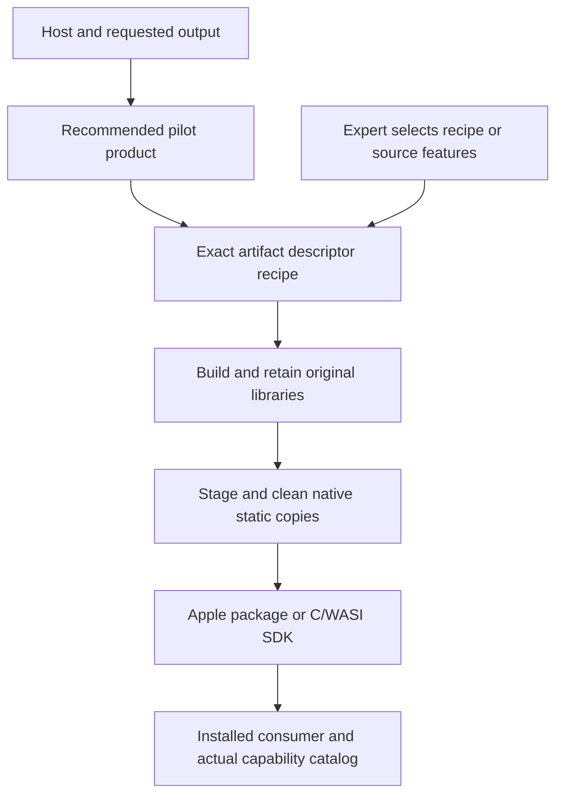
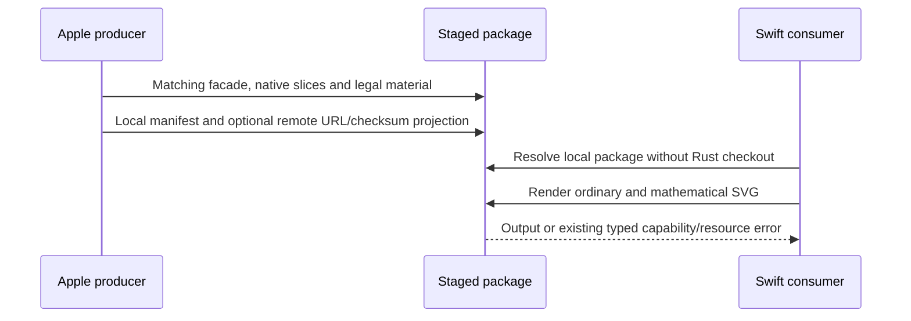

# Prebuilt Product Entry Points - Plan

## Goal Capsule

- Objective: Swift and language-neutral native/WASI consumers can choose a recommended prebuilt renderer by host and requested output, render ordinary Mermaid documents including mathematical labels, and integrate the supplied package without learning Cargo features or checking out the Rust repository.
- Means: complete recommended SVG products, descriptor-derived discovery, smaller static distribution inputs, and a self-contained Apple package (KTD1–KTD5).
- Authority: Product Contract requirements govern behavior; Planning Contract decisions govern implementation; existing transport contracts govern ABI, ownership and runtime policy.
- Execution: implement the Apple and C/WASI pilot on the main development line, using a feature branch; the maintainer decides publication. The implementation owns local verification, review, commits and a reviewable PR.
- Stop conditions: ask only if the complete semantic product cannot fit the measured size criterion without removing promised behavior, if a required public contract cannot be implemented within the stated pilot, or if publication requires new external repository/account configuration.

---

## Product Contract

### Summary

Offer one recommended rendering path for each pilot host, with advanced capability selection behind it.
Preserve fine-grained source builds and the existing SDK flavor meanings.
An Apple download becomes a complete local SwiftPM integration package, with a separately generated remote-manifest projection ready for a future publisher.

### Problem Frame

Current package names expose build decisions without explaining which installation handles a user's documents.
Apple requires a matching source checkout in addition to a large binary archive, and the default native recipe cannot render mathematical labels.
The C/WASI SDK already has an appropriate complete recipe, but ordinary users first encounter a three-way feature ladder.
The size investigation found that multi-architecture packaging and embedded LLVM bitcode dominate the Apple download; removing ordinary content semantics is not the first size intervention.

### Key Decisions

- Main-only pilot: isolate this change from maintenance and accepted releases. Governs R1.
- Recommend a complete supported SVG language surface rather than a second Math add-on package. Governs R2, R3.
- Keep native encoders and font acquisition separate from SVG language support. Governs R4, R5.

### Requirements

**Product selection**

- R1. Implement this work only on the main development line. Do not change `release/0.9.x`, published tags or accepted release assets.
- R2. The recommended Apple product includes all existing diagram families, SVG, analysis, ASCII, Cytoscape, ELK and math. Rust source defaults and positive feature selection remain explicit and unchanged.
- R3. Recommend the existing C/WASI `full` recipes for general rendering. Preserve `standard` and `math` as explicitly selected advanced recipes with their existing semantics.
- R4. Recommendations identify the host interface, supported targets, actual outputs and semantic capabilities. An unsupported request, such as PDF through the Apple UniFFI product, produces an actionable selection failure rather than a false recommendation.
- R5. Font loading, host text measurement, output codecs, ambient system access and resource policy retain their existing ownership. In particular, Swift callbacks do not become the C/WASI memory-font service through a feature change.

**Delivery and installation**

- R6. The canonical artifact descriptor supplies discovery data. The implementation does not maintain a second capability/output support table or expose a Cargo-feature Cartesian product as the normal install interface.
- R7. Apple and native C Mach-O/ELF static distribution copies omit delivery-only embedded bitcode while retaining machine code, required symbols, Rust optimization settings and the original build outputs. Windows COFF libraries retain their original bytes in this pilot: the pinned objcopy cannot transform their short import members, and the Apple size goal does not justify a custom archive rewriter.
- R8. A matched, same-source Apple package comparison must reduce the compressed XCFramework payload by at least 50% after cleanup, without dropping the R2 capabilities. Report linked-consumer size separately from archive size.
- R9. An Apple package includes its matching generated Swift sources, resource contract, package manifest, XCFramework and legal material. A clean Swift consumer can use it with a local package dependency without a repository checkout or Rust compiler.
- R10. A remote SwiftPM manifest projection accepts an explicit immutable artifact URL and its computed checksum. It references the separately emitted XCFramework ZIP, not the complete local Swift package ZIP. Both derive from the same staged inputs, and their separate checksums are never substituted for each other. Public remote installation is not claimed before publication.

**Migration and verification**

- R11. Preserve existing source-build entry points and actual transport catalogs. Recipe changes must update generated legal material and host consumers together.
- R12. Validate mathematical SVG through a real Swift consumer, retain missing-codec and constrained-policy rejection coverage, and qualify device/simulator builds plus a simulator runtime smoke for the new Apple product.
- R13. Guides start with host/task choices and explain advanced recipes, platform limitations and the separation between source compilation, prebuilt installation and published availability. Other language packages retain truthful descriptions of their current capabilities.

### Acceptance Examples

- AE1. A Swift application extracts the complete Apple package, adds its directory as a package, and renders both an ordinary flowchart and a formula-bearing diagram. Covers R2, R9, R12.
- AE2. A C or WASI user follows the recommended link for their host and receives a recipe with math and ELK; a user explicitly selecting standard still receives typed math absence. Covers R3, R11.
- AE3. A Swift user requesting PDF sees that the current Swift package does not provide it, with the native SDK alternative described explicitly. Covers R4, R5.
- AE4. Original and transformed native libraries link equivalent consumers; the macOS output is identical and the iOS simulator consumer executes. The archive comparison meets R8. Covers R7, R8, R12.
- AE5. A generated remote manifest references the staged XCFramework's exact digest; an invalid URL or mismatched expected checksum fails generation. Covers R10.

### Scope Boundaries

The pilot includes Apple, C/WASI package guidance and discovery, shared native static packaging, and the relevant release/preflight owners.
It does not redesign the renderer, add RGBA or a plugin ABI, merge all transports into C ABI, or change diagram algorithms.
No new global preset feature lattice or generic installer framework is introduced.
Publication, an independently hosted SwiftPM repository and the later default-package migration for Web, Node, Python, Android and Flutter are follow-up work.
Those hosts are documented accurately rather than silently relabelled as the pilot product.

---

## Planning Contract

### Key Technical Decisions

- KTD1. Keep exact recipes as the build authority. Extend their existing loader/query entry point for list, description and a small explicit pilot recommendation policy; match the requested host interface before validating target and output, and derive capabilities, targets and formats from descriptor fields. This preserves ADR-0076 ownership without a new manifest or feature resolver. Governs R3, R4, R6.
- KTD2. Preserve the independent source and binary choices. Add `math` explicitly to `apple-uniffi-native`; use existing SDK full rather than renaming the three published flavor meanings. Record the main-only Apple amendment to ADR-0079/0097 in a new ADR. Governs R2, R3, R11.
- KTD3. Use the active pinned Rust toolchain's `llvm-objcopy` on staged Mach-O/ELF static libraries. Remove only the relevant LLVM bitcode/command sections; do not use Xcode's obsolete bitcode-strip command or disable LTO. Preserve Windows COFF archives byte for byte because pinned LLVM rejects link-required short import members; member parsing/reassembly is considered and not built without a measured Windows delivery need. Existing consumer qualification remains the behavioral authority. Governs R7, R8.
- KTD4. Package the Swift consumer surface at the producer boundary. A dedicated Apple packager owns archive composition and local/remote manifest projections; the source-development root manifest remains local. Avoid a source-tag/checksum feedback loop by emitting the remote manifest as a release handoff artifact. Governs R9, R10.
- KTD5. Keep target-native wrappers. Existing C ABI 3, WASI ABI 1 and UniFFI API 7 remain independent; capability selection alone does not add services or alter record layouts. Use real installed consumers and existing SDK qualification rather than a new evidence framework. Governs R5, R11, R12.

### High-Level Technical Design

### Assumptions

The user authorized design followed by implementation without another planning approval.
The initial host set is Apple and C/WASI because it directly addresses the current delivery gap and offers complete installed-consumer paths.
Default Apple math is an explicit product choice for the next main-line release, not a change to the recently settled source-feature policy.
The current investigation branch's release repairs are a prerequisite; the new feature branch must keep them out of the feature PR after their main counterpart merges.

### Research That Changes The Decisions

resvg packages task-specific tools without requiring users to choose a text-enabled CLI; it does not publish a prebuilt C SDK in the inspected release. This supports a complete ordinary rendering path but not an assumption that every host already has an upstream binary route: [resvg release](https://github.com/linebender/resvg/releases/tag/v0.49.0).
CanvasKit retains text/shaping in its default package while treating embedded fonts and additional encoders separately, supporting R5 rather than an all-features default: [CanvasKit build](https://skia.googlesource.com/skia/+/e2def78fa232884d4aedcf3ad92d4a0dd673b898/modules/canvaskit/compile.sh).
Rive supplies host-native package entry points and explicit reduced products, supporting KTD4 and preserving typed Merman absence instead of copying invisible-content behavior: [Rive runtime entry points](https://rive.app/docs/runtimes.md), [Web variants](https://rive.app/docs/runtimes/web/canvas-vs-webgl.md).
ONNX Runtime separates ordinary runtime installation from model-specific reduced builds, supporting the expert path in R3; hardware execution providers are not a model for mathematical-label semantics: [custom builds](https://onnxruntime.ai/docs/build/custom.html).
The same-source size experiment and its limitations are recorded in `docs/research/2026-10-31-apple-artifact-size.md`.

---

## Implementation Units

### U1. Product policy and artifact discovery

**Goal:** Make the pilot's recommended packages and advanced selections understandable and machine-readable.
**Requirements:** R2–R6, R13.
**Dependencies:** None.
**Files:** `scripts/artifact_profile_recipe.py`, `scripts/test_artifact_profile_recipe.py`, `docs/adr/0100-prebuilt-product-entry-points.md`, `docs/adr/0079-default-native-prebuilt-capability-sku.md`, `docs/adr/0097-explicit-math-capability.md`.
**Approach:** Implement KTD1 and record KTD2 with explicit pilot scope. Preserve existing positional build/field invocations. Avoid host guessing that would require Rust to be installed.
**Test scenarios:** List/describe agree with the current descriptor targets and capabilities; native/WASI recommendations select full; unsupported Swift PDF and invalid targets fail clearly; old build commands keep their arguments; deliberately changed descriptor data changes discovery rather than a parallel table. The actual Apple math assertion belongs to U3, where its recipe changes.
**Verification:** Build-free query tests pass and existing consumers keep their invocation contract.

### U2. Native static distribution cleanup

**Goal:** Reduce native download inputs without changing executable behavior.
**Requirements:** R7, R8, R11.
**Dependencies:** None.
**Files:** `scripts/native_static_archive.py`, `scripts/test_native_static_archive.py`, `scripts/build-apple-xcframework.sh`, `scripts/sdk_qualify.py`, `scripts/test_sdk_archive.py`, relevant tool-install steps in `.github/workflows/ci.yml`, `.github/workflows/release-apple.yml`, `.github/workflows/release-sdk.yml`, `.github/workflows/release-preflight.yml`.
**Approach:** Apply KTD3 to copies of all five thin Apple libraries before lipo/packaging. Reuse the existing original build directories and consumer harnesses. Keep tool acquisition explicit in CI and provide a source-builder error naming the missing component.
**Test scenarios:** Original files remain unchanged; Mach-O/ELF receive only their intended removal options; COFF remains byte-identical without invoking objcopy; missing tools and unsuccessful transformations do not yield accepted staged libraries; WASI bypasses native cleanup; transformed libraries still satisfy existing C/Swift consumers.
**Verification:** Matched size and linked-output comparisons meet R8; platform owner builds qualify all shipped native targets.

### U3. Complete Apple SVG recipe

**Goal:** Deliver the recommended mathematical-label semantics through the existing Swift API.
**Requirements:** R2, R5, R11, R12.
**Dependencies:** U1, U2.
**Files:** `capabilities/artifact-profiles-v2.json`, generated Apple legal projections, `platforms/apple/examples/smoke/Sources/MermanAppleSmoke/`, `scripts/test_artifact_profile_recipe.py`, existing dependency-closure expectations, `platforms/apple/tests/` simulator consumer.
**Approach:** Apply KTD2 and KTD5. Update source-owned license reports before projections. Use a separate interactive engine for successful math; retain the existing constrained engine, codec absence and resource-policy behavior.
**Test scenarios:** Default Swift discovery and the actual catalog admit math/ELK; visible formula SVG is nonempty; ordinary diagrams render; constrained math is rejected; PNG/JPEG/PDF remain typed absences; source recipes without math preserve their existing absence coverage.
**Verification:** Generated bindings/legal reports are fresh; macOS and simulator consumers execute; device and simulator package builds pass.

### U4. Self-contained Swift package handoff

**Goal:** Remove the Rust-checkout prerequisite from binary installation.
**Requirements:** R9, R10, R11.
**Dependencies:** U2, U3.
**Files:** `scripts/apple_package.py`, `scripts/test_apple_package.py`, `.github/workflows/release-apple.yml`, `.github/workflows/release-preflight.yml`, `platforms/apple/README.md`, relevant release surface/security tests.
**Approach:** Apply KTD4. Produce a consumer archive with a local binary target and a remote-manifest handoff bound to the staged XCFramework. Reuse current tag validation, upload recovery and anonymous delivery verification.
**Test scenarios:** Extraction contains every required facade/header/legal file; a complete package rejects a partial `--ios` or `--macos` build; a separate Swift consumer resolves and runs without repository-relative paths; two variants cannot be accidentally combined; remote projections preserve exact URL/checksum for the XCFramework ZIP; malformed URL or checksum mismatch is rejected; source and package versions disagreeing fail before publication.
**Verification:** SwiftPM describes/builds the extracted package and executes its consumer; publication remains explicit and immutable.

### U5. Task-first guides and SDK examples

**Goal:** Present one ordinary installation path and an explicit expert path.
**Requirements:** R3–R6, R13.
**Dependencies:** U1, U3, U4.
**Files:** `docs/release/PREBUILT_PRODUCTS.md`, `docs/release/PACKAGE_SURFACES.md`, `distribution/sdk/README.md`, `platforms/apple/README.md`, packaged C/WASI example guides, `README.md`.
**Approach:** Use actual descriptor/runtime capabilities and the preserved SDK flavor meanings. Document font and codec boundaries where they affect the user's choice. Amend the earlier size report's incremental Math-variant recommendation to point to the product decision.
**Test scenarios:** Existing packaged C/WASI examples run against the recommended full archive and caller fonts; standard still exercises typed math absence. Documentation changes alone require review rather than prose-matching tests.
**Verification:** A newcomer can follow each pilot path without choosing Cargo leaves; examples and catalog data agree.

### U6. Producer and installed-consumer qualification

**Goal:** Make the new product and packaging claims reviewable before a release.
**Requirements:** R1, R7–R13.
**Dependencies:** U2–U5.
**Files:** Apple/SDK release and preflight owner workflows, existing workflow/packaging contract tests, source-scoped consumer examples.
**Approach:** Factor producer/package verification where needed so exact main-line source can be qualified without publishing a tag. Keep publisher permissions and existing delivery recovery separate. Do not build every feature combination as a normal product matrix.
**Test scenarios:** A source-bound nonpublishing candidate qualifies the complete package and all Apple slices; the publisher rejects a mismatched source/tag; installed C/WASI/Swift consumers report actual capability and schema facts; current Swift 5.9 source checking and Apple SDK consumer jobs remain required.
**Verification:** Relevant owner CI is successful, no publication occurred, and the PR reports actual local/hosted boundaries.

---

## Verification Contract

- Run focused Python artifact, static-archive, Apple-package, SDK, CI-planner and release-security suites for the units that change them; Python syntax, whitespace and indexed path-length checks must pass.
- Run actionlint and pinned zizmor high-severity checks on changed workflows.
- Use the existing feature/ABI/binding/dependency and legal generators when recipes or Cargo declarations change; run Cargo serially with the shared target and nextest for affected Rust tests.
- Exercise the existing full SDK qualification with memory fonts and mathematical fixtures, retaining constrained-policy and missing-capability controls.
- Build the five Apple architectures and compile device/simulator SwiftPM consumers. Run macOS and simulator consumers, and the real Swift 5.9 compiler gate.
- Measure the matched original/staged XCFramework ZIP and linked consumers separately. Pass R8 without changing native optimization or hiding unsupported cases.
- Review the final implementation and remove abandoned experiments; keep large investigation binaries and one-off evidence out of Git.

## Definition of Done

The pilot requirements and AE1–AE5 hold in source-bound qualification.
Recommended and expert paths remain distinct and truthful, with no invented font-service equivalence or universally identical output promise.
The main-line change set has focused commits and a reviewable PR with relevant checks successful or an explicitly identified external pending condition; no known failing owner remains unaddressed.
No maintenance branch, published tag, registry or accepted binary was mutated by this work.
