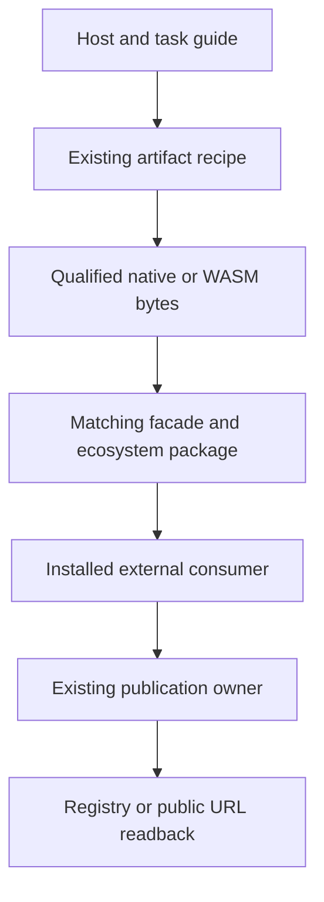
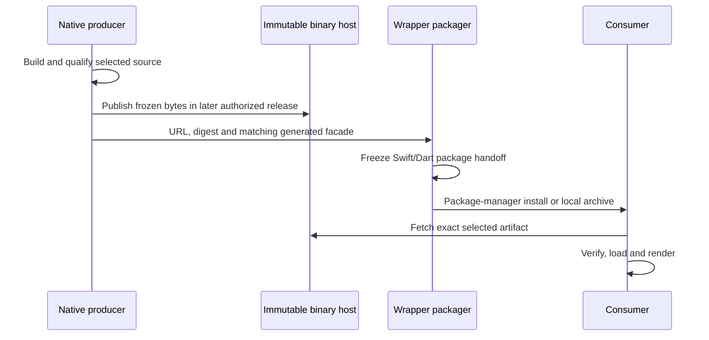

# Binding Installation and Delivery - Plan

## Goal Capsule

- **Objective:** Users can choose the appropriate Merman binding, install a coherent prebuilt
  product through familiar ecosystem tools, and understand its actual rendering capabilities.
- **Means:** Complete existing publication handoffs and target selection, then qualify the
  installed host products described by KTD1–KTD6.
- **Authority:** The maintainer's approved study and this Product Contract govern scope;
  existing artifact descriptors, generated contracts and release owners govern implementation.
- **Execution:** Implement and verify on the main development line in focused changes. Cargo
  builds are serialized and reuse the existing target cache where suitable.
- **Delivery:** Produce a reviewable PR. Public registry publication, account provisioning,
  external repository creation and merge are separate maintainer operations.
- **Stop conditions:** Preserve unrelated work and immutable releases. Report unavailable
  external credentials without presenting candidate artifacts as public installations.

---

## Product Contract

### Summary

Provide one recommended entry for each host, backed by matching wrappers and binaries.
Complete SwiftPM and Maven delivery artifacts, improve Python platform reach, make Flutter
native acquisition target-specific, and retain complete SVG semantics in the main rendering
products. Existing lightweight task packages and expert source builds remain available.

### Problem Frame

Users currently need to distinguish source features from downloaded capabilities and, on
some hosts, assemble packages manually. Sparse wheel coverage, all-platform Dart downloads,
and missing package-manager handoffs increase installation work despite working renderers.

### Requirements

**Selection and capability**

- R1. The installation guide starts with host and task, links a supported command, and
  distinguishes verified public versions from unreleased capabilities.
- R2. The next main-line ordinary native SVG products for Android, Python, Flutter and Node
  include math with their existing diagrams/layouts; Web full/render retain the complete SVG
  math expectation present in published 0.9.2. Actual final artifact budgets must be measured.
- R3. Encoder, font service, host runtime and resource-policy differences remain explicit;
  adding math does not silently change their defaults or ABI.

**Language delivery**

- R4. Apple produces a complete remote SwiftPM delivery tree with matching Swift sources,
  notices and a manifest bound to the separate XCFramework ZIP. The local ZIP remains usable.
- R5. Android retains the complete verified Maven publication as a distributable repository
  archive and supports standard Central handoff using an explicitly verified namespace.
- R6. Python wheels cover macOS ARM64/x86-64, GNU Linux ARM64/x86-64 and Windows x86-64;
  Linux uses a declared, executed manylinux baseline and normal installation needs no Rust.
- R7. Flutter's existing hook acquires only the selected native target using a version-pinned
  artifact digest, with verified caching, explicit local/offline use and clear failures.
- R8. Node native adds GNU and musl Linux ARM64 packages with exact-version selection;
  Node-WASM remains explicit and both transports implement R2.

**Release integrity**

- R9. Generated facades, binaries, catalogs, licenses and package metadata remain source and
  version matched. Existing owners retain their publication/recovery responsibilities.
- R10. Final consumers exercise package-manager resolution and representative rendering
  without a Rust checkout. New publication paths include public readback in their owner.
- R11. Work is main-only and does not replace accepted artifacts, create external repositories,
  publish versions, modify registry settings or merge without separate authorization.

### Key Decisions

- **Keep ecosystem-native installation.** Governs R1, R4–R8. (session-settled: user-approved —
  chosen over one universal transport/installer: preserve host conventions and existing APIs.)
- **Make complete SVG the ordinary rendering product.** Governs R2, R3. (session-settled:
  user-approved — chosen over repeating standard/math/full on every binding: users should
  render ordinary Mermaid documents without assembling source features.)
- **Keep the maintenance line unchanged.** Governs R11. (session-settled: user-directed —
  chosen over backporting this product migration: try the changes on main first.)

### Scope Boundaries

P0/P1 work from the origin study is included. Rust source features, CLI/LSP packaging, C/WASI
archives, Typst ABI and grammar versions keep their existing ownership.

#### Deferred to Follow-Up Work

Marketplace promotion, a Typst math product, a separately published Go wrapper, vcpkg/Conan,
extra Python musl/Windows ARM64 targets, and public registry rollout are follow-up work.

#### Considered and Not Built

- A universal feature-tier matrix: existing host products and task packages fit consumers.
- A new fingerprint or cross-registry transaction framework: existing digests and owners
  already identify frozen artifacts and reconcile accepted versions.
- Python PyO3 and Flutter Rust Bridge migrations: no installation benefit requiring them.
- Automatic native-to-WASM fallback: explicit transport choice preserves observable behavior.

---

## Planning Contract

### Key Technical Decisions

- KTD1. Amend the existing main artifact recipes and their generated projections for R2.
  Keep Cargo's additive source features and ABI epochs. Update ADR-0097's host product
  policy explicitly; ADR-0100's Apple pilot is accepted groundwork.
- KTD2. Extend Apple's current packager to emit a thin remote package archive, qualified
  against the exact staged binary. A delivery repository can consume it without rebuilding
  native source, avoiding a source-commit/checksum cycle. Implements R4, R9.
- KTD3. Reuse Android's `maven-publish`, `localStaging` and current verifier. Archive the full
  Maven-relative selected version; use a standard Portal handoff instead of a homemade
  registry client. Namespace/signing credentials are deployment inputs. Implements R5, R9.
- KTD4. Retain Python's UniFFI/ctypes and production-cdylib/generator-rlib split. Build Linux
  in a pinned manylinux_2_28 environment, audit the actual binary, and execute repaired wheels
  at that floor. Preserve standalone source-helper guidance until an sdist is qualified.
- KTD5. Keep one Dart facade and extend its existing native hook using the supported hooks
  output/cache and user-defines. Publish target archives before the facade carrying their
  hashes; generate the facade manifest into the frozen staging package, not a second source
  authority. A local override must participate in hook acquisition, not only runtime openPath.
  Its target-asset upload uses a separate protected GitHub-release job with content-write
  permission; builders stay read-only and pub.dev publication retains only read/OIDC rights.
- KTD6. Keep Node's exact optional-dependency group and existing explicit Node-WASM package.
  Add actual ARM64 target consumers. Keep Web's five task packages; expose only a narrow
  WASM asset convenience when needed by production bundlers. Implements R1, R2, R8–R10.

### High-Level Technical Design

### Assumptions and Execution Discovery

Public SwiftPM repository identity and Maven Central namespace are not selected in this
plan. Their absence does not block producing/qualifying complete handoff artifacts. Do not
invent a working URL or claim a registry namespace is owned. Apple binary-target validation
requires a controlled HTTPS endpoint trusted by SwiftPM; keep production HTTPS validation.
Local HTTP is sufficient for the Dart acquisition fixture. Public registry resolution remains
a later authorized rollout proof, distinct from candidate handoff qualification.

Execution found that the full release preflight correctly rejects main's `Unreleased`
changelogs. Its explicit `bindings` scope therefore qualifies these same host consumers
without release-readiness metadata or unrelated CLI/VSIX/SDK release lanes. The default
`release` scope retains every release gate, and only that complete scope can issue reusable
release-preflight evidence. This work does not assign a release date or bump main's version.

Final math size deltas, native loading behavior and toolchain floors require implementation
measurements. The initial Python Linux candidate is glibc 2.28. If the pinned dependency
graph cannot meet it, investigate the causal dependency before changing the advertised floor.

### Risks and Dependencies

Target downloads move a network dependency into the Dart build; KTD5 must include offline
preparation, failure messages and immutable package-pinned digests. Android needs actual 16 KB
native/APK validation. Hosted runners own nonlocal CPU/OS execution; cross compilation alone
does not establish it. Existing Web ceilings remain until measured, capability-preserving
replacement budgets are recorded with their source and build owner.

---

## Implementation Units

### U1. Establish product capabilities and user selection

**Goal:** Implement R1–R3, R9 through KTD1 and preserve an honest public-version boundary.
**Dependencies:** None; final projections depend on U2–U6 interfaces.
**Files:** `capabilities/artifact-profiles-v2.json`, `scripts/artifact_profile_recipe.py`,
`scripts/test_artifact_profile_recipe.py`, `docs/release/PREBUILT_PRODUCTS.md`,
`docs/release/PACKAGE_SURFACES.md`, `README.md`,
`crates/xtask/src/cmd/binding_contract.rs`, applicable ADR and generated legal reports.
**Approach:** Extend existing host recommendations and guide links. Change only the selected
product recipes and regenerate authoritative projections in owner order.
**Test scenarios:** Host/output queries select the intended recipe; absent codecs fail with
the supported alternatives; source defaults retain explicit math; loaded selected products
advertise and execute formulas, while reduced SDK products keep typed absence.
**Verification:** Descriptor/feature, binding, license and representative consumer checks agree.

### U2. Complete Apple remote package handoff

**Goal:** Implement R4, R9, R10 through KTD2.
**Dependencies:** Existing accepted Apple producer; independent of other host work.
**Files:** `scripts/apple_package.py`, `scripts/apple_qualify.py`,
`scripts/test_apple_package.py`, `scripts/test_apple_qualify.py`,
`.github/workflows/release-apple.yml`, `platforms/apple/README.md`.
**Approach:** Package the matching remote manifest, Swift sources and legal material as one
delivery tree. Qualify remote manifest resolution using controlled hosted binary bytes, and
retain the handoff alongside the existing outputs without creating a public repository.
Update the owner's explicit asset inventory and checksum/readback checks together.
**Test scenarios:** Remote/local archives use their own correct binary references; a fresh
Swift consumer resolves and renders; wrong checksum/version or missing facade fails; local
complete package remains checkout-independent; no unrequested publication occurs.
**Verification:** Packager contracts and actual macOS/Simulator consumers use the final package.

### U3. Deliver Android as a complete Maven publication

**Goal:** Implement R5, R9, R10 through KTD3.
**Dependencies:** U1 for final formula recipe.
**Files:** `platforms/android/build.gradle.kts`,
`scripts/verify-platform-bindings.py`, new `scripts/android_package.py` and its tests,
`.github/workflows/release-android.yml`, `platforms/android/README.md`.
**Approach:** Preserve selected-version Maven layout and metadata in one archive. Parameterize
the publication namespace and document standard Portal promotion prerequisites. Add a
nonpublishing candidate path and external Gradle consumer rather than only loose AAR smoke.
**Test scenarios:** Extracted repository resolves exact coordinate and transitive metadata;
wrong version/extra staged versions are excluded or rejected; JVM/JNI formulas run; both
ABI slices and 16 KB requirements are checked on delivered libraries and consumer packaging.
**Verification:** Maven contracts, final external app and owner security checks pass.

### U4. Expand Python wheel reach

**Goal:** Implement R6, R9, R10 through KTD4.
**Dependencies:** U1 for final product recipe.
**Files:** `scripts/build-python-uniffi-wheel.py`, `scripts/python_wheel_licenses.py`,
`scripts/test_python_wheel_licenses.py`, `.github/workflows/release-python.yml`,
`platforms/python/merman/README.md`, relevant Python wheel/smoke tests.
**Approach:** Admit the two missing target architectures, replace runner-dependent Linux
build assumptions with the pinned baseline, and keep ABI-independent wheels and existing
registry reconciliation. Check the declared Python minimum in a separate installed consumer.
Use read-only candidate qualification or preflight: `publish_to_pypi=false` in the current
owner alone still uploads GitHub assets and is not a nonpublishing invocation.
**Test scenarios:** All five targets map honestly; repaired GNU wheels load at glibc 2.28;
unsupported targets fail clearly; Python floor and current runtime import final wheel; math
renders without Rust; wrapper/library version and missing codec behavior remain enforced.
**Verification:** Final wheel installs, audit results and target-native execution are retained.

### U5. Acquire Flutter native assets per target

**Goal:** Implement R7, R9, R10 through KTD5.
**Dependencies:** U1; acquisition and packaging can be developed independently.
**Files:** `platforms/flutter/hook/build.dart`, new hook support/contract tests under
`platforms/flutter/tool/`, `scripts/flutter_release_archive.py`,
`scripts/test_flutter_release_archive.py`, `.github/workflows/release-flutter.yml`,
`platforms/flutter/README.md`, native target archive staging helper if needed.
**Approach:** Keep acquisition small: a manifest, target lookup and verified materialization.
Use existing release assets and owner receipts. Retain old self-contained staging compatibility
until target acquisition is qualified, and add existing pub reconciler after publication.
Change the actual archive collector as well as pub inclusion rules; the frozen facade contains
its target manifest, while target assets pass the KTD5 upload/readback handoff first.
**Test scenarios:** Correct target/Apple SDK fetches one artifact; corrupt cached/downloaded
bytes fail; local override works without network; offline cold cache explains missing input;
warm offline build succeeds; a packaged app contains/loads the selected library and math.
**Verification:** Dart hook contracts, package budget, final app and pub readback owner agree.

### U6. Complete JavaScript host products

**Goal:** Implement R2, R8–R10 through KTD6.
**Dependencies:** U1 for recipes and legal projections.
**Files:** `crates/merman-node/Cargo.toml`, `platforms/node/`,
`scripts/node_package_group.py`, `scripts/test_node_package_group.py`,
`.github/workflows/release-node.yml`, `platforms/web/`,
`scripts/web_package_group.py`, `scripts/test_web_package_group.py`,
`docs/release/WASM_SIZE_BUDGETS.json`, measured performance note.
**Approach:** Forward math to both Node artifacts, add ARM64 native package projections and
owner lanes, restore Web full/render math, and qualify standalone package/bundler loading.
Measure same-source final artifacts before updating product budgets.
**Test scenarios:** Root-only Node install chooses OS/CPU/libc and exact version; native and
Node-WASM formulas render; unsupported targets point to explicit alternatives; browser packages
installed alone load under non-root paths, module Worker and self-hosted WASM; analysis/editor/
ASCII remain independent; no formula loss or hidden default WASM request follows overrides.
**Verification:** Package-group tests, target installed consumers, real browsers and measured
budgets pass. Existing transports reject mismatched artifacts.

### U7. Review and qualify the integrated delivery

**Goal:** Establish R9–R11 across U1–U6.
**Dependencies:** U1–U6.
**Files:** Relevant existing workflow/feature/legal contracts and final documentation only.
**Approach:** Resolve independent review findings against actual consumers, remove abandoned
code, and run source-matched read-only hosted qualification where local targets are unavailable.
**Test scenarios:** Owner dispatch validation never publishes on a candidate path; source/tag
identities and frozen artifacts remain paired; selected owner failures remain visible; guide
links and actual advertised capabilities match the verified packages.
**Verification:** Focused Conventional Commits, clean intended diff, completed code review,
required CI results and a reviewable PR; publication remains outside this unit.

---

## Verification Contract

Use final-package/consumer smokes first for packaging work. Do not add source-text matching
tests for documentation or reimplement Cargo, SwiftPM, Maven or archive parsers.

| Surface | Required proof |
| --- | --- |
| All edits | `git diff --check`; `python3 scripts/check_path_lengths.py` after staging |
| Python helpers | `python3 -m py_compile` and the changed helpers' focused `unittest` suites |
| Features and native bindings | `cargo fmt --all -- --check`; representative dependency closures; xtask feature/native ABI/binding checks; focused nextest; real affected host consumers |
| Artifact/legal changes | Generate Rust reports first, then sync release legal projections; run both checks and third-party-license validation |
| Renderer profiles | Exact full Linux SVG structure gate from `.agents/skills/contribute-merman-pr/SKILL.md`; no comparator weakening |
| Workflow changes | Relevant release-security/owner tests; pinned actionlint and high-severity zizmor |
| Packages | Final extracted/installed consumers from U2–U6, with actual CPU/runtime scope recorded |
| Size changes | Same-source final artifacts, compressed download and selected-target bytes; Web ceilings retain measured owner/source evidence |

Hosted platform owners may provide target execution that cannot run on macOS. Their run must
identify this branch's exact source; a future workflow declaration is not a completed result.

---

## Definition of Done

All in-scope units implement their requirements with bounded consumer evidence. Required
checks and reviews pass, and remaining public rollout prerequisites are explicit. No legacy
artifact is replaced and no maintenance branch is changed. Generated projections follow
their authority, and the diff contains no dead experiments or unrelated user work. The PR
explains installation outcomes, compatibility changes, measurements and material limitations.

---

## Execution Record

Implementation is on `refactor/binding-delivery-20261101`, reviewed in
[PR #266](https://github.com/Latias94/merman/pull/266). U1–U6 are implemented in focused
commits. The product decisions are recorded in ADR-0101, and the user entry is
`docs/release/PREBUILT_PRODUCTS.md`.

U7 combines local contract checks with the existing read-only hosted owners. Local
verification covers the 57-cell feature matrix, native ABI/binding and dependency closures,
generated legal material, cargo-deny, the complete required SVG structure comparison,
installed Web/Node consumers, and the Apple five-architecture build and macOS consumer.
Independent reviews cover correctness, maintainability, security, API contracts, workflow
ownership and failure handling. Actual hosted qualification has also exercised all five
Python targets on current/minimum Python with the final metadata/license aggregation,
all seven Node native targets, Node-WASM, the five Web packages, Android's external Maven
consumer on a 16 KB device, and Apple's iOS/Simulator and HTTPS consumers.

Execution exposed issues in unattended Apple certificate cleanup, minimum-Node npm
selection, the ARM64 musl linker invocation, and Linux ARM64 Flutter local-build paths;
the fixes remain part of this branch. Flutter's complete Windows GNU product also exposed
automatic export of Rust implementation symbols after the Zig driver discarded rustc's
DEF argument. A DLL-only positional DEF preserves the single C entry point; the full
math-capable library cross-links with the pinned tool and passes an exact PE export check.
This local check does not claim Windows execution. Final candidate identity, complete job results,
Flutter's packaged-app proof and any unresolved qualification failures are maintained in
the PR's verification section. An earlier successful consumer does not by itself qualify
a later source revision. This record does not certify a public release or authorize one.
