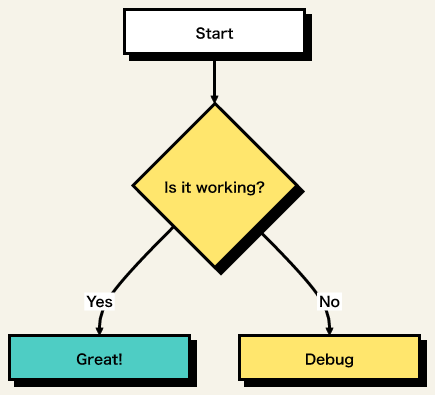
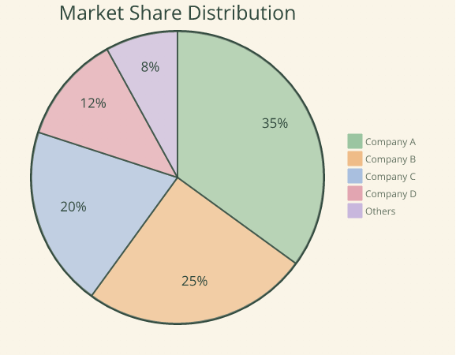
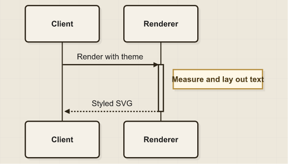
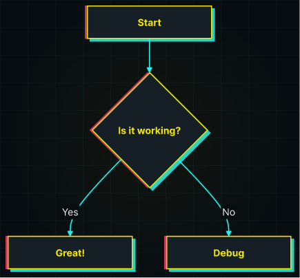
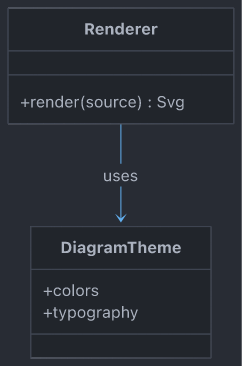
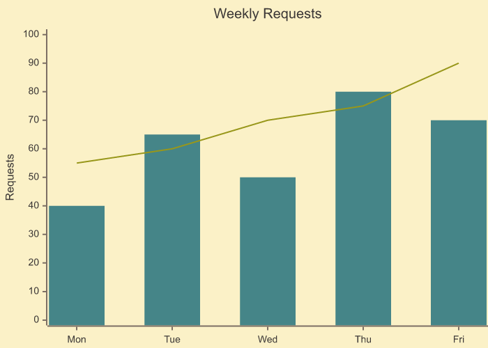

# Theme gallery

Six examples from the current 11-preset catalog show different visual designs, light and dark
palettes, and five diagram families. Use the built-in recipes in a matching `0.10.0-alpha.2` runtime.
These are actual Merman exports; design scope, runtime availability, and portable output are
separate facts reported by the installed catalog and each render's metadata.

## Six examples

| Preset | Source and visual treatment | Configuration | Catalog design scope for this family |
| --- | --- | --- | --- |
| `brutalist` | [Flowchart](brutalist.mmd): repeating accents, bold labels, black outlines, hard shadows | [Classic/Dagre, SVG text labels](brutalist.config.json); supported basic node shapes | Dedicated |
| `ghibli` | [Pie](ghibli.mmd): warm paper texture, muted slices, distinct title/percentage/legend sizes | Default Pie configuration | Dedicated |
| `spotless` | [Sequence](spotless.mmd): faint paper grid, ink outlines, bold participants and notes | Default Sequence configuration | Dedicated |
| `cyberpunk` | [The same Flowchart as Brutalist](brutalist.mmd): dark grid, cyan outlines and glow | [The same Classic/Dagre configuration](brutalist.config.json) | Base styling |
| `one-dark` | [Class](one-dark.mmd): dark surfaces, muted labels, blue relationship | [SVG text labels](one-dark.config.json) | Base styling |
| `gruvbox-light` | [XY Chart](gruvbox-light.mmd): warm cream canvas, teal bars, olive line | Default XY Chart configuration | Base styling |

| Brutalist · Flowchart | Ghibli · Pie |
| --- | --- |
|  |  |
| **Spotless · Sequence** | **Cyberpunk · Flowchart** |
|  |  |
| **One Dark · Class** | **Gruvbox Light · XY Chart** |
|  |  |

These previews were exported as native PNG on macOS with `--font-measurement native` from
the included sources and settings. Measurement and painting share the same operation's font
context. Font-agnostic deterministic estimates can be narrower than the final host glyphs;
for example, Spotless's semibold note needs native measurement to fit this host's text.
The commands below reproduce the workflow with a matching runtime, while pixel identity
across hosts is not guaranteed. The shared Flowchart source and settings let you compare
Brutalist and Cyberpunk without changing the diagram.

One Dark includes the Class label geometry fix from the next alpha's source tree. It uses the
explicit macOS fonts shown below, with system discovery disabled. The other gallery images
retain their earlier exports.

All presets remain alpha, and the catalog has no qualified output cells. Dedicated design
scope records family-specific styling, while base styling records a shared appearance.
Neither is a guarantee for every shape or export target; an unlisted family is unreviewed.
Brutalist's hard shadows and Cyberpunk's node glow work with supported basic Flowchart shapes
in both Classic and Neo. These saved previews retain their recorded Classic/Dagre configuration.

In these native PNG renders, Brutalist, Ghibli, Spotless, and Cyberpunk report verified theme
application with a host-dependent target. One Dark and Gruvbox Light retain the
`compatibility-unverified` diagnostic and report residual application with a rejected portable
target. The default best-effort policy still writes their images. Keep this distinction when
evaluating the examples; inspect `--theme-report` before requiring portable output.

## Design references and license

Brutalist, Spotless, Cyberpunk, and Ghibli use visual design references from
[Modern Mermaid by gotoailab](https://github.com/gotoailab/modern_mermaid). Thanks to the
Modern Mermaid Team for the original visual designs. The reference snapshot is commit
[`a021cbce37fc0b07a9f4791c28e983101ea06f2d`](https://github.com/gotoailab/modern_mermaid/tree/a021cbce37fc0b07a9f4791c28e983101ea06f2d),
particularly its [`src/utils/themes.ts`](https://github.com/gotoailab/modern_mermaid/blob/a021cbce37fc0b07a9f4791c28e983101ea06f2d/src/utils/themes.ts).
That project is MIT-licensed, copyright 2024 Modern Mermaid Team. Keep the
[license notice](../../../fixtures/themes/licenses/modern-mermaid-MIT.txt) and follow the
[design-reference and font policy](../../alignment/EXTERNAL_FIXTURES.md#design-references-and-fonts)
when refreshing the reference material.

Merman adapts selected mechanisms into its own typed recipes and semantic diagram targets.
The Ghibli example is Merman's scoped Pie adaptation of the reference's warm paper identity.
The images above come from Merman, and do not establish complete Modern Mermaid theme or
pixel parity. One Dark and Gruvbox Light are separate editor-style palette examples; they are
not presented as Modern Mermaid designs. Fonts are resolved independently on the host.

## Playground

Paste one of the included sources into the editor and open **Appearance**. The unified collection
includes Mermaid themes, built-in Merman presets, and standalone explorations. Choosing a theme
updates the current diagram immediately; closing the panel keeps that selection. **Undo appearance**
restores an earlier choice while keeping source edits.

Brutalist applies supported hard shadows in Classic and the default Neo look without changing
the source or configuration. Leave the font at **Inherit from theme / source**
to use recipe typography. Advanced settings retain the Mermaid base and the choice to remove only
Merman styling.

Read **Current preview** for this diagram's result. Catalog design scope does not guarantee every
requested effect or output target. An unreviewed family can still receive base styling. **Use in a
project** provides adoption code and source/theme files; downloading a theme alone produces a
reusable recipe. A workspace link restores the current source, settings, and theme. Check the
frozen image's output compatibility in **Export**, separately from the design's family scope.

## Native CLI

From this directory, with a CLI built with PNG, native-fonts, and system-fonts capabilities,
reproduce all six images:

```text
merman-cli capabilities
merman-cli render brutalist.mmd --theme-preset brutalist --config-file brutalist.config.json --font-measurement native -f png -o brutalist.png
merman-cli render ghibli.mmd --theme-preset ghibli --font-measurement native -f png -o ghibli.png
merman-cli render spotless.mmd --theme-preset spotless --font-measurement native -f png -o spotless.png
merman-cli render brutalist.mmd --theme-preset cyberpunk --config-file brutalist.config.json --font-measurement native -f png -o cyberpunk.png
merman-cli render one-dark.mmd --theme-preset one-dark --config-file one-dark.config.json --font-measurement native --font-file /System/Library/Fonts/SFNS.ttf --font-file /System/Library/Fonts/Menlo.ttc --font-system off --svg-id theme-gallery-one-dark -f png -o one-dark.png --theme-report one-dark.report.json
merman-cli render gruvbox-light.mmd --theme-preset gruvbox-light --font-measurement native -f png -o gruvbox-light.png
```

Use `-f svg -o brutalist.svg` or `-f pdf -o brutalist.pdf` with the same source, preset, and
configuration for other compiled outputs. PNG/JPEG/PDF select the export-safe SVG pipeline
automatically. `--theme-report` writes the actual render's evidence separately from the image;
`--theme-portability require-portable` enforces the renderer's strict policy. These host-font
examples do not meet that strict policy. Web supplies SVG; Playground's PNG/JPEG export uses
browser Canvas. Check the loaded artifact for available outputs.

For a controlled font set, replace `--font-measurement native` with
`--font-file /path/to/regular.ttf --font-file /path/to/bold.ttf --font-system off`.
Explicit font files select native measurement and painting together. Use the appropriate
weights and glyph coverage for the recipe. See the [host text measurement guide](../../bindings/HOST_TEXT_MEASUREMENT.md)
for native contexts and browser measurement callbacks.

Font stacks name host fonts and do not embed or download them. Open Sans and Noto Sans SC
are Ghibli's preferred fonts, with a generic sans-serif fallback. Text measurements and font
rendering can differ across hosts. Source/configuration can override individual recipe values.

## Reuse from a SDK

Select a built-in preset with `theme: { preset: "ghibli" }`, or export its editable recipe:

```ts
import { exportThemePreset, initMerman, renderSvgResult } from "@mermanjs/web";

await initMerman();
const source = `pie title Market Share
    "Company A": 35
    "Company B": 25
    "Others": 40
`;
const recipe = exportThemePreset("ghibli");
const { svg, metadata } = renderSvgResult(source, { theme: recipe });
const themeJson = JSON.stringify(recipe, null, 2);
```

For example, customize Cyberpunk's shared cyan token while keeping Mermaid configuration separate:

```ts
import { exportThemePreset, renderSvgResult } from "@mermanjs/web";

const recipe = structuredClone(exportThemePreset("cyberpunk"));
if (recipe.kind !== "design") throw new Error("Expected an editable design");
recipe.design.tokens!["neon-cyan"]!.value = "#22d3ee";

const source = "flowchart LR\n  A[Source] --> B[Styled SVG]";
const { svg, metadata } = renderSvgResult(source, {
  theme: recipe,
  site_config: { htmlLabels: false, flowchart: { look: "classic", layout: "dagre" } },
});
```

The customization example uses the same initialized runtime. Save a recipe as JSON for CLI
`--theme-file` or Playground **Import JSON**. Configuration is a separate input: a recipe alone
does not select Classic. For browser DOM insertion, use `renderSvgToElement(target, source, options)`
with an existing target element. For Rust, run the maintained example from the repository root:

```text
cargo run --locked -p merman --features svg --example theme_preset > themed.svg
```

The complete workflow and precedence rules are in [the theme guide](../custom-diagram-themes.md).
