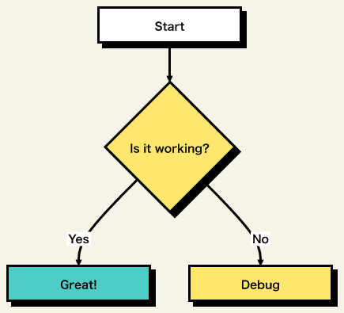
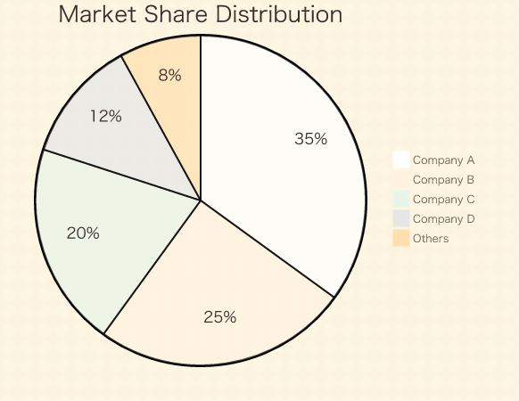
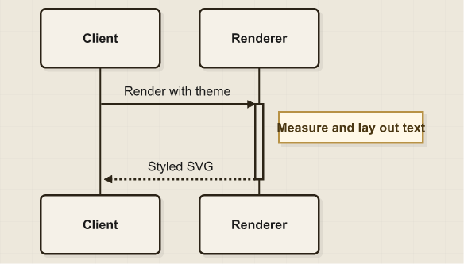
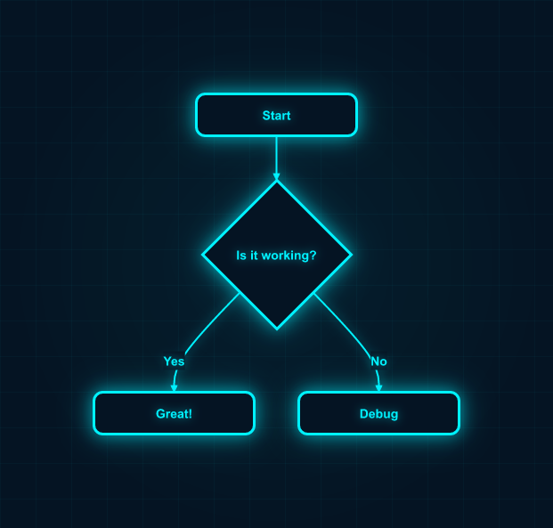
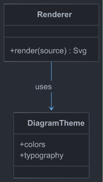
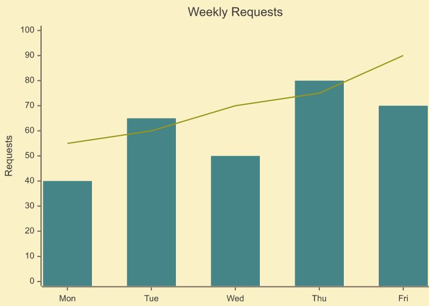
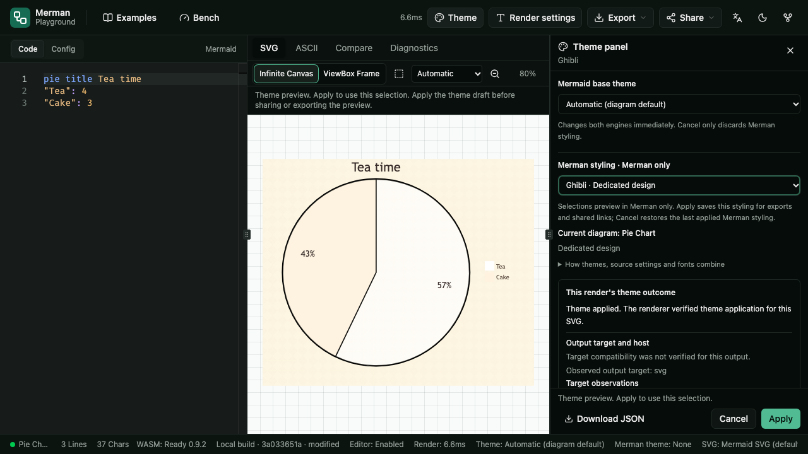
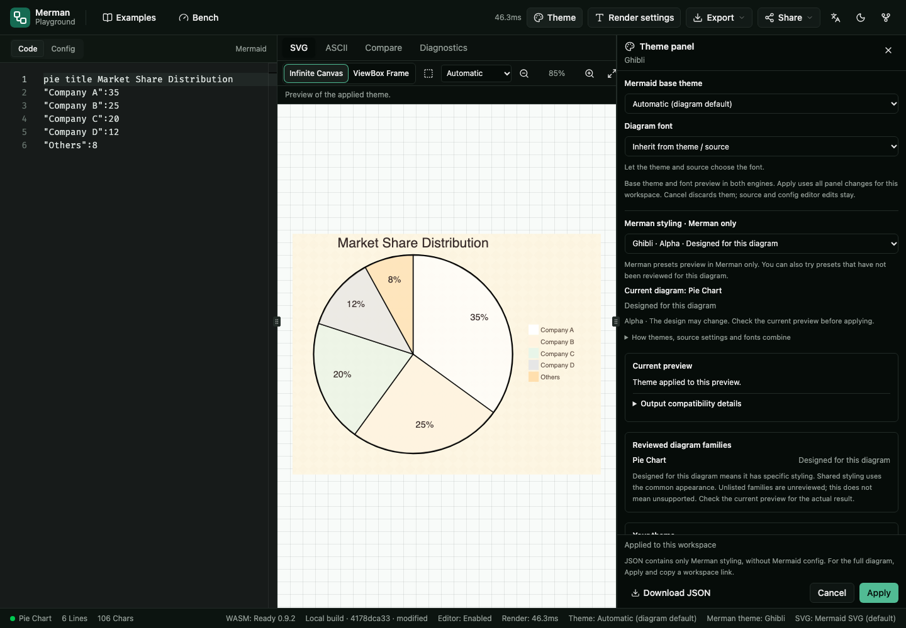

# Theme gallery

Six examples from the current 11-preset catalog show different visual designs, light and dark
palettes, and five diagram families. Use the built-in recipes in a matching source runtime.
These are actual Merman exports; design scope, runtime availability, and portable output are
separate facts reported by the installed catalog and each render's metadata.

## Six examples

| Preset | Source and visual treatment | Configuration | Catalog design scope for this family |
| --- | --- | --- | --- |
| `brutalist` | [Flowchart](brutalist.mmd): repeating accents, bold labels, black outlines, hard shadows | [Classic/Dagre, SVG text labels](brutalist.config.json); supported basic node shapes | Dedicated |
| `ghibli` | [Pie](ghibli.mmd): warm paper texture, muted slices, distinct title/percentage/legend sizes | Default Pie configuration | Dedicated |
| `spotless` | [Sequence](spotless.mmd): faint paper grid, ink outlines, bold participants and notes | Default Sequence configuration | Dedicated |
| `cyberpunk` | [The same Flowchart as Brutalist](brutalist.mmd): dark grid, cyan outlines and glow | [The same Classic/Dagre configuration](brutalist.config.json) | Base styling |
| `one-dark` | [Class](one-dark.mmd): dark surfaces, muted labels, blue relationship | [SVG text labels](one-dark.config.json) | Base styling |
| `gruvbox-light` | [XY Chart](gruvbox-light.mmd): warm cream canvas, teal bars, olive line | Default XY Chart configuration | Base styling |

| Brutalist · Flowchart | Ghibli · Pie |
| --- | --- |
|  |  |
| **Spotless · Sequence** | **Cyberpunk · Flowchart** |
|  |  |
| **One Dark · Class** | **Gruvbox Light · XY Chart** |
|  |  |

These previews were exported as native PNG on macOS from the included sources and settings.
Host font resolution affects the result; the commands below reproduce the workflow with the
matching runtime. Pixel identity across hosts is not guaranteed. The shared Flowchart source
and settings let you compare Brutalist and Cyberpunk without changing the diagram.

All presets remain alpha, and the catalog has no qualified output cells. Dedicated design
scope records family-specific styling, while base styling records a shared appearance.
Neither is a guarantee for every shape or export target; an unlisted family is unreviewed.
Brutalist's hard shadows and Cyberpunk's node glow need supported Classic Flowchart shapes.

In these native PNG renders, Brutalist, Ghibli, Spotless, and Cyberpunk report verified theme
application with a host-dependent target. One Dark and Gruvbox Light retain the
`compatibility-unverified` diagnostic and report residual application with a rejected portable
target. The default best-effort policy still writes their images. Keep this distinction when
evaluating the examples; inspect `--theme-report` before requiring portable output.

## Design references and license

Brutalist, Spotless, Cyberpunk, and Ghibli use visual design references from
[Modern Mermaid by gotoailab](https://github.com/gotoailab/modern_mermaid). Thanks to the
Modern Mermaid Team for the original visual designs. The reference snapshot is commit
[`a021cbce37fc0b07a9f4791c28e983101ea06f2d`](https://github.com/gotoailab/modern_mermaid/tree/a021cbce37fc0b07a9f4791c28e983101ea06f2d),
particularly its [`src/utils/themes.ts`](https://github.com/gotoailab/modern_mermaid/blob/a021cbce37fc0b07a9f4791c28e983101ea06f2d/src/utils/themes.ts).
That project is MIT-licensed, copyright 2024 Modern Mermaid Team; the
[retained license notice](../../../fixtures/themes/licenses/modern-mermaid-MIT.txt) and
[source capability corpus](../../alignment/MODERN_MERMAID_THEME_CAPABILITY_CORPUS.md) preserve
the provenance of the reference material.

Merman adapts selected mechanisms into its own typed recipes and semantic diagram targets.
The Ghibli example is Merman's scoped Pie adaptation of the reference's warm paper identity.
The images above come from Merman, and do not establish complete Modern Mermaid theme or
pixel parity. One Dark and Gruvbox Light are separate editor-style palette examples; they are
not presented as Modern Mermaid designs. Fonts are resolved independently on the host.

## Playground

Paste one of the included sources into the editor, open **Theme**, choose its preset, and inspect
the preview. The **Merman preset** selector at the top lists the current diagram's design
treatment next to each preset. **Browse presets** adds recipe color swatches. For Brutalist,
choose **Use Classic look** to explicitly preview Classic.
This keeps other configuration and the layout intact. **Apply** commits the panel's theme,
font and recommended configuration together; **Cancel** discards these drafts while preserving
independent source/config editor edits. Leave the font at **Inherit from theme / source** to use
the recipe's typography. **None** removes
Merman styling and keeps the selected Mermaid base theme.

Read **Current preview** for this diagram's result. **Designed for this diagram** describes
catalog intent, not a guarantee that every requested effect rendered. An unreviewed family
can still receive the recipe's base styling. Use **Download JSON** for an editable standalone
recipe and a workspace share link to include source, settings and the applied recipe together.

| Earlier panel | Current panel |
| --- | --- |
|  |  |

The current panel screenshot requests Ghibli's `Open Sans, Noto Sans SC, sans-serif` stack. A browser may
resolve the generic fallback when the named fonts are absent. The earlier panel always injected
Trebuchet, even when the user had not chosen a font. These are real Playground screenshots;
font installation and rasterization remain host-dependent.

## Native CLI

From this directory, with a matching PNG-capable CLI, reproduce all six images:

```text
merman-cli capabilities
merman-cli render brutalist.mmd --theme-preset brutalist --config-file brutalist.config.json -f png -o brutalist.png
merman-cli render ghibli.mmd --theme-preset ghibli -f png -o ghibli.png
merman-cli render spotless.mmd --theme-preset spotless -f png -o spotless.png
merman-cli render brutalist.mmd --theme-preset cyberpunk --config-file brutalist.config.json -f png -o cyberpunk.png
merman-cli render one-dark.mmd --theme-preset one-dark --config-file one-dark.config.json -f png -o one-dark.png --theme-report one-dark.report.json
merman-cli render gruvbox-light.mmd --theme-preset gruvbox-light -f png -o gruvbox-light.png
```

Use `-f svg -o brutalist.svg` or `-f pdf -o brutalist.pdf` with the same source, preset, and
configuration for other compiled outputs. PNG/JPEG/PDF select the export-safe SVG pipeline
automatically. `--theme-report` writes the actual render's evidence separately from the image;
`--theme-portability require-portable` enforces the renderer's strict policy. These host-font
examples do not meet that strict policy. Web supplies SVG; Playground's PNG/JPEG export uses
browser Canvas. Check the loaded artifact for available outputs.

Font stacks name host fonts and do not embed or download them. Open Sans and Noto Sans SC
are Ghibli's preferred fonts, with a generic sans-serif fallback. Text measurements and font
rendering can differ across hosts. Source/configuration can override individual recipe values.

## Reuse from a SDK

Select a built-in preset with `theme: { preset: "ghibli" }`, or export its editable recipe:

```ts
import { exportThemePreset, initMerman, renderSvgResult } from "@mermanjs/web";

await initMerman();
const source = `pie title Market Share
    "Company A": 35
    "Company B": 25
    "Others": 40
`;
const recipe = exportThemePreset("ghibli");
const { svg, metadata } = renderSvgResult(source, { theme: recipe });
const themeJson = JSON.stringify(recipe, null, 2);
```

For example, customize Cyberpunk's shared cyan token while keeping Mermaid configuration separate:

```ts
import { exportThemePreset, renderSvgResult } from "@mermanjs/web";

const recipe = structuredClone(exportThemePreset("cyberpunk"));
if (recipe.kind !== "design") throw new Error("Expected an editable design");
recipe.design.tokens!["neon-cyan"]!.value = "#22d3ee";

const source = "flowchart LR\n  A[Source] --> B[Styled SVG]";
const { svg, metadata } = renderSvgResult(source, {
  theme: recipe,
  site_config: { htmlLabels: false, flowchart: { look: "classic", layout: "dagre" } },
});
```

The customization example uses the same initialized runtime. Save a recipe as JSON for CLI
`--theme-file` or Playground **Import JSON**. Configuration is a separate input: a recipe alone
does not select Classic. For browser DOM insertion, use `renderSvgToElement(target, source, options)`
with an existing target element. For Rust, run the maintained example from the repository root:

```text
cargo run --locked -p merman --features svg --example theme_preset > themed.svg
```

The complete workflow and precedence rules are in [the theme guide](../custom-diagram-themes.md).
