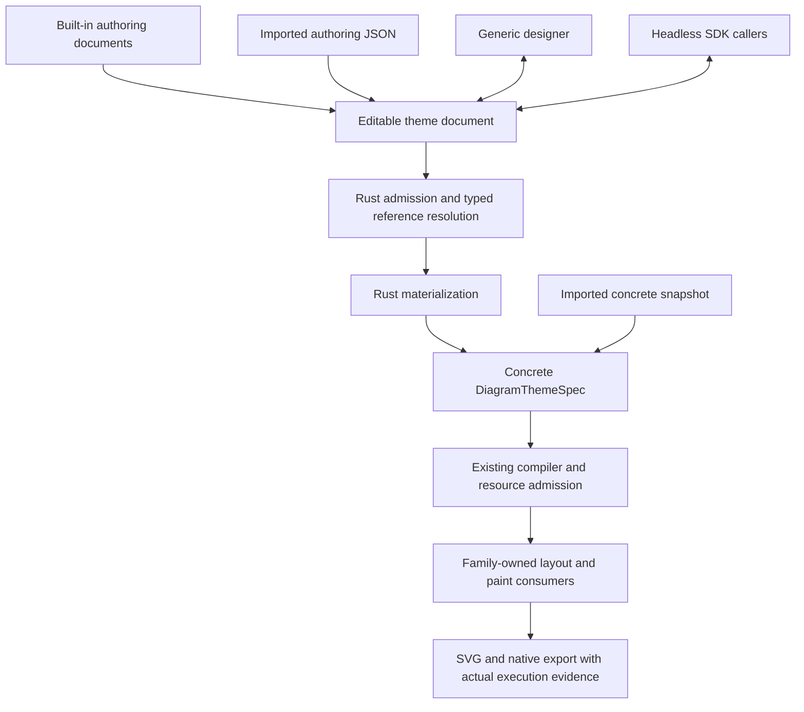

# General theme authoring interface

## Recommendation

Evolve the current compact authoring facade into one general, typed authoring document. Preserve
named reusable values and explicit references through editing, serialization, import, and preset
copying. Materialize that document in Rust into the existing concrete theme specification. Keep
the existing compiler, family writers, render identity, and demand-driven rendering architecture.

Presets supply authoring data, not separate parameter APIs or frontend implementations. A theme
can declare an extra shadow, grid, gradient, font, or numeric setting using the same supported
types as another theme. The editor does not branch on preset IDs. New drawing operations still
need an intentional renderer implementation; an arbitrary setting name cannot create one.

This design is implemented under [ADR 0095](../adr/0095-general-theme-authoring-and-retained-bindings.md)
within the unreleased version-1 contract. The maintainer authorized breaking unreleased
interfaces; no version-2 recipe or permanent compact-definition interpreter is retained.
The contract crate and [theme guide](../rendering/custom-diagram-themes.md) document exact public names.
See the [implementation verification](2026-10-19-general-theme-authoring-verification.md) for
executed checks and their limits.

## Why the current facade is insufficient

The renderer already accepts expressive concrete specifications: scoped and ordered semantic
rules, ordinal palettes, typography, gradients, canvas layers, effects, assets, and requirements.
The problem is not a missing general-purpose CSS engine.

`ThemeDefinitionV1` offers fixed color/series tokens and basic typography. Its materializer expands
these into literal rules and a solid canvas, then composes authored exceptions. It cannot retain
an editable connection from a shared color to a gradient stop or shadow in a complete recipe.
See [authoring.rs](../../crates/merman-theme-contract/src/authoring.rs) and
[materializer.rs](../../crates/merman-render/src/diagram_theme/materializer.rs).

Preset creation also appends concrete values after token materialization. The shared preset
builder explicitly creates family rules and palettes; complex builders append canvas decorations,
stroke sizes, typography, and effects. Merely exposing the original token record would therefore
leave some apparently related values unchanged. See
[catalog.rs](../../crates/merman-render/src/diagram_theme/presets/catalog.rs),
[brutalist.rs](../../crates/merman-render/src/diagram_theme/presets/brutalist.rs), and
[cyberpunk.rs](../../crates/merman-render/src/diagram_theme/presets/cyberpunk.rs).

The Playground's Customize action correctly copies the entire exported snapshot. That prevents
data loss but cannot reconstruct original author intent. Equal literal colors are not evidence
that two properties should be bound.

## Reference evidence and its limits

The local Modern Mermaid checkout is `a021cbce37fc0b07a9f4791c28e983101ea06f2d` from
`https://github.com/gotoailab/modern_mermaid`. It is an appearance and author-task reference, not
Merman's serialization or execution authority. Its source is MIT licensed. This investigation
does not copy assets or reproduce its source blocks.

The requested [screenshot](../../repo-ref/modern_mermaid/docs/images/screenshot-main.png) exists.
Image inspection was unavailable in this environment, so the exact theme depicted is unverified.
The following observations come from the corresponding source rather than a visual claim about
that screenshot.

| Source in `repo-ref/modern_mermaid/src/utils/themes.ts` | Authored mechanism | General authoring requirement |
| --- | --- | --- |
| Brutalist, starting line 913 | Shape shadows such as `drop-shadow(6px 6px 0px #000000)`, thick strokes, independently styled labels | Editable offset, zero softness, color, semantic body/label distinction |
| Ghibli, starting line 440 | Low-opacity soft offset shadows | Color and opacity distinct from offset and softness |
| Cyberpunk, starting line 209 | Sequential drop-shadow filters plus separate text-shadow declarations | Explicit filter composition and independently bound text effects |
| Material, starting line 3773 | Two sequential drop shadows for elevation | Multiple shadow stages without silently replacing one another |
| Glassmorphism, starting line 1327 | Transparent fills and sequential shadows; a comment says SVG backdrop blur is simulated | Transparency and shadows are real inputs; backdrop blur must not be implied |
| `src/utils/backgrounds.ts` and `ThemeConfig.bgStyle` | Host CSS backgrounds separate from Mermaid theme variables and CSS | Distinguish authored canvas paint from preview backing and host chrome |

Modern Mermaid's repeated CSS selectors, literal colors, and `!important` rules demonstrate
desired appearances, not a suitable portable authoring model. Merman should name semantic
targets rather than require authors to know Mermaid SVG classes or nth-child selectors.

[Frontend evidence](2026-10-19-theme-authoring-frontend-evidence.md) records current first-party
sources for shadcn, Chakra, MUI, DTCG, and W3C filter/shadow semantics. Relevant mechanisms are:

- shadcn: semantic surface/content color pairs and reusable starting configurations.
- Chakra: typed values, semantic aliases, and shared multi-part styles.
- MUI: shared defaults, local overrides, and collection-specific composition rules.
- DTCG: references that survive storage, typed composite values, and explicit resolution errors.

Borrow these mechanisms without adopting their CSS execution machinery, dynamic JavaScript
callbacks, arbitrary selector conditions, registries, or full DTCG conformance. None establishes
that a Merman family writer already supports a property.

## Proposed architecture



The authoring document is the sole editable owner. A resolved spec is an explicit output, never
a synchronized second editable copy. Frontend state stores the document and its existing draft
history; it does not maintain a hidden binding table or reimplement materialization.

Presentation labels, descriptions, and display groups do not change resolved render identity.
Resource IDs are stable authoring identities, not labels; renaming one may change lowered effect
IDs and the existing concrete fingerprint, while preserving the painted appearance. Define
deterministic, collision-free ID allocation when lowering named and inline effects; do not expose
its private IDs as authoring references. The existing compiler fingerprints the concrete result.
Do not create a new cross-pipeline hashing or caching service merely to make renames hash-neutral.
Materialize on an authoring change and reuse the existing prepared/compiled theme path; token
resolution is not a new per-node or per-export operation.

## Document model

Use a new version of the exchange envelope with two explicit kinds:

- **Design:** self-contained reusable values, references, semantic defaults, scoped rules, canvas,
  effects, compatibility settings, assets, and requirements. This is the normal authoring format.
- **Complete specification:** concrete snapshot for low-level callers and imported data without
  preserved authoring relationships. This remains directly editable and renderable.

Do not require a second creator manifest beside the design document. Downloading the normal
theme must retain its ability to be edited. Exporting a resolved snapshot is a separate action.
Neither kind looks up a preset ID during rendering. Copying a preset creates an independent
design document with all values and references embedded.

### Ordinary author entry points

Reusable values are optional. Every reference-capable field also accepts a direct typed value;
a small theme does not have to declare a resource library first. For example, the following
illustrative document only changes node fill:

```json
{
  "schema_version": 1,
  "kind": "design",
  "design": { "styles": { "node": { "fill": "#f0f4f8" } } }
}
```

The common interactive path is to copy a starter/preset, adjust its displayed shared colors and
objects, and save. A direct property can be promoted into a named shared value through an explicit
operation. SDK constructors/builders should expose the same direct values and typed references;
their output is this document, not an opaque generator state. The authoring layer earns its
complexity only when it makes these simple cases shorter than editing expanded concrete rules.

### Reusable values

A flat map of stable IDs contains typed values. IDs may contain dots for readable grouping, but
references match the exact ID; dots are not object traversal. The supported vocabulary is finite
and derived from real style fields: color, number, string, length, font stack, palette, paint,
stroke, text style, and effect. Composite values may reference other typed values in their fields.
Implement only types used by the first admitted authoring examples; this is not a plugin type system.

Optional label, description, and display-group metadata helps the generic editor present a
theme's additional values. It does not define rendering, inject executable code, or redirect a
control to arbitrary JSON paths. Rendering must remain identical if presentation metadata is
removed. Type and field descriptors determine controls and validation; theme-provided labels
must not determine type or capability.

A reference is a structured value, for example `{ "ref": "color.ink" }`. No string interpolation,
CSS `var()`, `calc()`, arbitrary transforms, external token URLs, or user-defined functions are
needed. References resolve to the declared type. A color consumed as a paint is placed in an
explicit solid-paint value; avoid a growing set of implicit conversions.

Whole-value references and per-field references are both useful. A whole stroke reference can
be detached into a copy before an individual width is changed. Do not add a special
`reference + recursive overrides` merge expression. Common fields such as shadow or gradient
stop opacity may multiply the referenced color's alpha during materialization; that is a typed
field operation with specified math, not a general expression language. Derived color schemes
and automatic contrast correction are separate work.

### Semantic defaults and exceptions

Default styles are keyed by the existing semantic target IDs. Node body, node label, edge,
edge label, actor, note, and other targets retain their existing meaning. The UI may group
related targets as an object and its parts without inventing a second target hierarchy.

Defaults lower first, in deterministic target-ID order. An ordered rule list follows for existing
family, variant, and ordinal selectors. Author order determines precedence among exceptions;
family specificity does not introduce a hidden CSS cascade. Ordinal palettes keep their explicit
target association and current winner behavior. Their collection semantics must be specified
and tested independently of ordinary style-rule ordering.

Omission leaves a field unspecified; explicit clear removes an earlier authored field according
to the existing patch semantics. A supplied list replaces the earlier list; it does not append
implicitly. Stroke and text-style patches compose only at their documented property boundaries.
Effect references are atomic; changing one does not merge graphs. Selecting a shared resource
and editing that resource is different from assigning a direct local value.

Authored body and label defaults remain distinct. A shape shadow must not silently filter its
label. Theme selectors do not select arbitrary Mermaid object IDs, change node shape kinds,
or change graph topology/layout selection.

### Canvas, effects, and theme-specific choices

Canvas paint, ordered layers, and effect definitions belong in the same authoring document, so
adding a gradient never forces an irreversible conversion that loses all token bindings.

For example, one theme may expose `paper.grid` as a paint, `shape.elevation` as an effect, and
`edge.width` as a length. Another may use different IDs or extra resources. The common editor
shows each by its supported type and usage. No `if preset == ...` control path is required.

Grid/stripe spacing and line width should be fields of a typed reusable paint, not independent
numbers wired to arbitrary locations or a hard-coded fraction in a gradient. A bounded paint
lowering can generate the existing supported tiled gradients. Dots and arbitrary patterns need
their own renderer implementation or explicit unsupported status. The currently serializable
`pattern` variant is not evidence that the SVG writer paints it.

Finite values such as cap/join choices can use a typed field or string resource constrained at
each consumer. A setting that introduces a genuinely new operation, such as backdrop blur,
requires a new supported type or field and implementation. Preserve advanced existing effect
graphs as an explicit escape hatch; do not turn presentation metadata into a filter interpreter.

## Shadow contract

Support hard shadows, soft shadows, centered glow, and multiple shadows through common values.
The public model must specify all of the following:

| Property | Proposed meaning |
| --- | --- |
| Input silhouette | The actual semantic paint terminal, using its alpha; shape and label are separate targets |
| Offset | Signed diagram-space pixel lengths |
| Softness | Explicit Gaussian standard deviation in pixels, named `std_deviation`; zero is a hard shadow |
| Color/opacity | Typed color/reference, with optional opacity multiplier applied to its alpha |
| Color space | Explicit sRGB default for the new authoring convenience; retain existing graph color-space choices |
| Independent composition | Each shadow reads the same original terminal; shadows paint in array order, later above earlier, then the original terminal paints on top |
| Cascade composition | Each shadow reads the preceding complete result, matching a sequential drop-shadow filter chain |
| Bounds | Reuse bounded paint outsets and root viewBox expansion; never alter layout just to make space for shadow |

The ordinary shadow editor uses independent composition. Cascade remains an explicit advanced
choice, necessary to reproduce existing Modern Mermaid and Cyberpunk filter chains. A zero-offset
shadow is a glow; it does not require a preset-specific primitive.

CSS `box-shadow` blur radius and SVG standard deviation are different conventions. An optional
future CSS import adapter must translate them explicitly. Do not label the generic operation
`box-shadow`: CSS box silhouettes, inset shadows, spread, and backdrop blur are not established
by the current engine. Initially reject these unsupported convenience fields rather than
silently accepting them. A later spread implementation requires morphology, paint bounds,
resource accounting, and native export support together.

Current code exposes a concrete gap that implementation must address:

- `DropShadow.blur_radius` is used directly as sigma in
  [shadow_plan.rs](../../crates/merman-render/src/diagram_theme/shadow_plan.rs).
- Nonzero spread prevents shadow lowering, although the wire/compiler accept it.
- `Previous` shadows the accumulated result; a later `SourceGraphic` resets the result and
  discards earlier stages. Repeating `SourceGraphic` cannot implement independent shadows.
- [shadow.rs](../../crates/merman-render/src/svg/parity/shadow.rs) and
  [theme_composed_effects.rs](../../crates/merman/tests/theme_composed_effects.rs) establish this behavior.

Independent composition needs a bounded dedicated shadow-stack representation: branch each
shadow from original alpha, merge all shadows and the source once, and union their paint bounds.
This also touches native filter receipts and exact expanded-filter recognition in
`merman-export`. It does not require an unrestricted SVG DAG. Preserve existing cascade output
through an explicit lowering rather than changing its meaning during the refactor.

The resolved effect representation may therefore need a new bounded shadow-stack variant. The
proposal preserves concrete-value compilation ownership, not every current concrete wire field.
Update snapshot serialization and native receipts coherently instead of hiding a new operation in
an old graph whose semantics cannot express it.

## Illustrative authoring JSON

This sketch demonstrates a general hard shadow, shared color, local scope, and editable binding.
It is not currently accepted JSON and omits optional typography, palettes, and assets for brevity.

```json
{
  "schema_version": 1,
  "kind": "design",
  "design": {
    "tokens": {
      "color.ink": {
        "type": "color",
        "value": "#171717",
        "label": "Ink"
      },
      "size.shadow-offset": {
        "type": "length",
        "value": { "px": 6 },
        "label": "Shadow offset"
      },
      "effect.raised": {
        "type": "effect",
        "value": {
          "kind": "shadow-stack",
          "composition": "independent",
          "color_space": "srgb",
          "shadows": [{
            "offset_x": { "ref": "size.shadow-offset" },
            "offset_y": { "ref": "size.shadow-offset" },
            "std_deviation": { "px": 0 },
            "color": { "ref": "color.ink" }
          }]
        },
        "label": "Raised shape"
      }
    },
    "canvas": { "base": "#f6f3e9" },
    "styles": {
      "node": {
        "fill": "#ffffff",
        "stroke": {
          "paint": { "kind": "solid", "color": { "ref": "color.ink" } },
          "width": { "px": 3 }
        },
        "effect": { "ref": "effect.raised" }
      },
      "node-label": {
        "fill": { "kind": "solid", "color": { "ref": "color.ink" } }
      }
    },
    "rules": [{
      "target": "actor",
      "family": "sequence",
      "style": { "effect": { "ref": "effect.raised" } }
    }]
  }
}
```

Changing `color.ink` changes exactly its consumers. Assigning a literal label color detaches only
that consumer. Replacing `effect.raised` with a soft shadow or glow leaves the rule mappings alone.
Renaming an ID must atomically rewrite its references; deleting an in-use value requires explicit
replacement or detachment, never a silent fallback.

## Headless interface and admission

Keep the public callable surface small and shared across Rust and bindings:

1. Create/copy an authoring document through the normal preset/starter operation. Common defaults
   are embedded in that document; no hidden preset inheritance remains after the copy.
2. Materialize a design document into an admitted concrete specification with source-path errors.
   Existing compile/render entry points compose that Rust operation for caller convenience.
3. Inspect authored resources and reference usages on demand for editor bind/detach and navigation.
   Include each consumer's known field descriptor: semantic location, accepted units, finite enum
   choices, and numeric bounds where defined. These are Rust-owned field contracts, not theme
   metadata. Inspection reports declared relationships, not winning rendered properties.

The generic editor already knows its finite field types. Reuse the runtime target/facet catalog
and generated contract definitions; do not ship a separate arbitrary form-description language.
Binding and detaching edit the same serializable document available to headless callers.

A generic string or number type alone cannot produce a useful shared control. The editor uses
the known consumer domains to offer valid choices and bounds. Incompatible consumers must be
explained next to the shared value with an explicit detach/rebind action. An unused value can
retain its generic editor until it has a consumer. Keep this vocabulary limited to existing enum,
unit, and interval domains; do not introduce arbitrary predicates or a general constraint solver.

Admission rejects missing references, cycles, incompatible types, illegal units at a consumer,
non-finite numbers, and resource-policy violations with exact authoring paths. Scalar bounds and
enum domains belong to typed consumers. Theme metadata cannot weaken them. Resolve each named
value once per materialization; charge reference depth, token count, expanded bytes, and effect/
paint expansion against explicit policies so aliases cannot amplify work without a bound.

Mermaid compatibility inputs remain explicit. Reference-enabled compatibility variables must be
validated against their admitted primitive domains; native semantic styles do not imply parity
for a browser-only Mermaid variable. Source-style precedence and actual terminal evidence remain
the renderer's responsibility. Unsupported family/look/output combinations stay visible.

## Alternatives considered

| Approach | Benefit | Cost and decision |
| --- | --- | --- |
| Add controls around current concrete snapshots | Smallest implementation; exact local edits remain useful | Cannot retain reusable relationships or reliably restyle a complex theme; insufficient as the creation model |
| Publish separate parameter structs for each preset | Clear hand-written mapping for each built-in appearance | Repeats interfaces and UI, excludes community themes, and couples editing to generators; rejected as the common contract |
| General typed authoring document with explicit references | One editor and headless interface, shared and local edits survive JSON | Requires real protocol/materializer work and conversion of preset sources; recommended |
| Full CSS/DTCG/Panda-style interpreter | Broad external vocabulary | Adds selectors, conditions, units, transforms, and semantics the headless engine does not own; defer optional adapters |

## Implementation sequence

1. Revise the authoring decision before changing production types. Specify the legal type/ref
   combinations, default/rule/palette precedence, clear/list semantics, document version, bounds,
   and distinction between design and snapshot. Include simple, grid, hard-shadow, soft-shadow,
   and cascade-glow authoring examples. Supersede the relevant restrictions in ADR-0082 explicitly.
2. Implement the Rust authoring document, typed resolver, materializer, and binding inspection at
   existing theme seams. Replace the compact-only DTO/materializer owner rather than retaining
   parallel implementations. Keep concrete compiler and demand-driven preparation ownership.
3. Implement independent shadow composition end to end, rename ambiguous new-contract softness,
   and make unsupported spread handling explicit. Carry bounds, resource accounting, SVG and
   native export through the same change. Add grid/stripe convenience lowering only against real
   supported paint output.
4. Convert built-in presets to authoring data/helpers using the common document. Capture current
   resolved outputs before conversion; preserve supported appearance and intended rule order.
   Remove superseded builders after parity checks. Keep metadata claims separate from execution.
5. Update bindings, CLI/theme-file exchange, sharing, fixtures, and docs in one coordinated
   pre-release protocol change. Update the bounded workspace/share codec explicitly. Do not add
   a permanent legacy interpreter or infer bindings when importing complete snapshots.
6. Replace the first-run designer flow with Choose a starting theme -> shared design values ->
   semantic object/part -> local overrides. Show bound value, direct value, and clear distinctly.
   Preserve current draft isolation, undo/redo, Apply/Cancel, and actual preview backing semantics.

These are implementation stages, not separate required public services. Performance verification
must compare against representative current workloads; do not invent an extra qualification
matrix or eagerly render every preset/family when the workbench opens.

## Acceptance scenarios

- A plain theme and themes with grid decoration, hard shadows, soft shadows, and cascade glow
  use the same UI components and headless materialization operation with no preset-ID branches.
- Copying any converted preset preserves its current resolved specification or has an explicitly
  reviewed semantic delta. Exporting/importing its design retains resource IDs and references.
- Editing one shared color updates a bound border, label, gradient stop, and shadow; an unrelated
  equal literal remains unchanged. Detaching one consumer survives save/import and later edits.
- A community-authored additional effect or size appears through supported types and optional
  labels without a new frontend module. It can be created and used through the SDK as well.
- Shared finite-choice and dimension resources expose valid menus/units from consumer descriptors;
  conflicting uses are explained without requiring JSON editing. Renaming a resource rewrites
  references atomically and preserves appearance; relabeling it preserves the concrete fingerprint.
- Independent red and blue offset shadows both appear in SVG, PNG, and PDF at their expected
  sides. Cascade/reset regression cases keep their existing distinct behavior. Body shadows do
  not accidentally filter labels. Paint bounds contain the bounded shadows without moving layout.
- Zero-softness offset, zero-offset glow, alpha multiplication, colorspace, degenerate path bounds,
  missing refs, cycles, wrong units/types, limit boundaries, and expansion amplification are covered
  at their owning public interfaces. Unsupported spread/inset/backdrop input has an explicit result.
- Theme JSON/share links round-trip through the real runtime. Invalid edits keep the last valid
  preview; undo/redo and Apply/Cancel preserve source/config changes as they do now.
- Materialization runs once per authored change, resolution visits each resource once, and the
  existing unthemed/preset prepared-render paths incur no added authoring traversal. Measure a
  representative simple, complex, and alias-heavy workload against the current implementation.

## Risks and remaining decisions

The main risk is rebuilding a design-system language while trying to simplify one. Keep the type
set tied to concrete authoring examples, references structural, and expansion Rust-owned. Avoid
arbitrary paths, functions, recursive merge semantics, selector syntax, and plugin-defined types.

The second risk is presenting serializable fields as rendered features. Shadow spread, independent
composition, patterns, and family/look support require concrete execution work or honest feedback.
The new convenience API must not inherit an overclaim from an older wire type.

The implementation uses typed local references and consumer-domain inspection. Compatibility
variables remain literal inputs. Ordinal palettes follow ordered rules in materialization.
Spread, inset, and backdrop blur are excluded from the shadow-stack convenience interface;
independent shadows have SVG and native export implementations.
