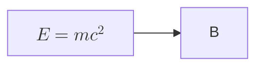

# Math SVG paint ownership

Follow-up findings, fixes and current verification are recorded in
[the adversarial review](2026-10-27-math-review.md). The initial repair results
below are bound to their listed source commits.

## Problem and evidence

The checksum-verified 0.9.2 CLI silently drops formula geometry when its native
fallback removes `foreignObject`. Current maintenance already preserves that
geometry. Current main preserves it through prepared projection, but ordinary
Flowchart node CSS overrides the formula's presentation attributes and turns
its glyphs into solid blocks.

The reproducer is the public md2pdf PR 1 test:

The CLI command is `render - --format png --output - --font-measurement native`.
Explicit `--math-renderer ratex` does not repair the released binary.
An independent Chromium experiment restores current main by changing only the
formula primitives' paint declarations; geometry, dimensions and transforms
remain unchanged.

SVG presentation attributes participate at specificity zero. They do not own
the final paint when a diagram stylesheet selects their elements. See
https://www.w3.org/TR/SVG/styling.html#PresentationAttributes.

## Design

The math producer owns formula glyphs and rules, including explicit formula
colors and transparency. Family layout owns the resolved foreground and size.
Browser and native writers consume the same prepared formula geometry and
paint. Native projection preserves it before generic HTML fallback removes
unsupported HTML. Terminal evidence continues to bind the complete prepared
projection, but is not a substitute for a real paint test.

The pinned `ratex-svg` 0.1.15 emits presentation attributes and has no inline
paint option. Add one private producer adapter for that exact emitted SVG
vocabulary. Use the existing XML reader/writer rather than copying the glyph
serializer or constructing a general CSS engine.

The adapter must:

1. Preserve geometry and attribute values from the backend.
2. Give path, rect, line, text and image primitives their own applicable paint,
   including the SVG defaults for properties omitted by the backend. Explicit
   `filter:none` prevents node shadows from being applied again to fraction rules.
3. Retain stroke-only rules, dashed rules, alpha and per-formula colors.
4. Preserve fallback text fonts and anchoring independently of node text CSS.
5. Resolve ownership before browser sanitization and projection fingerprinting.
6. Reject unexpected backend structure rather than silently weakening ownership.

Native glyphs live in root-level `defs`; a local `use` retains each original
label position. Inline important declarations alone are insufficient in usvg
0.47: its parser installs stylesheet declarations before inline declarations
and does not replace an existing important declaration with a later important
one. Chromium gives inline important paint the expected precedence. Root
ownership avoids the conflicting descendant shape selectors in the native
renderer without forking a CSS engine. Maintenance already uses this topology;
main now uses it too.

Main's terminal receipt resolves each instance to one root-owned definition,
rejects duplicate IDs and extra href/XLink instances, validates the exact
projection fingerprint, and keeps the definition wrappers effect-free. Each
mirrored actor emission owns a distinct definition. Existing SVG IDs are
preserved when allocating names. The private inline-group terminal form is
removed rather than retained as a second, vulnerable rendering path.

The maintenance projector recognizes the same canonical owned declarations
without accepting arbitrary inline CSS. Its existing APIs, grammar, resource
controls and bounded native projection remain intact. Do not import main's
theme/evidence architecture into maintenance.

Mixed prose/formula native support on main remains an explicit capability
boundary. It requires a separate typed row-layout design, including spaces,
entities, wrapping and rich markup. Replacing its current rejection with an
approximate HTML parser would not repair the paint defect correctly.

## Execution and acceptance

- [x] Add a real CLI raster regression comparing an isolated formula with the
      same formula under ordinary and important diagram shape CSS.
- [x] Add the shared producer adapter and use it for browser/native formula
      payloads on both lines.
- [x] Keep the maintenance native projector's validation finite and fail-closed.
- [x] Verify glyph paths, fraction rectangles, stroked/dashed rules, colors,
      transparency and fallback text through appropriate producer controls.
- [x] Run focused math/CLI/theme tests, strict Clippy and both full SVG gates.
- [x] Rebuild both CLIs and repeat the original PNG/browser reproducers.
- [x] Publish actual before/after artifacts and update both existing PRs.

A reference render must contain real ink and match the contextual render's
pixels. A nonempty path, a successful exit code, or merely nonzero alpha cannot
distinguish the defect from a correctly drawn formula.

No comparator tolerance, root-viewport residual, dependency graph or published
release asset is changed to implement this repair. The source version string
alone does not distinguish a repaired checkout from the released 0.9.2 archive;
evidence records commit identities.

## Verification on 2026-10-27

Source commits: main `3f0c6bf9f`; maintenance `207f5e339`. Both are changes to
existing repair PRs, not published releases. Main retains Mermaid 12.2.0;
maintenance retains 12.1.0 and its existing API and bounded native projection.

| Check | main | Maintenance |
| --- | --- | --- |
| Full renderer, all diagrams + both optional layouts + math | 5,412 pass; 5 existing skips | 2,510 pass; 2 existing skips |
| CLI math raster integration | 6 pass | 6 pass |
| Renderer library strict Clippy | Pass | Pass |
| CLI all-targets/all-features strict Clippy | Pass | Pass |
| No-default-feature Flowchart build, without math | Pass | Pass |
| Full SVG structure/parity/parity-root at 3 decimals | 37 families pass | 37 families pass |
| Rust root contracts | 7 pass | 10 pass |
| Actual Chromium math controls | 9 pass | 9 pass |

The final producer/evidence changes also pass 83 focused main library tests.
Existing integration helpers now follow the emitted local reference before
checking glyph geometry and role colors; they still reject unrelated paths.

The six CLI tests include four formula families: outline glyphs, fraction
rectangles, a genuinely stroked cancellation path under a radical, and explicit
red. Each exercises HTML labels enabled/disabled, ordinary node CSS, and native
classDef important CSS. Formula and required-primitive comparisons require
nonzero reference ink and zero differing pixels. A direct Mermaid-to-PNG
canary separately requires red formula ink in the center of a single node.
The old main and maintenance executables were run against the new regression
controls before the producer repair: the relevant defective cases failed.

Chromium 156.0.8078.4 checks the actual exports of Flowchart, Sequence and
Swimlane in parity and native-safe modes. The ninth control compares a real
styled fraction's primitive payload in isolated and classDef important contexts:
PNG bytes must match and the reference must contain ink. usvg is deliberately
not used as an oracle for browser important precedence. Producer controls retain
alpha, dashed rules and fallback text attributes without pretending they prove
arbitrary browser font availability.

The complete main root paint owner audited 3,737 freshly generated SVGs with
zero blocking containment failures, zero unused exact receipts, 54 browser-owned
paint diagnostics and 2,361 upstream-inherited outcomes. This is not a claim
that every fixture is fully contained. No root residual was changed.

Maintenance's fresh full macOS run covers 3,720 SVGs and retains one existing
blocking result: `flowchart/stress_flowchart_title_padding_subgraph_029`.
Its local/upstream SVG SHA-256 values and complete local audit match the
previous run exactly. The same single environment-bound receipt is unused;
the other 3,719 fixtures have no blocking result. This whole-corpus macOS
command exits 1 and is not reported as passing. Linux CI owns its exact browser
environment. Both root audit summaries and full-report hashes are included
beside the visual artifacts; no receipt is refreshed to hide this result.

The [actual before/after figure](assets/math-fixes-20261027/comparison.png),
HTML, input, unmodified CLI PNG/SVG exports, command/hash provenance, browser
controls and results are checked in under `assets/math-fixes-20261027`.
Maintenance includes its own eight browser SVGs; the overview figure explicitly
illustrates main. The rebuilt final main CLI matches both illustrated after
exports byte for byte.

Cargo builds ran sequentially with two build jobs and the shared existing
target. No dependency graph, upstream SVG baseline, comparator or published
asset changed. Source and visual commits trigger fresh PR CI; older-head CI
success is not reused as current-head qualification. Linux workspace and
platform/binding owner jobs remain CI evidence, not claims of this local run.
