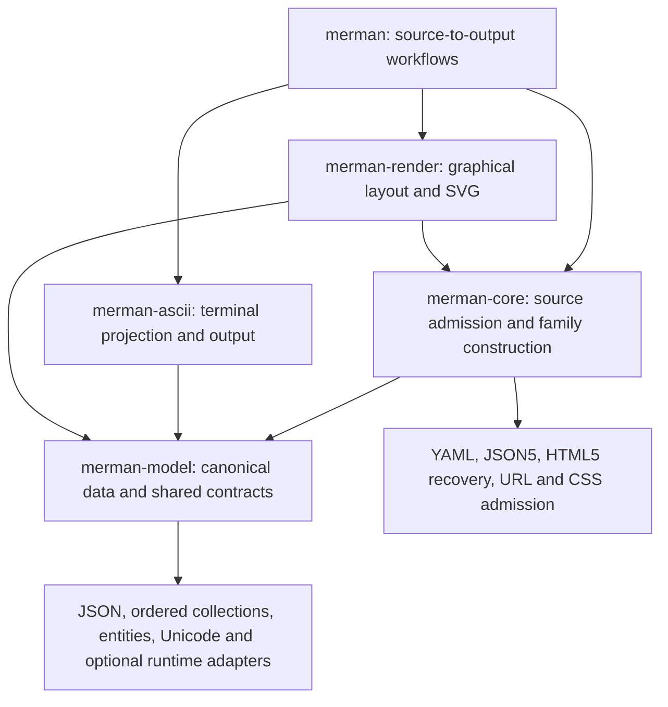

# Rust dependency and embedding review

Date: 2026-10-30. Baseline: main `4e9fa48139361bb30f81cb86d413597643978a4f`. The review includes local dependency-upgrade and feature-isolation candidates; it does not change the published 0.9.3 artifacts.

## Assessment

Merman has a substantial minimum dependency cost, including for applications that select only one diagram family. That concern is supported by actual consumer graphs. However, the workspace lockfile overstates what an embedding application compiles, and the current development default is smaller than the published 0.9.3 default. Further meaningful reductions require separating consumer responsibilities, rather than removing compatibility algorithms or repeatedly changing version requirements.

The existing output and host boundaries work: semantic and ASCII consumers do not pull in SVG, PDF, native fonts, HTTP, TLS, or an async runtime. Mathematical labels are now explicit. The expensive floor is configuration parsing, HTML recovery and sanitization, entity decoding, and URL normalization inside the semantic core. These participate in observable Mermaid semantics even when SVG is absent.

## Measurement contract

Counts below are distinct external `(package name, version)` pairs reported by Cargo for `x86_64-unknown-linux-gnu`, on a Windows host, with normal and build edges and without dev edges. Host build dependencies therefore retain their Windows selection. Workspace crates are listed separately from external dependencies. Proc macros and their build inputs count because consumers compile them; these numbers are not a count of linked libraries, deployed services, or executable bytes.

The baseline uses the checked-in lockfile. Standalone consumer projects independently reproduced the core-empty, Flowchart-SVG, and default-facade counts, avoiding workspace dev-feature unification. Published-library comparisons use fresh consumer resolution on the stated date. Cargo work ran sequentially; workspace validation used two compilation jobs and the existing shared target directory. No cold-build timing or final binary-size improvement is claimed.

```text
cargo tree --locked --offline -p merman --no-default-features \
  --features diagram-flowchart,svg --target x86_64-unknown-linux-gnu \
  --edges normal,build --prefix none --format "{p}"
```

Cargo features are additive: disabling a default on one edge does not disable a feature selected elsewhere. A final application must inspect its own combined graph. See the [Cargo feature reference](https://doc.rust-lang.org/cargo/reference/features.html#feature-unification).

## Baseline consumer graphs

| Consumer | Selection | External package versions | Total package versions, including Merman |
| --- | --- | ---: | ---: |
| Core without family parsers | No defaults or optional features | 82 | 83 |
| Core Flowchart parser | `diagram-flowchart` | 84 | 85 |
| Facade without families or output | No defaults | 84 | 86 |
| Facade Flowchart parser | `diagram-flowchart` | 86 | 88 |
| Facade, all parsers | `all-diagrams` | 87 | 89 |
| Flowchart ASCII | `diagram-flowchart,ascii` | 86 | 91 |
| Flowchart SVG | `diagram-flowchart,svg` | 115 | 123 |
| All-family SVG | `all-diagrams,svg` | 116 | 124 |
| Default facade | All families, SVG, Cytoscape and ELK | 116 | 127 |
| Flowchart SVG with formulas | `diagram-flowchart,svg,math` | 166 | 174 |
| Flowchart PNG | `diagram-flowchart,png` | 159 | 168 |
| Flowchart SVG with explicit native fonts | `diagram-flowchart,native-fonts` | 145 | 154 |
| Flowchart PDF | `diagram-flowchart,pdf` | 174 | 183 |
| Full facade | All families, codecs, math, both layouts and system fonts | 219 | 231 |
| LSP library | All families, without the stdio-runtime feature | 144 | 149 |
| Source-default CLI | Default CLI workflow | 287 | 304 |

Adding all family parsers to a one-family semantic build adds only one external package version in this sample. That does not imply negligible compilation cost: generated parsers and family implementations are substantial code inside existing crates. Similarly, enabling the two layout engines adds three Merman crates without adding an external package version to the all-family SVG graph. Dependency count alone misses both costs.

Optional stacks overlap. For this Flowchart sample, math adds 51 external versions over SVG, PNG adds 44, native font measurement adds 30, and PDF adds 59. These increments must not be summed to predict a combined build.

### Historical context

| Source | External entries in workspace lockfile | Facade defaults |
| --- | ---: | --- |
| 0.7.0 | 663 | Empty |
| 0.8.0 | 557 | All diagrams and the complete SVG/ELK aggregate |
| 0.9.0 | 573 | All diagrams and the complete SVG/ELK aggregate |
| 0.9.2 | 569 | All diagrams and the complete SVG/ELK aggregate |
| 0.9.3 | 567 | All diagrams and the complete SVG/ELK aggregate |
| Reviewed main | 568 | All diagrams, SVG, Cytoscape and ELK; math explicit |

The lockfile has not grown monotonically. It includes test tools, independent packages, other transports, and platform-specific branches. It should not be used as the embedding budget.

A fresh published `merman = "=0.9.3"` default consumer resolved 167 external package versions, compared with 116 for the reviewed main default. The 51-version reduction primarily follows the explicit-math boundary. This is dependency-graph evidence, not a measured reduction of 31% in compilation time or binary size.

### One alternative library

The published [`mermaid-rs-renderer 0.3.1` manifest](https://docs.rs/crate/mermaid-rs-renderer/0.3.1/source/Cargo.toml) defaults to `cli` and `png`. Independent consumers resolved 93 external versions with those defaults and 33 with defaults disabled for SVG. Merman's Flowchart SVG selection resolved 115.

This establishes a real dependency-floor difference. It does not establish equivalent parser behavior, configuration handling, security normalization, diagram coverage, layout fidelity, cancellation, resource control, or rendering speed. This review did not run a shared conformance or performance corpus against that project. Its manifest also uses the 0.47 resvg/usvg line; the native font-stack migration is not unique to Merman.

## Findings and decisions

### 1. The core floor is the primary structural concern

The core's unconditional dependencies include `html5ever`, `htmlize`, `url`, `cssparser`, `granit-parser`, `json5`, Serde, JSON and error types. `url` brings IDNA/Unicode processing; HTML recovery brings tokenizer, atom and table support; entity decoding has its own generated table.

These dependencies have real callers. Semantic titles are sanitized, Flowchart links are normalized, source CSS is admitted before entering effective configuration, and frontmatter/init directives are part of parser behavior. See [`semantic.rs`](../../crates/merman-core/src/semantic.rs), [`utils.rs`](../../crates/merman-core/src/utils.rs), [`sanitize/fragment.rs`](../../crates/merman-core/src/sanitize/fragment.rs), and [`yaml_config.rs`](../../crates/merman-core/src/yaml_config.rs).

Deleting HTML5 recovery, substituting string-based URL checks, or narrowing Unicode handling would change accepted corner cases or security behavior. Those are not dependency-only optimizations.

A larger reduction could come from an independently consumable layer for canonical models and the configuration-value, execution, and resource contracts they actually use. Consumers that already possess models should not have to compile source configuration parsing and sanitization again. Moving model structs alone would reintroduce core through their methods and shared types. Existing public model paths, enum variants, family discovery, Serde identities, and the distinction between caller-owned models and admitted source need an explicit migration. More internal crates could produce a smaller consumer graph; minimizing the number of repository crates is not the objective.

That split would primarily benefit model consumers. An application that still accepts arbitrary Mermaid source and renders SVG continues to need source configuration and security semantics. Moving those implementations to another crate would not, by itself, remove them from that application's closure or close the measured difference with a smaller source renderer. A deliberately restricted source product would need an explicit accepted-input and unsupported-feature contract; it must not silently weaken the precise product.

### 2. YAML comment capture was broader than its consumer

The workspace enabled `granit-parser/comments` for every core consumer. Its default parser options emitted comments even during ordinary semantic parsing, which discarded them. Editor configuration rewriting needs that evidence to avoid losing authored comments.

The candidate moves comment support to `merman-core/editor-facts` and selects emission per request. This also handles feature unification: an ordinary semantic request does not collect comments merely because another dependency enabled the parser's comment feature. YAML comment syntax remains recognized and validated. This removes unnecessary work and compiled capability, not the YAML parser package itself.

Independent review found an important acceptance boundary: the upstream parser bounds buffered comment events, so evidence capture could reject a comment-heavy document accepted by ordinary parsing. The candidate discards partial evidence and retries only `TooManyComments` once without comment capture, retaining the same input, nesting, materialization and cancellation limits. It marks rewriting unsafe and publishes no partial key evidence. Regression tests cover valid values, later syntax errors, resource limits, and agreement between strict parsing, snapshots and recovery. Editor evidence must never narrow semantic acceptance.

### 3. CSS color acceleration was enabled for tokenizer-only builds

The core uses CSS tokens and structural validation, while named-color lookup is used by ZenUML rendering. The candidate disables cssparser's defaults, keeps `fast_match_byte`, and enables `fast_match_color` through `merman-render/diagram-zenuml`. It preserves the upstream parser and color implementation.

This is a bounded feature improvement, not a solution to the 82-package core floor. Another dependency can still enable the same color feature. Full all-family products retain the accelerated color path.

### 4. Isolated analysis tests relied on an undeclared YAML feature

The analysis crate requests YAML serialization, but a unit test called the deserialization API without declaring its feature. Larger workspace builds could supply it indirectly. The candidate uses the existing Merman frontmatter parser for the scalar assertion, keeping the test tied to the actual read/write contract without expanding production dependencies.

### 5. Diagnostic-only analysis still includes configuration rewriting

`merman-analysis` uses `serde-saphyr/serialize` to produce advisory configuration fixes. That is legitimate functionality, but a consumer asking only for diagnostics still compiles the serializer. A future positive fix-generation feature could separate these audiences while complete editor/CLI products select it explicitly. This changes the existing analysis capability contract and needs coordinated recipes and documentation; it should not be implemented as a silent dependency removal.

### 6. Model-driven ASCII is not parser-free

ASCII borrows canonical models, but its family features also select the corresponding core parser. Its capability catalog additionally requires `has_semantic_parser`. Applications that construct or obtain a model elsewhere still compile that parser; moving types without changing this capability ownership would leave the coupling intact. This is another reason to evaluate a model/parser boundary using real consumers before adding more convenience feature bundles.

The facade's two additional terminal-Unicode dependencies are intentional: its diagnostics normalize control characters and grapheme boundaries. Direct `merman-core` users can already avoid them. Removing Unicode handling from terminal diagnostics would be a behavior and safety change.

### 7. CLI and developer-tool cleanup has a different audience

CLI Rustdoc and xtask parse TOML but do not write it in production. The candidate selects TOML's `std`, `serde`, and `parse` features explicitly; the CLI's configuration-writing test helper enables `display` only as a dev-dependency. The isolated CLI release runtime closure drops from 300 to 299 packages on its descriptor's representative Apple target. Ordinary library consumers did not depend on this stack and receive no benefit from that change.

Four unused direct xtask edges were removed: `data-encoding`, `dugong`, `merman-editor-core`, and `merman-layout-elk`. The independent diagram-consumer fixture keeps its own editor dependency. Several removed edges remain reachable through other dependencies, so four deleted manifest lines do not imply four fewer compiled packages.

Network dependencies remain confined to the CLI's `network-icons` capability. Its DNS and HTTP layers enforce cancellation, audited addresses, redirect policy and TLS verification; replacing them with unbounded system calls or deleting address checks would sacrifice supported security behavior. Hickory currently selects Tokio's multi-thread runtime feature even though this CLI uses a current-thread runtime. That is upstream feature granularity, not evidence that Merman starts an extra scheduler or that Tokio leaks into SVG embedding.

The LSP library genuinely uses Tokio and Tree-sitter. Disabling its stdio feature removes Merman's executable transport, not the upstream `tower-lsp-server` framing implementation. A finer upstream service/transport boundary is a separate opportunity; a `merman` renderer consumer does not pay those costs.

### Candidate graph effect

The core-empty graph drops from 82 to 80 external package versions: it no longer selects `phf_macros 0.14` or its otherwise unused Syn 2 branch. Flowchart SVG drops from 115 to 114 because another dependency still needs Syn 2. All-family/default facade builds keep the accelerated ZenUML color path and remain at 116. These are small reductions consistent with the limited implementation change.

| Selected consumer | Baseline external versions | Final candidate external versions |
| --- | ---: | ---: |
| Core, no family parsers | 82 | 80 |
| Flowchart ASCII | 86 | 84 |
| Flowchart SVG | 115 | 114 |
| Default facade | 116 | 116 |
| Full facade | 219 | 220 |
| Source-default CLI | 287 | 286 |

Wider graph counts can also move without adding a library capability. The full-facade candidate changes from 219 to 220 because Cargo rebound supported Windows build-host edges from `windows-sys 0.61` to the existing 0.52 line and its target packages. The workspace's retained `ring 0.17` branch already requires 0.52 for Windows ARM64. No forced transitive override was added to control the count. The selected patch updates should not be presented as a uniform count reduction.

## Upgrade experiments

The review queried the primary crates.io APIs for 103 distinct external names declared by workspace members, including development and build dependencies. Most direct dependencies were already on their current stable line. Registry observations are dated; they are not evergreen latest-version claims.

### Cross-version SVG/PDF attempt

The latest observed resvg/usvg line was 0.49.0 and fontdb was 0.24.0. The latest published krilla and krilla-svg remained 0.8.2 and 0.8.1. Their [published adapter manifest](https://docs.rs/crate/krilla-svg/0.8.1/source/Cargo.toml) still selects usvg 0.47.

A standalone compilation probe selected resvg/usvg 0.49 with the current PDF adapter and attempted to pass its SVG tree to `krilla_svg::SurfaceExt::draw_svg`. Cargo resolved both 0.47 and 0.49, and Rust rejected the call with `E0308`: the two `usvg::Tree` types are distinct. The probe also introduced the newer font stack alongside the old one.

Merman's [`NativeFontContext`](../../crates/merman-export/src/fonts.rs) retains a `usvg::fontdb::Database` and exposes `apply_to_usvg_options`. Updating only raster output would therefore split both the SVG tree and the shared font context, increasing dependencies while breaking the existing handoff. Re-parsing into two independent font databases would also undermine the measurement/painting identity this project deliberately enforces.

Decision: retain the supported 0.47 stack for this candidate. Revisit a coordinated adapter update or an explicitly owned font abstraction when there is a common admitted upstream line. Do not force incompatible transitive overrides or present a raster-only upgrade as removal of the old PDF/math dependencies. The two existing governed font advisories remain visible in the [exception record](../security/RUSTSEC_EXCEPTIONS.json).

### Compatible candidates selected for local validation

| Dependency | Baseline | Candidate | Consumer |
| --- | --- | --- | --- |
| `json5` | 1.3.4 | 1.3.6 | Source configuration and fixture tooling |
| `brotli` | 9.1.0 | 9.1.1 | xtask compression tooling |
| `jsonschema` group | 0.60.1 | 0.60.2 | Analysis contract tests |
| `rustix` | 1.1.5 | 1.1.6 | Optional Unix CLI filesystem operations |

Cargo updated the workspace, fuzz, and standalone Node lock owners where those packages occur. These patch updates are maintenance, not dependency-count reductions. Compiler, renderer and consumer checks determine acceptance; a newer version by itself is insufficient.

The broader `cargo update --dry-run` also proposed Unicode-width, WASM-bindgen, TLS and IDNA-related updates. They were kept outside this bounded candidate: Unicode width can change geometry; the WASM generator/runtime/tooling group needs coherent artifact admission; the TLS group belongs to the network-icons owner. These are separate verification tasks, rather than explanations to permanently freeze them.

## Structural direction after the recent refactors

[PR #241](https://github.com/Latias94/merman/pull/241) already established canonical semantic construction, independently selected editor facts and presentation, and model-based terminal output. [ADR-0098](../adr/0098-semantic-presentation-capabilities.md) records that boundary. [PR #251](https://github.com/Latias94/merman/pull/251) then removed duplicate controlled/uncontrolled parsing routes and repaired source mapping, configuration precedence and cancellation behavior; see the [simplification audit](../reviews/2026-10-29-simplification-audit.md). Repeating those changes would add churn without changing consumer dependencies.

The remaining boundary is compilation: a direct model-to-ASCII consumer still depends on the package that owns source parsing. The recommended next structural change is one leaf package, provisionally `merman-model`, with no dependency back to core. This is a proposal, not an implemented or measured reduction in this candidate.



The proposed ownership must close these concrete seams:

| Current seam | Required ownership |
| --- | --- |
| `SemanticMetadata` and `AsciiSourceContext` carry `MermaidConfig`; the same config implementation performs source filtering | Move value ownership, bounded clone/drop, read and merge operations with the models. Keep source authorization and CSS admission in core. Do not move the whole configuration module. |
| Class topology and terminal views use operation control, configuration and resource policies | Preserve one set of execution/control and budget types in the shared layer. Keep parser/presentation artifact adapters in core. Do not create a fresh default control for each projection. |
| Model files also sanitize family fields | Keep sanitization and source-location remapping in core's family construction functions. Rust does not allow core to retain inherent methods on a type owned by a different crate. |
| State exposes flat document data originally defined beside its AST | Move the public document data and bounded lifecycle with the models, while retaining lexer, grammar and DB implementation in core. |
| Some terminal views borrow both canonical and full payloads | Move the pure payload data they require under the existing presentation capability; keep theme evaluation and render-context construction in core. Avoid copied models or a dependency back to core. |
| Family identity records also carry parser callbacks | Share identity facts from one declaration. Core owns available parsers, ASCII owns compiled terminal handlers, and source-to-ASCII discovery reports their intersection. Model availability alone does not imply parser availability. |

Source evidence: [`config/mod.rs`](../../crates/merman-core/src/config/mod.rs), [`resources.rs`](../../crates/merman-core/src/resources.rs), [`models/class_diagram.rs`](../../crates/merman-core/src/models/class_diagram.rs), [`state/ast.rs`](../../crates/merman-core/src/diagrams/state/ast.rs), [`state/terminal.rs`](../../crates/merman-core/src/diagrams/state/terminal.rs), and [`ascii/capability.rs`](../../crates/merman-ascii/src/capability.rs).

Use one definition per model and re-export existing core paths where feasible. Preserve intentional Serde differences, provenance and iterative deep-value lifecycles: Flowchart compatibility JSON does not reconstruct every canonical fact, and Treemap's `ManagedJson` is not interchangeable with an ordinary recursively dropped `Value`. Several public models contain JSON fields, and ASCII still consumes HTML entities and Unicode rules, so this layer will not be dependency-free. Capability-query semantics and moved convenience methods need migration documentation under [ADR-0011](../adr/0011-semantic-model-versioning.md).

Admission should use independent consumers that construct a Flowchart, Class or State model directly, and another that passes the exact core-produced type to ASCII. Add the combination where an ASCII family handler is present but its core source parser is absent. Their normal/build graphs should omit core, grammar generation, YAML/JSON5, HTML5 recovery, and URL/CSS source admission, while preserving model/output limits, terminal safety, cancellation and bounded fallback. Reuse the existing feature-matrix and artifact-closure owners rather than introducing another resolver or source-analysis framework.

The benefit is specific: model consumers gain a real smaller compilation closure. Full Mermaid-source SVG consumers retain their existing source semantics and most of the core floor. A second restricted source dialect is not the recommended default response to the dependency concern.

## Pele reference

The maintainer suggested [Obsidian's Pele](https://github.com/obsidianmd/pele). This review cloned it under the ignored `repo-ref/pele` directory and inspected commit `36e584d59152181927e0d8bf70fddcd2a5f33d6c` (2026-10-28, package version 1.12.0). It is TypeScript, with no npm runtime dependencies. Its documented contract is Mermaid 12.1 syntax with its own layout and visual style, rather than Mermaid SVG reproduction. See the pinned [manifest](https://github.com/obsidianmd/pele/blob/36e584d59152181927e0d8bf70fddcd2a5f33d6c/package.json) and [compatibility statement](https://github.com/obsidianmd/pele/blob/36e584d59152181927e0d8bf70fddcd2a5f33d6c/README.md#compatibility).

| Source observation | Implication for Merman |
| --- | --- |
| Separate core, family entries and lazy loader; the build splits shared chunks and the loader deduplicates imports | Learn from capability ownership at the delivered artifact boundary. Merman already has family selectors; independently verify their consumer graphs instead of introducing another registration framework. See [build entries](https://github.com/obsidianmd/pele/blob/36e584d59152181927e0d8bf70fddcd2a5f33d6c/scripts/build.mjs#L24-L38) and [lazy loading](https://github.com/obsidianmd/pele/blob/36e584d59152181927e0d8bf70fddcd2a5f33d6c/src/lazy.ts#L44-L79). |
| A small width-measurement interface, including Canvas font-loading cache invalidation | Keep host measurement separate from layout ownership. Retain Merman's richer bbox, wrapping, computed-length, fallback and operation contracts. See [measurer](https://github.com/obsidianmd/pele/blob/36e584d59152181927e0d8bf70fddcd2a5f33d6c/src/text/measurer.ts#L107-L158). |
| Shared geometry and layered/compound infrastructure coexist with family-specific layout kernels | Review common primitives and family algorithms separately. Replacing the admitted Mermaid/Dagre/ELK policy with a smaller custom layout would change Merman's product contract. See an example [Treemap kernel](https://github.com/obsidianmd/pele/blob/36e584d59152181927e0d8bf70fddcd2a5f33d6c/src/diagrams/treemap/layout.ts#L35-L84). |
| URL normalization uses the JavaScript host's `URL`; browser measurement uses Canvas | Zero npm dependencies still rely on substantial platform services. Rust must supply equivalent URL/Unicode behavior and explicit headless font capabilities. See [URL handling](https://github.com/obsidianmd/pele/blob/36e584d59152181927e0d8bf70fddcd2a5f33d6c/src/util/url.ts#L44-L106). |
| Ordinary inline HTML is reduced to styled spans; math markup and dimensions come from a trusted host resolver | Its smaller delivered contract is legitimate, but does not justify replacing Merman's HTML5 recovery or controlled native font/raster/PDF pipeline with approximations. See [label processing](https://github.com/obsidianmd/pele/blob/36e584d59152181927e0d8bf70fddcd2a5f33d6c/src/text/label.ts#L166-L224) and [math insertion](https://github.com/obsidianmd/pele/blob/36e584d59152181927e0d8bf70fddcd2a5f33d6c/src/svg/builder.ts#L129-L136). |
| Parser specifications and differential mutations are tested, with explicit skipped rendering/engine tests | Adopt clear evidence boundaries. Parser acceptance/model-call comparisons do not prove full DOM or layout parity. See [Flowchart differential owner](https://github.com/obsidianmd/pele/blob/36e584d59152181927e0d8bf70fddcd2a5f33d6c/tests/flowchart/oracle.test.ts#L20-L46) and [skipped specs](https://github.com/obsidianmd/pele/blob/36e584d59152181927e0d8bf70fddcd2a5f33d6c/tests/compat/flowchart/SKIPPED.md). |

The proposed independently consumable model layer is Merman's architectural follow-up, not an existing Pele facility: Pele's parsed result is tracked through private model identity before SVG rendering. See its [public types](https://github.com/obsidianmd/pele/blob/36e584d59152181927e0d8bf70fddcd2a5f33d6c/src/types.ts#L57-L87) and [core implementation](https://github.com/obsidianmd/pele/blob/36e584d59152181927e0d8bf70fddcd2a5f33d6c/src/core.ts#L127-L158).

This was a source review. No shared conformance, speed or memory benchmark against Pele was executed, and npm package count is not directly comparable to Rust normal/build closure count. The useful conclusion is to assign responsibilities and verify that unwanted stacks disappear for the consumers who do not need them, while retaining Merman's precise-source path.

## Next decisions

1. Keep the precise default product, but make the defaults-off semantic, ASCII, and single-family SVG recipes prominent. Documentation should distinguish the library from the CLI and from native codecs.
2. Track a small set of actual consumer graphs rather than the entire workspace lockfile. Use existing artifact-closure and feature-matrix owners; do not create another dependency resolver or a large preset lattice.
3. Measure cold compilation and stripped artifact size for the same small consumer workloads before prioritizing a model/configuration split. [Cargo timings](https://doc.rust-lang.org/cargo/reference/timings.html) can attribute build work; package count alone cannot.
4. Prove the model-to-ASCII compilation boundary with independent consumers, preserving the recent canonical/presentation refactors. Evaluate diagnostics/fix generation separately. Preserve the existing complete source contract.
5. Upgrade the shared SVG/PDF/font stack as one admitted migration. Keep memory-only SDK fonts, system discovery, shaping, callbacks, and export budgets under the same ownership rules.

## Validation record

The final source candidate uses workspace lock SHA-256 `cedba9c75f98d1e1ced4c6b4ffdb86b9f7127c788f1f37a4d704c645d38124a0`. A final fetch confirmed that remote main remained at the reviewed baseline. Local audit evidence under `target/dependency-review-20261030` retains the baseline/final graph inventories, standalone consumer projects, registry observations, failing cross-version probe and owner logs. These scratch files are intentionally outside the tracked deliverable; the commands and consumer selections above describe the measurements.

Completed checks:

- Core all-feature unit tests and `semantic_editor_snapshot`: 2,236 passed after the YAML retry fix. The two new YAML regressions were first run against the unfixed candidate and failed with the expected comment-buffer mismatch.
- Analysis without defaults, with `all-diagrams`: 239 unit tests passed after the final YAML change.
- CLI without defaults, with `all-diagrams,rustdoc`: 198 binary-unit and Rustdoc integration tests passed.
- Renderer without defaults, with `all-diagrams`: 50 ZenUML unit/SVG tests passed. ZenUML has its own family tests and is not inferred to be covered by the main upstream SVG matrix.
- Standalone YAML consumers passed with minimal features, a foreign `granit-parser/comments` feature union, and `editor-facts`; all accept ordinary and comment-heavy frontmatter, and the editor consumer preserves the strict result.
- `xtask verify-feature-matrix`: all 49 builds and 16 isolated-consumer recipes passed. The final behavior-only retry was subsequently covered by the core, analysis and standalone-consumer checks above.
- `verify_artifact_dependency_closures.py --representative-targets`: all 42 representative closures passed against the final manifests. The CLI release runtime closure is 299 packages for its selected representative target.
- The exact full `compare-all-svgs --check-dom --dom-mode structure --dom-decimals 3 --diagnostic-browser-text-layout` owner passed. Existing exact browser-text-layout and parser-diagnostic residuals remain explicit; no comparator, receipt or upstream SVG was changed. This is not a new pixel-parity or browser-geometry claim.
- `cargo deny check advisories bans licenses sources` passed under the two existing governed RustSec exceptions; exception verification passed. No new exception or override was added.
- The pinned cargo-about owner regenerated and rechecked all 13 Rust license reports. Legal synchronization checked 436 projected files, and the third-party license contract passed. Inspected license identifiers and text identities were unchanged; version, closure and lock-identity changes explain the generated diff.
- The release/closure/license Python contracts passed 74 tests. Performance infrastructure contracts passed another 268 tests; this verifies tools and input identities, not a performance improvement.
- The three current candidate-admitted Flowchart-label and Sequence-message memory contracts advanced only their `Cargo.lock` input hash; their workloads, caps and historical evidence were not rewritten. Both probe executables were compiled locally with the locked recipe and the shared target. All three existing driver lanes passed operation/zero protocol smoke at 1x and 100x, and their smoke-report validators passed. The supported `--executable` smoke mode reused those probes without clearing the shared bench profile. These are protocol/resource-admission checks, not statistical memory-performance admission.
- Per-package `cargo fmt` checks for the affected Rust packages passed. Whole-workspace formatting is split by package on this Windows checkout to avoid the host command-line length limit.
- `git diff --check` and indexed-path-length validation passed, including the added report.

This review does not replace Linux execution of the optional Unix `rustix` filesystem path, cross-platform package builds, or release qualification. Those retain their existing CI owners. The model-layer extraction and cold-build/artifact-size comparison remain explicit follow-up work; they are not represented as completed reductions here.
