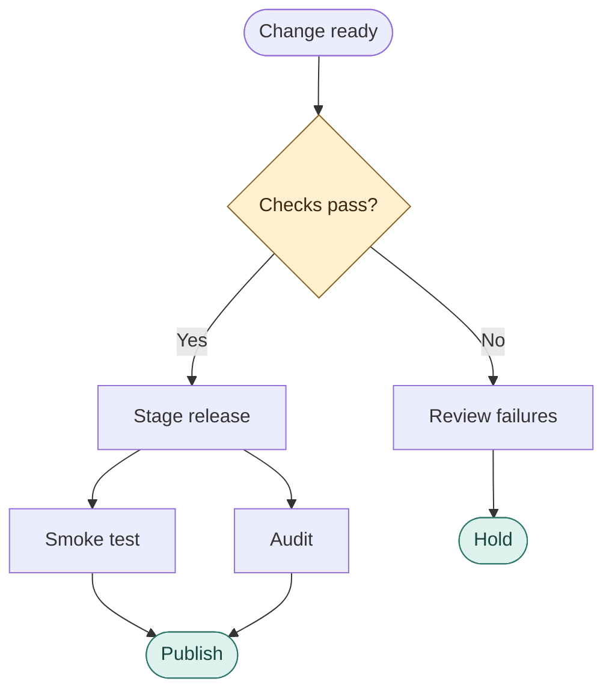

# Shoal node placement and edge readability

November 23, 2026. Studied the experimental Flowchart backend at `d64697e7c`, following the arrow-shaft fix in `5ec4a341b`. The next layout experiment should give private fork/join branches a shared axis and let ordered ports slide toward the tracks they serve. The next rendering experiment should check whether smoothing a safe polyline cuts a corner through a node or another edge's label. Both decisions can be evaluated on the final SVG. [Shoal renderer contract](../../crates/merman-layout-shoal/README.md#renderer-contract)

## A fork that looks like two unrelated routes

In the release workflow, `Stage release` launches `Smoke test` and `Audit`. Both feed `Publish`. A third node, `Hold`, shares their row and receives the failure branch. Shoal centers each packed row independently after ordering it. The lone `Publish` ends up near the middle of the entire row above, 110.625 SVG units to the right of the midpoint of its two actual parents. [Layer order](../../crates/merman-layout-shoal/src/layers.rs#L120-L171) · [Row coordinates](../../crates/merman-layout-shoal/src/kernel.rs#L129-L155)

There is also a separate return in `Audit → Publish`. The visible shaft starts at x = 278, reaches x = 330.438 and turns back to end at x = 312.783. The shared horizontal track is planned from node centers. Ports are then assigned evenly across each face, in track order. Finally the painter intersects each terminal ray with the real shape and applies the marker setback. In this drawing the selected approach lies farther right than the eventual arrow. [Tracks](../../crates/merman-layout-shoal/src/routing.rs#L81-L95) · [Ports and route](../../crates/merman-layout-shoal/src/routing.rs#L196-L270) · [Shape contacts](../../crates/merman-render/src/svg/parity/flowchart/edge_geom/compute.rs#L63-L78)

| Release workflow, top to bottom | Fork offset | Join offset | Return on `Audit → Publish` | Total shaft length |
| --- | ---: | ---: | ---: | ---: |
| Current Shoal | 9.625 | 110.625 | 17.655 | 892.1 |
| Same geometry, straight segments | 9.625 | 110.625 | 17.655 | 914.4 |
| Same nodes, sliding ports | 9.625 | 110.625 | 0 | 849.4 |
| Align toward neighboring nodes | 36.875 | 0 | 0 | 772.8 |
| Align the private fork and join | 0 | 0 | 0 | 798.7 |

The offsets are distances to the midpoint of `Smoke test` and `Audit` on the cross-rank axis. The node envelope was 575.25 units wide in every row of this table. Neighbor alignment produced the shortest total shaft length and moved the fork farther from its branches. The local fork/join rule made the branch structure visible at both ends. It also introduced a 4.813-unit offset at the decision immediately above the fork. In another drawing with two private joins, the local rule brought both forks and joins onto their axes while increasing total shaft length from 1,569.3 to 1,648.0 units.

Source of the release workflow

## Where the alternatives break down

| Input | Observation | Design consequence |
| --- | --- | --- |
| Uneven branches with a long bypass, 6 nodes | General neighbor alignment widened the node envelope from 354 to 455. With the original nodes and basis curve, the `A → T` shaft cut through the filled `Decode` rectangle. Local rounding on the same polyline cleared it. | Evaluate width and clearance alongside alignment. A shortcut that enters a node gives the reader a false connection. |
| Dense hub, 18 nodes and 39 edges | The original curve had 68 crossing pairs, 7 shaft/foreign-node box hits and 12 shaft/foreign-label box hits. Local rounding on the same layout gave 64, 0 and 0. General neighbor alignment with the original curve increased crossing pairs to 74. | Check the painted curve against the routing corridor before accepting an apparently shorter or smoother path. [Dense fixture](../../crates/merman/benches/fixtures/flowchart_ports_heavy.mmd) |
| Two sources feeding the same two children | Sliding ports eliminated 62.1 units of sideways return. The one crossing pair remained. | Port choices can simplify the approach to a crossing. Rank order and crossing angle are separate decisions. |
| Fan-in, 250 nodes | The measured nodes spanned 50,248 units across their row under every strategy. | Repositioning nodes within one rank cannot solve an excessive rank width. Wrapping a rank or changing rank assignment needs a separate width-aware experiment. |
| Balanced diamond; chain of 100 nodes | Baseline aggregate return was already zero. The positioning candidates kept it zero. | Preserve direct chains and balanced forks as controls. |

The dense counts are geometric diagnostics. A pair is counted once when two flattened shaft interiors properly intersect. Collinear overlaps and touches have their own readability costs and are excluded here. A foreign box hit counts a shaft entering a different node's measured rectangle or another edge's label rectangle. Chromium also confirmed individual shafts inside **painted** rectangular shapes in the uneven, parallel-label and dense examples. Dense curves and long edges may legitimately travel sideways around obstacles, so their total return alone is a poor optimization target.

## What transfers from other engines

Pele 1.13.0 balances four directional node assignments and can adjust coordinates and slide free ports to straighten eligible edges. A clear offset route can make a single S-shaped transition with tangents along the flow. The pinned Mermaid v13 development source also supports the ported curved route, while its Flowchart default selects rounded orthogonal routing. In the actual package renders of the release workflow, Pele and `mermaid@13.0.0-alpha.3` both put the fork and join at the midpoint of their two branches. Their SVGs show visibly different turns. Each product measured its own node sizes. [Pele placement](https://github.com/obsidianmd/pele/blob/3a2f075ee0c3d914f0fad3545fc0f193693975ac/src/layout/layered.ts#L2092-L2150) · [Pele port adjustment](https://github.com/obsidianmd/pele/blob/3a2f075ee0c3d914f0fad3545fc0f193693975ac/src/layout/layered.ts#L1135-L1244) · [v13 defaults](https://github.com/mermaid-js/mermaid-v13/blob/8482b825c73ec7fdf1d6920194b3b6272b1377b9/packages/diagram-flowchart/src/generated/config-defaults.ts#L14-L20) · [v13 route selection](https://github.com/mermaid-js/mermaid-v13/blob/8482b825c73ec7fdf1d6920194b3b6272b1377b9/packages/shared/src/svg/route.ts#L43-L72)

Brandes and Köpf give a stronger general placement candidate if local axes leave too many open forks unbalanced. Their method aligns eligible median neighbors from four directions and combines the results while preserving ordering and separation. A Shoal prototype would have to account for measured widths, sparse long edges and its own work budget. The published corrections matter for any implementation based on the original pseudocode. ELK supplies a useful complementary idea for routing. Its spline shortcut checks nearby geometry before removing a control point. [Brandes & Köpf](https://doi.org/10.1007/3-540-45848-4_3) · [Erratum](https://arxiv.org/abs/2008.01252) · [ELK clearance check](https://github.com/eclipse-elk/elk/blob/323312916048544e4e594eab3303cdb0d01e2929/plugins/org.eclipse.elk.alg.layered/src/org/eclipse/elk/alg/layered/intermediate/FinalSplineBendpointsCalculator.java#L345-L424)

Ware et al. found that continuity through intermediate nodes and crossings along the path contributed to shortest-path reading time in spring layouts. Xu et al. varied edge curvature with node positions fixed. Their results depended on the curve construction and the reading task. Neither study establishes an ideal radius for a labeled, directed Flowchart. For a reader comparison, ask people to identify both checks required before `Publish` and trace which failure reaches `Hold`. Record tracing errors, time and visual preference separately. [Ware et al., *Cognitive Measurements of Graph Aesthetics*](https://doi.org/10.1057/palgrave.ivs.9500013) · [Xu et al., *A User Study on Curved Edges in Graph Visualization*](https://doi.org/10.1109/TVCG.2012.189)

## Experiment and next implementation

The local experiment rendered 14 inputs in nine Shoal configurations. These included one source in the four layout directions, two independent fork/join pairs, disconnected components, parallel labeled edges, a long bypass, dense dependencies and large chain/fan controls. All alternatives used the same renderer, theme, measured boxes, source, diagram ID, rank assignment and within-rank order. The baseline matched the archived release-workflow SVG and three frozen stress SVGs byte for byte. The complete layout JSON matched across the three paint-only controls. All layouts preserved node and edge occurrences and had disjoint node interiors. Across the 126 drawings the browser checked 4,572 point-marker approaches. In each check the shaft sampled one marker depth back from the tip stayed within the marker's angular opening.

- **Ports.** Keep the track order, project preferred track coordinates onto the available face interval with ordered minimum separation, then intersect the resulting rays with the real shapes. The trial kept singleton ports centered and reserved space for marker approaches even on crowded faces. Node centers were identical to baseline in this trial.
- **Positions.** The general trial projected neighbor-average targets onto the fixed row order with measured widths and minimum gaps using weighted isotonic regression. It swept forward and backward once. The local trial moved a fork and its join to the midpoint of their outer branch centers only when each intermediate had exactly that fork and join as its sole neighbors, the join had no other inputs, and both moves fit with the existing gaps. It left ambiguous or conflicting structures for the general layout.
- **Paint.** Baseline basis interpolation, linear segments and local rounded corners received the same exterior waypoints. The selected curve operated between the two straight marker shafts. Sideways return was half the excess of total cross-axis variation over the absolute displacement between painted endpoints, using Bézier extrema. Shaft lengths used arc length, and the crossing and box checks flattened curves at 0.15 SVG units. The chain-100 and fan-in-250 served as scale controls and were excluded from the pair-intersection scan.

I would implement obstacle-aware corner rounding first, then the local fork/join rule and sliding ports as independent changes. Keep node positioning and port assignment in Shoal. The Flowchart adapter already supplies measured boxes and marker space. The painter can preserve the shafts and choose a locally safe transition using the route's clearance. General row alignment needs more work on dense ranks. Wide rank assignment, disconnected-component packing and small-edit stability each need their own evaluation. Before choosing a default, rerun the existing release timing and layout-work probes on the corrected drawings and compare reading tasks at the same scale. This study measured static geometry, with no reader trials or performance timing.
