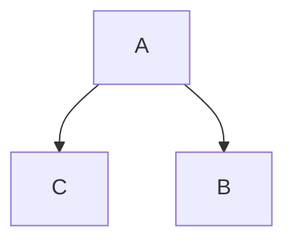

# Merman for browsers

Use Merman's Rust parser, renderers, analysis, and editor APIs in a browser through WebAssembly.

This guide documents `0.11.0`. Check the [host installation guide](../../docs/release/PREBUILT_PRODUCTS.md#published-versions) for verified versions and channel availability. See the [current changelog](../../CHANGELOG.md) for changes and upgrade actions.

Start with `@mermanjs/web` when evaluating Merman or when one browser realm needs several
workflows. Choose a focused package when the application has one isolated workflow and the smaller
boundary is useful. These packages require a browser main thread or Web Worker; for Node.js and
static-site builds, use [`@mermanjs/node`](../node/packages/node/README.md).

## Choose a package

| Need | Package | Includes |
| --- | --- | --- |
| A complete SDK or a starting point | [`@mermanjs/web`](packages/full/README.md) | SVG, analysis, ASCII, and editor APIs |
| SVG rendering only | [`@mermanjs/web-render`](packages/render/README.md) | Math, Cytoscape and ELK layouts |
| Validation and semantic facts | [`@mermanjs/web-analysis`](packages/analysis/README.md) | Detection, validation, analysis, and lint facts |
| Editor intelligence in a Worker | [`@mermanjs/web-editor`](packages/editor/README.md) | Analysis and parser-backed editor sessions |
| ASCII or Unicode output | [`@mermanjs/web-ascii`](packages/ascii/README.md) | Supported terminal-oriented diagram output |

Current-source browser packages target Mermaid `12.3.0` and use Web transport API `12` with Options JSON schema `4`. Analysis-capable packages use facts schema `3`, SVG results report `metadata.theme_outcome`, and ASCII-capable packages use schema-4 ASCII output. Published `0.10.0` uses Web API `10` and ASCII schema `3`. Keep the package facade, generated glue, and WASM binary at the same exact version and source revision. [Options JSON](../../docs/bindings/OPTIONS_JSON.md) · [Current-source migration](../../docs/migrations/render-reuse-host-integration.md)

The [Mermaid 12.3 migration](../../docs/migrations/mermaid-12-3.md) describes Step animations,
their closed browser admission, and the static SVG projection used for native export.

Published `0.10.0-alpha.2` retains Web transport API `9`. Version `0.10.0-alpha.1` retains Mermaid `12.2.0`, Web transport API `8`, facts schema `2`, theme execution evidence schema `1`, and Options JSON schema `3`. Upgrade the facade, generated glue, and WASM together when adopting `0.10.0`, and update JSON consumers for the [source appearance and render-evidence changes](../../docs/release/UNRELEASED_CONTRACT_VERSIONS.md#source-appearance-and-render-evidence-follow-up).

Prebuilt full/render packages include mathematical labels, Cytoscape and ELK layouts, native themes,
prepared-source reuse, and mounted-diagram updates with explicit Kanban width adaptation.
Dedicated analysis/editor/ASCII products retain their task scope. No extra npm math tier is
required.

Prefer one Merman package per browser realm. Combining the complete package with a focused package
creates another WASM runtime unless that duplication has been measured and is intentional.

The [host integration recipes](../../crates/merman/examples/README.md#host-integration-recipes)
explain explicit output, theme, width, and error policy. Map each recipe to the operations in your
initialized artifact; workspace support is not a promise that every Web package includes it.
The host owns environment detection, scheduling, caches, and display actions. The Web SDK provides
its documented DOM-admission helpers without owning the surrounding editor or terminal UI.

See the [Astro host integration guide](../../docs/integrations/astro.md) for browser and SSG examples with scoped icon packs and explicit font measurement.

## Quick start

```sh
npm install --save-exact @mermanjs/web@0.11.0
```

```ts
import { initMerman, renderSvgToElement } from "@mermanjs/web";

await initMerman();

const target = document.querySelector("#diagram");
if (!target) throw new Error("missing #diagram mount point");

renderSvgToElement(target, `flowchart TD
  A[Start] --> B[Done]`);
```

Initialize Merman once per browser realm and reuse it. Call `renderSvg()` instead when the host
needs the serialized SVG string rather than a mounted element.

### Bundlers and Self-Hosted WASM

Each browser package exports its matching WASM asset. With Vite, import its URL and pass it
to initialization:

```ts
import { initMerman } from "@mermanjs/web";
import wasmUrl from "@mermanjs/web/wasm?url";

await initMerman({ wasm: wasmUrl });
```

Use the equivalent focused package in both imports when selecting one. The asset export is
not a second runtime entry. For another bundler, emit that exported asset as a resource and
pass its deployed URL. Alternatively, copy the exact package's WASM to a versioned public
path and provide its same-origin URL. Keep package facade, generated glue and binary together.
`MERMAN_WASM_URL` remains the default URL for hosts that preserve the package layout.

A module Worker initializes its own runtime with the same pattern and uses non-DOM operations.
Serve WASM with `application/wasm`; a same-origin deployment may need
`script-src 'self' 'wasm-unsafe-eval'`, `connect-src 'self'`, and `worker-src 'self'`.
These directives cover WASM loading, not the application's complete SVG/font/style policy.
The package does not require a CDN, JavaScript `unsafe-eval` or a fake browser in SSR.

## Reuse a parsed source

`@mermanjs/web` and `@mermanjs/web-render` expose `prepareSource()`:

```ts
import { initMerman, prepareSource } from "@mermanjs/web-render";

await initMerman();
const prepared = prepareSource("flowchart LR\nA[Start] --> B[Done]");
try {
  const svg = prepared.renderSvg({
    layout: { container_width: 640 },
    timeout_ms: 250,
  });
  const layout = JSON.parse(prepared.layoutJson());
} finally {
  prepared.dispose();
}
```

The snapshot freezes successful semantics, effective configuration, parse settings, the
compiled theme binding, and parse-time dates or generated IDs. Prepare again to change those
facts. Each output has fresh cancellation, deadline and resource admission; a failed output does
not poison the snapshot. Layout options retain each diagram family's documented meaning.

Use `renderSvgResult()` on the snapshot for execution metadata, or `edgeGeometryJson()` for
edge geometry. All four output methods have `WithTextMeasurer` variants that accept the measurer
for that call. Keep `environment.text_measurement` omitted when selecting a host measurer;
this restriction also applies to defaults supplied during preparation.
The wrapper stays bound to its creating WASM runtime. Dispose is idempotent and
invalidates the wrapper immediately; disposal inside a measurement callback frees Rust data after
the active call returns. Calls after disposal fail explicitly. Semantic JSON is an export, not a
serialized snapshot format. Analysis, editor and ASCII packages do not expose `prepareSource()`.

## Maintain a mounted diagram

The full and render packages expose `mountDiagram()`. After initialization, retain the controller
to update the source or refresh the layout:

```ts
import { mountDiagram } from "@mermanjs/web";

const mounted = mountDiagram(target, kanbanSource, {
  outputOptions: { layout: { adaptation: "fit-width" }, timeout_ms: 250 },
  onError: (error) => console.error(error),
});
mounted.update(nextSource);
mounted.refresh();
mounted.destroy();
```

`source` is the newest requested source. `result` is the last successfully published SVG and its
metadata; `error` records the latest failure, and `status` is `pending`, `rendering`, `ready`,
`failed`, or `destroyed`. Failed updates retain the last good DOM. A callback failure after
publication also leaves that successful drawing in place. `destroy()` releases snapshots,
measurement probes and listeners while leaving published DOM in place; it is idempotent.

`prepareOptions` supplies typed parse inputs and output defaults. `outputOptions` supplies fresh
redraw settings. Unchanged source and exactly encoded preparation options reuse the snapshot;
width and font refreshes do not reparse it. `update(source)` keeps the current options, while
`update(source, options)` replaces them completely. Inputs are captured during the call, so later
mutation of the supplied objects does not alter a queued redraw. The mount owns `svg.diagram_id`
and assigns each mount a unique namespace, including across package instances.

Fit-width is explicit. Resize notifications use the target's content width. Kanban preserves whole
columns, and Flowchart or Agentflow can fit when the diagram explicitly selects Shoal in an artifact
built with the `layout-shoal` Cargo feature. Set `layout.fold_wide_ranks` to `true` to let Shoal fold
eligible wide leaf ranks. Inspect `result.metadata.layout_adaptation` for actual width and overflow.
A disconnected, zero-width or CSS-hidden target defers preparation and rendering while retaining
the newest request. Reconnecting requires a size notification or explicit `refresh()`.
A CSS visibility change with unchanged dimensions requires `refresh()`; `display: none` becoming
measurable is observed through its actual size change.

For a standalone Flowchart or Agentflow preview using Shoal, call `renderSvgResult()` with
`layout.capture_shoal_frame` set to `true`. The optional `metadata.shoal_layout_frame` is an opaque
object. Pass it back as `layout.previous_shoal_frame` for the same document to reuse placement hints
and capture a new frame. Keep the last successful result for that document while editing, and
discard it when its layout backend or document changes.

See [Try Shoal in Playground](#try-shoal-in-playground) for the hosted preview and local browser build.

Measurement remains deterministic unless `textMeasurement: "browser"` or a host callback is
selected. Browser measurement uses the target Document's probes and refreshes after font loading.
Do not combine a host/browser measurer with an explicit `environment.text_measurement` selector;
binding option admission reports that conflict. Arbitrary external typography changes need
an explicit refresh. After adopting the target into another Document, call `refresh()` to rebind
its observers, font listeners and probes. No global DOM observer discovers arbitrary adoption.

Each package instance keeps at most one controller per target; remounting destroys its prior
controller. Scheduled work and reentrant callbacks cannot publish superseded results. The mount
uses the same SVG source, actual-root, navigation and base-URI admission as the one-shot helpers.
Keep `renderSvgToElement()` for a single publication without a retained lifecycle.

## Choose a preset for a diagram

Call `themeCatalog()` after initialization to build a theme picker. Each preset has an ID, name,
category, description, concrete appearances, and six swatches from its default appearance. The
swatches represent the canvas, node, container, title, primary text, and first data fill. Use
`mermaid_themes` to list the classic Mermaid IDs and `families` to read each family's native
capability bit mask.

```ts
import { initMerman, renderSvgResult, themeCatalog } from "@mermanjs/web";

await initMerman();
const source = "flowchart LR\nA[Start] --> B[Done]";
const preset = themeCatalog().presets.find(({ id }) => id === "studio");
if (!preset) throw new Error("Studio is unavailable in this artifact");

const result = renderSvgResult(source, {
  theme: { preset: preset.id, appearance: preset.default_appearance },
  background: "#F8FAFC",
});
console.log(result.metadata.theme_outcome);
```

Choose `light` or `dark` in the host before passing `appearance`. If you omit it, the preset
uses its default. Pass `theme: "studio"` to select Studio directly, or `theme: "none"` to clear
a native selection. Classic Mermaid IDs belong in `site_config.theme`.

A native selection owns global visual defaults by default. Use `precedence: "source"` inside the
selector to let a source-declared Mermaid theme choose the rendering mode. A top-level `background`
sets the canvas to a hex color or `"transparent"` in either mode.

`renderSvgResult()` includes the rendered SVG and its `theme_outcome`. Read `mode` to distinguish
`merman_native` from `mermaid_parity`. `preset_id` and `appearance` are present when applicable,
and `notices` carries contrast or selection messages. `renderSvgResultWithTextMeasurer()` returns
the same metadata with per-call host text measurement.

## Edit, validate, and share a theme

The full and render packages export editable `ThemeDocumentV2` objects with `exportThemePreset(id)`.
Save the document as JSON to keep the preset's authored appearances, or write a small document
with `extends` to override selected values.

```ts
import { exportThemePreset, renderSvg, resolveTheme, type ThemeDocumentV2 } from "@mermanjs/web";

const presetJson = JSON.stringify(exportThemePreset("studio"), null, 2);
const document: ThemeDocumentV2 = {
  schema_version: 2,
  extends: "studio",
  seed: { accent: "#0052CC" },
  form: { radius: 8 },
};
const resolution = resolveTheme(document, { appearance: "dark", auto_fix_contrast: true });
if (resolution.ok) console.log(resolution.notices);

const svg = renderSvg("flowchart LR\nA[Review] --> B[Publish]", {
  theme: { document, appearance: "dark" },
});
```

Pass a document directly as `options.theme` to use its default appearance. To inspect a document
from a JSON editor, pass the original source text to `resolveTheme()`. The `{ ok: false }` result
includes a message and the available `line`, `column`, and `path` from that document. Auto-fix
returns adjusted role colors in `resolved` and records each adjustment in `notices`. Keep the
editable v2 document as the saved source of truth. To change a prepared diagram's theme or
appearance, call `prepareSource()` again.

## Choose an SVG pipeline

Browser previews should keep the default `parity` pipeline, which preserves Mermaid HTML labels
and styles. `readable` is an advanced text overlay for consumers that ignore HTML labels; a browser
can display both the HTML and fallback text, producing overlap. It is not a higher-quality preview
mode. Choose `resvg-safe` when sending SVG to resvg/usvg; it converts HTML labels and performs
additional compatibility cleanup. See the [SVG options guide](../../docs/bindings/OPTIONS_JSON.md#svg-options)
for the consumer matrix. Pipeline selection does not replace the mounting policy below.

## ASCII host policy

Use an ASCII-capable package (`@mermanjs/web` or `@mermanjs/web-ascii`) and inspect
`asciiCapabilities()` for the detected family. In builds containing Auto, Flowchart, Swimlane, and
Sequence admit `auto` or `compact`; other supported families use `canonical`. Auto requires an
explicit `ascii.max_width`. Viewport `fallback` requires `ascii.color_mode: "plain"`; a styled
fallback request is invalid even when the input would fit. Bindings reject environment-dependent
color `auto`, so the host must resolve its color policy before the call.

`renderAscii()` returns a text string. Use `renderAsciiResult()` when the host needs the same
execution's canonical `{ text, metadata }`; `metadata.output_plan` is the schema-4 ASCII plan.
It distinguishes unavailable primary geometry (`null`) from a real empty primary (`0`) and records
requested graph policy, effective projection, separate primary/emitted overflow, and fallback reason.
Do not infer those facts by parsing the drawing. For Flowchart, Swimlane, and State, explicit
`ascii.graph_presentation: "adaptive"` permits complete Plain graph documents after an admitted
planning miss. Strict remains the default; resource, cancellation, and unsupported-semantic errors
remain errors. Width policy is independent. For example:

```ts
const result = renderAsciiResult(source, {
  ascii: {
    graph_presentation: "adaptive",
    color_mode: "plain",
    layout_profile: "auto",
    max_width: 80,
    overflow: "fallback",
  },
});
console.log(result.text, result.metadata.output_plan);
```

State accepts only `canonical`, so omit `layout_profile: "auto"` for State requests. See the
[ASCII option contract](../../docs/bindings/OPTIONS_JSON.md#ascii-options) for versioned fields and
the [support matrix](../../docs/rendering/ASCII_SUPPORT_MATRIX.md) for admitted family combinations.

Pass a native preset or v2 document in `theme` to use its colors with `color_mode: "truecolor"`
or `"ansi256"`. A terminal palette in `ascii.theme` takes precedence. ANSI16 uses terminal Reset
and named colors for semantic roles.

## Mount SVG safely

`renderSvg()` returns Mermaid-parity source and deliberately makes no browser DOM-safety claim.
Use `renderSvgToElement(target, source)` for the standard navigable authoring surface: it validates
the serialized SVG, parses it in the target's document, rechecks fragment resolution at that exact
mount boundary, and hardens external anchors with a new browsing context plus
`noopener noreferrer`.

Hosts that own parsing themselves must choose one explicit capability:

- `assertSelfContainedSvgForDom()` rejects navigation as well as external rendering resources.
- `assertNavigableSvgForDom()` admits Mermaid-compatible anchor navigation while continuing to
  reject external images, styles, filters, scripts, tracking, and automatic resource loads.

The validators return opaque, package-instance-bound capabilities. Keep the returned value until
the real owner document is known. For navigable SVG, call `prepareNavigableSvgForDomMount()` after
importing the parsed root into that document; for a closed preview, call
`prepareSelfContainedSvgForDomMount()`. Both helpers revalidate the actual parsed root immediately
before insertion. Object literals, structured clones, source/tree substitution, and a
self-contained admission cannot stand in for a navigable admission. CSP, iframe/origin isolation,
and whether navigation remains enabled during stale UI states are host responsibilities.

## Runtime lifecycle and resource limits

Initialize Merman once per browser realm and reuse it; repeated `initMerman()` calls share the
cached initialization and module. There is no separate WASM unload API, so a main-thread runtime
lives for the page realm. The package does not create or own a Worker: a host that loads Merman in
a dedicated Worker must terminate that Worker after initialization failure, replacement, or
application teardown. Dispose every `BrowserTextMeasurementSession` created by
`createBrowserTextMeasurementSession()` as soon as it is no longer needed.

Call `runtimeCatalog()` after initialization when an integration needs to inspect compiled
capabilities, operations, and resource profiles. Validate the flat catalog's local relations and
tolerate newly introduced stable IDs; do not infer availability from package names or Cargo feature
names. Browser previews normally use the `interactive` profile. Public submission services also
need host-level timeout, memory, concurrency, and process isolation around the `constrained`
profile. See the [binding options guide](../../docs/bindings/OPTIONS_JSON.md) for the full resource
contract.

## Deadlines and cancellation

Use `transportApiVersion()` and `runtimeCatalog()` to inspect the loaded runtime. Initialization
validates Web transport API `12` and all required exports before making the module available.

SVG calls, preparation and each prepared output expose a typed top-level `timeout_ms` option.
Other transport-dispatched one-shot operations accept this field through their JSON-string options.
The transport removes it before shared binding-option validation:

```ts
const svg = renderSvg(
  source,
  { timeout_ms: 250, resources: { profile: "interactive" } }
);
```

`timeout_ms` must be an integer from `0` through `4294967295` milliseconds. The transport removes
it before shared option validation and installs the corresponding relative monotonic deadline on
the operation control. Expiry is reported as `MERMAN_CANCELLED` with
`details.cancellation.reason = "deadline_exceeded"` and a checkpoint phase.

This deadline is cooperative: Rust observes it only at operation checkpoints, and it cannot
preempt a host text-measurement callback that is already running. The synchronous WASM exports do
not expose a mid-call `AbortSignal`; JavaScript in the same realm cannot run an abort listener
until Rust returns. A host can check a signal before entering a call or discard its result after
return. If hard termination is required, run Merman in a dedicated Worker and terminate that
Worker from its parent realm.

## Custom WASM loading

Keep the package loader and pass a response, URL, request, module, or bytes through wasm-bindgen's
`module_or_path` contract when the host owns cache, service-worker, or fetch policy:

```ts
import {
  initMerman,
  loadMermanWasmModule,
  MERMAN_WASM_URL,
} from "@mermanjs/web";

const wasm = await fetch(MERMAN_WASM_URL, { cache: "reload" });
if (!wasm.ok) {
  throw new Error(`Failed to load Merman WASM: ${wasm.status}`);
}
await initMerman({ loader: loadMermanWasmModule, wasm });
```

The generated raw wasm-bindgen shim has no implicit module-path fallback. The public loader supplies
`MERMAN_WASM_URL` only when initialization receives no input, which keeps URL and cache policy at
the package/host boundary and prevents internal bundles from acquiring a hidden second WASM asset.

## Develop from source

Package assembly uses Python 3.11 or newer to verify the Cargo license inventory. Set
`MERMAN_PYTHON` if your interpreter is not named `python` on Windows or `python3` elsewhere.

```sh
npm ci --prefix platforms/web
npm run build --prefix platforms/web
npm test --prefix platforms/web
npm run smoke --prefix platforms/web
```

`web-surface-descriptor.json` maps package names to artifact profiles. The workspace derives Cargo
features, generated entries, and package assembly from those authorities rather than maintaining a
second feature matrix. Use `npm run verify:wasm-inputs --prefix platforms/web` and
`npm run verify:packages --prefix platforms/web` for the package-specific contracts.

### Try Shoal in Playground

The hosted Playground includes experimental Shoal for its Merman SVG preview. Set `layout: shoal`
in a diagram's frontmatter, or set `{"layout":"shoal"}` in **Config** for the workspace.
A `layout` value in **Config** takes precedence over frontmatter. [Open Playground](https://frankorz.com/merman/)

For local development, run these commands from the repository root after installing the Web and
Playground dependencies.

```sh
npm --prefix platforms/web run build:wasm:full -- --local-shoal
npm --prefix playground run assemble:shoal
npm --prefix playground run dev:shoal
```

When the preview uses Shoal, choose **Tools → Fit preview width** to fit the SVG layout to a
width in CSS pixels. Turn the setting off to return to the solver's natural width.

The Playground build adds `layout-shoal` to `web-full` and writes the raw build to
`platforms/web/pkg/full-local-shoal`. Assembly sets the existing `@mermanjs/web` package to use
that build for the Playground's file dependency after checking its wasm-bindgen declarations.
`dev:shoal` and `build:shoal` verify the exact
feature preset, current inputs, assembly provenance, and runtime file hashes before starting Vite.
Run the same check on its own with `npm --prefix playground run verify:wasm-inputs -- --local-shoal`.

With Vite running on port 5173, open the [release workflow with Shoal](http://localhost:5173/#s2:eJxdkM1uwyAQhF8FORdHsqXaafPDoVWVHHqqqraXyvaBwGKjUIgMbhrFefcCSRw1lwV25mMWDhHVDCIcpWlaKqoVFzUuFUKS7HVnMTKNJrJUQeZS72hDWos-V97j9qqGuFiGFbVA2L4aozR9dBLQjTksw4K2xJin4wkJDWfpv8D0yFhSQ_Hhq-MlEAPVje9V94iL3-IdfgTsECdCdi2YYAt4CDTfeuMu8hVZMPZGJh0Ttnj29aQEYwAbsY2Lt24thWmqsReDeRB9x-WHc6Mli4sXV70zDCrd21bAUU0sOJ-UeMQ5v6OQGNu6EDyaL6ZZnidUS93i0WSRkyz7h3KhXPYZZoznwAY4h9l8ur7A2ez-YUIH-PJNPvva9EMnftLzxaWKjn-hEqTh).

Open the standalone SVG preview and paste:



Edit the edges to `A --> B[Relabeled]`, `A --> C`, and `A --> D[New]` in that order. The preview
keeps `C` to the left of `B` as it adds `D`.

Stop the local preview and run `npm --prefix platforms/web run build:packages -- --package full`
to switch the assembled package back to the standard preset. If `pkg/full` needs a build, run
`npm --prefix platforms/web run build:wasm:full` first. Release verification requires the
standard preset.

The private workspace itself is never published. Release automation packs and verifies every
admitted package as a version-locked group before reconciling dist-tags. See the [package surface
guide](../../docs/release/PACKAGE_SURFACES.md) for artifact, provenance, legal-material, and
size-admission details.
